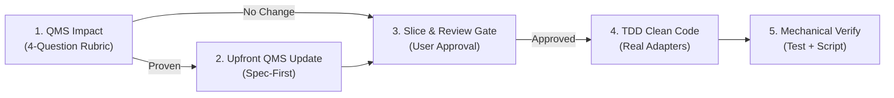
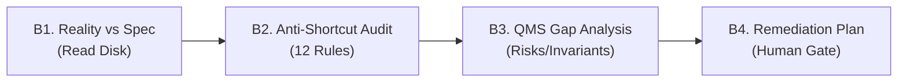

# QMS Implementation, Review & Specification Refinement Cycle

This skill enforces disciplined software lifecycle controls for medical-device-grade (FDA 21 CFR 820.30 / IEC 62304) components.

---

## 10 Cardinal Principles

| # | Principle | Strict Enforcement Invariant |
| :-: | :--- | :--- |
| **1** | **Design Controls Front-Loaded** | Design Inputs precede Design Outputs. Any required QMS update must be approved *before* writing code. |
| **2** | **Presumption of QMS Adequacy** | Default: zero QMS changes. The engineer/AI must explicitly *prove* a gap via the 4-Question Rubric. |
| **3** | **Zero Fake Stubs** | Outward adapters must execute real boundary calls (gRPC, SQLite, crypto), never fake `Task.FromResult`. |
| **4** | **Mandatory Round-Trip Test** | Every outward adapter requires at least one happy-path end-to-end integration test proving data traversal. |
| **5** | **100% Clean Code (No In-Code Tags)**| Never embed `// Implements DEP-*` or `// Req: ...` in code or tests (ISO 13485:7.3.9 non-conformity). |
| **6** | **CQRS Read-Path Guidance** | Write-heavy domain repositories must not be loaded for read queries. Use lightweight read models/queries. |
| **7** | **Escalation Over Silent Downgrade**| If a requirement is technically impractical, halt and present an ISO 14971 Risk-Benefit trade-off to user. |
| **8** | **Mandatory Human Review Gate** | Implementation ticket/plan must be reviewed and approved by the human user before touching code. |
| **9** | **Zero Nullable Evasion** | Required collaborator dependencies must be non-nullable without default `null` values. |
| **10**| **Semantic, Resilient Tests** | Unit tests must assert capability containment and operational lifecycles, never rigid `HaveCount(N)` counts. |

---

## Workflow A: Forward Implementation Lifecycle

### Step 1: QMS Impact Analysis (4-Question Rubric)
Default assumption: **Zero QMS changes required**. To propose a change, prove one of:
1. **Hazard (`HAZ-*`)**: Does it introduce a new safety, crypto, or privacy risk not covered in `RiskRegister.md`?
2. **System Capability (`SYS-*`)**: Does it introduce a new black-box capability or safety boundary in `SystemRequirements.md`?
3. **Software Allocation (`DEP-*`)**: Does it allocate a new public port interface between items (IEC 62304 Clause 5.3) in `Requirements.md`?
4. **Detailed Invariant (`INV-*`, `DEC-*`)**: Does it establish an enduring architectural rule or non-obvious trade-off in `<Project>/Design.md`?

*Gate Statement*: If none proven, state: *"QMS Impact Analysis: No QMS updates required. Covered by existing requirements [`DEP-XXX`, `SYS-XXX`]. Proceeding to Implementation Slice."*

### Step 2: Upfront QMS Update (If Proven)
- Update QMS documents *before* writing code.
- Maintain 3-tier symbol rules: zero code symbols in `SYS-*`, inward port interfaces only in `DEP-*`, concrete design details in `Design.md`. Attach `[Verify: ...]` and `[Control: ...]`.

### Step 3: Jira-Style Implementation Slice & User Review Gate
- Draft actionable ticket with Scope, Acceptance Criteria, and Test Plan (including happy-path round-trip test).
- **MANDATORY GATE**: Halt and obtain user approval before writing code.

### Step 4: Implementation (Clean Code & TDD)
- 100% clean C# (zero in-code QMS tags).
- Execute real boundary operations (zero fake returns, real gRPC/SQLite).
- Comply strictly with [`anti-shortcut-discipline`](../anti-shortcut-discipline/SKILL.md).

### Step 5: Lightweight Mechanical Verification
1. Run `dotnet test <TargetTestProject> --no-build` (all pass, including round-trip tests).
2. Run `pwsh -File scripts/validate-qms-compliance.ps1` (confirm audit passes).
3. Mark ticket deliverables complete (`- [x]`).

---

## Workflow B: Retrospective Code & Integrity Audit

Use this workflow to audit existing code, newly submitted PRs, or completed slices with fresh eyes.

### Audit Checklist
- [ ] **Reality vs. Spec**: Read concrete class realizations on disk. Confirm code actually implemented the port contract rather than merely compiling.
- [ ] **Anti-Shortcut Audit**: Audit against the 12 rules in [`anti-shortcut-discipline`](../anti-shortcut-discipline/SKILL.md) (no fake returns, no nullable evasion, no cross-host peeking, no synthetic preconditions, no unhandled subscriptions).
- [ ] **Memory & Loop Scalability**: Confirm no tight unyielding loops (`while (!token.IsCancellationRequested)` without delay) and no unbounded buffer allocations (`new MemoryStream()` on unbounded streams).
- [ ] **QMS Gap & Risk-Benefit**: Verify no leaked concrete symbols in requirements; evaluate over-specified requirements via ISO 14971 Risk-Benefit analysis if pure C# realization is impractical.
- [ ] **Remediation Gate**: Format findings as a structured Remediation Slice and obtain user approval before applying fixes.
