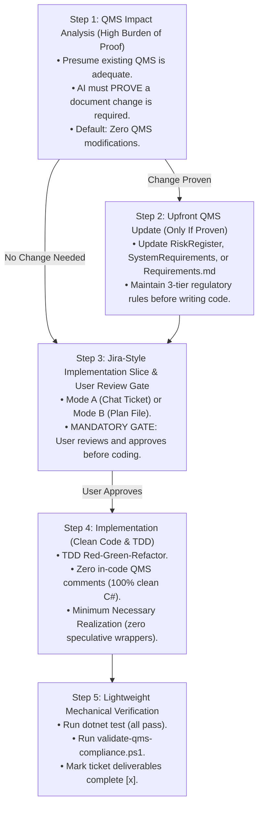

# QMS Implementation, Review & Specification Refinement Cycle

This skill guides engineers and AI assistants through a disciplined, developer-friendly software lifecycle for medical-device-grade and high-assurance architectures. It front-loads regulatory design controls (**FDA 21 CFR 820.30** / **IEC 62304**) *before* coding begins, keeps source code and unit tests 100% clean of bureaucratic comment clutter, and respects the boundary between developer unit implementation and formal quality engineering.

---

## Cardinal Principles

1. **Design Controls Are Front-Loaded (QMS-First)**:
   In medical device software, **Design Inputs precede Design Outputs**. If a technical design requires a QMS change, that change **MUST be documented and approved upfront**, before any production code is written. Never reverse-engineer QMS compliance after coding.
2. **Presumption of QMS Adequacy (High Burden of Proof)**:
   **The default assumption is that NO QMS document needs to change.** Most implementation tasks are simply realizations of existing requirements (`DEP-*`, `SYS-*`) or internal detailed design choices (`Design.md`). An AI assistant must explicitly *prove* that existing QMS documents are deficient before proposing additions. Not every feature is a user need, and not every exception is a hazard.
3. **Strict Prohibition on In-Code QMS Comments (100% Clean Code)**:
   **DO NOT** embed requirement tags (e.g. `// Implements DEP-*`, `// Verifies SYS-*`, `// Req: ...`) in source code or unit test comments. In-code requirement tagging is a known industry anti-pattern that leads to comment rot and auditor non-conformities. Traceability is maintained exclusively at the document and ticket level; source code and tests must remain 100% idiomatic C#.
4. **Developer Implementation vs. Quality Engineering Separation**:
   Developers write software units and automated unit tests. Do not burden developer tickets with artificial Quality Engineer (QE) sign-offs or pasted terminal transcripts. When tests pass, simply check off deliverables and mark the ticket resolved. Formal verification records belong to CI pipelines and QE release protocols.
5. **Mandatory Human Review Gate Before Coding**:
   The implementation ticket must be presented to the user (via interactive chat or a plan file) and approved *before* touching any code.

---

## The 5-Step Streamlined Life Cycle



---

## Step 1: QMS Impact Analysis (High Burden of Proof)

**Objective**: Determine whether a technical design (from a chat prompt, idea, or design plan) genuinely impacts the formal QMS.

### The Presumption of Adequacy
Assume the current QMS documents are complete and adequate for this task unless proven otherwise. 

### The 3-Question Proving Rubric:
The AI must evaluate the proposed design against these three questions. To recommend a QMS change, the AI **MUST provide concrete proof** answering:

1. **Hazard Impact (`HAZ-*` in `RiskRegister.md`)**:
   - *Question*: Does this technical design introduce or address a genuinely new systemic safety, cryptographic, or privacy hazard?
   - *Burden of Proof*: The AI must cite why existing hazards (e.g., DoS, replay, disk extraction, memory residue) do not already cover this vector. If it is an ordinary software bug or transient exception, it is **excluded**.
2. **System Requirement Impact (`SYS-*` in `SystemRequirements.md`)**:
   - *Question*: Does this introduce a new black-box system capability, external boundary, or risk control measure?
   - *Burden of Proof*: The AI must prove why existing system requirements do not already mandate this behavior. If it is internal framework plumbing, it is **excluded**.
3. **Software Item Allocation (`DEP-*` in `<Project>/Requirements.md`)**:
   - *Question*: Does this allocate a new architectural responsibility or define a new public port interface between software items (IEC 62304 Clause 5.3.1 / 5.3.2)?
   - *Burden of Proof*: The AI must prove that existing port contracts cannot satisfy the requirement. If it is an internal realizing class or helper, it belongs strictly in `Design.md`, **not** in `Requirements.md`.

### Decision Gate:
* **If NO QMS change is proven**: Explicitly state:
  > *"QMS Impact Analysis: No QMS updates required. Work is covered by existing requirements [`DEP-XXX`, `SYS-XXX`]. Proceeding directly to Implementation Slice."*
  $\longrightarrow$ Proceed immediately to **Step 3**.
* **If a QMS change is proven**:
  $\longrightarrow$ Proceed to **Step 2**.

---

## Step 2: Upfront QMS Update (Only If Proven)

**Objective**: Update the governing QMS documents *before* writing any implementation or test code.

### Rules for Upfront Updates:
1. **Assign Semantic Slug IDs**: Use globally unique IDs (`HAZ-<SLUG>`, `SYS-<SLUG>`, `DEP-<SLUG>`).
2. **Maintain the 3-Tier Symbol Rules**:
   - `SystemRequirements.md` (`SYS-*`): Strictly black-box behavior. **Zero C# interfaces, classes, or database schemas**.
   - `<Project>/Requirements.md` (`DEP-*`): Software Item requirements. **Public port interfaces (`IPortName`) and domain value objects from inward compile-time dependencies only**. **Zero concrete implementing classes**.
3. **Attach Verification & Control Tags**:
   - `[Verify: Integration | Simulation | Unit]` on `SYS-*`
   - `[Control: Inherent | Protective | Information]` on risk-mitigating requirements
   - `[Verify: Unit | Integration | StaticAnalysis]` on `DEP-*`
4. **Link Upward in the DAG**:
   - `DEP-*` $\longrightarrow$ `SYS-*` $\longrightarrow$ `UN-*` / `HAZ-*`.
5. **Human Approval Gate**: If a change alters existing risk scores or weakens an existing requirement, halt and obtain explicit human approval before proceeding.

---

## Step 3: Jira-Style Implementation Slice & User Review Gate

**Objective**: Format the intended work as a self-contained, actionable engineering ticket and obtain user sign-off before coding.

### Delivery Formats (Choose Based on Scope):

#### Mode A: Interactive Chat Ticket (For Single Slices / Ad-Hoc Tasks)
Format the ticket directly in the conversation turn and halt execution (using `ask_question` or a review prompt). The AI **MUST NOT** proceed to Step 4 until the user reviews and approves the ticket.

#### Mode B: Plan File Ticket (For Multi-Chunk Features)
Create or update the ticket inside a project roadmap file (e.g., `<Project>/implementation-plan.md` like `Percolator.Infrastructure/implementation-plan.md`). This allows the user to review deliverables directly in their IDE. The AI proceeds chunk by chunk only upon user confirmation.

### Ticket Template:
```markdown
### [TASK-XXX] <Slice Title>

- **Status**: Ready for Implementation (Pending User Review)
- **QMS Traceability**: 
  - Implements: [`DEP-XXX`](<PathToRequirements>#L10)
  - Allocates: [`SYS-XXX`](../SystemRequirements.md#L20)
  - Mitigates: [`HAZ-XXX`](../RiskRegister.md#L30) (if applicable)
  - Invariants: [`INV-XXX`](<PathToDesign>#L40)

- **Scope & Deliverables**:
  - [ ] `<Project>/Path/To/IPortInterface.cs`
  - [ ] `<Project>/Path/To/ConcreteRealization.cs`
  - [ ] `<Project>.Tests/Path/To/UnitTests.cs`

- **Technical Specifications & Inward Ports**:
  - Existing inward port interfaces and strongly-typed value objects to consume.
  - Public method contracts, signatures, and expected exceptions.

- **Embedded Unit Test Plan**:
  - `Method_Condition_ExpectedBehavior`: Verifies domain outcome.
  - `Method_BoundaryOrError_ThrowsOrRejects`: Verifies negative path.

- **Verification Gate**:
  - `dotnet build <Project>`
  - `dotnet test <Project.Tests> --filter FullyQualifiedName~<TestNamespace>`
```

---

## Step 4: Implementation (Clean Code & TDD)

**Objective**: Execute the approved ticket using Test-Driven Development (TDD) while adhering to strict code hygiene and Onion Architecture.

### Implementation Rules:
1. **100% Clean Code (Zero In-Code QMS Comments)**:
   - **NEVER** write comments referencing QMS IDs (e.g. `// Implements DEP-...`, `// Verifies SYS-...`).
   - Write clean, idiomatic C# and readable test method names (e.g., `Decrypt_WithTamperedCiphertext_ThrowsCryptoException`).
2. **Minimum Necessary Realization**:
   - Implement strictly the public port contract demanded by the ticket.
   - **DO NOT** introduce speculative wrapper interfaces, abstract factories, builder patterns, or redundant indirection. Prefer a single, robust concrete class implementing the port.
3. **Onion Architecture Purity**:
   - Domain layers have **zero outward dependencies** on databases, serializers, or transport sockets.
4. **Primitive Obsession Elimination**:
   - Cryptographic keys, tokens, hashes, and IDs must be wrapped in strongly-typed Value Objects (`[ByteArray]`, `[GuidId]`). Zero raw `byte[]` or `Guid` primitives in public APIs.
5. **TDD Red-Green-Refactor**:
   - Write failing unit/integration tests first.
   - Implement minimal code to pass.
   - Refactor cleanly while keeping tests green.

---

## Step 5: Lightweight Mechanical Verification

**Objective**: Verify software unit execution and confirm zero repository QMS regression.

Developer verification is fast and lightweight. Do not write artificial QE compliance essays:

### Actions:
1. **Execute Tests**:
   Run the test runner and verify 100% pass rate:
   ```powershell
   dotnet test <TargetTestProject> --no-build
   ```
   *Requirement*: Confirm all tests pass.
2. **Run Automated QMS Compliance Script**:
   Execute the repository audit script to confirm zero leaked concrete classes or invalid symbols in documentation:
   ```powershell
   pwsh -File ".agents/skills/qms-implementation-review-cycle/scripts/validate-qms-compliance.ps1"
   ```
   *Requirement*: Script exits with code 0 (`AUDIT PASSED`).
3. **Close Deliverables**:
   Mark the deliverable checkboxes complete (`- [x]`) in the ticket / plan file. Report a concise completion summary to the user.
