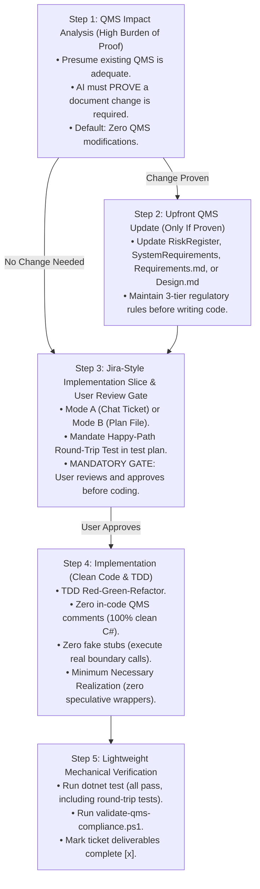
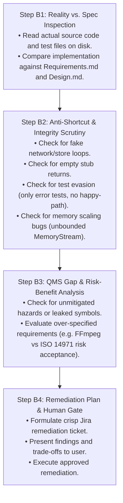

# QMS Implementation, Review & Specification Refinement Cycle

This skill guides engineers and AI assistants through a disciplined, dual-mode software lifecycle for medical-device-grade and high-assurance architectures:
1. **Workflow A: Forward Implementation Lifecycle** (for planning and implementing new feature slices).
2. **Workflow B: Retrospective Code & Integrity Audit** (for critically reviewing and hardening existing code with fresh eyes).

---

## Cardinal Principles

1. **Design Controls Are Front-Loaded (QMS-First)**:
   In medical device software (**FDA 21 CFR 820.30** / **IEC 62304**), **Design Inputs precede Design Outputs**. If a design idea requires a QMS change, that change **MUST be documented and approved upfront**, before any production code is written. Never reverse-engineer QMS compliance after coding.
2. **Presumption of QMS Adequacy (High Burden of Proof)**:
   **The default assumption is that NO QMS document needs to change.** Most implementation tasks are simply realizations of existing requirements (`DEP-*`, `SYS-*`) or internal detailed design choices (`Design.md`). An AI assistant must explicitly *prove* that existing QMS documents are deficient before proposing additions. Not every feature is a user need, and not every exception is a hazard.
3. **Anti-Stub & Implementation Integrity (Zero Fake Returns)**:
   AI assistants **SHALL NOT** write production adapters that simulate operations via empty loops, fake return strings (e.g. `ValueTask.FromResult(DomainResult.Success())`), or hardcoded error stubs without attempting the boundary operation. If an external contract or proto is blocked or missing, the AI **MUST halt and escalate** to the human user rather than writing a fake implementation.
4. **Mandatory Happy-Path Round-Trip Test**:
   Every outward adapter (e.g. gRPC client, store, crypto service) **MUST** include at least one happy-path unit or integration test proving that data actually traverses the adapter and returns expected results. Tests that only verify error guards (`> 100 MB`) or argument null exceptions are **insufficient to close a ticket**.
5. **Strict Prohibition on In-Code QMS Comments (100% Clean Code)**:
   **DO NOT** embed requirement tags (e.g. `// Implements DEP-*`, `// Verifies SYS-*`, `// Req: ...`) in source code or unit test comments. In-code requirement tagging is a known industry anti-pattern that leads to comment rot and auditor non-conformities (ISO 13485 Clause 7.3.9). Traceability is maintained exclusively at the document and ticket level; source code and tests must remain 100% idiomatic C#.
6. **CQRS Read-Path Guidance**:
   Write-heavy domain repositories (`IChannelRepository`) must not be loaded for read-only routing or resolution queries. Use lightweight query interfaces or cached lookup resolvers to prevent performance bottlenecks.
7. **Escalation Over Silent Downgrade**:
   If an AI discovers that a specification requirement is technically impractical or requires disproportionate external dependencies (e.g., pure C# video transcoding requiring FFmpeg), it **SHALL NOT silently downgrade or fake the code**. It must present the technical trade-off and propose an **ISO 14971 Risk-Benefit / Accepted Residual Risk** resolution to the human user.
8. **Mandatory Human Review Gate Before Coding**:
   The implementation ticket must be presented to the user (via interactive chat or a plan file) and approved *before* touching any code.

---

## Workflow Selection

Choose the appropriate workflow based on your current task:
* **Workflow A: Forward Implementation** $\longrightarrow$ Use when building a new feature slice, chunk, or architectural component from scratch or from a plan.
* **Workflow B: Retrospective Code & Integrity Audit** $\longrightarrow$ Use when critically reviewing, verifying, or auditing existing code slices, PRs, or previously completed chunks.

---

## Workflow A: Forward Implementation Lifecycle

### Step 1: QMS Impact Analysis (High Burden of Proof)
1. **The Presumption of Adequacy**: Assume existing QMS documents are complete unless proven otherwise.
2. **The 4-Question Proving Rubric**:
   - *Hazard Impact (`HAZ-*`)*: Does this design introduce a new safety, cryptographic, or privacy hazard not covered by existing hazards? (If ordinary bug or software failure mode $\rightarrow$ Exclude).
   - *System Requirement Impact (`SYS-*`)*: Does this introduce a new black-box capability or safety boundary? (If internal plumbing or software item design $\rightarrow$ Exclude).
   - *Software Item Allocation (`DEP-*`)*: Does this allocate a new public port interface between software items (IEC 62304 Clause 5.3)? (If internal component helper $\rightarrow$ Exclude).
   - *Detailed Design Invariants (`INV-*`, `DEC-*`)*: Does this implementation establish enduring architectural constraints, concurrency invariants, or non-obvious engineering trade-offs that mitigate software failure modes (IEC 62304 Clause 5.4 / FDA 21 CFR 820.30(d))? (If routine boilerplate $\rightarrow$ Exclude; if architectural rule or trade-off $\rightarrow$ Include in `<Project>/Design.md`).
3. **Decision Gate**: If no QMS change is proven, state: *"QMS Impact Analysis: No QMS updates required. Work is covered by existing requirements [`DEP-XXX`, `SYS-XXX`] and design invariants. Proceeding directly to Implementation Slice."* $\longrightarrow$ Proceed to Step 3.

### Step 2: Upfront QMS Update (Only If Proven)
- Update `RiskRegister.md`, `SystemRequirements.md`, `<Project>/Requirements.md`, or `<Project>/Design.md` *before* coding.
- Maintain the 3-Tier Symbol Rules (zero code symbols in `SYS-*`, inward port interfaces only in `DEP-*`, concrete design details in `Design.md`).
- Attach verification tags (`[Verify: ...]`) and control tags (`[Control: ...]`).

### Step 3: Jira-Style Implementation Slice & User Review Gate
Format as an actionable ticket in Chat (Mode A) or in a Plan File (Mode B).
**MANDATORY**: Test plan must include at least one **Happy-Path Round-Trip Test** for outward adapters.
**MANDATORY GATE**: Halt and obtain user approval before writing code.

### Step 4: Implementation (Clean Code & TDD)
- **Zero in-code QMS comments**: 100% clean, idiomatic C#.
- **Zero fake stubs**: Real boundary calls, real gRPC streaming, real file I/O.
- **Bounded $O(1)$ memory streaming**: Never buffer unbounded payloads into `MemoryStream`; stream in bounded chunks.
- **CQRS read-path purity**: Do not load write-side domain aggregates for read-only routing queries.
- **Escalation over silent downgrade**: If an obstacle arises (e.g. proto mismatch), escalate to the user immediately.

### Step 5: Lightweight Mechanical Verification
1. Run `dotnet test <TargetTestProject> --no-build` (confirm all pass).
2. Run `pwsh -File scripts/validate-qms-compliance.ps1` (confirm audit passes).
3. Mark ticket checkboxes complete (`- [x]`).

---

## Workflow B: Retrospective Code & Integrity Audit

Use this workflow to audit existing implementations, newly submitted PRs, or completed chunks with a "fresh set of eyes" to catch corner-cutting, architectural erosion, and spec drift.

### Step B1: Reality vs. Spec Inspection
- Do not trust comments, PR descriptions, or green badges.
- Read the actual concrete class realizations and test methods.
- Check: Did the code actually implement the port contract, or did it merely compile?
- Compare the code against `Requirements.md` (`DEP-*`) and `Design.md` (`INV-*`, `DEC-*`).

### Step B2: Anti-Shortcut & Integrity Scrutiny
Examine the implementation through the **4 AI Anti-Patterns Checklist**:
- [ ] **Fake Operation Check**: Does any client or adapter loop through data without calling the underlying transport or database?
- [ ] **Empty Stub Check**: Does any method return `Task.FromResult(DomainResult.Success())` or a hardcoded string without doing real work?
- [ ] **Test Evasion Check**: Do the tests only assert error guards (e.g. `> 100 MB` or `null` checks) while avoiding testing the happy-path round-trip?
- [ ] **Memory Scalability Check**: Does the implementation buffer multi-megabyte payloads in contiguous RAM (`new MemoryStream()`) instead of streaming in bounded $O(1)$ buffers?

### Step B3: QMS Gap & Risk-Benefit Analysis
- Check for leaked concrete classes in `Requirements.md` or leaked code in `SystemRequirements.md`.
- Check for undocumented architectural failure modes or missing `INV-*` / `DEC-*` entries in `Design.md`.
- Evaluate over-specified requirements: If a requirement is technically unachievable in pure portable C# (e.g., MP4 metadata scrubbing without FFmpeg), formulate an **ISO 14971 Clause 7.4 Risk-Benefit Analysis** proposing inherent controls on practical formats (JPEG/PNG) and documented accepted residual risk on complex formats.

### Step B4: Remediation Plan & Human Gate
- Format all identified defects as a structured **Remediation Slice**.
- Present the findings, technical trade-offs, and proposed fixes to the user for explicit approval.
- Upon approval, execute the fixes using Workflow A (TDD + Mechanical Verification).
