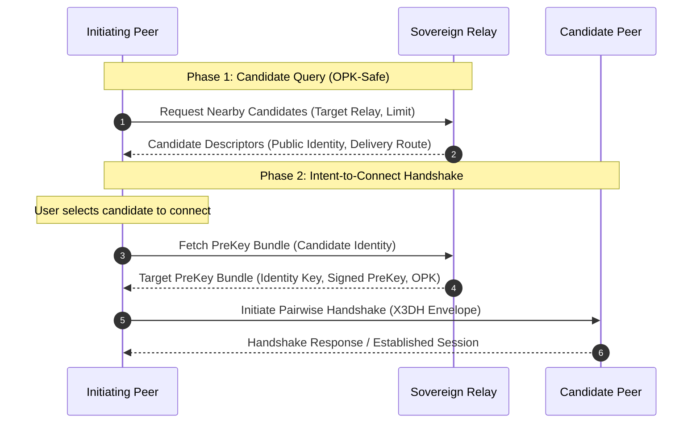

# Percolator Discovery Application Specification

## 1. Overview & Scope

The Discovery Application (`AppId: 0x02`) is the peer discovery and rendezvous subsystem within the Percolator network. It provides privacy-preserving mechanisms for nodes to locate sovereign relays, discover reachable peers, and coordinate private rendezvous without relying on centralized user registries, global crawlable distributed hash tables (DHTs), or unauthenticated local network broadcasts.

Discovery provides two primary interaction models:
1. **Nearby Peer Discovery**: Finding candidate peers registered on a designated sovereign relay or peer node to initiate communication.
2. **Private Blinded Rendezvous**: Enabling mutual contacts who share an out-of-band secret to match and connect across sovereign relays without revealing their identities or social graph to the relay.

### 1.1 Non-Goals & Architectural Boundaries
- **Transport & Connection Management**: Discovery does not manage physical network sockets, TLS sessions, or transport streaming loops. It operates purely as an application protocol layer.
- **Cryptographic Session Ratchets**: Discovery does not implement Double Ratchet sessions or generate cryptographic keys. It interacts with the security layer through application ports to trigger handshakes.
- **Continuous Presence & Heartbeats**: Discovery explicitly rejects online/offline indicators, heartbeat leases, or live activity tracking. In alignment with Signal Protocol parity, nodes function as asynchronous store-and-forward actors.
- **Global Network Crawling & Multicast**: Distributed hash table (DHT) routing networks (e.g., Kademlia) and UDP multicast/broadcast LAN scanning are excluded to prevent network fingerprinting, ISP censorship, and metadata correlation.

---

## 2. Privacy & Threat Model

Discovery operates under a **Zero-Metadata / Sovereign Privacy** threat model:

### 2.1 Two-Phase Discovery (Protection Against OPK Starvation)
- **The Attack**: In prekey-based cryptographic protocols (such as X3DH), an adversary can scrape discovery directories and pre-emptively exhaust targets' One-Time Prekeys (OPKs), forcing future handshakes to fall back to weaker modes or denying service to legitimate peers.
- **The Defense**: Discovery strictly bifurcates peer discovery into two independent phases:
  - **Phase 1 (Candidate Query)**: A query to a relay or peer returns only high-level candidate descriptors (public identity and delivery route). Phase 1 **never consumes or exposes One-Time Prekeys**.
  - **Phase 2 (Connection Intent)**: Prekey bundles are fetched out-of-band only when a user explicitly decides to initiate a connection to a specific discovered candidate.

### 2.2 Sovereign Discovery & Stealth Policies
Discovery adheres to dual-sided sovereign consent:
- **Relay Discovery Policy**: Sovereign relays govern their own discovery posture:
  - *Disabled*: The relay completely disallows discovery queries and registrations.
  - *Open*: The relay accepts registrations and serves candidate queries to authorized peers.
  - *Blinded Contacts Only*: The relay denies open candidate discovery and exclusively facilitates private blinded rendezvous.
- **Peer Stealth Visibility**: Individual peers maintain full control over their visibility:
  - *Hidden*: The peer uses the relay for message routing while remaining completely invisible to nearby discovery queries.
  - *Discoverable*: The peer permits the relay to include its descriptor in candidate discovery queries.

### 2.3 Hard Admission Gate & Anti-Impersonation
- **Cryptographic Gate**: To eliminate directory spam, Sybil attacks, and dead phantom listings, a sovereign relay admits a peer into its directory if and only if:
  1. The peer has completed a mutual authenticated cryptographic handshake with the relay.
  2. The peer has an active, valid Signed PreKey registered and available.
- **Anti-Impersonation**: Incoming discovery registrations require that the advertised identity matches the authenticated envelope sender. Relays reject registration attempts on behalf of third-party identities.

### 2.4 Private Blinded Rendezvous (Time-Ratcheted Locators)
- When two parties share an out-of-band contact key or pre-shared secret, they can rendezvous on a common relay without disclosing their identities or relationship to the relay.
- A **Blinded Locator** is calculated deterministically via HMAC-SHA256 keyed by the shared secret and ratcheted across 24-hour UTC epoch windows.
- Relays store and serve rendezvous descriptors keyed strictly by the blinded locator. Because locators rotate daily, past and future rendezvous operations cannot be correlated by passive observers or compromised relays.

### 2.5 Route & IP Privacy
- Wide-area discovery responses return relayed delivery routes rather than public IP addresses, masking user endpoints behind relay routing tokens.
- Peers communicate via relay mailboxes until they mutually choose to negotiate direct peer-to-peer transport connections.

---

## 3. Protocol Workflows & Interactions

### 3.1 Candidate Discovery Lifecycle
1. **Candidate Query**: The client requests candidate descriptors from a chosen relay or peer with an enforced upper bound (1 to 100 results).
2. **Review & Selection**: Candidates are presented to the user without consuming cryptographic prekeys.
3. **Connection Handshake**: Upon explicit user intent to connect, the client retrieves the candidate's prekey bundle and initiates a mutual cryptographic handshake.
4. **Fault Tolerance**: If a handshake attempt with one candidate fails or times out, the discovery workflow preserves and continues processing remaining candidates without failing the overall operation.

### 3.2 Private Rendezvous Lifecycle
1. **Epoch Ratchet**: Both parties determine the current 24-hour UTC ratchet window.
2. **Locator Generation**: Both parties compute identical blinded locators from their shared secret and current epoch.
3. **Publication & Query**: The publisher deposits a rendezvous descriptor under the blinded locator; the discoverer queries the relay using the same locator.
4. **Zero-Knowledge Matching**: The relay matches the descriptor to the query using the blind token alone, learning zero identity information about either party.

---

## 4. Functional Domain Architecture

The Discovery subsystem is divided into focused functional domains:

1. **Nearby Peer Discovery**: Manages candidate querying, result bounding, route sanitization, and the two-phase connection workflow that bridges candidate lookup to cryptographic handshakes.
2. **Relay Directory Hosting**: Manages relay-side directory registrations, enforcing admission gates, sovereign relay policies, stealth visibility filtering, and query result clamping.
3. **Private Rendezvous**: Implements zero-knowledge contact matching, computing deterministic time-ratcheted locators and handling anonymous rendezvous lookups.
4. **Ingress & Anti-Impersonation**: Demultiplexes incoming discovery payloads, verifying cryptographic sender fidelity before routing to hosting or rendezvous services.
5. **Architectural Ports**: Defines clean, decoupled port interfaces for prekey verification, bundle retrieval, client queries, and handshake initiation, allowing infrastructure adapters (gRPC, SQLite, in-memory) to be plugged in without domain coupling.

---

## 5. Architectural Invariants

- **Zero Primitive Obsession**: Sensitive domain parameters such as query limits, blinded locators, and epoch windows are encapsulated in dedicated value models with explicit invariants and zero implicit conversions.
- **Infrastructure Agnosticism**: Discovery contains zero dependencies on database engines, serialization frameworks, or network libraries. All external systems interact via domain port abstractions.
- **Immutability by Default**: All discovery payloads, registration records, and candidate descriptors are immutable upon creation, guaranteeing thread safety across concurrent asynchronous workflows.
- **Sovereign Opt-In**: A node is never discoverable by default; discoverability requires explicit user opt-in and active prekey publication.
