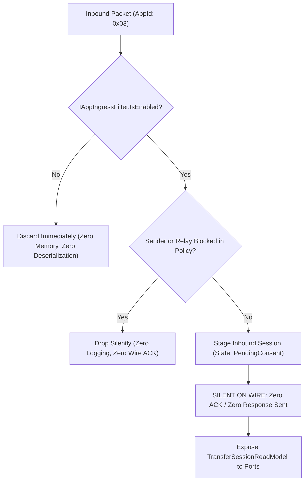

# Percolator.Apps.FileTransfer: Application Implementation Plan

## Refinement Status Gate
- [x] Lens 1: Scope & Feature Slice Framing (Status: Approved)
- [ ] Lens 2: Onion Architecture & Primitive Obsession (Status: In Progress)
- [ ] Lens 3: Threat Modeling & Security Posture (Status: Pending)
- [ ] Lens 4: High-Value, Low-Brittle Unit Test Design (Status: Pending)
- [ ] Lens 5: Cross-Layer Infrastructure Alignment (Status: Pending)
- [ ] Implementation Gate: LOCKED (Requires Approval of Lenses 1-5)

---

## 1. Summary, Plugin Lifecycle & Inherent Privacy Posture

- **Target Project**: `Percolator.Apps.FileTransfer` (`AppId = 0x03`).
- **Target Environment**: **Desktop only** (multi-core processors, high-bandwidth unmetered networks, fast SSD/NVMe storage, large addressable memory, sparse file OS support).
- **Core Inspiration**: **croc** (multi-stream parallel socket saturation, direct P2P with relay pipe fallback, directory tree bundling, chunked streaming, bitfield-based resumption) combined with **BitTorrent swarm piece sharing, peer tracking, and selective downloads**.\n- **Dependencies**: Depends on `Percolator.Domain`, `Percolator.Apps.FileTransfer.Domain`, `Percolator.PluginSdk`, and `Percolator.SourceGenerators`. Zero reference to concrete transport, storage, or SQLite implementations.

### 1.1 Inherent Swarm & Direct P2P Privacy Posture (Intentional Design)
Unlike Percolator's core Double Ratchet messaging—which enforces continuous per-message forward secrecy and shields IP addresses behind sovereign relay mailboxes—the FileTransfer app is intentionally designed with BitTorrent-grade multi-peer performance tradeoffs:
1. **Direct IP Exposure**: Direct socket saturation and multi-peer piece sharing require establishing direct TCP/QUIC socket connections between peers. In doing so, peers inherently expose their physical IPv4/IPv6 addresses, network NAT topologies, and ISP locations to each other. Unlike public BitTorrent swarms that reveal IPs to the open internet, Percolator restricts this exposure strictly to invited contacts (`TargetRecipients`).
2. **Static Symmetric Session Key**: To eliminate re-ratcheting overhead on millions of continuous bulk chunks, all chunks in a transfer session are encrypted with a single static symmetric AES-256 key ($K_{\text{transfer}}$). Forward secrecy and break-in recovery are intentionally lost at the bulk streaming layer; compromise of this session key decrypts all chunks for that session.
3. **Chunk Possession & Activity Leakage**: BitTorrent swarming relies on high-frequency possession broadcasts (`HAVE` and `BITFIELD` frames). Peers actively reveal which chunks they possess, which pieces they are requesting, and their real-time download progress to all other connected peers.
4. **UI Presentation Responsibility**: These tradeoffs are explicit architectural choices for gigabit throughput parity with croc and BitTorrent. The Presentation layer (UI) bears the explicit responsibility of warning users before initiating or accepting direct WAN/P2P transfers, listing the participating contacts (`PublicIdentityId`) whose IP addresses will be revealed.

---

## 2. Ingress Edge Pre-Filtering & Dispatching



### 2.1 Contracts
```csharp
namespace Percolator.PluginSdk;

public enum IngressDecision : byte
{
    Accept = 0x01,
    DiscardSilently = 0x02
}

public interface IAppIngressFilter
{
    AppId TargetAppId { get; }
    bool IsEnabled { get; }
    IngressDecision Evaluate(InboundPayloadContext context);
}
```

- `FileTransferIngressFilter` implements `IAppIngressFilter`, invoking `FileTransferFilterPolicy.EvaluatePeer(context.SenderIdentityId)`. When `PeerFilterDecision.Blocked`, raw bytes are discarded before deserialization (`IngressDecision.DiscardSilently`).
- `FileTransferPayloadHandler` implements `IAppPayloadHandler`, validating relay URI against `policy.EvaluateRelay(relayUri) == RelayFilterDecision.Blocked` before staging inbound sessions.

---

## 3. Application Wire Payloads & Out-of-Band Framing

### 3.1 Application Value Objects & Distribution Models (V-60)

```csharp
namespace Percolator.Apps.FileTransfer.Features.TransferNegotiation;

public sealed record EncryptedChunkData
{
    public ReadOnlyMemory<byte> CiphertextWithAuthTag { get; }
    public int Length => CiphertextWithAuthTag.Length;
    public ReadOnlySpan<byte> Span => CiphertextWithAuthTag.Span;

    private EncryptedChunkData(ReadOnlyMemory<byte> data) => CiphertextWithAuthTag = data;
    public static EncryptedChunkData FromBytes(byte[] data) => new(data ?? throw new ArgumentNullException(nameof(data)));
    public static EncryptedChunkData FromMemory(ReadOnlyMemory<byte> memory) => new(memory);
}

public sealed record InlineManifestData
{
    public ReadOnlyMemory<byte> SerializedBytes { get; }
    public int Length => SerializedBytes.Length;
    public ReadOnlySpan<byte> Span => SerializedBytes.Span;

    private InlineManifestData(ReadOnlyMemory<byte> bytes) => SerializedBytes = bytes;
    public static InlineManifestData FromBytes(byte[] bytes)
    {
        if (bytes == null || bytes.Length == 0 || bytes.Length > 65536)
            throw new ArgumentException("Inline manifest must be between 1 and 65536 bytes.", nameof(bytes));
        return new InlineManifestData(bytes);
    }
}

public sealed record ManifestBlobDescriptor(
    string BlobId,
    ChunkHash CiphertextSha256,
    TotalBundleBytes PlaintextSizeBytes,
    RelayPipeEndpointUri RelayEndpointUri);

public enum ManifestDistributionKind : byte
{
    Inline = 0x01,
    RemoteBlob = 0x02
}

public sealed record ManifestDistribution
{
    public ManifestDistributionKind Kind { get; }
    public InlineManifestData? InlineData { get; }
    public ManifestBlobDescriptor? BlobDescriptor { get; }

    private ManifestDistribution(ManifestDistributionKind kind, InlineManifestData? inlineData, ManifestBlobDescriptor? blob)
    {
        Kind = kind;
        InlineData = inlineData;
        BlobDescriptor = blob;
    }

    public static ManifestDistribution FromInline(InlineManifestData data) =>
        new(ManifestDistributionKind.Inline, data ?? throw new ArgumentNullException(nameof(data)), null);

    public static ManifestDistribution FromBlob(ManifestBlobDescriptor blob) =>
        new(ManifestDistributionKind.RemoteBlob, null, blob ?? throw new ArgumentNullException(nameof(blob)));
}

public sealed record DiskSpacePreflightResult(
    bool HasSufficientSpace,
    TotalBundleBytes RequiredBytes,
    TotalBundleBytes AvailableBytes)
{
    public static DiskSpacePreflightResult Sufficient(TotalBundleBytes required, TotalBundleBytes available) =>
        new(true, required, available);
    public static DiskSpacePreflightResult Insufficient(TotalBundleBytes required, TotalBundleBytes available) =>
        new(false, required, available);
}

public sealed record ResolvedFilePath
{
    public string AbsolutePath { get; }
    private ResolvedFilePath(string absolutePath) => AbsolutePath = absolutePath;
    public static ResolvedFilePath Resolve(RootDirectoryPath root, SanitizedRelativePath relativePath) =>
        new(Path.Combine(root.Value, relativePath.Value));
}
```

### 3.2 In-Band Control Channel Payloads (`AppId.FileTransferControl = 0x03`)
Carried inside the Double Ratchet envelope ($\le 64\text{ KB}$):

```csharp
namespace Percolator.Apps.FileTransfer.Features.TransferNegotiation;

public sealed record FileTransferOfferPayload(
    TransferSessionId TransferSessionId,
    TransferBundleSummary Summary,              // Cohesive root title, size, files, chunks, Merkle root
    ManifestDistribution Manifest,              // Discriminated union: InlineManifest vs RemoteManifestBlob
    TransferKey SessionEncryptionKey,           // 32-byte AES key
    BaseNonce BaseNonce,                        // 12-byte base nonce
    StreamAuthToken StreamAuthToken,            // 32-byte auth token for out-of-band streams
    RelayRendezvousDescriptor? RelayRendezvous, // Encapsulated endpoint URI + relay token
    IReadOnlyList<DirectEndpointCandidate> DirectCandidates);

public sealed record FileTransferAcceptPayload(
    TransferSessionId TransferSessionId,
    IReadOnlyList<DirectEndpointCandidate> ReceiverCandidates,
    TransportRoutingPreference RoutingPreference,
    Bitfield ResumptionBitfield);                // Bitmap of chunks already possessed

// Inbound offer decline in PendingConsent is 100% silent on the wire (local discard).
// FileTransferCancelPayload is dispatched exclusively when aborting active in-flight sessions (V-63).
public sealed record FileTransferCancelPayload(
    TransferSessionId TransferSessionId,
    TransferTerminationReason Reason);
```

### 3.3 Out-of-Band Stream Frame Envelopes (V-61)
Typed frame abstraction for parallel data streams (4–8 multiplexed streams):

```csharp
namespace Percolator.Apps.FileTransfer.Features.MultiStreamEngine;

public enum StreamFrameType : byte
{
    Handshake = 0x01,
    Bitfield = 0x02,
    Have = 0x03,
    RequestChunk = 0x04,
    ChunkData = 0x05,
    CancelChunk = 0x06,
    Choke = 0x07,
    Unchoke = 0x08,
    Interested = 0x09,       // Signals local interest in remote chunks (V-61)
    NotInterested = 0x0A,    // Signals local disinterest in remote chunks (V-61)
    KeepAlive = 0x0B,
    PexPeers = 0x0C
}

public interface IStreamFramePayload
{
    StreamFrameType FrameType { get; }
}

public sealed record HandshakeFrame(
    StreamAuthToken AuthToken,
    TransferSessionId SessionId,
    StreamIndex StreamIndex,
    PublicIdentityId SenderPeerId) : IStreamFramePayload
{
    public StreamFrameType FrameType => StreamFrameType.Handshake;
}

public sealed record BitfieldFrame(Bitfield Bitfield) : IStreamFramePayload
{
    public StreamFrameType FrameType => StreamFrameType.Bitfield;
}

public sealed record HaveFrame(ChunkIndex ChunkIndex) : IStreamFramePayload
{
    public StreamFrameType FrameType => StreamFrameType.Have;
}

public sealed record RequestChunkFrame(ChunkIndex ChunkIndex) : IStreamFramePayload
{
    public StreamFrameType FrameType => StreamFrameType.RequestChunk;
}

public sealed record ChunkDataFrame(ChunkIndex ChunkIndex, EncryptedChunkData Data) : IStreamFramePayload
{
    public StreamFrameType FrameType => StreamFrameType.ChunkData;
}

public sealed record CancelChunkFrame(ChunkIndex ChunkIndex) : IStreamFramePayload
{
    public StreamFrameType FrameType => StreamFrameType.CancelChunk;
}

public sealed record ChokeFrame : IStreamFramePayload
{
    public StreamFrameType FrameType => StreamFrameType.Choke;
}

public sealed record UnchokeFrame : IStreamFramePayload
{
    public StreamFrameType FrameType => StreamFrameType.Unchoke;
}

public sealed record InterestedFrame : IStreamFramePayload
{
    public StreamFrameType FrameType => StreamFrameType.Interested;
}

public sealed record NotInterestedFrame : IStreamFramePayload
{
    public StreamFrameType FrameType => StreamFrameType.NotInterested;
}

public sealed record KeepAliveFrame : IStreamFramePayload
{
    public StreamFrameType FrameType => StreamFrameType.KeepAlive;
}

public sealed record PexPeersFrame(IReadOnlyList<DirectEndpointCandidate> Candidates) : IStreamFramePayload
{
    public StreamFrameType FrameType => StreamFrameType.PexPeers;
}

public sealed record StreamFrameEnvelope(IStreamFramePayload Payload);
```

---

## 4. Outbound Ports & Infrastructure Contracts

```csharp
namespace Percolator.Apps.FileTransfer.Ports;

public interface ITransferStream : IAsyncDisposable
{
    StreamIndex Index { get; }
    ValueTask SendFrameAsync(IStreamFramePayload frame, CancellationToken ct = default);
    ValueTask<IStreamFramePayload> ReceiveFrameAsync(CancellationToken ct = default);
}

public interface ITransferStreamPool : IAsyncDisposable
{
    StreamCount ActiveStreams { get; }
    ValueTask ConnectDirectAsync(IReadOnlyList<DirectEndpointCandidate> candidates, CancellationToken ct = default);
    ValueTask ConnectRelayPipeAsync(RelayRendezvousDescriptor rendezvous, CancellationToken ct = default);
    ITransferStream GetStream(StreamIndex index);
    ValueTask BroadcastFrameAsync(IStreamFramePayload frame, CancellationToken ct = default);
}

public interface ITransferStreamPoolFactory
{
    ITransferStreamPool CreatePool(TransferSessionId sessionId, PublicIdentityId peerId, StreamCount streamCount);
    ITransferStreamPool CreatePool(TransferSessionId sessionId, PublicIdentityId peerId);
}

public interface IDistributedTrackerPort
{
    ValueTask<IReadOnlyList<DirectEndpointCandidate>> AnnounceAsync(
        SwarmRendezvousId rendezvousId,
        PublicIdentityId memberId,
        IReadOnlyList<DirectEndpointCandidate> candidates,
        SwarmPeerRole role,
        CancellationToken ct = default);

    ValueTask UnregisterAsync(
        SwarmRendezvousId rendezvousId,
        PublicIdentityId memberId,
        CancellationToken ct = default);
}

public interface IDesktopFileStorage
{
    ValueTask PreAllocateFilesAsync(RootDirectoryPath rootPath, TransferManifest manifest, SelectedFileIndices selectedIndices, CancellationToken ct = default);
    ValueTask WriteChunkAsync(ResolvedFilePath targetPath, FileByteOffset fileOffset, PlaintextChunkData data, CancellationToken ct = default);
    ValueTask<PlaintextChunkData> ReadChunkAsync(ResolvedFilePath sourcePath, FileByteOffset fileOffset, TransferByteLength length, CancellationToken ct = default);
    ValueTask<Bitfield> ScanAndComputeBitfieldAsync(RootDirectoryPath rootPath, TransferManifest manifest, CancellationToken ct = default);
    ValueTask FinalizeFileAsync(ResolvedFilePath targetPath, FileLastModifiedUtc lastModifiedUtc, CancellationToken ct = default);
    ValueTask<DiskSpacePreflightResult> CheckDiskSpaceAsync(RootDirectoryPath rootPath, TotalBundleBytes requiredBytes, CancellationToken ct = default);
}

public interface ITransferRateLimiter
{
    ValueTask SetGlobalSpeedCapsAsync(BandwidthLimit downloadCap, BandwidthLimit uploadCap, CancellationToken ct = default);
    ValueTask SetSessionSpeedCapsAsync(TransferSessionId sessionId, BandwidthLimit downloadCap, BandwidthLimit uploadCap, CancellationToken ct = default);
    ValueTask ThrottleDownloadAsync(TransferSessionId sessionId, TransferByteLength byteCount, CancellationToken ct = default);
    ValueTask ThrottleUploadAsync(TransferSessionId sessionId, TransferByteLength byteCount, CancellationToken ct = default);
}

public interface ITransferSessionRepository
{
    ValueTask SaveSessionAsync(TransferSession session, CancellationToken ct = default);
    ValueTask<TransferSession?> GetSessionByIdAsync(TransferSessionId sessionId, CancellationToken ct = default);
    ValueTask<IReadOnlyList<TransferSession>> GetActiveSessionsAsync(CancellationToken ct = default);
}

public interface IFileTransferFilterPolicyRepository
{
    ValueTask SavePolicyAsync(FileTransferFilterPolicy policy, CancellationToken ct = default);
    ValueTask<FileTransferFilterPolicy> GetPolicyAsync(PublicIdentityId ownerId, CancellationToken ct = default);
}
```

---

## 5. Minimal, Light-Touch CQRS Contracts

### 5.1 `IFileTransferActionHandler`
Consolidates into 5 fundamental lifecycle commands with explicit optional parameters for title and seeding ratio (V-64):

```csharp
namespace Percolator.Apps.FileTransfer.Ports;

public interface IFileTransferActionHandler
{
    ValueTask<DomainResult<TransferSessionId>> InitiateTransferAsync(
        IReadOnlyList<PublicIdentityId> recipients,
        RootDirectoryPath sourceRoot,
        IReadOnlyList<SanitizedRelativePath> filePaths,
        DirectWanPolicy wanPolicy,
        RootBundleName? customBundleName = null,
        SeedRatio? targetSeedRatio = null,
        CancellationToken ct = default);

    ValueTask<DomainResult> AcceptTransferAsync(
        TransferSessionId sessionId,
        RootDirectoryPath destinationFolder,
        SelectedFileIndices? selectedFiles = null,
        CancellationToken ct = default);

    ValueTask<DomainResult> PauseTransferAsync(TransferSessionId sessionId, CancellationToken ct = default);
    ValueTask<DomainResult> ResumeTransferAsync(TransferSessionId sessionId, CancellationToken ct = default);
    ValueTask<DomainResult> CancelTransferAsync(TransferSessionId sessionId, TransferTerminationReason reason, CancellationToken ct = default);
}
```

### 5.2 Read Models & Query Service
```csharp
namespace Percolator.Apps.FileTransfer.Ports;

public sealed record ManifestFileReadModel(
    FileIndex Index,
    SanitizedRelativePath RelativePath,
    FileSizeBytes FileSize,
    BundleByteOffset StartOffset,
    BundleByteOffset EndOffset,
    FileLastModifiedUtc LastModifiedUtc);

public sealed record TransferSessionReadModel(
    TransferSessionId SessionId,
    RootBundleName RootName,
    PublicIdentityId InitiatorId,
    TransferTopology Topology,
    TotalBundleBytes TotalBytes,
    TotalBundleBytes DownloadedBytes,       // Unambiguous downloaded volume (V-65)
    TotalBundleBytes UploadedBytes,         // Tracked upload volume (V-65)
    SeedRatio CurrentSeedRatio,
    SeedRatio TargetSeedRatio,
    ChunkCount CompletedChunks,
    ChunkCount TotalChunks,
    TransferBandwidth DownloadSpeed,
    TransferBandwidth UploadSpeed,
    StreamCount ConnectedStreams,
    PeerCount ConnectedPeers,
    TransferSessionState Status,
    TransferRole Role,
    DateTimeOffset CreatedAtUtc,            // Aligned with domain aggregate (V-65)
    DateTimeOffset? CompletedAtUtc);

public interface IFileTransferQueryService
{
    ValueTask<IReadOnlyList<TransferSessionReadModel>> GetAllTransfersAsync(CancellationToken ct = default);
    ValueTask<TransferSessionReadModel?> GetTransferByIdAsync(TransferSessionId sessionId, CancellationToken ct = default);
    ValueTask<IReadOnlyList<ManifestFileReadModel>> GetManifestFilesAsync(TransferSessionId sessionId, CancellationToken ct = default);
}
```

---

## 6. Swarm Rendezvous, Fast-Resume & PEX Orchestration

1. **Immediate Fast-Path Reconnection (Zero Tracker Latency)**:
   - When an active or paused transfer is resumed (or after an application restart), the transfer coordinator immediately dials the `EndpointCandidates` encapsulated on each `SwarmMember`.
   - On local LANs or stable WAN IPs, direct streaming resumes within milliseconds without wire signaling or tracker queries.
2. **Authenticated Rendezvous Fallback**:
   - If direct connection attempts fail or candidates have expired:
     $$\text{SwarmRendezvousId} = \text{HMAC-SHA256}(K_{\text{transfer}}, \text{"swarm-rendezvous"})$$
   - Peers announce their current IP candidates to the relay tracker under `SwarmRendezvousId` with their `PublicIdentityId`.
   - The relay tracker stores 90-second sliding records without learning file contents or session keys.
3. **Live Peer Exchange (PEX)**:
   - As connected peers discover new routes or candidates, they dispatch `PexPeersFrame(Candidates)` over active data streams.
   - The recipient aggregate invokes `SwarmMember.UpdateCandidates(newCandidates)` and persists the updated candidates to SQLite (`ft_swarm_endpoints`) for future fast-resume cycles.

---

## 7. Threat Modeling & Security Posture

| Threat / Vulnerability | Protocol Defense | Verification Mechanism |
| :--- | :--- | :--- |
| **Recipient Tracking / Probing** | Silent by default: Inbound transfer offers generate zero wire response or ACK unless explicitly accepted. | Unit test asserts zero outbound messages dispatched upon receiving offer. |
| **Parser / Deserialization Exploits** | Edge kill switch (`IAppIngressFilter`): When disabled, raw packets with `AppId = 0x03` are discarded before deserialization. | Unit test asserts parser is uninvoked when plugin is disabled. |
| **Directory Traversal** | Path sanitization rejecting `..`, absolute paths, null bytes, and Windows device names via `SanitizedRelativePath`. | Test suite fuzzes malicious path entries in manifests. |
| **Disk Exhaustion** | Upfront disk space verification (`CheckDiskSpaceAsync` with cancellation) before accepting. | Test asserts rejection if disk quota is exceeded. |
| **IP Address Leakage (Default Relayed)** | Default posture routes WAN transfers strictly via blind relay pipes; direct WAN endpoints (UPnP / Relay STUN) require explicit user opt-in (`WanPolicy == DirectWanPolicy.ExplicitlyAllowed`). | Test asserts WAN IP endpoints are never generated or dispatched unless opted in. |
| **Direct P2P & Swarm IP Exposure** | Intentional protocol design for throughput parity with BitTorrent. Direct socket saturation requires peers to exchange socket candidates, exposing physical IPv4/IPv6 addresses, NAT topologies, and ISP locations to invited peers (`TargetRecipients`). The UI presentation layer explicitly warns users and lists participant identities before opening direct connections. | Unit test asserts WAN IP candidates are never generated or advertised when direct connections are disabled; UI read model exposes participants for privacy prompt. |
| **Static Symmetric Session Key** | Intentional performance design avoiding per-chunk Double Ratchet overhead. AES-256 session key $K_{\text{transfer}}$ is securely negotiated in-band; all bulk streaming chunks share the key. Loss of per-chunk forward secrecy is bounded to that transfer session. | Architecture enforces strict in-band exchange of session key and base nonce; zero ratchet messages used for bulk data. |
| **Piece Possession Leakage** | Intentional BitTorrent swarming requirement; bitfield and `HAVE` broadcasts leak chunk possession to invited peers to enable rarest-first piece scheduling. | Architecture limits piece announcements strictly to authenticated swarm streams. |
| **Chunk Tampering / Substitution** | Dual cryptographic verification: AES-256-GCM authentication tag + SHA-256 leaf hash against Merkle root. | Test asserts corrupted chunk bytes are discarded and requested again. |
| **Relay Snooping** | E2EE per-chunk encryption ($K_{\text{transfer}}$); relay acts as blind socket proxy without keys. | Test verifies relay cannot decrypt chunks with zero knowledge of session key. |
| **Network Bufferbloat / Choking** | High-precision token bucket bandwidth throttle (`ITransferRateLimiter`). | Unit test asserts throughput throttles accurately to configured caps. |

---

## 8. Cross-Layer Infrastructure Alignment

| Application Port / Contract | Infrastructure Adapter / Concrete Artifact | Target Persistence / Transport |
| :--- | :--- | :--- |
| `ITransferStreamPool` | `TcpMultiStreamPool` | 4–8 multiplexed TCP/QUIC sockets (`TCP_NODELAY = true`) |
| `IDistributedTrackerPort` | Distributed Relay Swarm Tracker / PEX Client | Swarm rendezvous on relay or out-of-band PEX |
| `IDesktopFileStorage` | `PortableDesktopFileStore` | Staging with `.percolator-part`, pre-allocation, bitfield scanning, atomic rename |
| `ITransferSessionRepository` | `SqliteTransferSessionRepository` | `ft_transfer_sessions`, `ft_manifest_files`, `ft_swarm_members`, `ft_swarm_endpoints` |
| `IFileTransferFilterPolicyRepository` | `SqliteFilterPolicyRepository` | `ft_filter_policies`, `ft_blocked_peers`, `ft_blocked_relays` |
| `ITransferRateLimiter` | `TokenBucketRateLimiter` | High-precision token bucket bandwidth throttle |
| `IFileTransferQueryService` | `SqlFileTransferQueryService` | Fast-path Dapper/SQL projection for transfer dashboard |
| Ingress Filtering (`IAppIngressFilter`) | `InboundIngressPipeline` Edge Interceptor | Pre-dispatch drop before deserialization or app routing |

---

## 9. Phased Application Implementation Milestones

### Milestone 1: Plugin Registration & Ingress Edge Discard
1. Implement `FileTransferPlugin` implementing `IAppPlugin` (`AppId.FileTransferControl = 0x03`).
2. Implement `FileTransferIngressFilter` implementing `IAppIngressFilter` (`PluginSdk`) for ingress pre-filtering before deserialization.
3. Implement `FileTransferPayloadHandler` for ingress processing.
4. Implement in-band payloads: `FileTransferOfferPayload`, `FileTransferAcceptPayload`, `FileTransferCancelPayload`.

### Milestone 2: Multi-Stream Coordinator & Out-of-Band Engine
1. Define ports: `ITransferStreamPool`, `ITransferStreamPoolFactory`, `ITransferStream`.
2. Implement `TransferSessionCoordinator` managing active 4–8 streams.
3. Implement out-of-band typed frame dispatching via `IStreamFramePayload` and `StreamFrameEnvelope` (including `InterestedFrame` and `NotInterestedFrame`).
4. Implement concurrent chunk request pipeline (keeping 4–8 requests in flight per stream).
5. Implement opt-in direct candidate discovery adapter hooks (local UPnP port forwarder and relay-assisted STUN reflexive address resolver).

### Milestone 3: Desktop Disk I/O & Storage Abstraction
1. Define `IDesktopFileStorage` port using `PlaintextChunkData`, `FileLastModifiedUtc`, `RootDirectoryPath`, `ResolvedFilePath`, and `DiskSpacePreflightResult`.
2. Implement `DiskChunkAssembler` handling multi-file boundary spanning, chunk writes, and atomic finalization.
3. Implement selective file downloading chunk range mapping (`SelectedFileIndices`).

### Milestone 4: Swarm Coordination, Distributed Tracker & Seeding Ratios
1. Implement `SwarmCoordinator` updating `SwarmMember` entities within `TransferSession`.
2. Implement `RarestFirstChunkSelector` and `EndgameMode`.
3. Implement fast-resume endpoint hydration from `ft_swarm_endpoints` and live PEX frame candidate updates (`SwarmMember.UpdateCandidates`).
4. Implement `IDistributedTrackerPort` announce and unregister workflows using `SwarmRendezvousId` and `PublicIdentityId`.
5. Implement seeding ratio tracking ($\text{Uploaded} / \text{Total}$) and automatic disconnect on target ratio.

### Milestone 5: CQRS Transfer Manager Ports & Rate Limiter
1. Implement rate limiter adapter integration with `ITransferRateLimiter` using `BandwidthLimit` and async `ValueTask` caps.
2. Implement `IFileTransferFilterPolicyRepository` port for filter policy persistence taking `ownerId`.
3. Implement `IFileTransferQueryService` and `IFileTransferActionHandler` supporting the 5 core lifecycle commands (`InitiateTransferAsync`, `AcceptTransferAsync`, `PauseTransferAsync`, `ResumeTransferAsync`, `CancelTransferAsync`).
4. Expose state machine transitions and event streams for presentation consumers.

### Milestone 6: Infrastructure Adapter Integration & End-to-End Verification
1. Wire `FileTransferPlugin` with `TcpMultiStreamPool` and `PortableDesktopFileStore` from `Percolator.Infrastructure`.
2. Test local LAN P2P multi-stream gigabit transfer.
3. Test opt-in WAN direct connections (simulated UPnP and relay STUN reflection).
4. Test blind relay transfer pipe streaming with simulated latency and packet drop.
5. Test swarm multi-peer piece sharing with 3+ desktop nodes.
