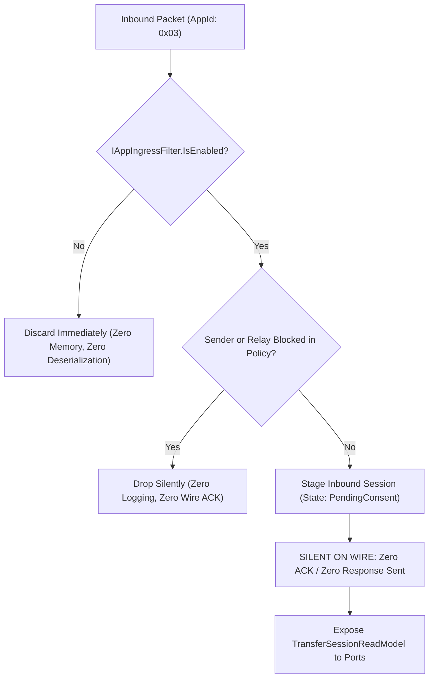

# Percolator.Apps.FileTransfer: Application Implementation Plan

## Refinement Status Gate
- [x] Lens 1: Scope & Feature Slice Framing (Status: Approved)
- [x] Lens 2: Onion Architecture & Primitive Obsession (Status: Approved)
- [x] Lens 3: Threat Modeling & Security Posture (Status: Approved)
- [x] Lens 4: High-Value, Low-Brittle Unit Test Design (Status: Approved)
- [x] Lens 5: Cross-Layer Infrastructure Alignment (Status: Approved)
- [x] Implementation Gate: UNLOCKED (All Lenses Approved)

---

## 1. Summary, Plugin Lifecycle & Inherent Privacy Posture

- **Target Project**: `Percolator.Apps.FileTransfer` (`AppId = 0x03`).
- **Target Environment**: **Desktop only** (multi-core processors, high-bandwidth unmetered networks, fast SSD/NVMe storage, large addressable memory, sparse file OS support).
- **Core Inspiration**: **croc** (multi-stream parallel socket saturation, direct P2P with relay pipe fallback, directory tree bundling, chunked streaming, bitfield-based resumption) combined with **BitTorrent swarm piece sharing, peer tracking, and selective downloads**.
- **Dependencies**: Depends on `Percolator.Domain`, `Percolator.Apps.FileTransfer.Domain`, `Percolator.PluginSdk`, and `Percolator.SourceGenerators`. Zero reference to concrete transport, storage, or SQLite implementations.

### 1.1 Inherent Swarm & Three-Tier Privacy Ladder (Intentional Design)

Unlike Percolator's core Double Ratchet messaging—which enforces continuous per-message forward secrecy and shields IP addresses behind sovereign relay mailboxes—the FileTransfer app balances multi-stream throughput with a **strict three-tier privacy ladder**:

1. **Tier 1: Default WAN Mode (Blind Relay Pipes) — ZERO IP Exposure**:
   - By default (`DirectWanPolicy.DisabledByDefault`), all internet/WAN transfers route exclusively through blind relay pipes (`POST /transfer-pipes/{sessionId}`).
   - The relay operates as an oblivious memory-buffered socket splicer; it cannot see file contents ($K_{\text{transfer}}$ encryption) and peers **never learn each other's physical IP addresses, ISP locations, or NAT topologies**.
2. **Tier 2: Direct LAN Mode — Local Subnet IP Only**:
   - When peers are detected on the same local subnet (e.g., home or office network), direct sockets connect over private RFC 1918 addresses (`192.168.x.x`, `10.x.x.x`).
   - Only local intranet addresses are exchanged; physical public WAN IP addresses are never exposed to the wider internet.
3. **Tier 3: Direct WAN Swarm (Explicit User Opt-In Only) — Public IP Exposure**:
   - Enabled **strictly** when the user explicitly grants permission (`DirectWanPolicy.ExplicitlyAllowed`).
   - Direct socket saturation and multi-peer piece sharing establish direct internet TCP/QUIC connections across WAN UPnP or STUN endpoints, exposing public IPv4/IPv6 addresses **exclusively to invited contacts (`TargetRecipients`)**, never to public open swarms.
   - **UI Presentation Responsibility**: The Presentation layer (UI) bears the explicit responsibility of warning users before initiating or accepting direct WAN transfers, displaying the participating contacts (`PublicIdentityId`) whose IP addresses will be revealed.

#### Cryptographic & Activity Privacy Invariants:
1. **Static Symmetric Session Key ($K_{\text{transfer}}$)**: To eliminate re-ratcheting overhead on millions of continuous bulk chunks, all chunks in a transfer session are encrypted with a single static symmetric AES-256 key negotiated in-band over Double Ratchet. Forward secrecy and break-in recovery are intentionally bounded to that transfer session; compromise of this session key decrypts all chunks for that session.
2. **Chunk Possession & Activity Leakage**: BitTorrent swarming relies on high-frequency possession broadcasts (`HAVE` and `BITFIELD` frames). Connected swarm peers actively reveal which chunks they possess, which pieces they are requesting, and their real-time download progress to other participating peers.
3. **Deniable Symmetric Secrets**: Stream handshakes rely exclusively on ephemeral symmetric HMAC tokens derived from $K_{\text{transfer}}$. Zero root identity keys or digital signatures are transmitted over raw network sockets, guaranteeing cryptographic deniability and preventing any third-party proof binding a physical IP address to a user identity.
4. **Swarm Tracker Identity Exposure (Intentional Tradeoff)**: When using the out-of-band relay swarm tracker (`RelaySwarmTrackerClient`), peers announce direct socket candidates alongside their `PublicIdentityId` under the session's blinded rendezvous ID. The relay learns which invited identities are participating in the swarm and their physical IP addresses. This is an explicit, intentional architectural tradeoff to enable instant peer-to-endpoint attribution without complex pseudonym translation layers, bounded by strictly ephemeral 90-second in-memory sliding retention and proactive unregistration upon session completion.

---

## 2. Ingress Edge Pre-Filtering & Dispatching



### 2.1 Contracts & Filter Policy Model
```csharp
namespace Percolator.PluginSdk;

public enum IngressDecision : byte
{
    Accept = 0x01,
    DiscardSilently = 0x02
}

public interface IAppIngressFilter
{
    AppId TargetAppId { get; }
    bool IsEnabled { get; }
    IngressDecision Evaluate(InboundPayloadContext context);
}
```

```csharp
namespace Percolator.Apps.FileTransfer.Features.IngressControl;

public enum PeerFilterDecision : byte
{
    Allowed = 0x01,
    Blocked = 0x02
}

public enum RelayFilterDecision : byte
{
    Allowed = 0x01,
    Blocked = 0x02
}

public sealed record FileTransferFilterPolicy(
    PublicIdentityId OwnerId,
    IReadOnlySet<PublicIdentityId> BlockedPeers,
    IReadOnlySet<RelayPipeEndpointUri> BlockedRelays)
{
    public PeerFilterDecision EvaluatePeer(PublicIdentityId peerId) =>
        BlockedPeers.Contains(peerId) ? PeerFilterDecision.Blocked : PeerFilterDecision.Allowed;

    public RelayFilterDecision EvaluateRelay(RelayPipeEndpointUri relayUri) =>
        BlockedRelays.Contains(relayUri) ? RelayFilterDecision.Blocked : RelayFilterDecision.Allowed;
}
```

- `FileTransferIngressFilter` implements `IAppIngressFilter`, invoking `policy.EvaluatePeer(context.SenderIdentityId)`. When `PeerFilterDecision.Blocked`, raw bytes are discarded before deserialization (`IngressDecision.DiscardSilently`).
- `FileTransferPayloadHandler` implements `IAppPayloadHandler`, validating relay URI against `policy.EvaluateRelay(relayUri) == RelayFilterDecision.Blocked` before staging inbound sessions.

### 2.2 Bundle Limits & Memory Defense (Symmetric Ingress & Egress Invariants)
To defend against unbounded heap allocations and memory exhaustion DoS attacks from untrusted peers or oversized local directory selections, the application layer validates bundle limits symmetrically:
- **Inbound Ingress**: `IngressTransferOfferValidator` validates incoming offers prior to staging or domain entity instantiation.
- **Outbound Egress**: `TransferInitiationService` validates local file scan results prior to constructing the `TransferManifest` or staging an outgoing session.

```csharp
namespace Percolator.Apps.FileTransfer.Features.TransferNegotiation;

public static class IngressTransferOfferValidator
{
    public const int MaxFilesPerBundle = 50_000;
    public const int MaxChunksPerBundle = 1_000_000;
    public const long MaxBundleSizeBytes = 16_000_000_000_000L; // 16 TB
    public const int MaxInlineManifestBytes = 49_152; // 48 KB (preserves headroom in 64 KB Double Ratchet envelope)
    public const long MaxRemoteManifestBlobBytes = 8_388_608L; // 8 MB

    public static ValidationResult ValidateOffer(FileTransferOfferPayload offer)
    {
        if (offer.Summary.TotalFiles.Count > MaxFilesPerBundle)
            return ValidationResult.Failure($"Offer file count ({offer.Summary.TotalFiles.Count}) exceeds maximum allowed ({MaxFilesPerBundle}).");
        if (offer.Summary.TotalChunks.Count > MaxChunksPerBundle)
            return ValidationResult.Failure($"Offer chunk count ({offer.Summary.TotalChunks.Count}) exceeds maximum allowed ({MaxChunksPerBundle}).");
        if (offer.Summary.TotalSize.Bytes > MaxBundleSizeBytes)
            return ValidationResult.Failure($"Offer bundle size ({offer.Summary.TotalSize.Bytes} bytes) exceeds maximum allowed ({MaxBundleSizeBytes} bytes).");
        if (offer.ManifestDistribution.Kind == ManifestDistributionKind.Inline)
        {
            if (offer.ManifestDistribution.InlineData == null || offer.ManifestDistribution.InlineData.Length > MaxInlineManifestBytes)
                return ValidationResult.Failure($"Inline manifest exceeds maximum allowed limit ({MaxInlineManifestBytes} bytes).");
        }
        else if (offer.ManifestDistribution.Kind == ManifestDistributionKind.RemoteBlob)
        {
            if (offer.ManifestDistribution.BlobDescriptor == null ||
                offer.ManifestDistribution.BlobDescriptor.PlaintextSizeBytes.Bytes <= 0 ||
                offer.ManifestDistribution.BlobDescriptor.PlaintextSizeBytes.Bytes > MaxRemoteManifestBlobBytes)
                return ValidationResult.Failure($"Remote manifest blob size ({offer.ManifestDistribution.BlobDescriptor?.PlaintextSizeBytes.Bytes ?? 0} bytes) must be between 1 and {MaxRemoteManifestBlobBytes} bytes.");
        }
        return ValidationResult.Success();
    }
}
```
Offers failing these bounds are dropped silently without staging into memory or SQLite.

---

## 3. Application Wire Payloads & Out-of-Band Framing

### 3.1 Application Value Objects & Transport Models

These models represent transport coordination, relay routing, wire encryption keys, rate throttling, and desktop filesystem paths (excised from `FileTransfer.Domain` to keep the domain pure and focused on math, bitfields, and lifecycle):

> [!IMPORTANT]
> **Strict Prohibition of Implicit / Explicit Conversion Operators**:
> In alignment with `FileTransfer.Domain`, all Application Value Objects, transport models, cryptographic secrets, and filesystem paths enforce a strict **zero implicit/explicit conversion operator** policy:
> - **Zero implicit or explicit conversion operators are permitted** across any Application Value Objects, transport models, or secrets.
> - Implicit type casting on cryptographic secrets (e.g. decaying `TransferKey` to a naked `byte[]`) is a critical security vulnerability that bypasses zeroization (`ISensitiveSecret`) and memory lifecycle controls.
> - Implicit type casting on filesystem paths (e.g. coercing `RootDirectoryPath` to `string`) subverts path canonicalization and directory traversal protections.
> - All transformations must be 100% explicit via designated factory methods (e.g. `Parse`, `FromInt`, `FromBytes`, `FromMemory`, `Resolve`) and named property accessors (e.g. `.Value`, `.Bytes`, `.Span`, `.Memory`, `.Count`).

```csharp
namespace Percolator.Apps.FileTransfer.Features.TransferNegotiation;

// --- Transport Reachability & Candidate Discovery ---
public enum DirectCandidateKind : byte
{
    DirectLan = 0x01,
    DirectWanUpnp = 0x02,
    DirectWanStun = 0x03
}

public enum DirectWanPolicy : byte
{
    DisabledByDefault = 0x01,
    ExplicitlyAllowed = 0x02
}

public enum TransportRoutingPreference : byte
{
    DirectPreferred = 0x01,
    RelayOnly = 0x02
}

public sealed record EndpointHost
{
    public string Value { get; }
    private EndpointHost(string value) => Value = value;
    public static EndpointHost Parse(string host)
    {
        if (string.IsNullOrWhiteSpace(host)) throw new ArgumentException("Host cannot be empty.", nameof(host));
        return new EndpointHost(host);
    }
}

public readonly record struct PortNumber
{
    public ushort Value { get; }
    private PortNumber(ushort value) => Value = value;
    public static PortNumber FromInt(int port)
    {
        if (port is < 1 or > 65535) throw new ArgumentOutOfRangeException(nameof(port), "Port must be 1..65535.");
        return new PortNumber((ushort)port);
    }
}

public sealed record DirectEndpointCandidate(
    EndpointHost Host,
    PortNumber Port,
    DirectCandidateKind Kind);

// --- Relay Reachability & Pipe Rendezvous ---
public sealed record RelayPipeEndpointUri
{
    public string Value { get; }
    private RelayPipeEndpointUri(string value) => Value = value;
    public static RelayPipeEndpointUri Parse(string uri) => new(uri ?? throw new ArgumentNullException(nameof(uri)));
}

public sealed record RelayPipeToken([property: ByteArray(32)] byte[] Bytes);

public sealed record RelayRendezvousDescriptor(
    RelayPipeEndpointUri EndpointUri,
    RelayPipeToken Token);

// --- Stream Encryption, Nonces & Sockets ---
public sealed record TransferKey([property: ByteArray(32)] byte[] Bytes) : ISensitiveSecret
{
    public void Zeroize() => CryptographicOperations.ZeroMemory(Bytes);
}

public sealed record BaseNonce([property: ByteArray(12)] byte[] Bytes);

/// <summary>
/// Deterministically derived 12-byte (96-bit) AES-256-GCM nonce for chunk index i:
/// ChunkNonce(i) = BaseNonce XOR BigEndianUInt96(i)
/// Guarantees zero nonce collision across all chunks (up to 1,000,000) under the same session key.
/// </summary>
public sealed record ChunkNonce([property: ByteArray(12)] byte[] Bytes)
{
    public ReadOnlySpan<byte> Span => Bytes;

    public static ChunkNonce Derive(BaseNonce baseNonce, ChunkIndex chunkIndex)
    {
        byte[] derived = new byte[12];
        baseNonce.Bytes.CopyTo(derived, 0);

        // XOR last 4 bytes with Big-Endian chunkIndex.Value (supports up to 2^32-1 chunks, covering MaxChunksPerBundle)
        BinaryPrimitives.WriteInt32BigEndian(derived.AsSpan(8, 4), 
            BinaryPrimitives.ReadInt32BigEndian(derived.AsSpan(8, 4)) ^ chunkIndex.Value);

        return new ChunkNonce(derived);
    }
}

public sealed record StreamAuthToken([property: ByteArray(32)] byte[] Bytes);

public sealed record SwarmRendezvousId([property: ByteArray(32)] byte[] Bytes);

public readonly record struct StreamIndex(int Value)
{
    public static StreamIndex FromInt(int index) => new(index);
}

public readonly record struct StreamCount(int Count)
{
    public static StreamCount FromInt(int count) => new(count);
    public static StreamCount Default => new(4);
}

// --- Bandwidth Rate Limiting ---
public readonly record struct TransferBandwidth(long BytesPerSecond);

public readonly record struct BandwidthLimit(bool IsUnlimited, TransferBandwidth Value)
{
    public static BandwidthLimit Unlimited => new(true, default);
    public static BandwidthLimit Capped(TransferBandwidth cap) => new(false, cap);
}

// --- Desktop OS Filesystem Paths ---
public sealed record RootDirectoryPath
{
    public string Value { get; }
    private RootDirectoryPath(string value) => Value = value;
    public static RootDirectoryPath Parse(string path)
    {
        if (string.IsNullOrWhiteSpace(path)) throw new ArgumentException("Path cannot be empty.", nameof(path));
        return new RootDirectoryPath(Path.GetFullPath(path));
    }
}

public sealed record ResolvedFilePath
{
    public string AbsolutePath { get; }
    private ResolvedFilePath(string absolutePath) => AbsolutePath = absolutePath;
    public static ResolvedFilePath Resolve(RootDirectoryPath root, SanitizedRelativePath relativePath) =>
        new(Path.Combine(root.Value, relativePath.Value));
}

// --- Wire Chunk Buffers & In-Band Manifest Wrappers ---
public sealed record EncryptedChunkData
{
    public ReadOnlyMemory<byte> CiphertextWithAuthTag { get; }
    public int Length => CiphertextWithAuthTag.Length;
    public ReadOnlySpan<byte> Span => CiphertextWithAuthTag.Span;

    private EncryptedChunkData(ReadOnlyMemory<byte> data) => CiphertextWithAuthTag = data;
    public static EncryptedChunkData FromBytes(byte[] data) => new(data ?? throw new ArgumentNullException(nameof(data)));
    public static EncryptedChunkData FromMemory(ReadOnlyMemory<byte> memory) => new(memory);
}

public sealed record InlineManifestData
{
    public ReadOnlyMemory<byte> SerializedBytes { get; }
    public int Length => SerializedBytes.Length;
    public ReadOnlySpan<byte> Span => SerializedBytes.Span;

    private InlineManifestData(ReadOnlyMemory<byte> bytes) => SerializedBytes = bytes;
    public static InlineManifestData FromBytes(byte[] bytes)
    {
        if (bytes == null || bytes.Length == 0 || bytes.Length > 49_152)
            throw new ArgumentException("Inline manifest must be between 1 and 49152 bytes.", nameof(bytes));
        return new InlineManifestData(bytes);
    }
}

public sealed record ManifestBlobDescriptor(
    BlobId BlobId,
    ChunkHash CiphertextSha256,
    TotalBundleBytes PlaintextSizeBytes,
    RelayPipeEndpointUri RelayEndpointUri);

public enum ManifestDistributionKind : byte
{
    Inline = 0x01,
    RemoteBlob = 0x02
}

public sealed record ManifestDistribution
{
    public ManifestDistributionKind Kind { get; }
    public InlineManifestData? InlineData { get; }
    public ManifestBlobDescriptor? BlobDescriptor { get; }

    private ManifestDistribution(ManifestDistributionKind kind, InlineManifestData? inlineData, ManifestBlobDescriptor? blob)
    {
        Kind = kind;
        InlineData = inlineData;
        BlobDescriptor = blob;
    }

    public static ManifestDistribution FromInline(InlineManifestData data) =>
        new(ManifestDistributionKind.Inline, data ?? throw new ArgumentNullException(nameof(data)), null);

    public static ManifestDistribution FromBlob(ManifestBlobDescriptor blob) =>
        new(ManifestDistributionKind.RemoteBlob, null, blob ?? throw new ArgumentNullException(nameof(blob)));
}

public sealed record DiskSpacePreflightResult(
    bool HasSufficientSpace,
    TotalBundleBytes RequiredBytes,
    TotalBundleBytes AvailableBytes)
{
    public static DiskSpacePreflightResult Sufficient(TotalBundleBytes required, TotalBundleBytes available) =>
        new(true, required, available);
    public static DiskSpacePreflightResult Insufficient(TotalBundleBytes required, TotalBundleBytes available) =>
        new(false, required, available);
}
```

### 3.2 In-Band Control Channel Payloads (`AppId.FileTransferControl = 0x03`)
Carried inside the Double Ratchet envelope ($\le 64\text{ KB}$):

```csharp
namespace Percolator.Apps.FileTransfer.Features.TransferNegotiation;

public sealed record FileTransferOfferPayload(
    TransferSessionId TransferSessionId,
    TransferBundleSummary Summary,              // Cohesive root title, size, files, chunks, Merkle root
    ManifestDistribution Manifest,              // Discriminated union: InlineManifest vs RemoteManifestBlob
    TransferKey SessionEncryptionKey,           // 32-byte AES key
    BaseNonce BaseNonce,                        // 12-byte base nonce
    StreamAuthToken StreamAuthToken,            // 32-byte auth token for out-of-band streams
    RelayRendezvousDescriptor? RelayRendezvous, // Encapsulated endpoint URI + relay token
    IReadOnlyList<DirectEndpointCandidate> DirectCandidates);

public sealed record FileTransferAcceptPayload(
    TransferSessionId TransferSessionId,
    IReadOnlyList<DirectEndpointCandidate> ReceiverCandidates,
    TransportRoutingPreference RoutingPreference,
    Bitfield ResumptionBitfield);                // Bitmap of chunks already possessed

// Inbound offer decline in PendingConsent is 100% silent on the wire (local discard).
// FileTransferCancelPayload is dispatched exclusively when aborting active in-flight sessions (V-63).
public sealed record FileTransferCancelPayload(
    TransferSessionId TransferSessionId,
    TransferTerminationReason Reason);
```

### 3.3 Out-of-Band Stream Frame Envelopes (V-61)
Typed frame abstraction for parallel data streams (4–8 multiplexed streams):

```csharp
namespace Percolator.Apps.FileTransfer.Features.MultiStreamEngine;

public enum StreamFrameType : byte
{
    Handshake = 0x01,
    Bitfield = 0x02,
    Have = 0x03,
    RequestChunk = 0x04,
    ChunkData = 0x05,
    CancelChunk = 0x06,
    Choke = 0x07,
    Unchoke = 0x08,
    Interested = 0x09,       // Signals local interest in remote chunks (V-61)
    NotInterested = 0x0A,    // Signals local disinterest in remote chunks (V-61)
    KeepAlive = 0x0B,
    PexPeers = 0x0C
}

public interface IStreamFramePayload
{
    StreamFrameType FrameType { get; }
}

public sealed record HandshakeFrame(
    StreamAuthToken AuthToken,
    TransferSessionId SessionId,
    StreamIndex StreamIndex,
    PublicIdentityId SenderPeerId) : IStreamFramePayload
{
    public StreamFrameType FrameType => StreamFrameType.Handshake;
}

public sealed record BitfieldFrame(Bitfield Bitfield) : IStreamFramePayload
{
    public StreamFrameType FrameType => StreamFrameType.Bitfield;
}

public sealed record HaveFrame(ChunkIndex ChunkIndex) : IStreamFramePayload
{
    public StreamFrameType FrameType => StreamFrameType.Have;
}

public sealed record RequestChunkFrame(ChunkIndex ChunkIndex) : IStreamFramePayload
{
    public StreamFrameType FrameType => StreamFrameType.RequestChunk;
}

public sealed record ChunkDataFrame(ChunkIndex ChunkIndex, EncryptedChunkData Data) : IStreamFramePayload
{
    public StreamFrameType FrameType => StreamFrameType.ChunkData;
}

public sealed record CancelChunkFrame(ChunkIndex ChunkIndex) : IStreamFramePayload
{
    public StreamFrameType FrameType => StreamFrameType.CancelChunk;
}

public sealed record ChokeFrame : IStreamFramePayload
{
    public StreamFrameType FrameType => StreamFrameType.Choke;
}

public sealed record UnchokeFrame : IStreamFramePayload
{
    public StreamFrameType FrameType => StreamFrameType.Unchoke;
}

public sealed record InterestedFrame : IStreamFramePayload
{
    public StreamFrameType FrameType => StreamFrameType.Interested;
}

public sealed record NotInterestedFrame : IStreamFramePayload
{
    public StreamFrameType FrameType => StreamFrameType.NotInterested;
}

public sealed record KeepAliveFrame : IStreamFramePayload
{
    public StreamFrameType FrameType => StreamFrameType.KeepAlive;
}

public sealed record PexPeersFrame(IReadOnlyList<DirectEndpointCandidate> Candidates) : IStreamFramePayload
{
    public StreamFrameType FrameType => StreamFrameType.PexPeers;
}

public sealed record StreamFrameEnvelope(IStreamFramePayload Payload);
```

---

## 4. Outbound Ports & Infrastructure Contracts

```csharp
namespace Percolator.Apps.FileTransfer.Ports;

public interface ITransferStream : IAsyncDisposable
{
    StreamIndex Index { get; }
    ValueTask SendFrameAsync(IStreamFramePayload frame, CancellationToken ct = default);
    ValueTask<IStreamFramePayload> ReceiveFrameAsync(CancellationToken ct = default);
}

public interface ITransferStreamPool : IAsyncDisposable
{
    StreamCount ActiveStreams { get; }
    ValueTask ConnectDirectAsync(IReadOnlyList<DirectEndpointCandidate> candidates, CancellationToken ct = default);
    ValueTask ConnectRelayPipeAsync(RelayRendezvousDescriptor rendezvous, CancellationToken ct = default);
    ITransferStream GetStream(StreamIndex index);
    ValueTask BroadcastFrameAsync(IStreamFramePayload frame, CancellationToken ct = default);
}

public interface ITransferStreamPoolFactory
{
    ITransferStreamPool CreatePool(TransferSessionId sessionId, PublicIdentityId peerId, StreamCount streamCount);
    ITransferStreamPool CreatePool(TransferSessionId sessionId, PublicIdentityId peerId);
}

public interface IDistributedTrackerPort
{
    ValueTask<IReadOnlyList<DirectEndpointCandidate>> AnnounceAsync(
        SwarmRendezvousId rendezvousId,
        PublicIdentityId memberId,
        IReadOnlyList<DirectEndpointCandidate> candidates,
        SwarmPeerRole role,
        CancellationToken ct = default);

    ValueTask UnregisterAsync(
        SwarmRendezvousId rendezvousId,
        PublicIdentityId memberId,
        CancellationToken ct = default);
}

public interface IDesktopFileStorage
{
    ValueTask PreAllocateFilesAsync(RootDirectoryPath rootPath, TransferManifest manifest, SelectedFileIndices selectedIndices, CancellationToken ct = default);
    ValueTask WriteChunkAsync(ResolvedFilePath targetPath, FileByteOffset fileOffset, PlaintextChunkData data, CancellationToken ct = default);
    ValueTask<PlaintextChunkData> ReadChunkAsync(ResolvedFilePath sourcePath, FileByteOffset fileOffset, TransferByteLength length, CancellationToken ct = default);
    ValueTask<Bitfield> ScanAndComputeBitfieldAsync(RootDirectoryPath rootPath, TransferManifest manifest, SelectedFileIndices? selectedIndices = null, CancellationToken ct = default); // (V-70)
    ValueTask FinalizeFileAsync(ResolvedFilePath targetPath, FileLastModifiedUtc lastModifiedUtc, CancellationToken ct = default);
    ValueTask<DiskSpacePreflightResult> CheckDiskSpaceAsync(RootDirectoryPath rootPath, TotalBundleBytes requiredBytes, CancellationToken ct = default);
}

public interface ITransferRateLimiter
{
    ValueTask SetGlobalSpeedCapsAsync(BandwidthLimit downloadCap, BandwidthLimit uploadCap, CancellationToken ct = default);
    ValueTask SetSessionSpeedCapsAsync(TransferSessionId sessionId, BandwidthLimit downloadCap, BandwidthLimit uploadCap, CancellationToken ct = default);
    ValueTask ThrottleDownloadAsync(TransferSessionId sessionId, TransferByteLength byteCount, CancellationToken ct = default);
    ValueTask ThrottleUploadAsync(TransferSessionId sessionId, TransferByteLength byteCount, CancellationToken ct = default);
}

public interface ITransferSessionRepository
{
    ValueTask SaveSessionAsync(TransferSession session, CancellationToken ct = default);
    ValueTask<TransferSession?> GetSessionByIdAsync(TransferSessionId sessionId, CancellationToken ct = default);
    ValueTask<IReadOnlyList<TransferSession>> GetActiveSessionsAsync(CancellationToken ct = default);
}

public interface IFileTransferFilterPolicyRepository
{
    ValueTask SavePolicyAsync(FileTransferFilterPolicy policy, CancellationToken ct = default);
    ValueTask<FileTransferFilterPolicy> GetPolicyAsync(PublicIdentityId ownerId, CancellationToken ct = default);
}
```

---

## 5. Minimal, Light-Touch CQRS Contracts

### 5.1 `IFileTransferActionHandler`
Consolidates into 5 fundamental lifecycle commands with explicit optional parameters for title and seeding ratio:

```csharp
namespace Percolator.Apps.FileTransfer.Ports;

public interface IFileTransferActionHandler
{
    ValueTask<DomainResult<TransferSessionId>> InitiateTransferAsync(
        IReadOnlyList<PublicIdentityId> recipients,
        RootDirectoryPath sourceRoot,
        IReadOnlyList<SanitizedRelativePath> filePaths,
        DirectWanPolicy wanPolicy,
        RootBundleName? customBundleName = null,
        SeedRatio? targetSeedRatio = null,
        CancellationToken ct = default);

    ValueTask<DomainResult> AcceptTransferAsync(
        TransferSessionId sessionId,
        RootDirectoryPath destinationFolder,
        SelectedFileIndices? selectedFiles = null,
        CancellationToken ct = default);

    ValueTask<DomainResult> PauseTransferAsync(TransferSessionId sessionId, CancellationToken ct = default);
    ValueTask<DomainResult> ResumeTransferAsync(TransferSessionId sessionId, CancellationToken ct = default);
    ValueTask<DomainResult> CancelTransferAsync(TransferSessionId sessionId, TransferTerminationReason reason, CancellationToken ct = default);
}
```

#### 5.1.1 Command Handler Orchestration Rules
1. **Initiate Transfer Pre-Flight Bounds**:
   - `InitiateTransferAsync` scans the local `sourceRoot` to collect files and compute total size.
   - Enforces symmetric caps before manifest allocation: if files $> 50,000$, total size $> 16\text{ TB}$, or chunks $> 1,000,000$, returns `DomainResult.Failure` without staging or persisting an aggregate.
2. **Accept Transfer Selective Pre-Flight Disk Math**:
   - `AcceptTransferAsync` resolves `selectedFiles`:
     - If `selectedFiles == null`: defaults to `SelectedFileIndices.All(manifest.TotalFiles)`.
     - If `selectedFiles.SelectedCount == 0`: returns `DomainResult.Failure("At least one file must be selected for transfer.")`.
   - **Selective Disk Space Verification**: Calculates required bytes strictly for selected files:
     $$\text{RequiredSpace} = \sum_{i \in \text{SelectedFiles}} \text{manifest.Files}[i].\text{FileSize}$$
     Invokes `IDesktopFileStorage.CheckDiskSpaceAsync(destinationFolder, RequiredSpace, ct)`. If space is insufficient, returns `DomainResult.Failure` without transitioning aggregate state.
3. **Zero-Byte File Finalization on InFlight Transition**:
   - When user consent is given and the session transitions from `PendingConsent` to `InFlight`, `TransferSessionCoordinator` immediately calls `IDesktopFileStorage.FinalizeFileAsync` for any selected files with `FileSize.Bytes == 0`.
   - Because 0-byte files have zero chunks, they emit no chunk verification events; immediate finalization ensures 0-byte files are materialized and marked completed immediately upon starting the transfer.
4. **Proactive Tracker Unregistration on Session Cancellation or Completion**:
   - When a transfer session transitions to `Completed`, `Cancelled`, or `Failed`, `TransferSessionCoordinator` proactively dispatches `IDistributedTrackerPort.UnregisterAsync(SwarmRendezvousId, LocalIdentityId, ct)`.
   - Proactive unregistration immediately purges candidate IP endpoints from the relay swarm tracker, preventing peer connection attempts to stale or closed endpoints and freeing relay memory before the 90-second ephemeral TTL expires.
5. **Candidate Gathering Egress Filtering (`DirectWanPolicy`)**:
   - When `wanPolicy == DirectWanPolicy.DisabledByDefault`: The candidate discovery engine must not query UPnP port mapping or STUN reflection, and must not populate WAN candidates in `FileTransferOfferPayload` or `FileTransferAcceptPayload`. Only private LAN candidates (`DirectCandidateKind.DirectLan`) are gathered if local network sharing is enabled; otherwise, candidate lists remain empty, forcing all traffic exclusively through blind relay pipes.
   - When `wanPolicy == DirectWanPolicy.ExplicitlyAllowed`: The discovery engine actively resolves WAN candidates via UPnP port forwarding and relay-assisted STUN before dispatching offer or accept payloads.

### 5.2 Read Models & Query Service
```csharp
namespace Percolator.Apps.FileTransfer.Ports;

public sealed record ManifestFileReadModel(
    FileIndex Index,
    SanitizedRelativePath RelativePath,
    FileSizeBytes FileSize,
    BundleByteOffset StartOffset,
    BundleByteOffset EndOffset,
    FileLastModifiedUtc LastModifiedUtc,
    bool IsSelected,                    // Selective download projection (V-69)
    bool IsCompleted);                  // Per-file completion status (V-69)

public sealed record TransferSessionReadModel(
    TransferSessionId SessionId,
    RootBundleName RootName,
    PublicIdentityId InitiatorId,
    TransferTopology Topology,
    RootDirectoryPath? LocalRootPath,   // Preserves local disk folder for UI actions (V-68)
    TotalBundleBytes TotalBytes,
    TotalBundleBytes DownloadedBytes,   // Unambiguous downloaded volume (V-65)
    TotalBundleBytes UploadedBytes,     // Tracked upload volume (V-65)
    SeedRatio CurrentSeedRatio,
    SeedRatio TargetSeedRatio,
    ChunkCount CompletedChunks,
    ChunkCount TotalChunks,
    TransferBandwidth DownloadSpeed,
    TransferBandwidth UploadSpeed,
    StreamCount ConnectedStreams,
    PeerCount ConnectedPeers,
    TransferSessionState Status,
    TransferRole Role,
    DateTimeOffset CreatedAtUtc,        // Aligned with domain aggregate (V-65)
    DateTimeOffset? CompletedAtUtc);

public interface IFileTransferQueryService
{
    ValueTask<IReadOnlyList<TransferSessionReadModel>> GetAllTransfersAsync(CancellationToken ct = default);
    ValueTask<TransferSessionReadModel?> GetTransferByIdAsync(TransferSessionId sessionId, CancellationToken ct = default);
    ValueTask<IReadOnlyList<ManifestFileReadModel>> GetManifestFilesAsync(TransferSessionId sessionId, CancellationToken ct = default);
}

public interface ITransferOfferReaperService
{
    ValueTask<int> SweepAndExpireStaleOffersAsync(TimeSpan retentionWindow, CancellationToken ct = default);
}
```

- Periodic background service (running every 15 minutes) scanning staged incoming sessions (`TransferSessionState.PendingConsent`) in `ITransferSessionRepository`.
- Any offer where `clock.UtcNow - session.CreatedAtUtc > TimeSpan.FromHours(24)` is transitioned to `Cancelled` via `session.ExpireOffer(clock)` and persisted.
- Prevents staging memory and database row accumulation from unaccepted transfer offers (Lens 3).

---

## 6. Swarm Rendezvous, Fast-Resume & PEX Orchestration

1. **Immediate Fast-Path Reconnection (Zero Tracker Latency)**:
   - When an active or paused transfer is resumed (or after an application restart), the transfer coordinator queries `ft_swarm_endpoints` and dials candidate IP addresses directly.
   - On local LANs or stable WAN IPs, direct streaming resumes within milliseconds without wire signaling or tracker queries.
2. **Authenticated Rendezvous Fallback**:
   - If direct connection attempts fail or candidates have expired:
     $$\text{SwarmRendezvousId} = \text{HMAC-SHA256}(K_{\text{transfer}}, \text{"swarm-rendezvous"})$$
   - Peers announce their current IP candidates to the relay tracker under `SwarmRendezvousId` with their `PublicIdentityId`.
   - The relay tracker stores 90-second sliding records without learning file contents or session keys.
3. **Live Peer Exchange (PEX) & Candidate Flooding Defense (Lens 3)**:
   - As connected peers discover new routes or candidates, they dispatch `PexPeersFrame(Candidates)` over active data streams.
   - **PEX Flood Rate Limiter**: Coordinators throttle `PexPeersFrame` ingestion to at most 1 frame per 10 seconds per peer.
   - **Candidate Capping & Deduplication**: Capped at `MaxCandidatesPerPeer = 16`. Candidates are deduplicated by Host+Port. Bogus formats or loopback/private candidates (unless `AllowLan` is enabled) are discarded.
   - **PEX WAN Policy Gate**: The coordinator strictly enforces the session's `DirectWanPolicy` on all incoming `PexPeersFrame` messages. If `DirectWanPolicy == DisabledByDefault`, any candidate received with `DirectCandidateKind.DirectWanUpnp` or `DirectCandidateKind.DirectWanStun` (or having a public IP address) is discarded immediately, preventing a remote peer from injecting WAN IPs and bypassing the user's relay-only privacy posture.
   - The coordinator persists valid candidates to SQLite (`ft_swarm_endpoints`) for fast-resume cycles, completely isolating physical network addresses from the core domain model.
4. **Swarm Peer Attribution, Poisoned Block Defense & Choking Coordination (Lens 3)**:
   - **Stream-to-Peer Attribution**: The `TransferSessionCoordinator` maps each active TCP/QUIC stream to its supplying peer identity (`PublicIdentityId`).
   - **Poisoned Block Penalization**: When a chunk payload received from stream $S$ fails cryptographic verification against the domain Merkle root:
     1. The coordinator records an offense against the supplying peer's score.
     2. Immediately terminates the corrupted stream and notifies the domain aggregate to choke the peer (`session.SetWeChokingPeer(peerId, PeerChokeStatus.Choked)`).
     3. Blacklists the peer from supplying that chunk and reschedules the failed piece to an alternate seeder via rarest-first selection.
     4. If a peer accumulates multiple invalid chunks (e.g. 3 failures), the coordinator tears down all streams to that peer and removes them from active dialing pools.
5. **Swarm Peer Liveness, Idle Keep-Alives & Endpoint Persistence**:
   - Tracking when a remote peer was last active over TCP/QUIC is a network liveness / transport coordination concern:
     ```csharp
     public sealed class SwarmPeerLiveness
     {
         public PublicIdentityId PeerId { get; }
         public DateTimeOffset LastSeenUtc { get; private set; }

         public SwarmPeerLiveness(PublicIdentityId peerId, DateTimeOffset lastSeenUtc)
         {
             PeerId = peerId;
             LastSeenUtc = lastSeenUtc;
         }

         public bool IsActive(DateTimeOffset now, TimeSpan timeout) => now - LastSeenUtc <= timeout;
         public void RecordActivity(IDateTimeProvider clock) => LastSeenUtc = clock.UtcNow;
     }
     ```
   - **Keep-Alive Frame Dispatch**: `SwarmCoordinator` tracks `SwarmPeerLiveness` for each connected peer. If a stream remains idle for $\ge 30\text{ seconds}$ without chunk traffic, the coordinator transmits a 0-byte payload `KeepAliveFrame` to keep NAT bindings open.
   - **Disconnect Detection & Ephemeral Eviction**: If no packet or frame is received from a peer for $\ge 60\text{ seconds}$, the coordinator marks the peer connection dead, tears down dead sockets, and persists `last_seen_utc` in SQLite (`ft_swarm_endpoints`) before evicting the peer from active dialing pools.
6. **Chunk Request Flooding & Unsolicited Chunk Defense (Lens 3)**:
   - **In-Flight Request Queue Capping**: `TransferSessionCoordinator` bounds in-flight chunk requests from any single peer to at most `MaxPendingRequestsPerPeer = 32`.
   - If a remote peer dispatches `RequestChunkFrame` exceeding 32 outstanding unfulfilled requests, the coordinator drops excess requests, transmits `ChokeFrame`, and throttles the peer stream.
   - **Unsolicited Chunk Drop**: Any incoming `ChunkDataFrame` containing a `ChunkIndex` that was not actively requested by local rarest-first scheduling (or has already been verified and written to disk) is discarded immediately without buffering in memory or writing to disk.
7. **Stream Authentication & Session Binding (Lens 3)**:
   - When establishing a TCP/QUIC stream connection, the connecting peer presents `StreamAuthToken`, `SessionId`, `StreamIndex`, and `SenderPeerId` in `HandshakeFrame`.
   - The listening peer verifies:
     1. `AuthToken` matches the symmetric token negotiated in-band via Double Ratchet ($\text{HMAC-SHA256}(K_{\text{transfer}}, \text{"stream-auth"}))$.
     2. `SessionId` matches an active transfer session.
     3. `SenderPeerId` is an authorized participant in `session.Topology`.
   - If verification fails or the token is invalid, the receiver terminates the socket immediately with zero data exchanged.
   - **Privacy & Deniability**: Authentication relies strictly on symmetric session secrets ($K_{\text{transfer}}$) established inside the end-to-end encrypted channel. No long-term private identity signatures are emitted over raw TCP streams, preventing physical IP-to-identity binding and preserving cryptographic deniability.

---

## 7. Threat Modeling & Security Posture

| Threat / Vulnerability | Protocol Defense | Verification Mechanism |
| :--- | :--- | :--- |
| **Recipient Tracking / Probing** | Silent by default: Inbound transfer offers generate zero wire response or ACK unless explicitly accepted. | Unit test asserts zero outbound messages dispatched upon receiving offer. |
| **Parser / Deserialization Exploits** | Edge kill switch (`IAppIngressFilter`): When disabled, raw packets with `AppId = 0x03` are discarded before deserialization. | Unit test asserts parser is uninvoked when plugin is disabled. |
| **Directory Traversal** | Path sanitization rejecting `..`, absolute paths, null bytes, and Windows device names via `SanitizedRelativePath`. | Test suite fuzzes malicious path entries in manifests. |
| **Disk Exhaustion** | Upfront disk space verification (`CheckDiskSpaceAsync` with cancellation) before accepting. | Test asserts rejection if disk quota is exceeded. |
| **IP Address Leakage (Default Relayed)** | Default posture routes WAN transfers strictly via blind relay pipes; direct WAN endpoints (UPnP / Relay STUN) require explicit user opt-in (`WanPolicy == DirectWanPolicy.ExplicitlyAllowed`). | Test asserts WAN IP endpoints are never generated or dispatched unless opted in. |
| **Direct P2P & Swarm IP Exposure** | Intentional protocol design for throughput parity with BitTorrent. Direct socket saturation requires peers to exchange socket candidates, exposing physical IPv4/IPv6 addresses, NAT topologies, and ISP locations to invited peers (`TargetRecipients`). The UI presentation layer explicitly warns users and lists participant identities before opening direct connections. | Unit test asserts WAN IP candidates are never generated or advertised when direct connections are disabled; UI read model exposes participants for privacy prompt. |
| **PEX WAN Policy Bypass / Unauthorized Direct Dialing** | PEX WAN Policy Gate drops all incoming WAN candidates from `PexPeersFrame` if `DirectWanPolicy == DisabledByDefault`, preventing rogue peers from forcing direct internet connections. | Unit test verifies dropping of WAN candidates from PEX frames in relay mode (Lens 3). |
| **Egress WAN IP Leakage during Initiation / Acceptance** | Candidate discovery engine strictly suppresses UPnP/STUN queries and WAN endpoint population unless `wanPolicy == DirectWanPolicy.ExplicitlyAllowed`. | Unit test asserts zero WAN candidates serialized in offer/accept when disabled (Lens 3). |
| **Relay Swarm Tracker Identity Exposure** | Explicit architectural tradeoff for direct contact swarms; bounded by ephemeral 90-second in-memory sliding window, zero disk logging, and proactive unregistration upon session termination. | Integration test verifies in-memory expiration and candidate deletion on transfer complete (Lens 3). |
| **Physical IP-to-Identity Binding / Non-Repudiation** | Raw stream handshakes rely strictly on symmetric HMAC session tokens ($K_{\text{transfer}}$) negotiated inside Double Ratchet. Zero root identity signatures are emitted over TCP, maintaining forward secrecy and cryptographic deniability. | Architecture enforces that private identity keys are never passed to transport socket pools or stream frames (Lens 3). |
| **Static Symmetric Session Key** | Intentional performance design avoiding per-chunk Double Ratchet overhead. AES-256 session key $K_{\text{transfer}}$ is securely negotiated in-band; all bulk streaming chunks share the key. Loss of per-chunk forward secrecy is bounded to that transfer session. | Architecture enforces strict in-band exchange of session key and base nonce; zero ratchet messages used for bulk data. |
| **Piece Possession Leakage** | Intentional BitTorrent swarming requirement; bitfield and `HAVE` broadcasts leak chunk possession to invited peers to enable rarest-first piece scheduling. | Architecture limits piece announcements strictly to authenticated swarm streams. |
| **Chunk Tampering / Substitution** | Dual cryptographic verification: AES-256-GCM authentication tag + SHA-256 leaf hash against Merkle root. | Test asserts corrupted chunk bytes are discarded and requested again. |
| **Poisoned Block / Sybil Torrent Flooding** | Application `TransferSessionCoordinator` maps streams to peer identities; on verification failure, it chokes the peer (`SetWeChokingPeer`), logs an offense, drops the connection, and reschedules the chunk to alternate seeders. | Coordinator unit test verifies that peer streams are disconnected and choked upon receiving corrupt chunks (Lens 3). |
| **Relay Snooping** | E2EE per-chunk encryption ($K_{\text{transfer}}$); relay acts as blind socket proxy without keys. | Test verifies relay cannot decrypt chunks with zero knowledge of session key. |
| **Network Bufferbloat / Choking** | High-precision token bucket bandwidth throttle (`ITransferRateLimiter`). | Unit test asserts throughput throttles accurately to configured caps. |
| **In-Band Ratchet Envelope Overflow** | Strict 48 KB cap (`MaxInlineManifestBytes = 49_152`); manifests exceeding 48 KB must distribute via out-of-band `RemoteBlob`. Preserves headroom in Double Ratchet 64 KB total envelope limit. | Unit test verifies that inline manifests $> 48\text{ KB}$ are rejected by validator and initiation service (Lens 3). |
| **Remote Manifest Blob Exhaustion / Heap Bloat** | Strict 8 MB cap (`MaxRemoteManifestBlobBytes = 8_388_608`) on `RemoteBlob` size; downloader counting stream aborts download if exceeded. | Unit test rejects offer with `PlaintextSizeBytes > 8\text{ MB}` (Lens 3). |
| **Unbounded Manifest Allocation / Deserialization DoS** | Ingress offer bounds (`MaxFilesPerBundle = 50,000`, `MaxChunksPerBundle = 1,000,000`, `MaxBundleSizeBytes = 16 TB`, 48 KB inline limit) reject malformed offers before domain allocation. | Ingress validation unit tests verify rejection of oversized offers (Lens 3). |
| **AES-GCM Nonce Collision / Key-Stream Reuse** | Deterministic nonce derivation $\text{ChunkNonce}(i) = \text{BaseNonce} \oplus \text{BigEndianUInt96}(i)$ guarantees distinct 12-byte nonces for every chunk index $0 \le i < 1,000,000$. | Unit test asserts mathematical uniqueness of nonces across all chunk indices up to bundle maximum (Lens 3). |
| **Chunk Request Queue Flooding (Memory Exhaustion DoS)** | In-flight request queue capped at `MaxPendingRequestsPerPeer = 32`; requests beyond cap are dropped and peer is choked. | Unit test verifies request dropping and choking upon exceeding 32 requests (Lens 3). |
| **PEX Candidate Flooding / Dialing Amplification** | PEX frame rate-limiting (1 frame / 10s per peer), candidate cap (`MaxCandidates = 16`), and Host/Port deduplication protect dialing pools and memory. | Unit test asserts candidate list truncation and deduplication (Lens 3). |
| **Dangling Swarm Tracker Candidates** | Proactive unregistration via `IDistributedTrackerPort.UnregisterAsync` upon cancellation, failure, or completion. | Unit test asserts `UnregisterAsync` invocation when cancelling/completing transfer (Lens 3). |
| **Pre-Consent Offer Hoarding / Storage Bloat** | Background `TransferOfferReaperService` sweeps and expires offers older than 24h via `session.ExpireOffer(clock)`. | Integration test verifies offer reaping after time-advancement (Lens 3). |

---

## 8. Cross-Layer Infrastructure Alignment

| Application Port / Contract | Infrastructure Adapter / Concrete Artifact | Target Persistence / Transport |
| :--- | :--- | :--- |
| `ITransferStreamPool` | `TcpMultiStreamPool` | 4–8 multiplexed TCP/QUIC sockets (`TCP_NODELAY = true`) |
| `IDistributedTrackerPort` | Distributed Relay Swarm Tracker / PEX Client | Swarm rendezvous on relay or out-of-band PEX |
| `IDesktopFileStorage` | `PortableDesktopFileStore` | Staging with `.percolator-part`, pre-allocation, bitfield scanning, atomic rename |
| `ITransferSessionRepository` | `SqliteTransferSessionRepository` | `ft_transfer_sessions`, `ft_manifest_files`, `ft_swarm_members`, `ft_swarm_endpoints` |
| `IFileTransferFilterPolicyRepository` | `SqliteFilterPolicyRepository` | `ft_filter_policies`, `ft_blocked_peers`, `ft_blocked_relays` |
| `ITransferRateLimiter` | `TokenBucketRateLimiter` | High-precision token bucket bandwidth throttle |
| `IFileTransferQueryService` | `SqlFileTransferQueryService` | Fast-path Dapper/SQL projection for transfer dashboard |
| Ingress Filtering (`IAppIngressFilter`) | `InboundIngressPipeline` Edge Interceptor | Pre-dispatch drop before deserialization or app routing |
| `ITransferOfferReaperService` | `TransferOfferReaperWorker` | Scheduled background worker sweeping expired staged sessions (Lens 3) |
| Retention & Maintenance | `SwarmEndpointRetentionPruner` | Scheduled background worker pruning `ft_swarm_endpoints` older than 7 days |

---

## 9. Phased Application Implementation Milestones

### Milestone 1: Plugin Registration & Ingress Edge Discard
1. Implement `FileTransferPlugin` implementing `IAppPlugin` (`AppId.FileTransferControl = 0x03`).
2. Implement `FileTransferIngressFilter` implementing `IAppIngressFilter` (`PluginSdk`) for ingress pre-filtering before deserialization.
3. Implement `FileTransferPayloadHandler` for ingress processing.
4. Implement in-band payloads: `FileTransferOfferPayload`, `FileTransferAcceptPayload`, `FileTransferCancelPayload`.

### Milestone 2: Multi-Stream Coordinator & Out-of-Band Engine
1. Implement Application Value Objects and Transport Models, strictly verifying **zero implicit or explicit conversion operators** across all types.
2. Define ports: `ITransferStreamPool`, `ITransferStreamPoolFactory`, `ITransferStream`.
3. Implement `TransferSessionCoordinator` managing active 4–8 streams.
4. Implement out-of-band typed frame dispatching via `IStreamFramePayload` and `StreamFrameEnvelope` (including chunk nonce derivation, request queue capping, `InterestedFrame`, and `NotInterestedFrame`).
5. Implement concurrent chunk request pipeline (keeping 4–8 requests in flight per stream, bounded to `MaxPendingRequestsPerPeer = 32`).
6. Implement opt-in direct candidate discovery adapter hooks (local UPnP port forwarder and relay-assisted STUN reflexive address resolver).

### Milestone 3: Desktop Disk I/O & Storage Abstraction
1. Define `IDesktopFileStorage` port using `PlaintextChunkData`, `FileLastModifiedUtc`, `RootDirectoryPath`, `ResolvedFilePath`, and `DiskSpacePreflightResult`.
2. Implement `DiskChunkAssembler` handling multi-file boundary spanning, chunk writes, and atomic finalization.
3. Implement selective file downloading chunk range mapping (`SelectedFileIndices`) and selective disk space pre-flight calculation.
4. Implement zero-byte file immediate finalization workflow on transfer start.

### Milestone 4: Swarm Coordination, Distributed Tracker & Seeding Ratios
1. Implement `SwarmCoordinator` managing active `SwarmMember` entities within `TransferSession` and tracking heartbeat/liveness via `SwarmPeerLiveness`.
2. Implement `RarestFirstChunkSelector` and `EndgameMode`.
3. Implement fast-resume endpoint hydration from `ft_swarm_endpoints` and live PEX frame candidate updates.
4. Implement `IDistributedTrackerPort` announce and unregister workflows using `SwarmRendezvousId` and `PublicIdentityId`.
5. Implement seeding ratio tracking ($\text{Uploaded} / \text{Total}$) and automatic disconnect on target ratio.

### Milestone 5: CQRS Transfer Manager Ports & Rate Limiter
1. Implement rate limiter adapter integration with `ITransferRateLimiter` using `BandwidthLimit` and async `ValueTask` caps.
2. Implement `IFileTransferFilterPolicyRepository` port for filter policy persistence taking `ownerId`.
3. Implement `IFileTransferQueryService` and `IFileTransferActionHandler` supporting the 5 core lifecycle commands (`InitiateTransferAsync`, `AcceptTransferAsync`, `PauseTransferAsync`, `ResumeTransferAsync`, `CancelTransferAsync`).
4. Expose state machine transitions and event streams for presentation consumers.

### Milestone 6: Infrastructure Adapter Integration & End-to-End Verification
1. Wire `FileTransferPlugin` with `TcpMultiStreamPool` and `PortableDesktopFileStore` from `Percolator.Infrastructure`.
2. Test local LAN P2P multi-stream gigabit transfer.
3. Test opt-in WAN direct connections (simulated UPnP and relay STUN reflection).
4. Test blind relay transfer pipe streaming with simulated latency and packet drop.
5. Test swarm multi-peer piece sharing with 3+ desktop nodes.


---

---

---

## 10. High-Value, Low-Brittle Application Unit Testing Suite (Lens 4)

### 10.1 Testing Strategy & Anti-Brittle Verification Invariants
In strict adherence to the Percolator architecture and testing standards, application-layer unit tests focus exclusively on **observable domain outcomes, protocol admission boundaries, state machine transitions, and fault tolerance**.

#### Anti-Brittle Directives:
1. **Zero Mock Invocation Assertions**: Tests never assert internal mock dispatch counts or internal method invocation sequences. Verification is conducted exclusively through observable state transformations, returned `DomainResult` values, event emissions, and outbound port records.
2. **Zero Serialization & String Matching**: Tests never perform fragile string matching against serialized JSON/Protobuf or exception error messages. Tests assert typed domain errors, enum codes, or structured payload properties.
3. **Pure State & Admission Testing**: Subsystems are tested through pure input/output matrices, boundary condition limits, deterministic cryptographic derivation, and fault-isolated batch execution.
4. **Vertical Slice Alignment**: Tests are organized strictly by vertical feature slices (`Features/<FeatureName>/Tests/` and `Ports/Tests/`), matching the production directory topology.
5. **Deterministic Virtualized Clocks**: All temporal evaluations (PEX 10s rate limiting, 30s idle keep-alive, 60s dead peer timeout, 24h offer reaper sweep) must use `IDateTimeProvider` (or .NET's `FakeTimeProvider`) to advance virtual time, explicitly prohibiting real-time wall-clock delays (`Task.Delay`, `Thread.Sleep`).

---

### 10.2 Vertical Slice 1: `Features/IngressControl` Unit Tests

| Test Identifier | Test Scenario | Input / Preconditions | Observable Behavioral Assertion / State Transition | Rationale & Anti-Brittle Justification |
| :--- | :--- | :--- | :--- | :--- |
| **UT-ING-01** | Edge filter silent discard when plugin disabled | `IAppIngressFilter.IsEnabled == false`, inbound packet with `AppId.FileTransferControl` (0x03). | Returns `IngressDecision.DiscardSilently`. Zero parsing, zero allocation, zero downstream dispatch. | Verifies edge kill-switch behavior without inspecting internal filter state. |
| **UT-ING-02** | Ingress peer blocking policy enforcement | Filter policy contains sender `PublicIdentityId` in `BlockedPeers`. | `FileTransferIngressFilter.Evaluate` returns `IngressDecision.DiscardSilently`. | Verifies privacy firewall without emitting error frames on wire. |
| **UT-ING-03** | Ingress relay URI blocking policy enforcement | Inbound offer contains `RelayPipeEndpointUri` present in `BlockedRelays`. | `FileTransferPayloadHandler` drops payload silently; session repository retains zero staged rows. | Verifies unverified relay rejection without wire signaling. |
| **UT-ING-04** | Ingress offer staging for allowed peer | Valid `FileTransferOfferPayload` received from authorized sender not in blocklist. | Staged session is persisted in `ITransferSessionRepository` with `TransferSessionState.PendingConsent`. Exactly zero outbound network packets or wire ACKs emitted. | Proves silent staging requirement (recipient privacy). |
| **UT-ING-05** | Offer rejection on bundle file count overflow | Inbound `FileTransferOfferPayload` specifies `Summary.TotalFiles.Count = 50_001` (> 50,000 cap). | `IngressTransferOfferValidator.ValidateOffer` returns `ValidationResult.Failure`. Session is not staged; repository is uninvoked. | Guards against memory exhaustion DoS before domain object instantiation. |
| **UT-ING-06** | Offer rejection on bundle chunk count overflow | Inbound `FileTransferOfferPayload` specifies `Summary.TotalChunks.Count = 1_000_001` (> 1,000,000 cap). | Returns `ValidationResult.Failure`. Session is not staged. | Enforces symmetric chunk bounds. |
| **UT-ING-07** | Offer rejection on bundle byte size overflow | Inbound `FileTransferOfferPayload` specifies `Summary.TotalSize.Bytes = 16_000_000_000_001L` (> 16 TB cap). | Returns `ValidationResult.Failure`. Session is not staged. | Enforces 16 TB architectural cap. |
| **UT-ING-08** | In-band manifest envelope overflow rejection | Inbound offer with `ManifestDistributionKind.Inline` containing 49,153 bytes (> 48 KB cap). | Returns `ValidationResult.Failure`. Offer is rejected prior to domain allocation. | Preserves 64 KB Double Ratchet headroom. |
| **UT-ING-09** | Remote manifest blob size bounds verification | Inbound offer with `ManifestDistributionKind.RemoteBlob` referencing blob with `PlaintextSizeBytes = 8_388_609L` (> 8 MB cap). | Returns `ValidationResult.Failure`. Offer is rejected prior to fetching blob. | Prevents manifest memory exhaustion. |
| **UT-ING-10** | Inbound cancellation from authorized initiator | Inbound `FileTransferCancelPayload` received matching an active or staged session from `InitiatorId`. | Session transitions to `TransferSessionState.Cancelled` with reason recorded. | Verifies authorized session lifecycle termination. |
| **UT-ING-11** | Inbound cancellation from unauthorized third party | Inbound `FileTransferCancelPayload` received from peer identity not present in `session.Topology`. | Cancellation is discarded silently; session state remains unchanged (`PendingConsent` or `InFlight`). | Prevents unauthorized session disruption. |

---

### 10.3 Vertical Slice 2: `Features/TransferNegotiation` Unit Tests

| Test Identifier | Test Scenario | Input / Preconditions | Observable Behavioral Assertion / State Transition | Rationale & Anti-Brittle Justification |
| :--- | :--- | :--- | :--- | :--- |
| **UT-NEG-01** | Selective file preflight disk space calculation | User accepts transfer selecting files 0 and 2 from 4-file bundle (sizes: 100 MB, 500 MB, 200 MB, 1 GB). | Coordinator queries `IDesktopFileStorage.CheckDiskSpaceAsync` with exactly 300 MB (`RequiredBytes`). If sufficient, transitions session to `InFlight`. | Verifies that unselected files (1.5 GB) are excluded from disk pre-allocation math. |
| **UT-NEG-02** | Insufficient disk space abort | User accepts transfer, but `IDesktopFileStorage.CheckDiskSpaceAsync` returns `DiskSpacePreflightResult.Insufficient`. | `AcceptTransferAsync` returns `DomainResult.Failure`; session state remains `PendingConsent`; no files pre-allocated. | Prevents partial writes when disk space is inadequate. |
| **UT-NEG-03** | Immediate finalization of zero-byte files on start | Transfer bundle contains three files: 0-byte `empty.txt`, 50 MB `data.bin`, 0-byte `readme.txt`. Session transitions to `InFlight`. | Storage port records completion for `empty.txt` and `readme.txt` immediately with zero chunk read/write operations. | Prevents hung transfers on zero-chunk files. |
| **UT-NEG-04** | Egress candidate suppression under default WAN policy | User initiates transfer with `DirectWanPolicy.DisabledByDefault`. | Generated `FileTransferOfferPayload.DirectCandidates` contains zero WAN endpoints (UPnP/STUN); only RFC 1918 LAN candidates present (or empty if LAN disabled). | Verifies Tier 1 default WAN privacy posture. |
| **UT-NEG-05** | Egress candidate gathering under explicit opt-in policy | User initiates transfer with `DirectWanPolicy.ExplicitlyAllowed`. | Generated `FileTransferOfferPayload.DirectCandidates` contains resolved WAN candidates (`DirectCandidateKind.DirectWanUpnp` / `DirectWanStun`). | Verifies Tier 3 opt-in candidate emission. |
| **UT-NEG-06** | Dialing pool fault tolerance on partial batch failure | Coordinator dials 4 endpoint candidates (2 LAN direct, 2 relay pipes). One LAN dial fails with connection timeout; 3 remaining succeed. | Failed connection does not abort transfer; 3 active streams are registered in pool; session state progresses to `InFlight`. | Verifies fault-tolerant batch connection dialing without brittle single-point abort. |
| **UT-NEG-07** | Remote manifest blob deceptive overflow abort | Inbound offer advertises `PlaintextSizeBytes = 500 KB`, but relay HTTP stream emits $> 8\text{ MB}$ of ciphertext. | Counting stream detects byte count exceeding `MaxRemoteManifestBlobBytes` (8 MB), aborts connection immediately, and deletes incomplete payload. | Defends against malicious seeders attempting heap exhaustion via false manifest size claims. |

---

### 10.4 Vertical Slice 3: `Features/MultiStreamEngine` Unit Tests

| Test Identifier | Test Scenario | Input / Preconditions | Observable Behavioral Assertion / State Transition | Rationale & Anti-Brittle Justification |
| :--- | :--- | :--- | :--- | :--- |
| **UT-MSE-01** | Deterministic AES-GCM nonce derivation | Derived `ChunkNonce` calculated for indices $i = 0$, $i = 1$, $i = 999,999$ from fixed `BaseNonce`. | Nonce values match $\text{BaseNonce} \oplus \text{BigEndianUInt96}(i)$; nonces are pairwise distinct across all indices up to maximum. | Verifies mathematical uniqueness avoiding key-stream reuse. |
| **UT-MSE-02** | In-flight request queue bounding per peer | Remote peer sends 33 consecutive `RequestChunkFrame` messages without waiting for responses (`MaxPendingRequestsPerPeer = 32`). | The 33rd request is dropped unfulfilled; coordinator transitions peer flow status to choked (`SetWeChokingPeer`) and pending count remains at 32. | Verifies observable queue bounding and flow control without inspecting private frame emission order. |
| **UT-MSE-03** | Unsolicited chunk data frame drop | Inbound `ChunkDataFrame` arrives for chunk index 42, which was never scheduled or requested by local node. | Chunk payload is discarded immediately; storage port is not invoked; zero disk writes occur. | Protects disk I/O and cache from unrequested data injection. |
| **UT-MSE-04** | Corrupted chunk verification & poisoned peer choking | Inbound `ChunkDataFrame` fails Merkle tree leaf hash or AES-GCM authentication. | Coordinator chokes peer (`SetWeChokingPeer`), increments offense counter, terminates corrupted stream, and reschedules chunk to alternate peer. | Verifies poisoned block containment and swarm self-healing. |
| **UT-MSE-05** | Symmetric stream handshake authentication | Incoming stream connection receives `HandshakeFrame` with valid `StreamAuthToken`, valid `SessionId`, and authorized `SenderPeerId`. | Stream handshake completes successfully; stream is registered in active multi-stream pool. | Verifies symmetric deniable authentication without identity leakage. |
| **UT-MSE-06** | Invalid handshake token socket termination | Incoming stream connection receives `HandshakeFrame` with invalid `StreamAuthToken` or unknown `SessionId`. | Stream socket is terminated immediately; zero payload data is read or processed. | Prevents unauthorized socket hijacking. |
| **UT-MSE-07** | Out-of-order parallel chunk reassembly | Parallel streams deliver chunks out of order (Stream 1 delivers Chunk 4, Stream 2 delivers Chunk 1). | `DiskChunkAssembler` dispatches each chunk to its target file offset independently; `LocalBitfield` marks both chunks; zero chunk stalling occurs. | Validates concurrent non-blocking chunk assembly across parallel streams. |

---

### 10.5 Vertical Slice 4: `Features/SwarmCoordination` Unit Tests

| Test Identifier | Test Scenario | Input / Preconditions | Observable Behavioral Assertion / State Transition | Rationale & Anti-Brittle Justification |
| :--- | :--- | :--- | :--- | :--- |
| **UT-SWM-01** | Rarest-first chunk scheduling across swarm | 3 peers connected. Chunk 0 is available on 3 peers; Chunk 1 is available on 1 peer; Chunk 2 is available on 2 peers. | `RarestFirstChunkSelector` schedules Chunk 1 first, maximizing swarm piece availability. | Validates piece dissemination optimization. |
| **UT-SWM-02** | PEX frame ingestion rate limiting via virtual clock | Remote peer sends two `PexPeersFrame` messages separated by 4 seconds on `IDateTimeProvider` virtual clock (limit is 1 frame / 10s). | Second PEX frame is dropped without processing candidates or querying storage. | Prevents PEX dialing amplification attacks with zero wall-clock wait. |
| **UT-SWM-03** | PEX WAN policy gate enforcement | Inbound `PexPeersFrame` contains 2 LAN candidates and 2 public WAN candidates during session with `DirectWanPolicy.DisabledByDefault`. | LAN candidates are accepted; WAN candidates are discarded immediately and not persisted to `ft_swarm_endpoints`. | Enforces strict relay privacy firewall against remote candidate injection. |
| **UT-SWM-04** | Swarm peer heartbeat & idle keep-alive via virtual clock | Connected stream has zero chunk traffic while virtual clock is advanced by 30 seconds. | `SwarmCoordinator` transmits 0-byte `KeepAliveFrame` over the idle stream. | Maintains NAT bindings without payload overhead. |
| **UT-SWM-05** | Dead peer detection and endpoint archival via virtual clock | Virtual clock is advanced by 60 seconds with zero frames received from connected peer. | Peer connection is marked dead, sockets are closed, and peer's `last_seen_utc` is archived in SQLite `ft_swarm_endpoints`. | Cleans up dead connections and prepares fast-resume cache. |
| **UT-SWM-06** | Target seed ratio auto-completion | Transfer session configured with `TargetSeedRatio = 1.5`. Cumulative uploaded bytes reach $1.5 \times \text{TotalBytes}$. | Session transitions to `TransferSessionState.Completed`; seeding streams disconnect cleanly; tracker is unregistered. | Enforces bandwidth quota policy without manual user intervention. |
| **UT-SWM-07** | Endgame mode chunk broadcast & cancellation | Only 2 chunks remain uncompleted in transfer; active request to Peer A is slow. | Coordinator broadcasts `RequestChunkFrame` for remaining chunks to all unchoked seeders (Peers A and B). Upon receiving chunk from Peer B, coordinator immediately broadcasts `CancelChunkFrame` to Peer A. | Prevents tail latency in multi-peer swarm transfers. |
| **UT-SWM-08** | PEX candidate deduplication & self-endpoint filtering | Inbound `PexPeersFrame` contains duplicate host+port entries and local node's own listening address. | Coordinator deduplicates candidates and strips local node endpoint before persisting to `ft_swarm_endpoints`. | Prevents self-dialing loops and redundant connection attempts. |

---

### 10.6 Vertical Slices 5 & 6: Application Ports & CQRS Unit Tests

| Test Identifier | Test Scenario | Input / Preconditions | Observable Behavioral Assertion / State Transition | Rationale & Anti-Brittle Justification |
| :--- | :--- | :--- | :--- | :--- |
| **UT-CMD-01** | Initiate transfer bounds enforcement | User initiates transfer from folder containing 50,001 files. | `IFileTransferActionHandler.InitiateTransferAsync` returns `DomainResult.Failure`; zero database records created. | Validates command boundary enforcement. |
| **UT-CMD-02** | Proactive tracker endpoint unregistration on cancellation | Active transfer session is cancelled via `CancelTransferAsync`. | Coordinator dispatches `IDistributedTrackerPort.UnregisterAsync(RendezvousId, LocalPeerId)`; session state is `Cancelled`. | Prevents dangling stale IP endpoints on relay swarm tracker. |
| **UT-REP-01** | Stale offer reaping service sweep via virtual clock | `ITransferSessionRepository` contains two offers in `PendingConsent`: one created 25 hours ago, one created 2 hours ago. `IDateTimeProvider` clock matches current time. | `TransferOfferReaperService.SweepAndExpireStaleOffersAsync` expires the 25-hour offer (transitions to `Cancelled`), leaving the 2-hour offer intact. | Prevents staged offer hoarding and database accumulation with zero wall-clock delay. |
| **UT-QRY-01** | Transfer session query projection accuracy | Query service retrieves `TransferSessionReadModel` for multi-file transfer in progress. | Read model accurately projects `TotalBytes`, `DownloadedBytes`, `UploadedBytes`, `CurrentSeedRatio`, `ConnectedStreams`, and `Status` without exposing secrets. | Ensures UI presentation layer receives strictly sanitized, typed progress data. |
