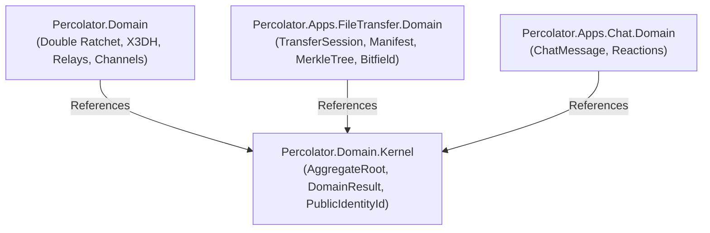

# Percolator.Domain.Kernel: Implementation & Migration Plan

## Refinement Status Gate
- [x] Lens 1: Scope & Feature Slice Framing (Status: Approved)
- [x] Lens 2: Onion Architecture & Primitive Obsession (Status: Approved)
- [ ] Lens 3: Threat Modeling & Security Posture (Status: In Progress)
- [ ] Lens 4: High-Value, Low-Brittle Unit Test Design (Status: Pending)
- [ ] Lens 5: Cross-Layer Infrastructure Alignment (Status: Pending)
- [ ] Implementation Gate: LOCKED (Requires Approval of Lenses 1-5 across plans)

---

## 1. Summary & Architectural Mandate

`Percolator.Domain.Kernel` is a pure, zero-dependency, foundational shared kernel library designed to eliminate circular and domain-on-domain coupling across Percolator's bounded contexts. 

Following strict Domain-Driven Design (DDD) principles:
- **Universal Foundational Abstractions**: Hosts *only* domain building blocks common across all aggregates (`AggregateRoot<TId>`, `IEntity<TId>`, `IDomainEvent`, `DomainResult`, `DomainError`, `IDateTimeProvider`, `ISensitiveSecret`) and universal cross-domain identity identifiers (`PublicIdentityId`).
- **Complete Decoupling**: Completely frees feature plugins (`Percolator.Apps.FileTransfer.Domain`, `Percolator.Apps.Chat`, etc.) from depending upon the core E2EE messaging domain (`Percolator.Domain`).
- **Zero Platform / Framework Dependencies**: Targets standard `net10.0` with reference *only* to `Percolator.SourceGenerators` (as a Roslyn compile-time analyzer/source generator). Zero references to ASP.NET Core, transport sockets, EF Core, SQLite, Protobuf, or `PluginSdk`.



---

## 2. Kernel Guardrails: Rules for AI & Human Contributors

> [!CAUTION]
> ### STRICT CONTRIBUTOR INSTRUCTION: AVOID "CONVENIENCE CREEP"
> **Do NOT add code to `Percolator.Domain.Kernel` simply because two projects need it, or because it is convenient.**
> 
> The Shared Kernel is an architectural hazard if left unpoliced. Every type added here creates an immutable coupling surface across every application and plugin in the repository.
> 
> **Explicit Inclusion Criteria (Must satisfy ALL 4):**
> 1. It is a fundamental DDD tactical pattern base contract (e.g. `AggregateRoot`, `DomainResult`).
> 2. It has zero business logic specific to any single application (no file transfer, no chat, no ratchet encryption).
> 3. It depends on nothing other than the C# BCL and `Percolator.SourceGenerators`.
> 4. It represents a universal domain concept shared by *every* participant in the mesh (e.g. `PublicIdentityId`).

### What Belongs in `Percolator.Domain.Kernel`
- `AggregateRoot<TId>` & `IAggregateRoot<TId>`
- `IEntity<TId>`
- `IDomainEvent`
- `DomainResult`, `DomainResult<T>`, and `DomainError`
- `IDateTimeProvider`
- `ISensitiveSecret` (zeroization interface)
- `PublicIdentityId` (the universal cryptographic persona identifier)

### What Strictly DOES NOT Belong in `Percolator.Domain.Kernel`
- **Zero Cryptographic Engines or Ratchets**: No X3DH, Double Ratchet, session keys, PreKey bundles, or curve math (belongs in `Percolator.Domain.Security`).
- **Zero Network / Transport Models**: No IP addresses, port numbers, endpoint candidates, or URIs (belongs in app feature domains or infrastructure).
- **Zero Storage / File Concepts**: No manifests, bitfields, file paths, hashes, or chunk slices (belongs in `Percolator.Apps.FileTransfer.Domain`).
- **Zero Channel / Chat Primitives**: No message IDs, reaction types, or delivery tokens (belongs in `Percolator.Domain` or `Percolator.Apps.Chat`).
- **Zero Application / Plugin SDK Contracts**: No `IAppPlugin`, `IAppIngressFilter`, serializers, or wire DTOs (belongs in `Percolator.PluginSdk`).

---

## 3. Concrete Kernel Project Specification

### 3.1 Project File (`Percolator.Domain.Kernel.csproj`)
```xml
<Project Sdk="Microsoft.NET.Sdk">

  <PropertyGroup>
    <TargetFramework>net10.0</TargetFramework>
    <ImplicitUsings>enable</ImplicitUsings>
    <Nullable>enable</Nullable>
    <RootNamespace>Percolator.Domain</RootNamespace>
  </PropertyGroup>

  <ItemGroup>
    <ProjectReference Include="..\Percolator.SourceGenerators\Percolator.SourceGenerators.csproj" 
                      OutputItemType="Analyzer" 
                      ReferenceOutputAssembly="false" />
  </ItemGroup>

</Project>
```

### 3.2 Types & File Layout
```
Percolator.Domain.Kernel/
├── README.md                          <- Contributor & AI guardrails
├── Common/
│   ├── IEntity.cs                     <- Interface IEntity<TId>
│   ├── IDomainEvent.cs                <- Interface IDomainEvent (EventId, OccurredOnUtc)
│   ├── AggregateRoot.cs               <- Abstract AggregateRoot<TId>, IAggregateRoot<TId>
│   ├── DomainError.cs                 <- readonly record struct DomainError(Code, Description)
│   ├── DomainResult.cs                <- readonly record struct DomainResult, DomainResult<T>
│   ├── IDateTimeProvider.cs           <- Interface IDateTimeProvider (UtcNow)
│   └── ISensitiveSecret.cs            <- Interface ISensitiveSecret (Zeroize())
└── Identities/
    └── PublicIdentityId.cs            <- [GuidId(GuidIdKind.CryptographicRandom)] struct
```

### 3.3 Root README.md (`Percolator.Domain.Kernel/README.md`)
Must be authored with the following exact text:
```markdown
# Percolator.Domain.Kernel

## Purpose
`Percolator.Domain.Kernel` provides the shared domain kernel for the Percolator architecture. It defines the foundational tactical DDD abstractions and universal identity tokens that must be shared across autonomous domain libraries without introducing domain-to-domain coupling.

## Contributor & AI Guardrails
**DO NOT ADD CODE HERE FOR CONVENIENCE.**
- This project must NEVER reference any other project except the compile-time `Percolator.SourceGenerators` analyzer.
- This project must NEVER contain feature logic (chat, file transfer, messaging, ratchet cryptography, relay routing).
- Any proposal to add a new type here must prove that the type is required by at least two completely independent domain bounded contexts and contains zero application-specific invariants.
```

---

## 4. Migration & Cutover Workflow

To safely extract `Percolator.Domain.Kernel` and update `Percolator.Domain`:

### Step 1: Create Kernel Project & Move Types
1. Create `Percolator.Domain.Kernel/Percolator.Domain.Kernel.csproj`.
2. Add project to `Percolator.sln`.
3. Move the following files from `Percolator.Domain/Common/` and `Percolator.Domain/Identities/ValueObjects/` into `Percolator.Domain.Kernel/`:
   - `Common/IEntity.cs`
   - `Common/IDomainEvent.cs`
   - `Common/AggregateRoot.cs`
   - `Common/DomainError.cs`
   - `Common/DomainResult.cs`
   - `Common/IDateTimeProvider.cs`
   - `Common/ISensitiveSecret.cs`
   - `Identities/ValueObjects/PublicIdentityId.cs`
4. Preserve namespaces (`namespace Percolator.Domain.Common` and `namespace Percolator.Domain.Identities.ValueObjects`) so that existing consumers require zero namespace refactoring.

### Step 2: Update `Percolator.Domain.csproj`
1. Add `<ProjectReference Include="..\Percolator.Domain.Kernel\Percolator.Domain.Kernel.csproj" />` to `Percolator.Domain.csproj`.
2. Delete the original local files from `Percolator.Domain/Common/` and `Percolator.Domain/Identities/ValueObjects/PublicIdentityId.cs`.

### Step 3: Verify Existing Test Suites Pass
1. Run `dotnet test Percolator.Domain.Tests\Percolator.Domain.Tests.csproj`.
2. Verify all 119 tests pass without compile errors or behavioral regressions.
3. Migrate existing `DomainResultTests.cs` and `GuidIdTests.cs` to a new lightweight test project `Percolator.Domain.Kernel.Tests` or reference `Kernel` in `Percolator.Domain.Tests`.

### Step 4: Update `FileTransfer.Domain` Plan
Update `Percolator.Apps.FileTransfer/domain-plan.md` to reference `Percolator.Domain.Kernel` rather than `Percolator.Domain`.

---

## 5. Kernel Unit Testing Matrix

| Test Suite | Target Invariant Under Test | Observable Verification | Low-Brittle Guarantee |
| :--- | :--- | :--- | :--- |
| `DomainResultTests` | `Success()` and `Failure(error)` factory behavior | `IsSuccess` / `IsFailure` booleans reflect state; `Value` throws `InvalidOperationException` on failure | Pure state assertions on result wrapper. |
| `AggregateRootTests` | Adding and clearing domain events on `AggregateRoot<TId>` | `DomainEvents` captures events in FIFO order; `ClearDomainEvents()` clears list | Asserts aggregate event queue behavior. |
| `PublicIdentityIdTests` | Source generator equality and deterministic formatting | `FromGuid` generates struct with `.Value`; equality holds across identical GUIDs; zero cast operators | Asserts generated value object contract. |
| `DomainErrorTests` | Empty error vs populated error | `DomainError.None.IsEmpty == true`; custom error preserves `Code` and `Description` | Validates error structure. |

---

## 6. Implementation Milestones

- **Milestone 1**: Author `Percolator.Domain.Kernel.csproj`, source files, and guardrail `README.md`.
- **Milestone 2**: Reference `Kernel` from `Percolator.Domain.csproj`, delete duplicates, and build solution.
- **Milestone 3**: Run `dotnet test Percolator.Domain.Tests` to verify green test suite (119 passing tests).
- **Milestone 4**: Update `Percolator.Apps.FileTransfer/domain-plan.md` to establish `Percolator.Apps.FileTransfer.Domain` as a standalone project referencing `Percolator.Domain.Kernel`.
