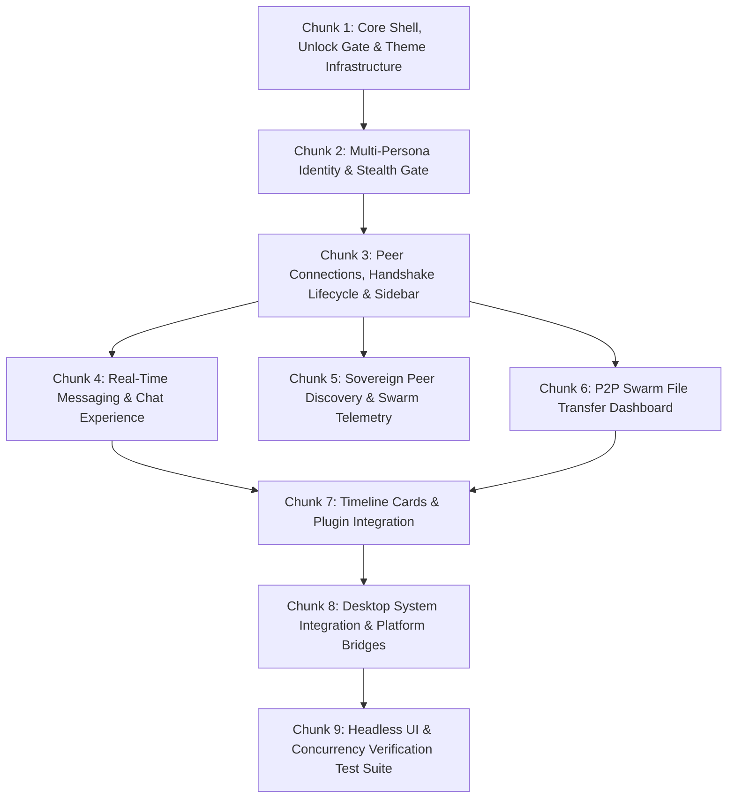

# Percolator.Desktop Implementation Plan

## 1. Executive Summary & Core Architectural Invariants

`Percolator.Desktop` is the cross-platform desktop UI for the Percolator peer-to-peer ecosystem, targeting **Windows, Linux, and macOS** using **Avalonia UI 11.2**, **FluentAvalonia 2.1**, **CommunityToolkit.Mvvm 8.4**, **R3 1.3.1**, **R3Extensions.Avalonia 1.3.1**, and **ObservableCollections.R3 3.3.4** on **.NET 10**.

### 1.1 Architectural & Security Invariants

1. **Two-Stage Container Architecture & Zero-Repository Pre-Unlock Gate**:
   * **Unified Encrypted SQLite (`percolator.db`)**: All application data resides in a single database encrypted with SQLCipher AES-256-CBC.
   * **Bootstrap Container (Root DI)**: On startup, `App.axaml.cs` builds a lightweight container hosting only core presentation and bootstrap infrastructure (`WindowManager`, `WindowHandoffCoordinator`, `ICryptoEngine`, `SystemDateTimeProvider`, and `IDatabaseUnlockCoordinator`). **Zero SQLite DbContexts, repositories, or background sync workers exist in memory.**
   * **Mandatory Unlock First Screen (`UnlockWindow`)**: The initial window presented on launch.
     * *First-Time Setup*: Guides user to create a master password and optional emergency duress passphrase. An empty master password (`""`) is supported, but triggers an explicit UI confirmation warning before creating the database.
     * *Subsequent Launches (Explicit Unlock)*: Always presents an empty password field requiring the user to explicitly click "Unlock" (even if the master password is blank).
     * *Duress Kill Switch & Decoy State*: Entering an established duress passphrase triggers cryptographic shredding of the header and SQLite database files, followed by immediate, seamless transition to an uninitialized first-launch setup view (decoy state) with zero forensic alerts or crash signatures.
   * **Canary Verification & Post-Unlock Migration**:
     * Derives a 256-bit key using Argon2id (3 iterations, 64 MB RAM, 4 lanes).
     * Validates passphrase with canary query `SELECT count(*) FROM sqlite_master;`.
     * On success, pending EF Core / SQLite migrations (`Database.MigrateAsync()`) execute immediately before any repositories are resolved.
   * **Authenticated Host (`IHost`)**:
     * Instantiates a child `IHost` containing `PercolatorDbContext`, all 57 repositories/query services, and background workers.
     * `await session.StartAsync()` automatically discovers and launches all registered `IHostedService` instances.
   * **Window Handoff & Relocking**:
     * `UnlockWindow` closes and `MainWindow` is resolved from `session.Services` and shown.
     * Locking triggers graceful `session.StopAsync()`, flushes connection pools via `SqliteConnection.ClearAllPools()`, zeroizes the key span via `CryptographicOperations.ZeroMemory`, disposes the authenticated `IHost`, closes `MainWindow`, and re-opens `UnlockWindow`.
2. **Total Network Stealth Startup Invariant**:
   * On launch, the application operates in **total network stealth**—zero sockets bound, zero UDP DHT packets, zero STUN probes, and zero gRPC listeners active.
   * Sockets bind **only after** database unlock and subsequent identity selection in `IdentityGateWindow`.
   * Session lock or deactivating all identities immediately terminates all listening sockets and tears down active network sessions, returning the application to stealth mode.
3. **Domain Purity & Presentation Model Isolation**:
   * `Percolator.Domain` is strictly isolated from UI dependencies (zero UI interfaces, zero dispatcher calls, zero snapshotting methods on domain entities).
   * All reactive UI models (`ChatMessageModel`, `PeerSessionSummaryModel`, `DiscoveredPeerModel`, `FileTransferTaskModel`, `TimelineCardModel`) live exclusively in `Percolator.Desktop.Features.*.Models`.
   * Presentation models implement `.ToSnapshot()` returning immutable C# `record` types for lock-free background reads, caching, and export.
4. **State Ownership Boundary (Stateful UI Services vs. Local ViewModels)**:
   * **Local State (Owned by ViewModels)**: Transient view state (input text, validation errors, accordion expansion, dialog visibility, scroll offsets) is private to the ViewModel.
   * **Shared State (Owned by Stateful UI Services)**: Cross-cutting application state (active identities, peer sessions, message queues, DHT discovery tables, swarm file transfers) is owned exclusively by singleton/scoped **Stateful UI Services** (`IdentityStateService`, `PeerConnectionStateService`, `ChatStateService`, `DiscoveryStateService`, `FileTransferStateService`, `TimelineCardStateService`).
   * Stateful UI Services are **100% UI-agnostic**—they operate on background worker threads, guard mutations with concurrency gates (`SemaphoreSlim`), and expose canonical `ObservableList<T>` / `ObservableDictionary<TKey, TValue>` collections.
5. **Strict R3 Reactive Programming Rules**:
   * **Avalonia Dispatcher Integration**: Configured in `Program.cs` via `.UseR3()`, wiring `AvaloniaDispatcherTimeProvider` and `AvaloniaDispatcherFrameProvider` into `ObservableSystem`.
   * **Filter Early, Marshal Late**: Perform filtering, deduplication, debounce, and sorting on background worker threads; only marshal to the UI thread at the terminal step via `.ObserveOn(AvaloniaSynchronizationContext.Current)`.
   * **Throttle the Firehose**: High-frequency streaming events (network packet rates, DHT search hops, file piece bitfields) must be sampled (`.Sample(TimeSpan.FromMilliseconds(16), _timeProvider)`) to protect the UI thread from 60fps+ inundation.
   * **Thread-Safety Collection Invariant**: Never enumerate UI-bound collections (`NotifyCollectionChangedSynchronizedViewList`) on background threads. Background threads must query the raw presentation list or take an immutable snapshot.
   * **Removal Disposal Pattern**: Every projected view created with `presentationList.CreateView(m => new ItemViewModel(m))` must explicitly observe item removal and dispose the projected ViewModel:
     ```csharp
     _view.ObserveRemove().Subscribe(e => e.Value.View.Dispose()).AddTo(ref Bag);
     ```
6. **Deterministic Virtualized Time Invariant**:
   * Replace all wall-clock `Task.Delay` and real-time timers with `System.TimeProvider`.
   * Enables instantaneous, deterministic unit and UI testing via `FakeTimeProvider` without wall-clock sleep delays.
7. **LRU-Cached DI Session Scoping (`SessionScopeFactory`)**:
   * To prevent memory bloat while preserving uncommitted message drafts and scroll positions, active conversation scopes are managed by an LRU cache (capacity 3–5).
   * Navigating away from a chat keeps its child `IServiceScope` hot in memory; opening a 6th conversation evicts and disposes the least recently used scope.
8. **Reactive Debounced Reload Coordination (`ReloadCoordinator`)**:
   * Network and database sync bursts are coalesced using debounced triggers (`50ms`) combined with `AwaitOperation.Drop` to guarantee that while a read query is in-flight, redundant requests are dropped and the latest state is captured in a single roundtrip.

---

## 2. Technology Stack & Component Architecture

| Layer | Component | Description |
|---|---|---|
| **Presentation Framework** | Avalonia UI 11.2 | Hardware-accelerated, cross-platform XAML engine |
| **Theme & Controls** | FluentAvaloniaUI 2.1 | Fluent Design System: Win11 NavigationView, ContentDialog, CommandBar |
| **Database Security Gate** | `IDatabaseUnlockCoordinator` | SQLCipher master key derivation, canary verification, and migration |
| **Session Lifecycle** | `IWindowHandoffCoordinator` | Orchestrates two-stage DI transition, window swap, and secure relock |
| **Privacy & Security** | `INetworkStealthGate` | Gated listener activation ensuring zero open ports until identity selection |
| **Iconography** | Segoe Fluent Icons + FiraCode Nerd Font | Fluent icons for general UX; embedded Nerd Font for P2P mesh & route telemetry |
| **Custom UI Primitives** | `PeerAvatar`, `StatusChip`, `Badge`, `ChatComposer`, `PieceMapControl` | Reusable custom controls for peer presence, route badges, notification pulse |
| **Session Scoping** | `SessionScopeFactory` | LRU-cached child DI scopes for active conversation ViewModels |
| **Data Synchronization** | `ReloadCoordinator` | Debounced reactive query batching with `AwaitOperation.Drop` |
| **MVVM Tooling** | CommunityToolkit.Mvvm 8.4 | Source-generated `[ObservableProperty]`, `[RelayCommand]` |
| **Reactive Pipelines** | R3 (v1.3.1) + R3Extensions.Avalonia (v1.3.1) | Next-generation reactive pipelines and Avalonia Dispatcher providers |
| **Collection Sync** | ObservableCollections.R3 (v3.3.4) | Synchronized collection projections and free-threaded `ObservableList<T>` |
| **Hosting & DI** | `Microsoft.Extensions.Hosting` | Two-stage dependency injection (`BootstrapHost` vs. `AuthenticatedHost`) |
| **Domain & App Core** | `Percolator.Domain`, `Percolator.Application`, `Percolator.PluginSdk` | Core messaging, cryptographic identities, session managers |
| **App Plugins** | `Percolator.Apps.Chat`, `Percolator.Apps.Discovery`, `Percolator.Apps.FileTransfer` | Modular P2P feature applications |

---

## 3. UI Directory Structure & Layout

```
Percolator.Desktop/
├── Assets/                               # Embedded resources & fonts
│   └── Fonts/
│       └── FiraCodeNerdFontMono-Regular.ttf
├── Common/
│   ├── Behaviors/                        # Badge.cs (attached properties for count & pulse)
│   ├── Controls/                         # NerdGlyph.cs, NerdIcon.cs, NerdIconSource.cs, PeerAvatar, StatusChip
│   ├── Converters/                       # IdentityHashToBrushConverter, RouteToColorConverter
│   ├── Navigation/                       # INavigationService.cs, NavigationService.cs, PageViewModelFactory
│   ├── Services/                         # NetworkStealthGate, DesktopIdentityKeyStore, SystemDateTimeProvider
│   └── Windowing/                        # IWindowManager.cs, WindowManager.cs, IWindowHandoffCoordinator.cs, WindowHandoffCoordinator.cs, IDialogWindow.cs
├── Features/
│   ├── Unlock/                           # Database Decryption & Master Passphrase Gate (First Screen)
│   │   ├── Models/                       # UnlockStateModel.cs
│   │   ├── ViewModels/                   # UnlockViewModel.cs
│   │   └── Views/                        # UnlockWindow.axaml
│   ├── IdentityGate/                     # Total Network Stealth Gatekeeper
│   │   ├── Models/                       # SelectableIdentityModel.cs
│   │   ├── ViewModels/                   # IdentityGateViewModel.cs, CreateIdentityDialogViewModel.cs
│   │   └── Views/                        # IdentityGateWindow.axaml, CreateIdentityDialog.axaml
│   ├── Shell/                            # Main Application Shell
│   │   ├── ViewModels/                   # MainWindowViewModel.cs, ShellNavigationItem.cs
│   │   └── Views/                        # MainWindow.axaml
│   ├── Sessions/                         # Peer Sessions, Handshakes & Connection Management
│   │   ├── Models/                       # PeerSessionSummaryModel.cs, PendingHandshakeModel.cs
│   │   ├── Services/                     # IPeerConnectionStateService.cs, PeerConnectionStateService.cs, SessionScopeFactory.cs
│   │   ├── ViewModels/                   # SessionsSidebarViewModel.cs, ConnectionManagementDialogViewModel.cs, PendingHandshakesMenuViewModel.cs
│   │   └── Views/                        # SessionsSidebarView.axaml, ConnectionManagementDialog.axaml, PendingHandshakesMenuView.axaml
│   ├── Chat/                             # Real-Time Messaging & Channels
│   │   ├── Controls/                     # ChatComposer.axaml, ReactionPickerFlyout.axaml
│   │   ├── Models/                       # ChatMessageModel.cs, ChatMessageSnapshot.cs, ConversationModel.cs
│   │   ├── Services/                     # IChatStateService.cs, ChatStateService.cs, ChatReloadCoordinator.cs
│   │   ├── ViewModels/                   # ChatViewModel.cs, ChatMessageViewModel.cs, GroupInvitationViewModel.cs
│   │   └── Views/                        # ChatView.axaml, GroupInvitationDialog.axaml
│   ├── Discovery/                        # Sovereign Peer Discovery & Telemetry
│   │   ├── Models/                       # DiscoveredPeerModel.cs, BlindedRendezvousModel.cs, SwarmTelemetryModel.cs
│   │   ├── Services/                     # IDiscoveryStateService.cs, DiscoveryStateService.cs
│   │   ├── ViewModels/                   # DiscoveryViewModel.cs, DiscoveredPeerItemViewModel.cs
│   │   └── Views/                        # DiscoveryView.axaml
│   ├── FileTransfer/                     # P2P Swarm File Sharing
│   │   ├── Controls/                     # PieceMapControl.axaml (bitfield canvas rendering)
│   │   ├── Models/                       # FileTransferTaskModel.cs, TransferBitfieldSnapshot.cs
│   │   ├── Services/                     # IFileTransferStateService.cs, FileTransferStateService.cs
│   │   ├── ViewModels/                   # FileTransferViewModel.cs, TransferTaskItemViewModel.cs
│   │   └── Views/                        # FileTransferView.axaml
│   ├── Timeline/                         # Plugin Timeline & Card Host
│   │   ├── Models/                       # TimelineCardModel.cs, TimelineActionModel.cs
│   │   ├── Services/                     # ITimelineCardStateService.cs, TimelineCardStateService.cs, DesktopTimelinePostSink.cs, DesktopPluginActionHandler.cs
│   │   ├── ViewModels/                   # TimelineViewModel.cs, TimelineCardViewModel.cs
│   │   └── Views/                        # TimelineView.axaml
│   └── Settings/                         # Identity, Network & Display Settings
│       ├── ViewModels/                   # SettingsViewModel.cs
│       └── Views/                        # SettingsView.axaml
├── ViewModels/
│   └── ViewModelBase.cs                  # ObservableObject + DisposableBag base class
├── App.axaml                             # Styles, FluentAvalonia theme, embedded fonts
├── App.axaml.cs                          # App bootstrap, R3 unhandled exceptions, DI composition root
├── Program.cs                            # Avalonia entry point with .UseR3()
└── Percolator.Desktop.csproj
```

---

## 4. Sequential Implementation Chunks



---

### Chunk 1: Core Shell, Unlock Gate, Navigation Framework & Theme Infrastructure

**Goal**: Establish the cross-platform application shell, theme switching, the mandatory pre-unlock `UnlockWindow`, the two-stage DI composition root, and the `WindowHandoffCoordinator`.

#### Tasks
- [x] Configure `Program.cs` with `.UseR3()`, `App.axaml`, and FluentAvalonia theme.
- [x] Link embedded Nerd Font definitions and declare `NerdFontFamily`.
- [x] Implement `NerdGlyph` enum, `NerdIcon` control, and `NerdIconSource` extending FluentAvalonia `FontIcon`.
- [x] Implement `StatusChip` and `PeerAvatar` controls with presence dot and hash-color palette.
- [x] Implement `Badge` attached behavior (notification count & pulse animation).
- [x] Implement `IWindowManager` with single-instance activation and child DI scope lifecycle.
- [ ] Implement `Features/Unlock/UnlockWindow.axaml` and `Features/Unlock/UnlockViewModel.cs`:
  - Interacts with `IDatabaseUnlockCoordinator`:
    - Calls `DetermineStatusAsync()` on load to toggle between First-Launch Setup and Subsequent Unlock modes.
    - Password entry field with show/hide password toggle.
    - Optional expandable Duress Passphrase field during first-time setup (validates non-empty/non-whitespace and distinct from master password).
    - Explicit blank password warning: If user leaves master password empty and clicks \"Unlock\" / \"Set Password\", present an explicit confirmation dialog (`ContentDialog` alert: *\"Using an empty password leaves your local SQLite database unencrypted at rest. Are you sure you want to proceed?\"*).
    - Asynchronous unlock execution with loading spinner (`IsBusy` state).
    - Evaluates `UnlockResult`:
      - `UnlockOutcome.Success`: delegates to `IWindowHandoffCoordinator.TransitionToAuthenticatedAsync(session)`.
      - `UnlockOutcome.DuressDecoyActivated`: delegates to `IWindowHandoffCoordinator.TransitionToDecoyFreshStateAsync()` (presenting a fresh uninitialized setup view).
      - `UnlockOutcome.InvalidPassphrase`: inline error alert displaying validation failures (*\"Invalid passphrase: could not decrypt percolator.db\"*).
- [ ] Implement `IWindowHandoffCoordinator` & `WindowHandoffCoordinator`:
  - `Task TransitionToAuthenticatedAsync(IAuthenticatedSession session)`:
    - Calls `await session.StartAsync()` (launching all registered `IHostedService` instances).
    - Resolves `MainWindow` from `session.Services`.
    - Updates `ApplicationLifetime.MainWindow = mainWindow`, displays `mainWindow.Show()`, and closes `unlockWindow`.
  - `Task TransitionToDecoyFreshStateAsync()`:
    - Executed upon `UnlockOutcome.DuressDecoyActivated`.
    - Smoothly transitions the UI back to the uninitialized First-Launch Setup view with zero error popups, alert badges, or forensic crash indicators.
  - `Task LockSessionAsync()`:
    - Deactivates network listeners via `INetworkStealthGate.DeactivateAsync()`.
    - Awaits `IDatabaseUnlockCoordinator.LockAsync()` (stopping `IHost`, clearing SQLite pools, zeroizing key span, disposing host).
    - Closes `MainWindow`, instantiates a fresh `UnlockWindow` from the root bootstrap container, and displays it.
- [ ] Configure Two-Stage DI Composition in `App.axaml.cs`:
  - Build `BootstrapContainer` containing logging, crypto engine, `SystemDateTimeProvider`, `WindowManager`, `WindowHandoffCoordinator`, `IDatabaseUnlockCoordinator`, and `UnlockViewModel`.
  - Configure `OnFrameworkInitializationCompleted()` to instantiate and display `UnlockWindow` as the initial application window.
- [ ] Implement `INavigationService` and `NavigationService`:
  - Target interface in `Common/Navigation/INavigationService.cs`:
    - `void NavigateTo(string pageKey, object? parameter = null);`
    - `void GoBack();`
    - `bool CanGoBack { get; }`
    - `Observable<string> CurrentPageKey { get; }`
  - Integration with `MainWindow.axaml` `NavigationView` and `Frame` control.
  - Page cache to prevent re-instantiating navigation pages when navigating between tabs.
- [ ] Implement `SettingsView.axaml` and `SettingsViewModel.cs`:
  - Dark / Light / HighContrast theme switcher utilizing `FluentAvalonia.Styling.FluentAvaloniaTheme`.
  - System accent color auto-detection and custom palette selector.
  - Diagnostic logging level selector (`Information`, `Debug`, `Trace`).
  - Master Password Change: allows changing master password via `IDatabaseUnlockCoordinator.ChangeMasterPasswordAsync(currentPassword, newPassword)`, performing an instantaneous O(1) envelope re-wrap without touching the SQLite database.
  - Emergency Duress Passphrase Configuration: allows setting, updating, or removing an emergency duress passphrase via `IDatabaseUnlockCoordinator.ConfigureDuressPasswordAsync(duressPassword)` within the active authenticated session. Enforces non-empty/non-whitespace validation.
- [ ] Refactor `MainWindow.axaml` & `MainWindowViewModel.cs`:
  - Bind `NavigationView.SelectedItem` cleanly to `NavigationService`.
  - Wire header status chip with live identity count and network state.
  - Add `LockSessionCommand` bound to the header lock button, delegating to `IWindowHandoffCoordinator.LockSessionAsync()`.

#### Verification
- Launching the app presents `UnlockWindow` without opening SQLite handles or binding network ports.
- Entering an incorrect passphrase displays an error without crashing.
- Entering the correct passphrase unlocks the database, runs migrations, launches `IHostedService` workers, opens `MainWindow`, and closes `UnlockWindow`.
- Clicking "Lock" in `MainWindow` executes complete teardown (stops host, clears pools, zeroizes key) and returns to `UnlockWindow`.

---

### Chunk 2: Multi-Persona Identity Management & Stealth Mode Gate

**Goal**: Deliver the privacy gatekeeper ensuring total network stealth before identity activation, multi-persona selection, encrypted vault unlocking, and identity key creation (operating within the authenticated container).

#### Tasks
- [x] Implement `NetworkStealthGate` ensuring all network listener sockets remain unbound until identity confirmation.
- [x] Implement `IdentityGateWindow.axaml` and `IdentityGateViewModel.cs` initial startup window.
- [x] Wire user confirmation to transition into `MainWindow`.
- [ ] Implement `ActiveIdentityContext`:
  - Tracks currently active `PublicIdentityId` instances selected for the desktop session.
  - Exposes reactive stream `Observable<IReadOnlyList<PublicIdentityId>> ActiveIdentitiesChanged`.
  - Provides thread-safe lookup for currently active signing and prekey credentials.
- [ ] Implement `IIdentityStateService` / `IdentityStateService`:
  - Manages cached local identity profiles and cryptographic key metadata.
  - Synchronizes with `IIdentityProfileRepository` and `ILocalIdentityKeyStore` within the decrypted database.
  - Exposes `ObservableList<SelectableIdentityModel> AvailableIdentities`.
- [ ] Refactor `CreateIdentityDialog.axaml` and `CreateIdentityDialogViewModel.cs`:
  - Dedicated modal dialog spawned via `IWindowManager.ShowDialogAsync<CreateIdentityDialogViewModel, PublicIdentityId?>()`.
  - Input fields: Display name, Persona role (`UserPersona`, `RelayOperator`, `Bot`), Optional seed phrase import.
  - Real-time input validation: Non-empty name, valid BIP-39 mnemonic phrase if importing.
- [ ] Encrypted Keystore Passphrase Unlock:
  - Argon2id / AES-GCM passphrase derivation to unlock identity private keys stored on disk.
  - Failed attempt lockout / rate-limiting indicator.

#### Verification
- Headless test confirms zero sockets are opened or probed when `IdentityGateViewModel` is instantiated.
- Selecting 2 identities and confirming activation invokes `INetworkStealthGate.ActivateAsync(selected)` with exact IDs.
- Creating a new identity persists both the keypair in `ILocalIdentityKeyStore` and the profile in `IIdentityProfileRepository`.

---

### Chunk 3: Peer Connections, Handshake Lifecycle & LRU Session Scoping

**Goal**: Implement the left sidebar session list, P2P connection workflows (invitation token import/export, direct vs relay dialing), inbound handshake queue (Accept/Reject/Burn), and bounded LRU session scopes.

#### Tasks
- [ ] Presentation Models in `Features/Sessions/Models/`:
  - `PeerSessionSummaryModel`: `SessionId`, `PeerIdentityId`, `DisplayName`, `AvatarBrush`, `LastMessagePreview`, `LastMessageTimestamp`, `UnreadCount`, `RouteType` (`Direct` vs `Relayed`), `PresenceStatus`.
  - `PendingHandshakeModel`: `HandshakeId`, `InitiatorIdentityId`, `DisplayName`, `ProposedAtUtc`, `RouteHint`, `IsRelayed`.
- [ ] `IPeerConnectionStateService` / `PeerConnectionStateService`:
  - Bridges to `IPeerContactQueryService`, `IPendingHandshakeRepository`, and `IHandshakeService`.
  - Exposes canonical `ObservableList<PeerSessionSummaryModel> Sessions` and `ObservableList<PendingHandshakeModel> PendingHandshakes`.
  - Mutated concurrently from background events via `SemaphoreSlim` gate.
- [ ] `PeerConnectionReloadCoordinator`:
  - Debounces incoming contact/handshake triggers by `50ms` using `AwaitOperation.Drop` to coalesce SQLite query roundtrips.
- [ ] `SessionScopeFactory`:
  - Manages child `IServiceScope` instances for active conversation tabs.
  - LRU cache with capacity = 5.
  - Evicts and disposes the least recently used `IServiceScope` and its `ChatViewModel` when capacity is exceeded.
- [ ] `ConnectionManagementDialog.axaml` & `ConnectionManagementDialogViewModel.cs`:\n  - Out-of-band invitation token generation and display (Base64 string + QR code render).
  - Invitation token decoder importing peer identity keys and route descriptors.
  - Multi-route connection initiator: Direct IP:Port vs. Relayed route via sovereign relay selection.
- [ ] `PendingHandshakesMenuView.axaml` & `PendingHandshakesMenuViewModel.cs`:
  - Notification badge attached behavior on handshakes icon in shell.
  - Inbound handshake list with Accept, Reject, and Burn (blacklist) commands.
- [ ] `SessionsSidebarView.axaml` & `SessionsSidebarViewModel.cs`:
  - Virtualized list of active conversations.
  - Live route indicator badge using `StatusChip` and `NerdIcon` (`DirectRoute` vs `RelayedRoute`).
  - Search filter box to filter contacts by display name or public key prefix.

#### Verification
- Importing an out-of-band invitation token decodes public key and route descriptor correctly.
- Accepting a pending handshake completes the session handshake workflow and adds a session to `SessionsSidebarView`.
- Navigating between 6 conversations evicts the 1st conversation's `IServiceScope`, triggering disposal of its subscriptions.

---

### Chunk 4: Real-Time Messaging & Chat Experience (`Percolator.Apps.Chat` Integration)

**Goal**: Deliver a high-performance, virtualized messaging interface integrating `Percolator.Apps.Chat`, supporting message composition, stepped bucket padding, reactions, message editing/tombstones, and media previews.

#### Tasks
- [ ] Presentation Models in `Features/Chat/Models/`:
  - `ChatMessageModel`: `MessageId`, `SessionId`, `SenderId`, `SenderDisplayName`, `ContentText`, `TimestampUtc`, `DeliveryStatus` (`Queued`, `Sending`, `Sent`, `Delivered`, `Read`, `Failed`), `IsOutgoing`, `IsEdited`, `IsDeleted`, `Reactions` (`ObservableList<ReactionModel>`), `Attachments` (`ObservableList<MediaAttachmentModel>`).
  - `ChatMessageSnapshot` immutable `record` for lock-free background reads, search indexing, and export.
- [ ] `IChatStateService` / `ChatStateService`:
  - Bridges `IChatService`, `IChatMessageQueryService`, and `IConversationListQueryService`.
  - Maintains `ConcurrentDictionary<Guid, ObservableList<ChatMessageModel>>` for open conversations.
  - Emits `Observable<ChatMessageModel> MessageReceived` and `Observable<MessageStatusUpdatedEvent> StatusChanged`.
- [ ] `ChatReloadCoordinator`:
  - Debounces message arrivals and receipt updates by `50ms` with `AwaitOperation.Drop` to prevent database lock contention during high-throughput message bursts.
- [ ] `ChatComposer.axaml` & `ChatComposer.axaml.cs`:
  - Dedicated custom control encapsulating chat input ergonomics.
  - Auto-expanding `TextBox` (1 to 6 lines max).
  - Keyboard handling: `Enter` sends message; `Shift+Enter` or `Ctrl+Enter` inserts newline.
  - Attachment button triggering file picker flyout.
  - Emoji reaction picker flyout.
- [ ] `ChatView.axaml` & `ChatViewModel.cs`:
  - Virtualized message list using `ListBox` / `ItemsRepeater` with smooth scroll-to-bottom on new messages.
  - Asymmetric message bubbles: Right-aligned accent bubble for outgoing messages; left-aligned surface bubble for incoming messages.
  - Message status icons: Single tick (Sent), Double tick (Delivered), Colored double tick (Read), Exclamation (Failed).
  - Message edit inline editor and tombstone (\"This message was deleted\") placeholder.
  - Reaction summary pills with click-to-toggle reaction.
  - Synchronous projection pipeline:
    ```csharp
    _messagesView = _chatState.GetOrAddMessages(sessionId).CreateView(m => new ChatMessageViewModel(m)).AddTo(ref Bag);
    _messagesView.ObserveRemove().Subscribe(e => e.Value.View.Dispose()).AddTo(ref Bag);
    Messages = _messagesView.ToNotifyCollectionChanged();
    ```

#### Verification
- Sending a message enqueues `SendMessageCommand` in `Percolator.Apps.Chat` and renders an outgoing bubble in `Queued` state.
- Inbound messages from `ChatIngressFilter` populate the message list on the UI thread without cross-thread exceptions.
- Rapidly receiving 50 messages triggers coalesced debounced reload via `ChatReloadCoordinator` without UI stutter.
- Closing a conversation tab disposes all child `ChatMessageViewModel` instances via `ObserveRemove`.

---

### Chunk 5: Sovereign Peer Discovery & Swarm Telemetry (`Percolator.Apps.Discovery` Integration)

**Goal**: Deliver a live peer discovery dashboard and network swarm inspector integrating `Percolator.Apps.Discovery`, showing candidate peers, NAT traversal status, roundtrip latency, and private blinded rendezvous.

#### Tasks
- [ ] Presentation Models in `Features/Discovery/Models/`:
  - `DiscoveredPeerModel`: `PeerId`, `DisplayName`, `Endpoint`, `NatTraversalStatus` (`DirectPublic`, `StunTraversed`, `RelayedOnly`), `RoundtripLatencyMs`, `DiscoveredViaRelayId`, `DiscoveredAtUtc`.
  - `BlindedRendezvousModel`: `CurrentEpochNumber`, `BlindedLocatorHex`, `NextEpochTransitionUtc`, `MatchedContactsCount`.
  - `SwarmTelemetryModel`: `ActivePeersCount`, `KnownRelaysCount`, `AverageLatencyMs`, `BandwidthInBps`, `BandwidthOutBps`.
- [ ] `IDiscoveryStateService` / `DiscoveryStateService`:
  - Bridges `INearbyPeerDiscoveryWorkflow`, `IPrivateRendezvousService`, and `IRelayPeerDirectory`.
  - Subscribes to DHT search events and candidate peer descriptors.
  - Throttles event stream using `.Sample(TimeSpan.FromMilliseconds(16), _timeProvider)` to protect the UI thread from high-frequency candidate packet bursts.
- [ ] `DiscoveryView.axaml` & `DiscoveryViewModel.cs`:
  - Live candidate peer cards with:
    - Peer public key preview and avatar color hash.
    - NAT status badge (`DirectPublic` = Green, `StunTraversed` = Blue, `RelayedOnly` = Orange).
    - Latency meter with `NerdIcon GlyphType=\"Latency\"`.
    - One-click \"Connect / Handshake\" action button triggering Step 2 on-demand prekey retrieval.
  - Blinded Rendezvous Panel:
    - Current 24-hr UTC epoch countdown timer.
    - Matched sovereign contacts count.
  - Sovereign Relay Selection dropdown allowing users to select which relay directory to query.

#### Verification
- High-frequency discovery stream (100 candidates/sec) is sampled down to 60fps without freezing the UI thread.
- Clicking \"Connect\" on a candidate invokes `INearbyPeerDiscoveryWorkflow` to retrieve the Signed PreKey and initiate the X3DH handshake.
- Latency updates update the UI reactively via `BindableReactiveProperty`.

---

### Chunk 6: High-Performance Swarm File Transfer Dashboard (`Percolator.Apps.FileTransfer` Integration)

**Goal**: Deliver a comprehensive swarm file transfer manager integrating `Percolator.Apps.FileTransfer`, featuring real-time chunk piece-map rendering, drag-and-drop file sharing, transfer rate limiters, and `IDesktopFileStorage` disk integration.

#### Tasks
- [ ] Presentation Models in `Features/FileTransfer/Models/`:
  - `FileTransferTaskModel`: `TransferId`, `FileName`, `TotalSizeBytes`, `TransferredSizeBytes`, `TransferProgress` ($0.0 \dots 1.0$), `TransferSpeedBps`, `EtaTimeSpan`, `SwarmPeersCount`, `Direction` (`Download` vs `Upload`), `Status` (`Queued`, `Transferring`, `Verifying`, `Paused`, `Completed`, `Failed`, `Canceled`).
  - `TransferBitfieldSnapshot`: Immutable snapshot of piece bitfield array for high-performance rendering.
- [ ] `IFileTransferStateService` / `FileTransferStateService`:
  - Bridges `IFileTransferQueryService`, `ITransferSessionRepository`, and `DiskChunkAssembler`.
  - Exposes `ObservableList<FileTransferTaskModel> ActiveTransfers` and `ObservableList<FileTransferTaskModel> CompletedTransfers`.
  - Rate-samples progress updates via `.Sample(TimeSpan.FromMilliseconds(50), _timeProvider)`.
- [ ] `PieceMapControl.axaml` & `PieceMapControl.axaml.cs`:
  - Custom Avalonia control rendering a graphical bitfield piece grid on an Avalonia `DrawingContext`.
  - Visual states: Empty cell (missing), Accent fill (downloaded & verified), Pulse amber (in-flight request).
  - Handles 10,000+ pieces efficiently via direct rectangle drawing operations without creating individual XAML visual elements.
- [ ] `FileTransferView.axaml` & `FileTransferViewModel.cs`:
  - Active transfers list with file icon, transfer speed meter (KB/s, MB/s), ETA timer, and swarm peer count badge.
  - Action buttons: Pause, Resume, Cancel, Open Containing Folder.
  - Send File Area: Drag-and-drop drop-target supporting Avalonia `DragDrop.DropEvent`.
  - File picker button integrated with Avalonia `TopLevel.StorageProvider`.
- [ ] Integration with `IDesktopFileStorage` (`PortableDesktopFileStore`):
  - Immediate zero-byte file allocation upon transfer acceptance.
  - `.percolator-part` staging and safe atomic rename on verification completion.
  - Path sanitization enforcing zero Win32 reserved device names (`CON`, `PRN`, `AUX`, `NUL`), zero NTFS alternate data streams (`:`), and Unicode Form C normalization.

#### Verification
- Dropping a 50 MB file onto `FileTransferView` creates a transfer manifest and stages the upload task.
- Accepting an inbound file offer creates the zero-byte target file and updates `PieceMapControl` dynamically as chunks arrive.
- Completed transfers rename `.percolator-part` staging files to target file names atomically and show \"Completed\" status.

---

### Chunk 7: Timeline Cards & Plugin Integration (`Percolator.PluginSdk`)

**Goal**: Deliver an extensible Timeline Card notification center and concrete Desktop adapters for `Percolator.PluginSdk` (`ITimelinePostSink` and `IPluginActionHandler`), allowing plugins to surface interactive cards and handle action callbacks.

#### Tasks
- [ ] Presentation Models in `Features/Timeline/Models/`:
  - `TimelineCardModel`: `CardId`, `SourceAppId`, `Title`, `SummaryText`, `IconGlyph`, `TimestampUtc`, `Metadata` (`IReadOnlyDictionary<string, string>`), `Actions` (`ObservableList<TimelineActionModel>`).
  - `TimelineActionModel`: `ActionId`, `ButtonText`, `CustomPayload`, `IsDestructive`, `Command`.
- [ ] `ITimelineCardStateService` / `TimelineCardStateService`:
  - Manages active timeline cards posted by plugins.
  - Exposes `ObservableList<TimelineCardModel> Cards`.
  - Concurrency-guarded methods for adding, updating, and dismissing cards.
- [ ] Concrete Desktop Adapters for `Percolator.PluginSdk`:
  - `DesktopTimelinePostSink` implementing `Percolator.PluginSdk.ITimelinePostSink`:
    - `PublishCardAsync(TimelineCardDto card, CancellationToken ct)`: Translates DTO to `TimelineCardModel` and pushes to `ITimelineCardStateService`.
    - `UpdateCardStatusAsync(Guid cardId, string newSummary, ...)`: Updates existing card content reactively.
    - `RemoveCardAsync(Guid cardId, CancellationToken ct)`: Dismisses card.
  - `DesktopPluginActionHandlerDispatcher` implementing `Percolator.PluginSdk.IPluginActionHandler`:
    - Dispatches card action button clicks back to the target plugin's registered action handler.
- [ ] `TimelineView.axaml` & `TimelineViewModel.cs`:
  - Feed of interactive cards with header, source app icon, summary text, metadata chips, and action buttons.
  - Dismiss button removing card from view and invoking `ITimelinePostSink.RemoveCardAsync`.
  - Badged notification count in main navigation header.

#### Verification
- Calling `ITimelinePostSink.PublishCardAsync` from a plugin displays a new interactive card in `TimelineView`.
- Clicking a card action button executes the command and invokes `IPluginActionHandler.HandleActionAsync` with matching payload.
- Dismissing a card removes it from the UI and invokes `RemoveCardAsync` cleanly.

---

### Chunk 8: Desktop System Integration, Tray Icon & Native Notifications

**Goal**: Provide native operating system desktop polish, including minimize-to-tray background listening, native OS notifications, and developer simulation mode.

#### Tasks
- [ ] System Tray Integration (`TrayIcon`):
  - Cross-platform system tray icon configured in `App.axaml`.
  - Context menu: \"Open Percolator\", \"Lock Session (Stealth)\", \"Exit\".
  - Window behavior: Minimize-to-tray on close when enabled in settings.
- [ ] Desktop Notifications:
  - Cross-platform in-app notification toasts (`FluentAvalonia.UI.Controls.InfoBar` banner or notification popup).
  - Platform bridge: Conditionally link `Percolator.Infrastructure.Windows` for Windows WinRT Toast notifications.
  - Fallback to native D-Bus notifications on Linux and Notification Center on macOS.
- [ ] Developer Interoperability Mode (`Development:AllowLocalhostPeers`):
  - Configuration flag allowing loopback `127.0.0.1` and `localhost` peer connections for integration with `Percolator.Simulator`.
  - Visual banner in title bar when developer mode is active.
- [ ] Window State Preservation:
  - Persist window position, width, height, and maximized state across restarts in encrypted local settings.

#### Verification
- Closing window with \"Minimize to tray\" enabled hides window to notification area without terminating background services.
- Clicking tray icon restores window to foreground.
- Inbound chat message triggers OS notification toast when window is not focused.

---

### Chunk 9: Headless UI & Concurrency Verification Test Suite

**Goal**: Establish an automated headless UI test project (`Percolator.Desktop.Tests`) using `Avalonia.Headless.XUnit` to verify ViewModels, stealth mode invariants, LRU scope eviction, and reactive reload coordinators without spinning up native OS windows.

#### Tasks
- [ ] Scaffold `Percolator.Desktop.Tests` project:
  - Package references: `Avalonia.Headless.XUnit`, `Microsoft.NET.Test.Sdk`, `xunit`, `FluentAssertions`, `NSubstitute`, `R3`.
  - Headless test bootstrap: `[assembly: AvaloniaTestApplication(typeof(TestAppBuilder))]`.
- [ ] Unlock & Two-Stage Lifecycle Headless Tests:
  - Test `UnlockViewModel`:
    - Assert `DetermineStatusAsync` correctly toggles `Uninitialized` vs `Locked` modes.
    - Assert blank password entry prompts confirmation dialog.
    - Assert invalid passphrase sets error message without crashing.
    - Assert valid passphrase calls `IWindowHandoffCoordinator.TransitionToAuthenticatedAsync`.
    - Assert duress passphrase triggers `IDuressWipeHandler.ExecuteWipeAsync()` and transitions cleanly to `TransitionToDecoyFreshStateAsync` without error popups.
  - Test `WindowHandoffCoordinator`:
    - Assert `TransitionToAuthenticatedAsync` awaits `session.StartAsync()`, opens `MainWindow`, and closes `UnlockWindow`.
    - Assert `TransitionToDecoyFreshStateAsync` resets UI to clean first-launch setup state.
    - Assert `LockSessionAsync` awaits `coordinator.LockAsync()`, closes `MainWindow`, and opens fresh `UnlockWindow`.
- [ ] Stealth Mode & Network Gate Verification Tests:
  - Assert zero network sockets are initialized upon test app startup.
  - Assert `INetworkStealthGate.ActivateAsync` is called only after `IdentityGateViewModel.ActivateSessionCommand.Execute()`.
  - Assert locking session triggers `INetworkStealthGate.DeactivateAsync()`.
- [ ] `SessionScopeFactory` LRU Cache Tests:
  - Simulate opening 6 consecutive chat sessions; verify the first session's `IServiceScope` is disposed and hot memory contains exactly 5 scopes.
- [ ] `ChatReloadCoordinator` Debounce & Drop Tests:
  - Using `FakeTimeProvider`, simulate 100 rapid reload triggers in 10ms; assert database read service is invoked exactly once after 50ms advance.
- [ ] Synchronized View Projection & Disposal Tests:
  - Verify `ObserveRemove` triggers `Dispose()` on projected ViewModel when item is removed from `ObservableList`.
- [ ] `DesktopTimelinePostSink` & `DesktopPluginActionHandler` Integration Tests:
  - Publish card, assert presence in `Cards` collection, trigger action command, assert payload delivery to handler.

#### Verification
- All headless tests run and pass via `dotnet test Percolator.Desktop.Tests` in < 5 seconds.
- Zero cross-thread exceptions or unhandled reactive exceptions thrown during test execution.

---

## 5. Port-to-Adapter Realization Matrix

This matrix maps all infrastructure ports and desktop adapters across their owning chunks, ensuring zero architectural disconnects between domain, infrastructure, plugins, and UI.

| Interface / Port | Layer / Source | Concrete Realization / Adapter | Chunk |
| :--- | :--- | :--- | :--- |
| `IDatabaseUnlockCoordinator` | Application Ports | `SqlCipherDatabaseUnlockCoordinator` (Infrastructure) | Chunk 1 |
| `IAuthenticatedSession` | Application Ports | `AuthenticatedSession` (Infrastructure) | Chunk 1 |
| `IMasterKeyProtector` | Application Ports | `MasterKeyProtector` (Infrastructure) | Chunk 1 |
| `IWindowHandoffCoordinator` | Desktop Windowing | `WindowHandoffCoordinator` | Chunk 1 |
| `INavigationService` | Desktop Shell | `NavigationService` | Chunk 1 |
| `IWindowManager` | Desktop Shell | `WindowManager` | Chunk 1 |
| `IDialogWindow<TResult>` | Desktop Shell | Implemented by dialog views | Chunk 1 |
| `INetworkStealthGate` | Desktop Core | `NetworkStealthGate` | Chunk 2 |
| `IDesktopIdentityKeyStore` | Desktop Core | `DesktopLocalIdentityKeyStore` | Chunk 2 |
| `IIdentityProfileRepository` | Domain Identities | `DesktopIdentityProfileRepository` (SQLite) | Chunk 2 |
| `ILocalIdentityKeyStore` | Domain Identities | `DesktopLocalIdentityKeyStore` (SQLite / DPAPI) | Chunk 2 |
| `IPeerConnectionStateService` | Desktop Sessions | `PeerConnectionStateService` | Chunk 3 |
| `IPeerContactQueryService` | Application Delivery | `SqlPeerContactQueryService` (Infrastructure) | Chunk 3 |
| `IPendingHandshakeRepository`| Domain Delivery | `SqlitePendingHandshakeRepository` | Chunk 3 |
| `IHandshakeService` | Application Handshake| `HandshakeService` | Chunk 3 |
| `IChatStateService` | Desktop Chat | `ChatStateService` | Chunk 4 |
| `IChatService` | Apps Chat | `ChatService` | Chunk 4 |
| `IChatMessageQueryService` | Apps Chat | `SqlChatMessageQueryService` (Infrastructure) | Chunk 4 |
| `IConversationListQueryService`| Apps Chat | `SqlConversationListQueryService` (Infrastructure)| Chunk 4 |
| `IDiscoveryStateService` | Desktop Discovery | `DiscoveryStateService` | Chunk 5 |
| `INearbyPeerDiscoveryWorkflow` | Apps Discovery | `NearbyPeerDiscoveryWorkflow` | Chunk 5 |
| `IPrivateRendezvousService` | Apps Discovery | `PrivateRendezvousService` | Chunk 5 |
| `IRelayPeerDirectory` | Apps Discovery | `SqliteRelayPeerDirectory` (Infrastructure) | Chunk 5 |
| `IFileTransferStateService` | Desktop FileTransfer| `FileTransferStateService` | Chunk 6 |
| `IFileTransferQueryService` | Apps FileTransfer | `FileTransferQueryService` | Chunk 6 |
| `ITransferSessionRepository` | Apps FileTransfer | `SqliteTransferSessionRepository` (Infrastructure)| Chunk 6 |
| `IDesktopFileStorage` | Apps FileTransfer | `PortableDesktopFileStore` (Infrastructure) | Chunk 6 |
| `ITimelineCardStateService` | Desktop Timeline | `TimelineCardStateService` | Chunk 7 |
| `ITimelinePostSink` | PluginSdk | `DesktopTimelinePostSink` | Chunk 7 |
| `IPluginActionHandler` | PluginSdk | `DesktopPluginActionHandlerDispatcher` | Chunk 7 |
| `IDateTimeProvider` | Domain Common | `SystemDateTimeProvider` | Chunk 1 |

---

## 6. Developer Tooling & Simulation Interoperability

Testing multi-peer network topologies, relays, and handshakes is handled by the standalone companion project **`Percolator.Simulator`** (see [`Percolator.Simulator/implementation-plan.md`](../Percolator.Simulator/implementation-plan.md)).

`Percolator.Desktop` contains **zero simulator code** or mock interceptors. To interoperate with the simulator during development, `Percolator.Desktop` supports a development flag:
* `Development:AllowLocalhostPeers: true` (or `--allow-localhost` CLI argument).
* When set, loopback `127.0.0.1` targets are permitted as valid peer endpoints without triggering production WAN stealth security rejections.
