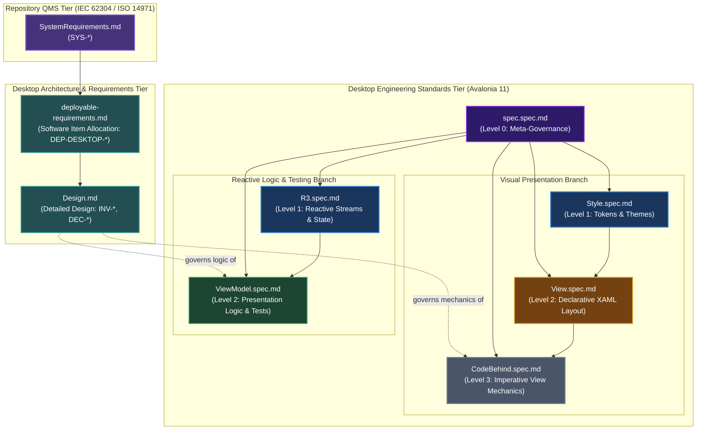
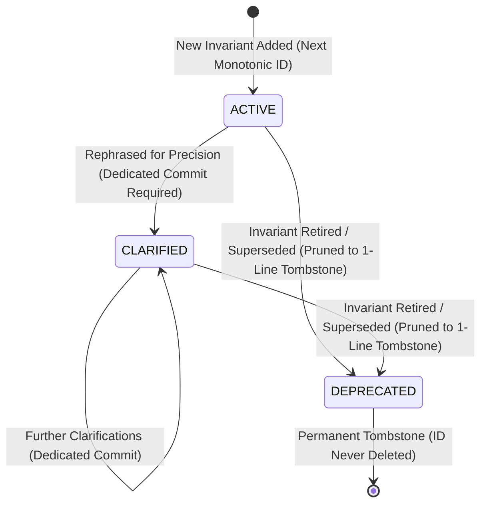

<!-- SPECIFICATION GOVERNANCE: Governed by Percolator.Desktop/spec/spec.spec.md -->

# Percolator.Desktop Specification Suite

This directory contains the authoritative, non-redundant engineering standards, QMS software item requirements, and detailed design governing presentation, styling, reactivity, and testing across `Percolator.Desktop`.

All specifications are governed by [`spec.spec.md`](./spec.spec.md) and adhere to a strict **Add-Only**, **Permanent Prefixed ID** architecture.

---

## 1. Specification Directed Acyclic Graph (DAG)

To preserve Onion Architecture and maintain strict bidirectional regulatory traceability (IEC 62304 Clauses 5.3 & 5.4, ISO 13485:7.3, FDA 21 CFR 820.30), **specifications form a strict Directed Acyclic Graph (DAG)**.

Specifications and design documents may only depend upon and reference specifications lower or inward in their dependency branch.



### The Decoupled Branch Rule (View vs. ViewModel Independence)
* **`View.spec.md` DOES NOT depend on `ViewModel.spec.md` ([META-004])**: XAML layout rules (compiled binding syntax, fluid grids, SplitView drawers, tokens) exist independently of how ViewModels are implemented or tested.
* **`ViewModel.spec.md` DOES NOT depend on `View.spec.md` or `Style.spec.md` ([META-004])**: ViewModels remain 100% UI-agnostic, with zero references to controls, pixels, or styling.
* **Meeting Point**: They only meet at runtime in source code via data binding, never at the specification dependency level.

---

## 2. Document Prefix Registry & Authoritative Domains

Every specification is assigned a permanent, collision-free prefix. All normative rules within that specification carry a permanent monotonic 3-digit ID ([META-005]):

| Prefix | Specification File | Authoritative Scope & Domain Responsibility | Governed File Patterns | Allowed Upstream DAG Dependencies |
| :--- | :--- | :--- | :--- | :--- |
| `DEP-DESKTOP-` | [`deployable-requirements.md`](./deployable-requirements.md) | Software Item requirements allocating system requirements (`SYS-*`) to the desktop deployable (IEC 62304 Clause 5.3). | Entire `Percolator.Desktop` project | `SystemRequirements.md` |
| `INV-`, `DEC-` | [`Design.md`](./Design.md) | Software detailed design, architectural invariants, container lifecycle, and localized decisions (IEC 62304 Clause 5.4). | Entire `Percolator.Desktop` project | `deployable-requirements.md`, `design-spec.md` |
| `META-` | [`spec.spec.md`](./spec.spec.md) | Meta-governance, RFC 2119/8174 conventions, DAG acyclicity, header formatting. | `spec/*.spec.md` | *(None - Root)* |
| `STYLE-` | [`Style.spec.md`](./Style.spec.md) | ControlThemes, cascading Styles, Fluent v2 tokens, geometry metrics, theme engines. | `Common/Styles/*.axaml`, `App.axaml` | `spec.spec.md` |
| `VIEW-` | [`View.spec.md`](./View.spec.md) | XAML Views, Windows, UserControls, DataTemplates, layout containers, SplitView drawers. | `Features/**/*.axaml`, `Views/**/*.axaml` | `spec.spec.md`, `Style.spec.md` |
| `CB-` | [`CodeBehind.spec.md`](./CodeBehind.spec.md) | View mechanics, focus handling, constructor DI, `Loaded`/`Unloaded` lifecycle, responsive size adaptations. | `Features/**/*.axaml.cs`, `Views/**/*.axaml.cs` | `spec.spec.md`, `View.spec.md` |
| `R3-` | [`R3.spec.md`](./R3.spec.md) | Reactive streams, `BindableReactiveProperty`, `SelectAwait`, collection synchronization, disposal lifetimes. | Any file using `R3` or `ObservableCollections.R3` | `spec.spec.md` |
| `VM-` | [`ViewModel.spec.md`](./ViewModel.spec.md) | MVVM presentation logic, CommunityToolkit commands, UI isolation, high-value low-brittle tests. | `Features/**/*ViewModel.cs`, `ViewModels/**/*.cs`, `tests/**/*.cs` | `spec.spec.md`, `R3.spec.md` |

---

## 3. The "Add-Only" Rule & Invariant Lifecycle

To prevent silent AI rule erosion, specifications are **strictly add-only** ([META-006]):



1. **`ACTIVE`**: Full normative requirement with paired MUST / MUST NOT invariants and micro-diffs.
2. **`CLARIFIED` ([META-007])**: Text rephrased for clarity or precision. Normative intent remains identical. **MUST be committed in its own isolated Git commit** (e.g. `docs(spec): clarify [CB-003] loaded lifecycle pairing`).
3. **`DEPRECATED` ([META-008])**: The invariant is retired or superseded. Its descriptive body and micro-diffs are deleted to conserve tokens, leaving a single-line tombstone stating the reason and any successor ID:
   ```markdown
   | [VIEW-005] | DEPRECATED | Superseded by [VIEW-012] (custom drawer replaced by native SplitView). |
   ```
4. **Never Deleted**: Invariant IDs are permanent and immutable. An ID once issued is never removed or reused.

---

## 4. Code Traceability Conventions

Source code, unit tests, commit messages, and pull request reviews cite permanent rule IDs to document compliance:

```csharp
// Complies with [CB-003] (Loaded/Unloaded pairing) and [VIEW-002] (SplitView overlay)
private void OnLoaded(object? sender, RoutedEventArgs e)
{
    PasswordInput.Focus();
}
```

---

## 5. Topological Feature Implementation Sequence

When implementing any vertical feature slice (e.g. `Features/Shell/`, `Features/Chats/`), write files in this strict sequence:

1. **Step 1: Presentation Models & State Services**:
   * Immutable records (`ChatMessageSnapshot`) and free-threaded background collections.
2. **Step 2: ViewModel & Unit Tests** (governed by [`ViewModel.spec.md`](./ViewModel.spec.md) & [`R3.spec.md`](./R3.spec.md)):
   * Implement ViewModel with constructor injection and anchored R3 subscriptions.
   * Write and verify state-based unit tests before writing UI markup.
3. **Step 3: Declarative View XAML** (governed by [`View.spec.md`](./View.spec.md) & [`Style.spec.md`](./Style.spec.md)):
   * Build XAML layout using compiled bindings (`x:DataType`), fluid grids, and Fluent v2 tokens.
4. **Step 4: Code-Behind Hooks** (governed by [`CodeBehind.spec.md`](./CodeBehind.spec.md)):
   * Add constructor injection (`DataContext = vm`) and pure view mechanics (focus, responsive drawer modes).

---

## 6. Change Impact Matrix

When updating a specification, audit all downstream files governed by that branch:

| If you modify... | Downstream Specs Affected | Production Files Requiring Audit |
| :--- | :--- | :--- |
| `deployable-requirements.md` | `Design.md`, `ViewModel.spec.md`, `CodeBehind.spec.md` | All files in `Percolator.Desktop` |
| `Design.md` | `ViewModel.spec.md`, `CodeBehind.spec.md` | Host lifecycle, stateful services, views |
| `spec.spec.md` (`META-`) | All specifications | All files in `Percolator.Desktop` |
| `Style.spec.md` (`STYLE-`) | `View.spec.md`, `CodeBehind.spec.md` | `App.axaml`, `Spacing.axaml`, all `*.axaml` views |
| `R3.spec.md` (`R3-`) | `ViewModel.spec.md` | `Program.cs`, all `*ViewModel.cs`, state services |
| `ViewModel.spec.md` (`VM-`) | *None* | `*ViewModel.cs` and test suites |
| `View.spec.md` (`VIEW-`) | `CodeBehind.spec.md` | All `*.axaml` views |
| `CodeBehind.spec.md` (`CB-`) | *None (Leaf)* | All `*.axaml.cs` files |

---

## 7. Governance Header Requirement

Every code file must declare its governing specification on Line 1. See [`spec.spec.md#2-mandatory-line-1-governance-headers`](./spec.spec.md) for the exact syntax for `.cs`, `.axaml`, and `.spec.md` files.
