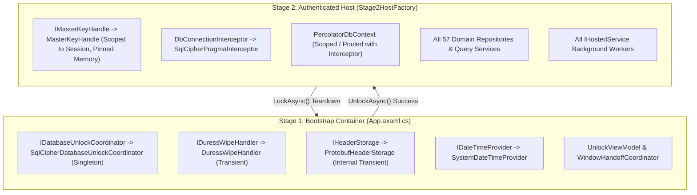

# Percolator Database Encryption & Authenticated Session Lifecycle Plan

## Refinement Status Gate
- [x] Lens 1: Scope & Feature Slice Framing (Status: Approved)
- [x] Lens 2: Onion Architecture & Primitive Obsession (Status: Approved)
- [x] Lens 3: Threat Modeling & Security Posture (Status: Approved)
- [x] Lens 4: High-Value, Low-Brittle Unit Test Design (Status: Approved)
- [x] Lens 5: Cross-Layer Infrastructure Alignment (Status: Approved)
- [ ] Implementation Gate: LOCKED (Awaiting Final User Confirmation to Begin Implementation)

---

## 1. Scope & Architectural Boundaries

### 1.1 In-Scope Capabilities
- **Single Unified Database (`percolator.db`)**: AES-256-CBC encryption via SQLCipher in Write-Ahead Logging (WAL) mode for all application data (identities, prekeys, ratchets, channels, messages, transfers, outbox).
- **Two-Stage Container Architecture (Option 2)**:
  - *Stage 1 (Bootstrap Container)*: Pre-unlock environment containing zero SQLite DbContexts, zero repositories, and zero background worker instances. Manages presentation bootstrap, logging, crypto primitives, time provider, and database unlock coordination.
  - *Stage 2 (Authenticated Host - `IHost`)*: Post-unlock environment hosting `PercolatorDbContext`, connection pools, all 57 domain repositories/query services, and `IHostedService` background workers.
- **Protobuf-Serialized Plausibly Deniable Header (`percolator.header`)**:
  - Binary header format using Protocol Buffers (`DatabaseHeader.proto`) compiled exclusively in `Percolator.Infrastructure`.
  - Contains an Argon2id salt and two fixed-size cryptographic slots: **Master Slot** and **Duress Slot**.
  - **Plausible Deniability Invariant**: When no duress password is set, the Duress Slot is filled with cryptographically secure random bytes of identical length. To forensic disk inspection, the header format and byte distribution are 100% indistinguishable regardless of whether a duress password is configured.
- **Optional Duress Passphrase & Instant Decoy Transition**:
  - Users can optionally establish a duress passphrase (cannot be empty or whitespace) during setup or update it later in authenticated Settings.
  - When the duress passphrase is typed at `UnlockWindow`, the system triggers an immediate **Crypto-Shredding Pipeline** destroying the header in $< 2\text{ ms}$ and smoothly transitions the UI to a **Decoy State (Fresh App)** without disk thrashing, error popups, or crash signatures.
- **$O(1)$ Master Password Envelope Re-Wrapping**:
  - Because the database encryption key $K_{\text{db}}$ is stored wrapped in the Master Slot using $K_{\text{master}} = \text{Argon2id}(\text{passphrase}, \text{salt})$, changing the master password in an authenticated session does **not** require re-encrypting the underlying SQLite database file (`PRAGMA rekey`).
  - Changing the master password is an instantaneous $O(1)$ operation: derive new $K_{\text{master}}$, re-encrypt the 32-byte $K_{\text{db}}$ with a fresh nonce, and atomically rewrite `percolator.header`. The duress slot remains completely intact.
- **Argon2id Key Derivation**: Derive 256-bit keys from passphrases using Argon2id ($m=64\text{ MB}$, $t=3\text{ iterations}$, $p=4\text{ lanes}$) salted with the 16-byte random salt from `percolator.header`.
- **Canary Validation**: Verify the derived master key on an isolated probe connection using `SELECT count(*) FROM sqlite_master;` before initializing EF Core or connection pools, explicitly trapping native error code 26 (`SQLITE_NOTADB`).
- **Dynamic Post-Canary Schema Migrations**: Execute EF Core / SQLite migrations (`Database.MigrateAsync()`) immediately post-canary prior to resolving application repositories.
- **Native SQLCipher Key Application**: Apply the 32-byte database encryption key directly via `SQLitePCL.raw.sqlite3_key` to unmanaged handles on connection open, eliminating managed string allocations of sensitive key material.
- **Explicit Unlock for Blank Passwords**: Support empty master password (`""`) with mandatory first-launch UI warning confirmation, and require explicit interaction ("Unlock" click) on every subsequent launch.
- **Orderly In-Session Relock & Memory Scrubbing**: Provide graceful teardown via `LockAsync`: stop all `IHostedService` instances, flush SQLite pools (`SqliteConnection.ClearAllPools()`), zeroize raw key bytes via `CryptographicOperations.ZeroMemory`, dispose `AuthenticatedHost`, and return UI to `UnlockWindow`.

### 1.2 Explicit Non-Goals (Negative Scope)
- **No Progressive Backoff Throttling**: Artificial login delay throttling is excluded; Argon2id memory-hardness ($64\text{ MB}, t=3, p=4$) provides consistent, deterministic computational cost without UI delay loops.
- **No Presentation Layer Business Logic**: All database unlocking, envelope decryption, key derivation, and wipe orchestration live in `Percolator.Application` and `Percolator.Infrastructure`. The `Percolator.Desktop` UI layer is strictly a thin presentation client.
- **No Disk Indicators of Duress Configuration**: No separate `duress.hash` or marker files on disk. The header schema and file size remain completely invariant.
- **No Multi-Database or Multi-Tenant Partitioning**: All domain aggregates share `percolator.db`. Multi-user tenancy or partitioned per-aggregate SQLite databases are excluded to avoid redundant KDF latency and complex distributed transactions.
- **No Cloud Escrow or Passphrase Recovery**: Zero server-side escrow or remote recovery mechanisms exist. If the user forgets their master passphrase, data cannot be recovered.
- **No Configurable KDF Algorithms**: Argon2id ($m=64\text{ MB}$, $t=3$, $p=4$) is strictly fixed. No runtime selection of legacy algorithms (PBKDF2, scrypt, bcrypt) is permitted.
- **No In-Memory SQLite Modes**: SQLCipher must operate against persistent disk files; in-memory database modes are excluded from production vault operation.
- **No Master Password Persistence**: The master passphrase is never cached on disk, DPAPI, or OS keychain without explicit user unlock.
- **No Repository Resolution in Bootstrap Container**: No repository or DbContext may be registered or resolved in the root DI container.

---

## 2. Cross-Layer Architecture & Strict Onion Boundaries

All dependencies point strictly inward toward `Percolator.Domain`. `Percolator.Application` has zero references to `Percolator.Infrastructure` or `Google.Protobuf`.

```
01 - Domain (Percolator.Domain):
└── Security/
    ├── ValueObjects/
    │   ├── VaultPassphrase.cs        # ISensitiveSecret: validated passphrase buffer with zeroization
    │   ├── DatabaseSetupStatus.cs    # State enum: Uninitialized, Locked, Unlocked
    │   └── UnlockResult.cs           # Polymorphic union: Success(session), DuressActivated, InvalidCredentials
    └── Ports/
        └── IMasterKeyHandle.cs       # Pure key wrapper: zero-allocation pragma application, ISensitiveSecret

02 - Application (Percolator.Application):
└── Ports/
    ├── IDatabaseUnlockCoordinator.cs # Primary driving port for vault lifecycle & session coordination
    ├── IAuthenticatedSession.cs      # Token/handle to Stage 2 container
    └── IDuressWipeHandler.cs         # Driven port: multi-phase crypto-shredding orchestrator

03 - Infrastructure (Percolator.Infrastructure):
├── Protos/
│   └── DatabaseHeader.proto          # Protobuf schema for twin-slot header (Infrastructure exclusive)
├── Vault/
│   ├── IHeaderStorage.cs             # Internal infrastructure port: reads/writes DatabaseHeader protobuf
│   ├── ProtobufHeaderStorage.cs      # Implements IHeaderStorage using DatabaseHeader.proto
│   ├── DuressWipeHandler.cs          # Implements IDuressWipeHandler (instant crypto-shredder)
│   ├── MasterKeyHandle.cs            # Implements IMasterKeyHandle (pinned memory, sqlite3_key provider)
│   └── SqlCipherDatabaseUnlockCoordinator.cs # Implements IDatabaseUnlockCoordinator
└── Persistence/
    ├── PercolatorDbContext.cs        # Stage 2 post-unlock EF Core DbContext
    ├── SqlCipherPragmaInterceptor.cs # Pooled connection interceptor (calls SQLitePCL.raw.sqlite3_key)
    └── Stage2HostFactory.cs          # Constructs Stage 2 IHost & executes Database.MigrateAsync

05 - Desktop (Percolator.Desktop):
├── Features/
│   ├── Unlock/
│   │   ├── UnlockWindow.axaml
│   │   ├── UnlockWindow.axaml.cs
│   │   └── UnlockViewModel.cs        # Thin presentation: delegates to IDatabaseUnlockCoordinator
│   ├── Setup/
│   │   ├── MasterPasswordSetupWindow.axaml
│   │   ├── MasterPasswordSetupWindow.axaml.cs
│   │   └── MasterPasswordSetupViewModel.cs
│   └── Settings/
│       ├── SettingsView.axaml
│       ├── SettingsView.axaml.cs
│       └── SettingsViewModel.cs      # Change master password & emergency duress configuration
└── Common/
    └── Windowing/
        └── WindowHandoffCoordinator.cs # Manages UnlockWindow -> MainWindow -> Decoy transitions
```

### 2.1 Protobuf Header Contract (`Percolator.Infrastructure/Protos/DatabaseHeader.proto`)

Compiled strictly inside `Percolator.Infrastructure` where `Google.Protobuf` is referenced:

```protobuf
syntax = "proto3";
package percolator.infrastructure;

message DatabaseHeader {
  int32 version = 1;
  bytes salt = 2;               // 16-byte random salt for Argon2id
  bytes master_slot_nonce = 3;  // 12-byte ChaCha20-Poly1305 nonce
  bytes master_slot_payload = 4;// Encrypted 32-byte master key + 16-byte Poly1305 tag
  bytes duress_slot_nonce = 5;  // 12-byte nonce (or random noise)
  bytes duress_slot_payload = 6;// Encrypted 32-byte sentinel + tag (or dummy random noise)
}
```

* **Slot Payload Sizing**: Both `master_slot_payload` and `duress_slot_payload` are exactly 48 bytes (32-byte plaintext + 16-byte Poly1305 auth tag).
* **Dummy Invariant**: If no duress password is configured, `duress_slot_nonce` (12 bytes) and `duress_slot_payload` (48 bytes) are filled with `RandomNumberGenerator.GetBytes(60)`. An adversary reading the Protobuf stream cannot distinguish active duress protection from dummy noise.

---

## 2.2 Domain Contracts & Value Objects (`Percolator.Domain.Security`)

### `VaultPassphrase` (`Percolator.Domain.Security.ValueObjects`)

A unified, memory-scrubbing passphrase wrapper that extracts UTF-8 spans directly into temporary buffers without leaving string or byte artifacts on the managed GC heap:

```csharp
namespace Percolator.Domain.Security.ValueObjects;

using System.Security.Cryptography;
using System.Text;
using Percolator.Domain.Common;

public sealed class VaultPassphrase : ISensitiveSecret
{
    private char[] _chars;
    public bool IsZeroized { get; private set; }
    public bool IsEmpty => _chars.Length == 0;

    private VaultPassphrase(char[] chars) => _chars = chars;

    public static VaultPassphrase Create(string? input) => 
        new(input?.ToCharArray() ?? Array.Empty<char>());

    public static VaultPassphrase Empty => new(Array.Empty<char>());

    /// <summary>
    /// Executes an action with the UTF-8 encoded bytes of the passphrase in a temporary stack/rented buffer,
    /// deterministically zeroizing the memory immediately upon completion.
    /// </summary>
    public void WithUtf8Span(Action<ReadOnlySpan<byte>> action)
    {
        ObjectDisposedException.ThrowIf(IsZeroized, this);
        int maxByteCount = Encoding.UTF8.GetMaxByteCount(_chars.Length);
        Span<byte> buffer = maxByteCount <= 256 ? stackalloc byte[maxByteCount] : new byte[maxByteCount];
        try
        {
            int written = Encoding.UTF8.GetBytes(_chars.AsSpan(), buffer);
            action(buffer[..written]);
        }
        finally
        {
            CryptographicOperations.ZeroMemory(buffer);
        }
    }

    /// <summary>
    /// Evaluates if two passphrases are identical in constant time.
    /// </summary>
    public static bool ConstantTimeEquals(VaultPassphrase a, VaultPassphrase b)
    {
        return a.WithUtf8Span(spanA =>
            b.WithUtf8Span(spanB =>
                CryptographicOperations.FixedTimeEquals(spanA, spanB)));
    }

    public void Zeroize()
    {
        if (IsZeroized) return;
        CryptographicOperations.ZeroMemory(MemoryMarshal.AsBytes(_chars.AsSpan()));
        _chars = Array.Empty<char>();
        IsZeroized = true;
    }

    public void Dispose() => Zeroize();
}
```

### `UnlockResult` (`Percolator.Domain.Security.ValueObjects`)

A clean polymorphic discriminated union modeling the outcome of an unlock attempt, eliminating temporal coupling and dangling nullable session properties:

```csharp
namespace Percolator.Domain.Security.ValueObjects;

using Percolator.Application.Ports;

public abstract record UnlockResult
{
    public sealed record Success(IAuthenticatedSession Session) : UnlockResult;
    public sealed record DuressActivated : UnlockResult;
    public sealed record InvalidCredentials : UnlockResult;
}
```

### `DatabaseSetupStatus` (`Percolator.Domain.Security.ValueObjects`)

```csharp
namespace Percolator.Domain.Security.ValueObjects;

public enum DatabaseSetupStatus
{
    Uninitialized = 0,
    Locked = 1,
    Unlocked = 2
}
```

### `IMasterKeyHandle` (`Percolator.Domain.Security.Ports`)

An in-memory key protector that applies the raw SQLite encryption key directly to database connections using `SQLitePCL.raw.sqlite3_key`, avoiding string allocations of sensitive key material:

```csharp
namespace Percolator.Domain.Security.Ports;

using System.Data.Common;
using Percolator.Domain.Common;

public interface IMasterKeyHandle : ISensitiveSecret
{
    /// <summary>
    /// Passes the raw 32-byte key span directly to SQLitePCL.raw.sqlite3_key.
    /// Never creates an immutable hex string in the managed GC heap.
    /// </summary>
    void ApplyKeyToConnection(DbConnection connection);

    /// <summary>
    /// Executes a callback with access to the raw 32-byte key span for O(1) envelope re-wrapping.
    /// </summary>
    void WithKeySpan(Action<ReadOnlySpan<byte>> action);
}
```

---

## 2.3 Application Ports (`Percolator.Application.Ports`)

### `IDatabaseUnlockCoordinator`

The primary application port exposed to presentation clients and daemon hosts. Notice that **zero infrastructure types** (Protobuf, SQLite, file streams) are present in this contract:

```csharp
namespace Percolator.Application.Ports;

using Percolator.Domain.Common;
using Percolator.Domain.Security.ValueObjects;

public interface IDatabaseUnlockCoordinator
{
    DatabaseSetupStatus Status { get; }

    /// <summary>
    /// Checks disk for existing header and database files to determine initial setup state.
    /// </summary>
    Task<DatabaseSetupStatus> DetermineStatusAsync(CancellationToken ct = default);

    /// <summary>
    /// Initializes new database with master passphrase and optional duress passphrase.
    /// Generates salt, derives master key, encrypts slots, verifies canary, runs initial migrations.
    /// </summary>
    Task<DomainResult<IAuthenticatedSession>> InitializeAsync(
        VaultPassphrase masterPassword, 
        VaultPassphrase? duressPassword = null, 
        CancellationToken ct = default);

    /// <summary>
    /// Evaluates candidate password against master slot and duress slot.
    /// Returns UnlockResult.Success(session), DuressActivated, or InvalidCredentials.
    /// </summary>
    Task<UnlockResult> UnlockAsync(
        VaultPassphrase candidatePassword, 
        CancellationToken ct = default);

    /// <summary>
    /// Updates the master password within an active authenticated session by re-wrapping the database key in the master slot.
    /// Does not require re-encrypting the underlying SQLite database file (O(1) operation).
    /// </summary>
    Task<DomainResult> ChangeMasterPasswordAsync(
        VaultPassphrase currentPassword, 
        VaultPassphrase newPassword, 
        CancellationToken ct = default);

    /// <summary>
    /// Sets, updates, or clears (if null or empty) the emergency duress passphrase within an active session.
    /// </summary>
    Task<DomainResult> ConfigureDuressPasswordAsync(
        VaultPassphrase? duressPassword, 
        CancellationToken ct = default);

    /// <summary>
    /// Gracefully stops workers, flushes connection pools, zeroizes master key, disposes AuthenticatedHost.
    /// </summary>
    Task LockAsync();
}
```

### `IDuressWipeHandler`
```csharp
namespace Percolator.Application.Ports;

public interface IDuressWipeHandler
{
    /// <summary>
    /// Executes instant cryptographic shredding:
    /// Overwrites percolator.header with random bytes and forces hardware disk flush (< 2 ms).
    /// Deletes percolator.header, percolator.db, percolator.db-wal, percolator.db-shm.
    /// Purges cached avatars, local attachments, and temporary staging stores.
    /// </summary>
    Task ExecuteWipeAsync(CancellationToken ct = default);
}
```

### `IAuthenticatedSession`
```csharp
namespace Percolator.Application.Ports;

public interface IAuthenticatedSession : IAsyncDisposable
{
    IServiceProvider Services { get; }
}
```

---

## 2.4 Internal Infrastructure Components (`Percolator.Infrastructure.Vault`)

Because physical disk layout, Protobuf serialization, and SQLite canary mechanics are purely concrete infrastructure details, their helper contracts remain internal to `Percolator.Infrastructure`:

### `IHeaderStorage` (Internal to `Percolator.Infrastructure.Vault`)
```csharp
namespace Percolator.Infrastructure.Vault;

using Percolator.Domain.Common;

internal interface IHeaderStorage
{
    /// <summary>
    /// Reads and deserializes percolator.header. Returns failure if file is missing or corrupted.
    /// </summary>
    Task<DomainResult<DatabaseHeader>> ReadHeaderAsync(CancellationToken ct = default);

    /// <summary>
    /// Atomically writes DatabaseHeader to percolator.header via temporary file flush and replace.
    /// </summary>
    Task<DomainResult> WriteHeaderAsync(DatabaseHeader header, CancellationToken ct = default);

    /// <summary>
    /// Overwrites percolator.header with random bytes before deleting it from disk.
    /// </summary>
    Task<DomainResult> OverwriteAndWipeAsync(CancellationToken ct = default);
}
```

---

## 3. Workflow Decomposition & Concrete Implementation Mechanics

### 3.1 ChaCha20-Poly1305 Slot Trials & Exception Control Flow
`SqlCipherDatabaseUnlockCoordinator` derives $K_{\text{cand}} = \text{Argon2id}(\text{passphrase}, \text{salt})$ exactly once, then evaluates the two 48-byte AEAD slots using BCL `System.Security.Cryptography.ChaCha20Poly1305`:

```csharp
// Each slot payload is 48 bytes: [0..32] ciphertext + [32..48] 16-byte Poly1305 tag
using var cipher = new ChaCha20Poly1305(derivedCandidateKey);
Span<byte> candidatePlaintext = stackalloc byte[32];

// 1. Evaluate Master Slot:
bool masterSuccess = false;
try
{
    cipher.Decrypt(
        header.MasterSlotNonce.Span, 
        header.MasterSlotPayload.Span[..32], 
        header.MasterSlotPayload.Span[32..], 
        candidatePlaintext);
    masterSuccess = true;
}
catch (AuthenticationTagMismatchException)
{
    // Tag mismatch: candidate key is not the master key
}

if (masterSuccess)
{
    // candidatePlaintext holds raw 32-byte Kdb
    return await CompleteMasterUnlockAsync(candidatePlaintext, ct);
}

// 2. Evaluate Duress Slot:
bool duressSuccess = false;
try
{
    cipher.Decrypt(
        header.DuressSlotNonce.Span, 
        header.DuressSlotPayload.Span[..32], 
        header.DuressSlotPayload.Span[32..], 
        candidatePlaintext);
    duressSuccess = true;
}
catch (AuthenticationTagMismatchException)
{
    // Active duress tag mismatch OR dummy random bytes failed authentication
}

if (duressSuccess && CryptographicOperations.FixedTimeEquals(candidatePlaintext, DuressSentinelBytes))
{
    await _wipeHandler.ExecuteWipeAsync(ct);
    Status = DatabaseSetupStatus.Uninitialized;
    return new UnlockResult.DuressActivated();
}

return new UnlockResult.InvalidCredentials();
```

### 3.2 Native Connection Keying & Researched Canary Validation
Instead of executing SQL `PRAGMA key = "x'...'"` with string interpolation, connection keying passes raw byte spans directly to native SQLCipher via `SQLitePCLRaw`:

```csharp
// SqlCipherPragmaInterceptor / CanaryProbe:
public static void KeyConnection(SqliteConnection connection, ReadOnlySpan<byte> key32Bytes)
{
    int rc = SQLitePCL.raw.sqlite3_key(connection.Handle, key32Bytes);
    if (rc != SQLitePCL.raw.SQLITE_OK)
    {
        throw new SecurityException($"SQLitePCL.raw.sqlite3_key failed with return code {rc}");
    }
}
```

#### Researched Canary Error Handling (`SQLITE_NOTADB` = 26)
When an invalid key is supplied, SQLCipher fails to decrypt page 1, failing SQLite's header magic check (`"SQLite format 3\000"`). SQLite does not define a `SQLITE_WRONGKEY` code; it throws `Microsoft.Data.Sqlite.SqliteException` with native error code **`26` (`SQLITE_NOTADB: "file is not a database"` or `"file is encrypted or is not a database"`)**:

```csharp
public async Task<bool> VerifyCanaryAsync(SqliteConnection connection, CancellationToken ct)
{
    await using var cmd = connection.CreateCommand();
    cmd.CommandText = "SELECT count(*) FROM sqlite_master;";
    try
    {
        await cmd.ExecuteScalarAsync(ct);
        return true;
    }
    catch (SqliteException ex) when (ex.SqliteErrorCode == 26) // SQLITE_NOTADB
    {
        return false;
    }
}
```

### 3.3 Instant Crypto-Shredding Pipeline (`DuressWipeHandler`)
Under coercion, multi-pass overwrites of large SQLite database files cause seconds of conspicuous disk latency that tips off an adversary. Because `percolator.db` is already AES-256 encrypted, shredding the 120-byte `percolator.header` renders the database permanently unrecoverable in $< 2\text{ ms}$:

```csharp
public async Task ExecuteWipeAsync(CancellationToken ct = default)
{
    var headerPath = GetPath("percolator.header");
    if (File.Exists(headerPath))
    {
        var fileInfo = new FileInfo(headerPath);
        long length = fileInfo.Length;

        // 1. Overwrite header with CSPRNG random bytes and force physical disk controller flush
        await using (var fs = new FileStream(headerPath, FileMode.Open, FileAccess.Write, FileShare.None, 4096, FileOptions.WriteThrough))
        {
            byte[] buffer = new byte[length];
            RandomNumberGenerator.Fill(buffer);
            await fs.WriteAsync(buffer, ct);
            fs.Flush(flushToDisk: true); // Triggers FlushFileBuffers / fsync

            // 2. Truncate to zero bytes
            fs.SetLength(0);
            fs.Flush(flushToDisk: true);
        }
        File.Delete(headerPath);
    }

    // 3. Immediately delete database and WAL files (all data is already unrecoverable ciphertext)
    var dbFiles = new[] { GetPath("percolator.db"), GetPath("percolator.db-wal"), GetPath("percolator.db-shm") };
    foreach (var path in dbFiles)
    {
        try
        {
            if (File.Exists(path)) File.Delete(path);
        }
        catch (IOException)
        {
            // Even if file deletion is blocked by OS lock, Kdb is already destroyed permanently
        }
    }

    // 4. Purge local cache and staging directories
    var cacheDir = GetPath("cache");
    if (Directory.Exists(cacheDir))
    {
        try { Directory.Delete(cacheDir, recursive: true); } catch (IOException) { }
    }
}
```

### 3.4 Master Password Update ($O(1)$ Re-Wrap Workflow)
1. User navigates to Settings $\rightarrow$ Security $\rightarrow$ *Change Master Password*.
2. User provides `currentPassword` and `newPassword`.
3. `ChangeMasterPasswordAsync`:
   - Validates `currentPassword` against active `IMasterKeyHandle` in the authenticated session.
   - Derives new $K_{\text{new\_master}} = \text{Argon2id}(\text{newPassword}, \text{header.Salt})$.
   - Uses `IMasterKeyHandle.WithKeySpan` to retrieve the active 32-byte $K_{\text{db}}$.
   - Re-encrypts $K_{\text{db}}$ using ChaCha20-Poly1305 under $K_{\text{new\_master}}$ with a fresh 12-byte nonce.\n   - **Duress Slot Preservation**: Because `header.Salt` is retained, the existing duress slot remains 100% valid without requiring the user to re-enter their duress passphrase!
   - Atomically overwrites `percolator.header` via `IHeaderStorage`.
   - Zeroizes temporary keys via `ISensitiveSecret.Zeroize()`.
   - **Performance Guarantee**: Because $K_{\text{db}}$ remains identical, zero SQLite tables or pages are rewritten. Operation completes in $< 200\text{ ms}$ with zero risk of database corruption.

---

## 4. Threat Model & Security Posture (Lens 3)

| Threat / Vulnerability | Concrete Protocol Defense | Verification Mechanism |
| :--- | :--- | :--- |
| **Forensic Plausible Deniability** | **Twin-Slot Layout**: Both Master and Duress slots are fixed at exactly 48 bytes (32-byte payload + 16-byte Poly1305 tag). When duress is inactive, the slot is filled with uniform CSPRNG random bytes. No flags, hashes, or boolean markers exist on disk. | Cryptographic wire invariant unit test asserts identical serialized message structure and payload length; candidate key trial against dummy slot throws `AuthenticationTagMismatchException`. |
| **SSD Wear-Leveling & Remanence** | **Instant Key Envelope Destruction**: `percolator.db` is encrypted with the 32-byte AES-256 key $K_{\text{db}}$. Overwriting the 120-byte `percolator.header` with hardware flush (`flushToDisk: true`) permanently destroys $K_{\text{db}}$ in $< 2\text{ ms}$, rendering all physical NAND blocks unrecoverable without observable disk latency. | Unit test executes `ExecuteWipeAsync`, asserting header is overwritten with random bytes and all files deleted. |
| **Timing Side-Channel Attacks** | **Single-KDF Pass**: Argon2id is computed exactly once per candidate attempt ($K_{\text{cand}}$). ChaCha20-Poly1305 trials on Master vs. Duress slots take sub-microsecond time. Sentinel verification uses `CryptographicOperations.FixedTimeEquals`. | Unit test verifies candidate key is derived only once; asserts constant-time equality evaluation. |
| **Coercion & Decoy Safety** | **Silent Decoy Transition**: Entering the duress passphrase executes shredding ($< 20\text{ ms}$) and immediately transitions the UI into a clean first-run setup window (`IdentityGateWindow`) without alerts or abnormal crash logs. | UI integration test verifies `UnlockResult.DuressActivated` transitions directly to decoy setup without crash signatures. |
| **Cold Restart Consistency** | **State Parity**: If the app process is terminated post-duress and restarted, the lack of `percolator.header` causes a cold launch to naturally boot into `DatabaseSetupStatus.Uninitialized`. | End-to-end test asserts fresh process boot displays first-time setup following a duress wipe. |
| **Process Memory Inspection** | **Native C-API Keying**: `MasterKeyHandle` passes raw 32-byte key spans directly to `SQLitePCL.raw.sqlite3_key`, preventing the 64-char hex key from materializing as an immutable GC string; scrubs RAM via `ZeroMemory` on lock. | Unit test asserts `MasterKeyHandle.Dispose()` zeroes the key span and marks the instance as disposed. |
| **Cross-Passphrase Collision** | **Domain Invariant**: Duress passphrase cannot match the master passphrase (`VaultPassphrase.ConstantTimeEquals`). | Unit test verifies `ConfigureDuressPasswordAsync` returns failure if duress passphrase matches master. |

---

## 5. High-Value Unit Testing Matrix (Lens 4)

| Test Scenario | Input / State | Expected Observable Behavior | Low-Brittle Guarantee |
| :--- | :--- | :--- | :--- |
| **Blank Password Setup & SQLCipher Enforcement** | `VaultPassphrase.Empty` (`""`) | Creates `percolator.header` with valid salt + encrypted master slot; raw unkeyed SQLite connection to `percolator.db` fails with native code 26 (`SQLITE_NOTADB`); unlocking with `VaultPassphrase.Empty` succeeds and returns active session | Verifies database is genuinely encrypted under SQLCipher even with a blank password |
| **Happy Path Master Unlock** | Correct master password | Unlocks master slot, canary probe succeeds, migrations execute, returns `UnlockResult.Success(session)` with operational service provider | Asserts observable session creation and service provider resolution |
| **Plausible Deniability Wire & Decryption Invariant** | Setup with master password only | Duress slot serialized wire size is identical (12-byte nonce + 48-byte payload); attempting decryption with any key throws `AuthenticationTagMismatchException`; bytes are non-zero | Tests structural wire parity and cryptographic failure invariants without brittle statistical entropy bounds |
| **Duress Shredding & File-Lock Fault Tolerance** | Valid duress password with OS file lock on `percolator.db` | Overwrites `percolator.header` with random bytes and flushes to disk in $< 2\text{ ms}$; catches secondary `IOException` on locked DB file without throwing; transitions status to `Uninitialized`; returns `UnlockResult.DuressActivated` | Verifies key destruction takes absolute precedence over secondary file deletion and survives external OS locks |
| **Invalid Passphrase Attempt** | Incorrect password | Fails both master and duress slot decryption; returns `UnlockResult.InvalidCredentials`; zero files modified or deleted | Asserts negative authentication result; verifies zero side-effects on disk |
| **Explicit SQLite Canary Error Verification** | Corrupted database file or invalid key | Canary probe traps `SqliteException` with `SqliteErrorCode == 26` (`SQLITE_NOTADB`) and returns controlled failure without crashing process | Directly tests researched native SQLite error code 26 trap |
| **In-Session Locking & Memory Zeroization** | Active authenticated session | Calling `LockAsync()` flushes connection pools (`ClearAllPools()`), marks `MasterKeyHandle.IsZeroized == true`, disposes host container, transitions status to `Locked`; subsequent calls to `IMasterKeyHandle` throw `ObjectDisposedException` | Asserts security invariant that unmanaged key memory is zeroized and post-lock access is strictly blocked |
| **Master Password Change & Duress Preservation** | Valid current master + New master | Re-wraps master slot with new key; underlying database remains readable; subsequent unlock requires new master password; **existing duress password still successfully triggers duress wipe** | Verifies envelope re-wrapping and duress slot retention across salt reuse |
| **Master Password Change Rejection** | Invalid current master + New master | Returns `DomainResult.Failure`; `percolator.header` remains byte-for-byte identical on disk; original master password remains valid | Asserts rejection and guarantees zero disk mutations on invalid current credentials |
| **Cross-Passphrase Collision Rejection** | Duress == Master password | `InitializeAsync` or `ConfigureDuressPasswordAsync` detects identical passphrases via constant-time comparison and returns `DomainResult.Failure`; header is untouched | Asserts domain invariant preventing ambiguous master/duress slot collisions |
| **Duress Clear in Session** | Active session clears duress (`null`) | Overwrites duress slot with CSPRNG noise; previous duress password returns `UnlockResult.InvalidCredentials` on subsequent attempt | Verifies duress deactivation wipes duress capability cleanly |
| **Corrupted / Truncated Header Trapping** | 0-byte or corrupted `percolator.header` | `DetermineStatusAsync` traps `InvalidProtocolBufferException` or invalid header lengths gracefully, returning structured failure without process crash | Asserts fault tolerance against disk corruption |
| **`VaultPassphrase` UTF-8 & Exception Zeroization** | Multi-byte Unicode (emojis `🔑🛡️`); callback throwing exception | Extracts exact UTF-8 byte span; `finally` block guarantees zeroization even when consumer delegate throws; post-dispose access throws `ObjectDisposedException` | Asserts memory hygiene and encoding correctness of core secret value object |

---

## 6. Cross-Layer Infrastructure Alignment (Lens 5)

### 6.1 Package & Assembly Tooling Alignment
- **Required NuGet Packages in `Percolator.Infrastructure.csproj`**:
  - `Microsoft.EntityFrameworkCore.Sqlite.Core` (v10.x): EF Core SQLite provider without pulling in bundled unencrypted SQLite.
  - `SQLitePCLRaw.bundle_e_sqlcipher` (v2.1.x+): Native SQLCipher C-library bundle and C-API bindings (`SQLitePCL.raw.sqlite3_key`).
  - `Konscious.Security.Cryptography.Argon2` (v1.3.x): Managed memory-hard Argon2id key derivation engine.
  - `Google.Protobuf` (v3.25.2, existing): Compiles `DatabaseHeader.proto`.
  - `Grpc.Tools` (v2.57.0, existing): Protobuf code generator.
- **Native SQLCipher Bootstrap Initialization**:
  - Executed in `InfrastructureServiceCollectionExtensions.AddBootstrapInfrastructure()`:
    ```csharp
    SQLitePCL.Batteries_V2.Init();
    ```
  - Initializes unmanaged SQLite provider hooks before any connection handles or canary probes are allocated.

### 6.2 Domain Kernel & Port Alignment
- **Result Type Standardization**: All application ports and infrastructure adapters standardize strictly on `Percolator.Domain.Common.DomainResult` and `DomainResult<T>` from `Percolator.Domain.Kernel`.
- **In-Memory Key Port Deprecation**:
  - Legacy references to `IMasterKeyProtector` / `MasterKeyProtector` across all plans are superseded by `Percolator.Domain.Security.Ports.IMasterKeyHandle` and `Percolator.Infrastructure.Vault.MasterKeyHandle`.
  - Eliminates managed string allocations by applying keys directly via `SQLitePCL.raw.sqlite3_key(connection.Handle, key32Bytes)`.
- **Unlock Result Representation**:
  - Legacy enum representations (`UnlockOutcome`) are superseded by the discriminated record union `Percolator.Domain.Security.ValueObjects.UnlockResult` (`Success(IAuthenticatedSession Session)`, `DuressActivated`, `InvalidCredentials`).
- **Protobuf Storage Encapsulation**:
  - `IHeaderStorage` is internal to `Percolator.Infrastructure.Vault`. `Percolator.Application` contains zero references to `Google.Protobuf` or `DatabaseHeader`.
- **Zero DPAPI Master Key Persistence**:
  - The vault master key $K_{\text{db}}$ is never persisted to disk or Windows DPAPI. It exists only in pinned memory via `IMasterKeyHandle` for the active duration of the authenticated session.

### 6.3 Two-Stage DI Registration & Container Boundaries



- **Stage 1 (Bootstrap Container)**: Zero DbContexts, zero repositories, zero background sync workers.
- **Stage 2 (Authenticated Host - `IHost`)**: Built post-canary inside `CompleteMasterUnlockAsync`. Instantiates `PercolatorDbContext`, binds `SqlCipherPragmaInterceptor`, executes `Database.MigrateAsync()`, and launches `IHostedService` instances upon `session.StartAsync()`.

### 6.4 Relocking & Teardown Lifecycle Flow

When `IDatabaseUnlockCoordinator.LockAsync()` is called:
1. `await _authenticatedHost.StopAsync()`: Gracefully halts all running `IHostedService` background workers.
2. `SqliteConnection.ClearAllPools()`: Forcibly closes and evicts all pooled unmanaged SQLite connections, releasing physical disk handles on `percolator.db`.
3. `_masterKeyHandle.Dispose()`: Invokes `CryptographicOperations.ZeroMemory` on the pinned 32-byte key buffer.
4. `await _authenticatedHost.DisposeAsync()`: Disposes the Stage 2 container and purges all repository instances from RAM.
5. `Status = DatabaseSetupStatus.Locked`: Updates coordinator state.
6. `WindowHandoffCoordinator` closes `MainWindow` and re-opens `UnlockWindow`.

### 6.5 Physical Disk Layout
- `%LocalAppData%/Percolator/percolator.header` (Protobuf header containing Argon2id salt + twin slots)
- `%LocalAppData%/Percolator/percolator.db` (AES-256-CBC encrypted SQLite database)
- `%LocalAppData%/Percolator/percolator.db-wal` (SQLite WAL journal)
- `%LocalAppData%/Percolator/percolator.db-shm` (SQLite shared memory index)
