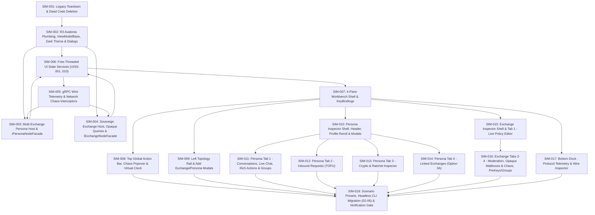

# Percolator.Simulator

Spec: [design-spec](../spec/design-spec.md) | UI Blueprint: [ui-design](ui-design.md) | MVVM & State Specs: [ViewModel.spec](../Percolator.Desktop/spec/ViewModel.spec.md), [UiStateService.spec](../Percolator.Desktop/spec/UiStateService.spec.md), [R3.spec](../Percolator.Desktop/spec/R3.spec.md), [View.spec](../Percolator.Desktop/spec/View.spec.md), [CodeBehind.spec](../Percolator.Desktop/spec/CodeBehind.spec.md)

> [!NOTE] Non-Regulatory Tooling Disclaimer
> `Percolator.Simulator` is an engineering developer tool, interactive relay-mediated protocol workbench, and headless integration test harness. It is **NOT** part of the formal medical device QMS (FDA 21 CFR 820.30 / IEC 62304) software item deliverables and does not contain `SYS-*` or `DEP-*` regulatory tags.

---

## 1. Purpose and Layer Boundary

`Percolator.Simulator` is a standalone, out-of-process developer workbench and integration-testing executable. Segregated from `Percolator.Desktop` so the production client contains zero simulator hooks or mock transports, it hosts multiple real, isolated Percolator **Sovereign Exchanges (Relays)** and **Pure-Client Personas** over authentic localhost/LAN TLS 1.3 HTTP/2 gRPC sockets within a single visual IDE-style Avalonia process or headless CLI runner.

- **In Scope:**
  - Multi-host lifecycle orchestration for Sovereign Exchanges (Kestrel HTTP/2 TLS 1.3 servers leasing canonical ports via `IPortReservationService`) and pure-client Personas (zero listening ports; real `OutboxDispatchHost` + `RelayMailboxDrainHost` + `DrainScheduler` background loops).
  - Multi-Exchange linking (Option 3A: `0..N` linked Exchanges per Persona with isolated Exchange-scoped conversations, blinded routing tokens, and drain streams).
  - Interactive 4-pane IDE workbench UI ([`ui-design.md`](ui-design.md)) enabling QA to manually exercise all relay-mediated Percolator features: 1:1 X3DH/Double Ratchet chat, TOFU moderation, rich chat actions (replies, edits, reactions, tombstones, disappearing message TTLs, encrypted blob attachments), profile/avatar sync & reroll, Group V2 epochs & member eviction, Exchange policy hot-reload & registration moderation, Exchange mailbox queue tamper chaos, Virtual Clock advancement, and global network chaos/pause.
  - Real wire-level gRPC telemetry interception, unencrypted fast SQLite per-node persistence, automated UI Scenario Presets, and headless `--replay` CLI execution for Scenarios `02`–`06`.
- **Out of Scope (Dropped from Active Codebase):**
  - Production desktop client code (`Percolator.Desktop`), direct P2P persona listening ports, mock cryptographic math engines (must execute real `SignalCryptoEngine` / `ZkgroupCryptographyService`), cross-node RAM peeking, and production SQLCipher unlock ceremonies.
  - Legacy Peer Discovery (`Features/DiscoverySimulation/*`, `Scenarios/07-peer-discovery.json`) and synthetic Swarm File Transfer (`Features/SwarmSimulation/*`, `Scenarios/08-swarm-file-transfer.json`) — cleanly deleted rather than retained as dead/peeking code (recoverable from git history if revisited later).

---

## 2. Architectural Invariants and Encapsulation

1. **`INV-SIMULATOR-PROCESS-SEPARATION` (True Process & Container Separation):** The production desktop client interacts with simulator-hosted Exchanges and Personas over real loopback or LAN TLS 1.3 gRPC sockets (`--allow-localhost`), never through in-process hooks or shared memory.
2. **`INV-SIMULATOR-HOST-ISOLATION` (Strict Per-Node Container & Zero RAM Peeking):** Each simulated Exchange or Persona executes inside its own isolated `IHost` / `WebApplication` with a dedicated scoped DI container and isolated SQLite database. Coordinators, hosts, and ViewModels MUST NEVER resolve another node's `IServiceProvider` or inspect another node's in-memory state (`_worldState.GetPersonaHost(...)` / `FindPersonaHostByIdentity(...)` cross-node lookups are prohibited); all inter-node interaction MUST traverse real gRPC/TLS sockets and Exchange mailboxes.
3. **`INV-SIMULATOR-PURE-CLIENT-PERSONA` (Zero Listening Ports on Personas):** Simulated Personas are strictly outbound pure clients (`OutboxDispatchHost` + `DrainScheduler`). Only Sovereign Exchanges bind Kestrel listening sockets, and they MUST lease ports via the canonical `IPortReservationService` (`5100–5199`) matching production client allocation semantics.
4. **`INV-SIMULATOR-OPAQUE-EXCHANGE` (Blind Relay Zero-Knowledge Boundary):** Exchange inspector views and query services MUST surface only opaque ciphertext metadata (`[EncryptedPackage: N bytes]`, blinded routing tokens, TTLs, OPK counts, group ledger epochs) and MUST NEVER attempt to decrypt envelopes or resolve Persona display names from Exchange state.
5. **`INV-SIMULATOR-FREE-THREADED-STATE` (UI-Agnostic State Services & Spec-Compliant MVVM):** All state shared across two or more ViewModels MUST live in free-threaded UI State Services adhering to [`UiStateService.spec.md`](../Percolator.Desktop/spec/UiStateService.spec.md) (`[UISS-001]`–`[UISS-010]`): zero `Avalonia.Threading` / `Dispatcher.UIThread` coupling, lock-protected state with out-of-lock `Subject<T>.OnNext` publication, `ISynchronizedView` / `ReadOnlyReactiveProperty<T>` projections, and deterministic `Dispose()`. All ViewModels MUST adhere to [`ViewModel.spec.md`](../Percolator.Desktop/spec/ViewModel.spec.md) (`[VM-001]`–`[VM-019]`) and [`R3.spec.md`](../Percolator.Desktop/spec/R3.spec.md) (`[R3-001]`–`[R3-014]`): zero Avalonia UI types, zero `IServiceProvider` injection, non-nullable constructor DI, `.ObserveOnUIThread()` + `.AddTo(ref Bag)`, and compiled XAML bindings (`[VIEW-001]`).
6. **`INV-SIMULATOR-DUAL-MODE` (Interactive Workbench & Headless Harness Parity):** Core protocol scenarios (Exchange provisioning, registration moderation, multi-exchange linking, 1:1 Double Ratchet chat, offline buffering, queue tamper chaos, rich chat + virtual clock, profile sync, Group V2 epochs/eviction) MUST execute through the same underlying `IPersonaNodeFacade` and `IExchangeNodeFacade` abstractions in both the interactive UI and the headless `--replay` CLI runner.

---

## 3. Key Technical Design Choices

1. **`DEC-OUT-OF-PROCESS-SIMULATOR` (Out-of-Process Segregation over In-App Simulator Hooks):**
   - *Mechanism:* Running the simulator as an independent executable eliminates mock transport hooks and DI bloat from `Percolator.Desktop`.
   - *Trade-Off:* Requires separate host bootstrapping in `Percolator.Simulator` in exchange for an uncompromised production security boundary.
   - *Rejected Alternative:* Embedding a simulator tab inside `Percolator.Desktop`, which distorts real socket behavior and leaks test harnesses into production builds.
2. **`DEC-REAL-STACK-EXECUTION` (Real Stack Execution over Mock Protocol Engines):**
   - *Mechanism:* Simulated nodes execute the real [`Percolator.Domain`](../Percolator.Domain/Design.md), [`Percolator.Application`](../Percolator.Application/Design.md), and [`Percolator.Infrastructure`](../Percolator.Infrastructure/Design.md) pipelines over localhost TLS 1.3 HTTP/2 gRPC.
   - *Trade-Off:* Slightly higher startup cost per node in exchange for testing authentic Protobuf framing, X3DH/Double Ratchet transitions, outbox retries, and concurrency gates.
   - *Rejected Alternative:* In-memory mock transport dispatchers that bypass wire serialization and mask real protocol bugs.
3. **`DEC-SIMULATOR-FAST-SQLITE-PERSISTENCE` (Unencrypted SQLite for Simulated Nodes):**
   - *Mechanism:* Configures `VaultStorageOptions { UseEncryption = false }` with node-scoped temp SQLite files so nodes boot in milliseconds while exercising full production EF Core relational schemas and CQRS read queries.
   - *Trade-Off:* Sacrifices SQLCipher key derivation coverage inside the simulator (covered separately by dedicated vault tests) to keep monkey-testing and CI scenarios fast.
   - *Rejected Alternative:* Running Argon2/PBKDF2 SQLCipher unlock ceremonies for every spawned persona.
4. **`DEC-SIMULATOR-UI-STATE-SERVICES` (Free-Threaded UI State Services over Ad-Hoc Event Bus):**
   - *Mechanism:* Replaces legacy `ISimulatorStateBus`, `ISelectionStateService`, `SimulatedWorldStateService` (`UiTaskRunner.PostToUi`), global RAM-peeking coordinators, and God-ViewModel polling with four cohesive, free-threaded UI State Services (`ISimulatorTopologyStateService`, `ISimulatorNetworkControlStateService`, `IProtocolTelemetryStateService`, `INotificationToastStateService`) governed by [`UiStateService.spec.md`](../Percolator.Desktop/spec/UiStateService.spec.md) and scoped node facades (`IPersonaNodeFacade`, `IExchangeNodeFacade`).
   - *Trade-Off:* Introduces thin facade interfaces over per-node `IHost` containers to completely eliminate `IServiceProvider` service-locator leaks (`[VM-004]`), cross-host RAM peeking, and UI-thread deadlocks (`[UISS-002]`, `[UISS-004]`), making every ViewModel and state service 100% pure in-memory unit-testable.
   - *Rejected Alternative:* Patching the legacy `ISimulatorStateBus` + `PersonaCardViewModel` (1,279 lines) + `WorkbenchView` pinned-cards grid, which creates cross-VM coupling hacks, leaks subscriptions, and directly contradicts [`ui-design.md`](ui-design.md).
5. **`DEC-SIMULATOR-GRPC-WIRE-INTERCEPTION` (Native gRPC Client/Server Interceptors for Telemetry & Chaos):**
   - *Mechanism:* Attaches lightweight gRPC `Interceptor` instances to each Persona's outbound channel factory and each Exchange's Kestrel `AddGrpc()` pipeline to enforce global pause, inject latency/jitter/drops, and emit structured wire telemetry events (RPC name, `Authenticated`/`Unauthenticated` pool, Protobuf metadata/hex preview, status) directly into `IProtocolTelemetryStateService`.
   - *Trade-Off:* Adds negligible per-RPC interception overhead in exchange for truthful, non-invasive wire inspection without polluting Domain/Application code.
   - *Rejected Alternative:* Scraping unstructured `ILogger` text strings into `LogDockView`, which cannot render structured Protobuf inspection drawers or distinguish gRPC channel pools.

---

## 4. Greenfield Implementation Plan & Jira Ticket Backlog

### 4.1 Architecture Overview & Dependency Graph

This is a **greenfield UI, state-layer, and facade rebuild** implementing [`Percolator.Simulator/ui-design.md`](ui-design.md) v2.1 using the production desktop MVVM and UI State Service architecture ([`ViewModel.spec.md`](../Percolator.Desktop/spec/ViewModel.spec.md), [`UiStateService.spec.md`](../Percolator.Desktop/spec/UiStateService.spec.md), [`R3.spec.md`](../Percolator.Desktop/spec/R3.spec.md), [`View.spec.md`](../Percolator.Desktop/spec/View.spec.md), [`CodeBehind.spec.md`](../Percolator.Desktop/spec/CodeBehind.spec.md)). **Zero unused legacy code is kept** (everything obsolete is deleted cleanly in `SIM-001` and relies on git history if ever needed).

### 4.2 Target State Service & Facade Map (Zero Cross-VM State Hacks)

Per `[UISS-001]`, a UI State Service is created **only** for state shared across $\ge 2$ ViewModels:

| UI State Service | Shared Consumers | Reactive Outputs (Read-Only) | Semantic Mutation Commands |
| :--- | :--- | :--- | :--- |
| `ISimulatorTopologyStateService` | Top Bar, Left Rail, MainWindow, Center Inspectors, Scenario Presets/CLI | `IReadOnlyObservableList<ExchangeSummary>`, `IReadOnlyObservableList<PersonaSummary>`, `ReadOnlyReactiveProperty<SelectedNodeRef?>`, `ReadOnlyReactiveProperty<bool> IsBusy` | `SpawnExchangeAsync(...)`, `SpawnPersonaAsync(...)`, `RemoveNodeAsync(...)`, `SelectNode(...)`, `ResetEnvironmentAsync()`, `TryGetPersonaFacade(id)`, `TryGetExchangeFacade(id)` |
| `ISimulatorNetworkControlStateService` | Top Bar (Chaos & Virtual Clock), gRPC Interceptors, Telemetry Dock, `SimulatedPersonaHost` / `SimulatedRelayHost` (`IDateTimeProvider`) | `ReadOnlyReactiveProperty<bool> IsTrafficPaused`, `ReadOnlyReactiveProperty<NetworkChaosProfile> ChaosProfile` (`LatencyMs`, `PacketDropPercent`, `JitterMs`), `ReadOnlyReactiveProperty<DateTimeOffset> VirtualUtcNow` | `ToggleTrafficPause()`, `SetChaosProfile(...)`, `ResetFaults()`, `AdvanceVirtualTimeAsync(TimeSpan)` |
| `IProtocolTelemetryStateService` | gRPC Interceptors, Outbox/Security Bridges, Bottom Dock, Scenario Assertions | `IReadOnlyObservableList<ProtocolTelemetryEvent>` (bounded ring buffer, 5,000 events), `Observable<ProtocolTelemetryEvent> EventRecorded` | `Record(ProtocolTelemetryEvent)`, `Clear()` |
| `INotificationToastStateService` | MainWindow Toast Overlay, Inspector VMs, Top Bar | `ReadOnlyReactiveProperty<ToastNotification?> ActiveToast` | `Show(title, message, severity)`, `Dismiss()` |

*Local-only ViewModel state* (active tab index, composer draft text, disappearing TTL selection, telemetry search query, unsaved policy form edits, open drawer state) stays strictly inside its owning ViewModel (`[UISS-001]`).

### 4.3 Headless JSON Scenarios (`02`–`08`) Migration & Feasibility Decision

| Scenario | Core Features Exercised | Feasibility | Plan / Disposition |
| :--- | :--- | :--- | :--- |
| **`02-relayed-stealth-and-chat.json`** | Exchange hosting, mailbox registration, prekeys, offline drain buffering, relayed handshake, TOFU approve, 1:1 chat | **Feasible (High)** | Migrate directly to `ISimulatorTopologyStateService` + `IPersonaNodeFacade` + `IExchangeNodeFacade` (`SIM-018`). |
| **`03-prekey-depletion.json`** | Exchange mailbox queue chaos (`FlipRelayEnvelopeBit`, `DuplicateRelayEnvelope`), unwrap tamper detection (`CORRUPTED`), OPK depletion & replenishment | **Feasible (High)** | Keep `IRelayQueueChaosController` on `SimulatedRelayHost` / `IExchangeNodeFacade`; expose `[Tamper Bit]` / `[Duplicate]` / `[Shuffle]` in Exchange Tab 3 for QA (`SIM-004`, `SIM-016`, `SIM-018`). |
| **`04-rich-chat-and-virtual-clock.json`** | Disappearing messages (`ExpireAfterSeconds`), emoji reactions, edits, tombstones, `AdvanceVirtualTime` (+120s) | **Feasible (High)** | Update JSON from `InitiateDirectHandshake` → `SpawnRelay` + `RegisterMailboxes` + `InitiateRelayedHandshake`. Move `RichChatActionCoordinator` methods into `IPersonaNodeFacade` (`SIM-003`). Expose disappearing TTL selector in Tab 1 (`SIM-011`) + Virtual Clock advance in Top Bar Chaos Popover (`SIM-008`). |
| **`05-advanced-chat-and-profiles.json`** | Encrypted avatar blind blob (`UploadBlindBlob`), padded profile upload, auto-share on approval, `RerollProfile` | **Feasible (High)** | Update JSON from `InitiateDirectHandshake` → `InitiateRelayedHandshake`. Move `ProfileSyncCoordinator` logic into `IPersonaNodeFacade` (reads own `IPeerContactRepository`, sends over gRPC; zero peer host RAM peeking). Expose `[Reroll Profile]` in Persona Header (`SIM-010`). |
| **`06-group-chat-and-epochs.json`** | Group V2 creation, group invites, group stream broadcast, offline catchup, member eviction (`Epoch E -> E+1`), forward secrecy, 25-msg flood | **Feasible (Medium-High)** | Update JSON from `InitiateDirectHandshake` → `InitiateRelayedHandshake`. Move group lifecycle/stream ownership into each Persona's `SimulatedPersonaHost` / `IPersonaNodeFacade`: Admin reads routing tokens from its own `IPeerMailboxRoutingRepository` (zero `_worldState` lookups), and remaining members react locally to `MemberLeft` `SystemNotice` to rotate their own SenderKeys! Expose `[+ New Group]`, Group chat, `[Evict Member]`, and `[Flood 25]` in Persona Tab 1 (`SIM-003`, `SIM-011`). |
| **`07-peer-discovery.json`** | `NearbyDiscoveryService` + `PrivateRendezvousRelayService` + `ConnectDiscoveredPeer` | **Retired (Path 1)** | Exchange-hosted stranger discovery and `PrivateRendezvous` are permanently retired (`relay-plan.md` Step 16 Part A) in favor of out-of-band `PeerInvitation` links and E2E Chat Peer Introductions (`INTRO-001`..`INTRO-003`). **Delete** `Features/DiscoverySimulation/*`, `07-peer-discovery.json`, and Discovery step/assertion records (`SIM-001`). |
| **`08-swarm-file-transfer.json`** | Synthetic multi-stream loopback TCP swarm transfer (`SwarmSimulationCoordinator`) & late downloader | **Drop Legacy / Rebuild After `FT-005`** | Legacy `SwarmSimulationCoordinator` is a hand-rolled loopback `TcpListener` simulator that peeks peer temp folders via `_worldState`. **Delete** legacy `Features/SwarmSimulation/*`, `08-swarm-file-transfer.json`, and Swarm step/assertion records in `SIM-001`; rebuild `08-swarm-file-transfer.json` on real Option 2 `DataChannelDotnet` ICE/DTLS/SCTP + `SwarmTrackerService` + optional `TransferPipe` in `FT-006` after inner-layer `FT-001`..`FT-005` complete. |

---

### Epic 1 — Foundation Reset, Legacy Teardown & Spec-Compliant Platform Plumbing

#### `SIM-001` — Delete Legacy Pinned-Card UI, Dead Coordinators, Direct-P2P & Unscoped Discovery/Swarm Code
- **Type:** Chore / Delete | **Priority:** P0 (Blocker) | **Dependencies:** None
- **Goal:** Establish a pure greenfield baseline with **zero dead or unplanned code** (git history preserves everything). Remove the obsolete pinned-card workbench UI, `ISimulatorStateBus` / `ISelectionStateService` / `UiTaskRunner`, `DesignDataService`, Direct P2P / Quick-Pair remnants, and dropped Discovery (`07`) / Swarm (`08`) subsystems.
- **Files to DELETE:**
  - Legacy Shell, State Bus & Card Views:
    - `Percolator.Simulator/Features/Shell/ContextualActionBarView.axaml` & `.axaml.cs` & `ContextualActionBarViewModel.cs`
    - `Percolator.Simulator/Features/Shell/WorkbenchView.axaml` & `.axaml.cs` & `WorkbenchViewModel.cs`
    - `Percolator.Simulator/Features/Shell/RosterTreeView.axaml` & `.axaml.cs` & `RosterViewModel.cs`
    - `Percolator.Simulator/Features/Shell/TopGlobalToolbarView.axaml` & `.axaml.cs` & `TopGlobalToolbarViewModel.cs`
    - `Percolator.Simulator/Features/Shell/DesignDataService.cs`
    - `Percolator.Simulator/Features/Shell/ISelectionStateService.cs`
    - `Percolator.Simulator/Features/Shell/ISimulatorStateBus.cs`
    - `Percolator.Simulator/Features/Shell/SimulatorEventBusExtensions.cs`
    - `Percolator.Simulator/Features/Shell/SimulatorStateSignal.cs`
    - `Percolator.Simulator/Features/Shell/IStatusToastService.cs` *(superseded by `INotificationToastStateService`)*
    - `Percolator.Simulator/Features/Shell/UiTaskRunner.cs` *(superseded by R3 `.ObserveOnUIThread()` + `[RelayCommand]`)*
    - `Percolator.Simulator/Features/Shell/CoalescedActionGate.cs` *(superseded by R3 `SelectAwait(..., AwaitOperation.Drop)`)*
    - `Percolator.Simulator/Features/Shell/SimulatedNodeSummary.cs` *(superseded by `ExchangeSummary` & `PersonaSummary`)*
  - Legacy Topology Cards, Flyouts & Cross-Host Coordinators:
    - `Percolator.Simulator/Features/Topology/PersonaCardView.axaml` & `.axaml.cs` & `PersonaCardViewModel.cs` & `PersonaCardDependencies.cs`
    - `Percolator.Simulator/Features/Topology/PersonaConnectPeerFlyoutViewModel.cs`
    - `Percolator.Simulator/Features/Topology/PersonaInvitationExportFlyoutViewModel.cs`
    - `Percolator.Simulator/Features/Topology/RelayRegistrationFlyoutViewModel.cs`
    - `Percolator.Simulator/Features/Topology/ISimulatedWorldStateService.cs` *(superseded by `ISimulatorTopologyStateService`)*
    - `Percolator.Simulator/Features/Topology/SimulatorAdvertisedHostKind.cs` & `SimulatorNetworkHelper.cs` & `SimulatorNotifyingAppRouterDecorator.cs`
    - `Percolator.Simulator/Features/RelayedChat/RelayCardView.axaml` & `.axaml.cs` & `RelayCardViewModel.cs`
    - `Percolator.Simulator/Features/RelayedChat/RemoteRelayHost.cs`
    - `Percolator.Simulator/Features/RelayedChat/RelayChatCoordinator.cs`
    - `Percolator.Simulator/Features/RelayedChat/RelayProvisioningCoordinator.cs`
    - `Percolator.Simulator/Features/RichChatAndProfiles/RichChatActionCoordinator.cs` *(logic moves onto `IPersonaNodeFacade` in `SIM-003`)*
    - `Percolator.Simulator/Features/RichChatAndProfiles/ProfileSyncCoordinator.cs` *(logic moves onto `IPersonaNodeFacade` in `SIM-003`)*
    - `Percolator.Simulator/Features/GroupMessaging/GroupChatCoordinator.cs` *(logic moves onto `IPersonaNodeFacade` in `SIM-003`)*
    - `Percolator.Simulator/Features/GroupMessaging/GroupPanelView.axaml` & `.axaml.cs` & `GroupPanelViewModel.cs`
  - Legacy Pairing, DirectChat, Unstructured Log Dock & FlightRecorder:
    - `Percolator.Simulator/Features/Pairing/QuickPairCoordinator.cs`
    - `Percolator.Simulator/Features/DirectChat/AutopilotPongResponder.cs`
    - `Percolator.Simulator/Features/DirectChat/ChatMessageItemViewModel.cs`
    - `Percolator.Simulator/Features/Logging/LogDockView.axaml` & `.axaml.cs` & `LogDockViewModel.cs`
    - `Percolator.Simulator/Features/Scenarios/FlightRecorderView.axaml` & `.axaml.cs` & `FlightRecorderViewModel.cs` & `FlightRecorderStateService.cs` & `IFlightRecorderStateService.cs`
  - Dropped Discovery & Swarm Features:
    - `Percolator.Simulator/Features/DiscoverySimulation/*` (entire folder)
    - `Percolator.Simulator/Features/SwarmSimulation/*` (entire folder)
    - `Percolator.Simulator/Scenarios/07-peer-discovery.json`
    - `Percolator.Simulator/Scenarios/08-swarm-file-transfer.json`
  - Obsolete Unit Tests:
    - `Percolator.Simulator.Tests/Topology/PersonaConnectPeerFlyoutViewModelTests.cs`
    - `Percolator.Simulator.Tests/Topology/PersonaInvitationExportFlyoutViewModelTests.cs`
    - `Percolator.Simulator.Tests/Topology/RelayRegistrationFlyoutViewModelTests.cs`
    - `Percolator.Simulator.Tests/Pairing/*` & `Percolator.Simulator.Tests/RelayedChat/*`
- **Files to MODIFY:**
  - `Percolator.Simulator/Features/Scenarios/Model/ScenarioStepDefinition.cs` & `ScenarioAssertionDefinition.cs` — prune `InitiateDirectHandshakeStep`, Discovery steps/assertions, and FileTransfer/Swarm steps/assertions.
  - `Percolator.Simulator/App.axaml.cs` & `ScenarioCliRunner.cs` — remove deleted service registrations so the solution builds incrementally alongside `SIM-002`–`SIM-007`.
- **Acceptance Criteria:**
  - [ ] Zero references remain to `ISimulatorStateBus`, `ISelectionStateService`, `UiTaskRunner`, `DesignDataService`, `PersonaCardViewModel`, `RelayCardViewModel`, `WorkbenchViewModel`, `ContextualActionBarViewModel`, `QuickPairCoordinator`, `DiscoverySimulation`, or `SwarmSimulation`.
  - [ ] Zero Direct P2P files or step types remain anywhere in `Percolator.Simulator/` or `Percolator.Simulator.Tests/`.

---

#### `SIM-002` — Platform Plumbing (`UseR3`), Spec-Compliant `ViewModelBase`, Dark IDE Theme & UI Service Abstractions
- **Type:** Architecture / Foundation | **Priority:** P0 (Blocker) | **Dependencies:** `SIM-001`
- **Goal:** Bring `Percolator.Simulator` to 100% parity with `Percolator.Desktop` specs (`[R3-001]`, `[VM-001]`, `[VM-002]`, `[VM-014]`, `[VM-016]`, `[VIEW-001]`, `[VIEW-004]`, `[VIEW-006]`) and define the Dark IDE Theme tokens from [`ui-design.md`](ui-design.md) §3.
- **Files to MODIFY:**
  - `Percolator.Simulator/Percolator.Simulator.csproj`:
    - Add `<AvaloniaUseCompiledBindingsByDefault>true</AvaloniaUseCompiledBindingsByDefault>` (`[VIEW-001]`).
    - Upgrade `R3` to `1.3.1` and add `R3Extensions.Avalonia` `1.3.1` (`[R3-001]`).
  - `Percolator.Simulator/Program.cs`:
    - Add `.UseR3()` to `AppBuilder` (`[R3-001]`).
  - `Percolator.Simulator/App.axaml`:
    - Merge `Theme/SimulatorDarkTheme.axaml` resource dictionary.
  - `Percolator.Simulator/App.axaml.cs`:
    - Register `ObservableSystem.RegisterUnhandledExceptionHandler(...)` (`[R3-001]`) forwarding to `ISimulatorLogSink` + `IProtocolTelemetryStateService`.
    - Register `TimeProvider.System` as singleton `TimeProvider` (`[VM-007]`, `[R3-012]`).
    - Resolve `MainWindow` via constructor injection (`MainWindow(MainWindowViewModel)` per `[CB-002]`).
  - `Percolator.Simulator/Features/Shell/ViewModelBase.cs`:
    - Inherit from `ObservableValidator, IDisposable` (`[VM-001]`, `[VM-016]`).
    - Expose `protected DisposableBag Bag;` and `public virtual void Dispose() => Bag.Dispose();`.
- **Files to CREATE:**
  - `Percolator.Simulator/Theme/SimulatorDarkTheme.axaml`:
    - Semantic `{DynamicResource}` color & brush tokens from [`ui-design.md`](ui-design.md) §3 (`BgCanvas #121418`, `BgSurface #1A1D24`, `BgSubtle #222630`, `BorderSubtle #2D323E`, `TextPrimary #E6EDF3`, `TextSecondary #8B949E`, `TextMonospace #7EE787`, `AccentPrimary #2F81F7`, `StatusActive #2EA043`, `StatusPending #D29922`, `StatusDanger #F85149`, `BadgeRelay #A371F7`), corner radius tokens (`CardCornerRadius`, `ControlCornerRadius`, `OverlayCornerRadius`), and monospace font resource.
  - `Percolator.Simulator/Platform/ISimulatorDialogService.cs` & `AvaloniaSimulatorDialogService.cs` (`[VM-014]`):
    - Strongly typed async dialog methods: `ShowAddExchangeDialogAsync()`, `ShowAddPersonaDialogAsync(IReadOnlyList<ExchangeOption>)`, `ShowShareInvitationDialogAsync(...)`, `ShowConnectToPeerDialogAsync(...)`, `ShowNewGroupDialogAsync(...)`, `ShowLinkExchangeDialogAsync(...)`, `ShowConfirmationAsync(title, message, confirmText)`.
  - `Percolator.Simulator/Platform/ISimulatorClipboardService.cs` & `AvaloniaSimulatorClipboardService.cs` (`[VM-002]`, `[CB-007]`).
  - `Percolator.Simulator/Platform/ISimulatorFilePickerService.cs` & `AvaloniaSimulatorFilePickerService.cs` (`[VM-002]`, `[CB-007]`).
  - `Percolator.Simulator/Platform/AvaloniaCollectionExtensions.cs` (`[VM-019]` `SynchronizationContext.Current != null` guard for `ToNotifyCollectionChanged`).
- **Acceptance Criteria:**
  - [ ] `Percolator.Simulator.csproj` builds with `AvaloniaUseCompiledBindingsByDefault=true` and `R3Extensions.Avalonia` v1.3.1.
  - [ ] `Program.cs` calls `.UseR3()` and `App.axaml.cs` registers `ObservableSystem.RegisterUnhandledExceptionHandler`.
  - [ ] All ViewModel unit tests instantiate `ViewModelBase` subclasses with zero Avalonia runtime dependencies.

---

### Epic 2 — Pure-Client Persona Host, Sovereign Exchange Host & Real Wire Telemetry

#### `SIM-003` — Multi-Exchange `SimulatedPersonaHost` (Option 3A) & Scoped `IPersonaNodeFacade`
- **Type:** Architecture / Host | **Priority:** P0 | **Dependencies:** `SIM-002`, `SIM-005`
- **Goal:** Remove all cross-node `_worldState` / `_stateBus` coupling from `SimulatedPersonaHost`, support **0..N linked Exchanges** (Option 3A) instead of a single `HomeRelay`, absorb all Direct/Rich/Profile/Group operations natively inside each Persona's own host (zero cross-node RAM peeking), and expose `IPersonaNodeFacade` so ViewModels never touch `IServiceProvider` (`[VM-004]`).
- **Files to MODIFY:**
  - `Percolator.Simulator/Features/Topology/ISimulatedPersonaHost.cs` & `SimulatedPersonaHost.cs`:
    - Remove `ISimulatedWorldStateService` and `ISimulatorStateBus` dependencies completely.
    - Remove single `HomeRelay` property; manage `0..N` linked Exchanges strictly through the Persona's own `IRelayDirectory` + `IRelayMailboxProvisioner`, each with its own `BlindedRoutingToken`, `DeliveryToken`, `MailboxDrainToken`, and `DrainScheduler` stream status.
    - Remove legacy `_stateBus.Signals.Where(RelayQueueChanged)` drain hack — rely exclusively on the production `DrainScheduler` / `RelayMailboxDrainHost` continuous streaming loop.
    - Wire `SimulatorGrpcTelemetryClientInterceptor` + `NetworkControlGrpcInterceptor` (`SIM-005`) into outbound gRPC channel construction.
    - Bridge node-local domain events (`IEventSubscriber`: message received, inbound contact request, group epoch/member notice, ratchet change, outbox failure) into a node-local `Observable<PersonaDomainEvent>` and forward security/outbox trace items to `IProtocolTelemetryStateService`.
    - **Own-Container Rich Chat, Profile Reroll & Group V2 Operations (replacing deleted global coordinators):**
      - `RerollProfileAsync(...)` uploads encrypted avatar blob + padded profile to each linked Exchange and sends `ShareProfileCapability` to established contacts in this Persona's *own* `IPeerContactRepository` over gRPC (zero peer host RAM lookups).
      - `CreateGroupAsync(...)`, `AcceptGroupInviteAsync(...)`, `DeclineGroupInviteAsync(...)`, `SendGroupMessageAsync(...)`, `FloodGroupMessagesAsync(...)`, `AddGroupMemberAsync(...)`, `EvictGroupMemberAsync(...)`, `RenameGroupAsync(...)`: Admin resolves member `BlindedRoutingToken` values from its *own* `IPeerMailboxRoutingRepository`; each Persona owns its own `SubscribeGroupStream` background loop tied to `IsDrainActive`; and on receiving a `MemberLeft` `SystemNotice`, each remaining member rotates and redistributes its *own* SenderKey locally (zero reaching into peer `IServiceProvider` containers).
  - `Percolator.Simulator/Features/Topology/SimulatorRatchetQueryService.cs` & `ISimulatorRatchetQueryService.cs`:
    - Expand read models for Persona Tab 3: Ed25519 `IdentityKey` hex, active `SignedPreKey` (`KeyId`, signature hex, expiry), local/hosted OPK count, and active Exchange-scoped Double Ratchet sessions (`PeerIdentityId`, `ExchangeEndpoint`, `ChannelId`, `SendChainCounter`, `RecvChainCounter`, `DhRatchetCount`, `SkippedKeysCount`, `RootKeyFingerprintHex`, sanitized session snapshot).
  - `Percolator.Simulator/Features/DirectChat/ISimulatorChatQueryService.cs` & `SimulatorChatQueryService.cs` *(move to `Features/Nodes/Queries/`)*:
    - Expand `SimulatorChatMessageReadModel` with `DeliveryRoute`, `DoubleRatchetStep`, `DhRatchetNumber`, `SenderKeyEpoch`, `SenderKeyIteration`, `ReplyToMessageId`, `AttachmentMetadata`, `IsTombstone`, plus `GetConversationsAsync(ownerId)` returning Exchange-scoped Direct + Group channels with unread counts and Exchange origin.
- **Files to CREATE:**
  - `Percolator.Simulator/Features/Nodes/IPersonaNodeFacade.cs` & `PersonaNodeFacade.cs`:
    - Encapsulates all `IServiceScope` resolutions internally; zero `IServiceProvider` exposure.
    - Exposes lifecycle, Exchange linking (`GetLinkedExchangesAsync`, `LinkExchangeAsync`, `UnlinkExchangeAsync`, `ForceReDrainAsync`), invitations/connections (`CreateInvitationAsync`, `ConnectToPeerAsync`, `GetPendingInboundRequestsAsync`, `Approve/Reject/BlockInboundRequestAsync`), messaging/rich chat/groups (`GetConversationsAsync`, `GetTranscriptAsync`, `SendDirectMessageAsync` with optional `expireAfterSeconds`, `EditMessageAsync`, `AddReactionAsync`, `DeleteMessageAsync`, `MarkAsReadAsync`, `SendAttachmentAsync`, `CreateGroupAsync`, `AcceptGroupInviteAsync`, `DeclineGroupInviteAsync`, `SendGroupMessageAsync`, `FloodGroupMessagesAsync`, `EvictGroupMemberAsync`, `GetGroupDetailsAsync`), profile (`RerollProfileAsync`), and crypto (`GetCryptoStateAsync`, `RotateSignedPreKeyAsync`, `ReplenishOneTimePreKeysAsync`).
- **Acceptance Criteria:**
  - [ ] `SimulatedPersonaHost` has ZERO references to `ISimulatedWorldStateService` or `ISimulatorStateBus`, and zero cross-node `Services.CreateScope()` calls.
  - [ ] A Persona boots with 0 linked Exchanges, links to 2+ Exchanges simultaneously, unlinks one independently, and toggles Drain `[ON/OFF]` via `IActiveIdentitySet`.
  - [ ] Group creation, member eviction SenderKey rotation, and profile reroll complete end-to-end over real localhost TLS/gRPC without any cross-host RAM peeking.

---

#### `SIM-004` — Sovereign Exchange Host (`SimulatedRelayHost`), Opaque CQRS Queries & `IExchangeNodeFacade`
- **Type:** Architecture / Host | **Priority:** P0 | **Dependencies:** `SIM-002`, `SIM-005`
- **Goal:** Upgrade `SimulatedRelayHost` to support runtime Kestrel `[ON/OFF]` toggling while preserving its canonical `IPortReservationService` port lease, hot-reload `RelayHostingPolicyHolder`, wire telemetry & chaos gRPC server interceptors, expose strictly opaque CQRS read queries + mailbox queue chaos mutations, and provide `IExchangeNodeFacade`.
- **Files to MODIFY:**
  - `Percolator.Simulator/Features/RelayedChat/ISimulatedRelayHost.cs` & `SimulatedRelayHost.cs`:
    - Remove `ISimulatorStateBus` dependency; expose node-local `ReadOnlyReactiveProperty<bool> IsOnline` and `Observable<ExchangeDomainEvent> Events`.
    - Accept optional `RelayHostingPolicy initialPolicy` and optional `int? preferredPort` (leased via `IPortReservationService` in canonical `5100–5199` range).
    - `StopAsync()` shuts down Kestrel while keeping SQLite state and the port lease so `StartAsync()` restarts on the same port; release port lease only on `DisposeAsync()`.
    - Register `SimulatorGrpcTelemetryServerInterceptor` in `builder.Services.AddGrpc(...)`.
    - Pass `_virtualClock` into `AnonymousGroupRelayEndpoint` instead of `new SystemDateTimeProvider()`.
  - `Percolator.Simulator/Features/RelayedChat/ISimulatorRelayQueryService.cs` & `SimulatorRelayQueryService.cs`:
    - Strictly opaque `AsNoTracking()` queries (`INV-SIMULATOR-OPAQUE-EXCHANGE`):
      - `GetMailboxQueueSummariesAsync()` — returns `BlindedRoutingToken` hex, held envelope count, total bytes, oldest age, and per-envelope opaque records (`EnvelopeId`, `ByteLength`, `EnqueuedAtUtc`, `ExpiresAtUtc`, display `[EncryptedPackage: N bytes]`).
      - `PurgeExpiredEnvelopesAsync(DateTimeOffset utcNow)`.
      - `GetHostedPreKeySummariesAsync()` — `BlindedRoutingToken`, active `SignedPreKeyId`, `OneTimePreKey` count, `IsLowWater` (`< 35`).
      - `GetHostedGroupLedgersAsync()` — `ConversationId` hex, `CurrentEpoch`, `RosterSize`, `CommitCount`.
      - `GetOverviewCountsAsync()` — `(HeldEnvelopeCount, MailboxCount, PendingModerationCount, TotalHostedOpkCount)`.
  - `Percolator.Simulator/Features/Topology/SimulatedNodeFactory.cs` & `ISimulatedNodeFactory.cs`:
    - Update `CreateRelayHostAsync(string displayName, int? preferredPort, RelayHostingPolicy initialPolicy, CancellationToken ct)` and `CreatePersonaHostAsync(string displayName, CancellationToken ct)`.
- **Files to CREATE:**
  - `Percolator.Simulator/Features/Nodes/IExchangeNodeFacade.cs` & `ExchangeNodeFacade.cs`:
    - Encapsulates `SimulatedRelayHost` with zero `IServiceProvider` exposure:
      - `NodeId`, `RelayIdentityId`, `DisplayName`, `BoundPort`, `Endpoint`, `ReadOnlyReactiveProperty<bool> IsOnline`, `ReadOnlyReactiveProperty<RelayHostingPolicy> CurrentPolicy`, `ReadOnlyReactiveProperty<ExchangeMetricsSnapshot> Metrics`, `Observable<ExchangeDomainEvent> Events`.
      - `SetOnlineAsync(bool)`, `ApplyPolicyAsync(RelayHostingPolicy)`.
      - Moderation: `GetPendingRegistrationsAsync()`, `ApproveRegistrationAsync(...)`, `RejectRegistrationAsync(...)`, `BlockRegistrationAsync(...)`.
      - Mailboxes & Chaos: `GetMailboxQueuesAsync()`, `PurgeExpiredEnvelopesAsync()`, `FlipMailboxEnvelopeBitAsync(queueId?, byteOffset)`, `DuplicateMailboxEnvelopeAsync(queueId?)`, `ShuffleMailboxQueueAsync()`.
      - PreKeys & Groups: `GetHostedPreKeySummariesAsync()`, `GetHostedGroupLedgersAsync()`.
  - `Percolator.Simulator/Features/RelayedChat/NodeNotifyingRelayCapabilityStoreDecorator.cs` & `NodeNotifyingRelayPreKeyRepositoryDecorator.cs` *(replacing global `ISimulatorStateBus` decorators with node-local event callbacks)*.
- **Acceptance Criteria:**
  - [ ] Stopping and restarting `SimulatedRelayHost` preserves its `IPortReservationService` port lease and persisted SQLite mailbox envelopes.
  - [ ] `ApplyPolicyAsync(...)` updates `RelayHostingPolicyHolder` live without restarting Kestrel.
  - [ ] Zero plaintext payloads or Persona display names appear anywhere in `ISimulatorRelayQueryService` or `IExchangeNodeFacade`.

---

#### `SIM-005` — Wire-Level gRPC Telemetry & Network Chaos Interceptors
- **Type:** Feature / Infrastructure | **Priority:** P0 | **Dependencies:** `SIM-006` *(interfaces)*
- **Goal:** Replace legacy enum-based chaos decorators with real wire-level gRPC interceptors enforcing global Traffic Pause and Latency/Jitter/Packet-Drop sliders, and emitting structured wire telemetry events (RPC name, `Authenticated` vs `Unauthenticated` channel pool, Protobuf metadata/hex preview, duration, status) to `IProtocolTelemetryStateService`.
- **Files to CREATE:**
  - `Percolator.Simulator/Features/Telemetry/ProtocolTelemetryEvent.cs`:
    - Immutable record: `EventId`, `TimestampUtc`, `Category` (`GrpcCall`, `OutboxJob`, `SecurityEvent`, `ErrorAndChaos`), `SourceLabel`, `DestinationLabel`, `ChannelPool` (`Authenticated`, `Unauthenticated`, `GroupRelay`, `Internal`), `RpcOrEventName`, `TargetOrPayloadId`, `StatusText`, `IsError`, `DurationMs`, `RawDetailsJson`, `RawPayloadHexPreview`.
  - `Percolator.Simulator/Features/Telemetry/SimulatorGrpcTelemetryClientInterceptor.cs` & `SimulatorGrpcTelemetryServerInterceptor.cs`:
    - Intercepts unary and streaming RPCs (`FetchPreKeyBundle`, `SendInitialHandshake`, `ConnectMailboxStream`, `EnqueueMailbox`, `RegisterMailbox`, `UploadPreKeys`, `UploadBlindBlob`, `UploadProfile`, `CreateGroup`, `SubscribeGroupStream`, `CommitRosterMutation`, etc.), logs structured `ProtocolTelemetryEvent` with opaque payload sizes & hex headers (never plaintext!).
  - `Percolator.Simulator/Features/Chaos/NetworkControlGrpcInterceptor.cs`:
    - Reads `ISimulatorNetworkControlStateService`:
      - Awaits pause gate when `IsTrafficPaused` is true.
      - Injects configured `LatencyMs` ± `JitterMs` delay via injected `TimeProvider`.
      - Drops RPCs at `PacketDropPercent` throwing `RpcException(StatusCode.Unavailable, "Simulated packet drop")` and recording an `ErrorAndChaos` telemetry event.
- **Files to DELETE:**
  - `Percolator.Simulator/Features/Chaos/ISimulatorChaosController.cs`, `SimulatorChaosController.cs`, `ChaosRelayMailboxCapabilityStoreDecorator.cs`, `SimulatorChaosTransportDispatcherDecorator.cs`, `Percolator.Simulator.Tests/Chaos/SimulatorChaosDecoratorTests.cs`, `SimulatorChaosTransportDispatcherDecoratorTests.cs` *(replaced cleanly by `NetworkControlGrpcInterceptor` tests)*.
- **Files to CREATE (Tests):**
  - `Percolator.Simulator.Tests/Chaos/NetworkControlGrpcInterceptorTests.cs`
  - `Percolator.Simulator.Tests/Telemetry/SimulatorGrpcTelemetryInterceptorTests.cs`
- **Acceptance Criteria:**
  - [ ] Every gRPC call between Persona and Exchange emits a structured `ProtocolTelemetryEvent` with accurate RPC name, channel pool, duration, and status.
  - [ ] Enabling `IsTrafficPaused` halts gRPC dispatch until resumed; chaos drops emit authentic `RpcException(Unavailable)`.
  - [ ] Unit tests verify deterministic latency, jitter, drop rate, and pause/resume using `FakeTimeProvider`.

---

### Epic 3 — Free-Threaded UI State Services (`UiStateService.spec.md`)

#### `SIM-006` — Implement Free-Threaded UI State Services (`[UISS-001]`–`[UISS-010]`)
- **Type:** Architecture / State | **Priority:** P0 | **Dependencies:** `SIM-002`, `SIM-003`, `SIM-004`
- **Goal:** Eliminate all cross-VM state hacking by implementing the four free-threaded, lock-synchronized, UI-agnostic UI State Services strictly obeying [`UiStateService.spec.md`](../Percolator.Desktop/spec/UiStateService.spec.md).
- **Files to CREATE:**
  - `Percolator.Simulator/Features/State/Models/SelectedNodeRef.cs` (`SelectedNodeRef(SimulatedNodeId NodeId, SimulatedNodeKind Kind)`).
  - `Percolator.Simulator/Features/State/Models/ExchangeSummary.cs` (`NodeId`, `RelayIdentityId`, `DisplayName`, `EndpointText`, `Port`, `IsOnline`, `Strategy`, `HeldEnvelopeCount`, `MailboxCount`, `PendingModerationCount`).
  - `Percolator.Simulator/Features/State/Models/PersonaSummary.cs` (`NodeId`, `PublicIdentityId`, `DisplayName`, `IdenticonPng`, `ShortIdentityHex`, `IsDrainActive`, `LinkedExchangeCount`, `PendingRequestCount`, `UnreadMessageCount`).
  - `Percolator.Simulator/Features/State/Models/NetworkChaosProfile.cs` (`LatencyMs`, `PacketDropPercent`, `JitterMs`, `IsActive`).
  - `Percolator.Simulator/Features/State/ISimulatorTopologyStateService.cs` & `SimulatorTopologyStateService.cs`:
    - Free-threaded `ObservableList<ExchangeSummary>` and `ObservableList<PersonaSummary>` (zero `Avalonia.Threading`!).
    - Lock-protected internal state (`_gate`), out-of-lock `Subject` / `ReactiveProperty` publication (`[UISS-004]`).
    - Subscribes to each spawned facade's `Events` / `IsOnline` / `IsDrainActive` / `Metrics` streams to keep summaries synchronized automatically.
    - Semantic methods: `SpawnExchangeAsync(...)`, `SpawnPersonaAsync(...)`, `SelectNode(SelectedNodeRef?)`, `RemoveNodeAsync(SimulatedNodeId)`, `ResetEnvironmentAsync()`, `TryGetExchange(SimulatedNodeId)`, `TryGetPersona(SimulatedNodeId)`.
    - Deterministic `Dispose()` completing subjects and disposing all hosts (`[UISS-008]`).
  - `Percolator.Simulator/Features/State/ISimulatorNetworkControlStateService.cs` & `SimulatorNetworkControlStateService.cs`:
    - Owns `ReadOnlyReactiveProperty<bool> IsTrafficPaused`, `ReadOnlyReactiveProperty<NetworkChaosProfile> ChaosProfile`, `ReadOnlyReactiveProperty<DateTimeOffset> VirtualUtcNow`, delegates virtual clock ticks to `IVirtualClockStateService` (`IDateTimeProvider` across all nodes), and exposes `WaitIfPausedAsync(CancellationToken)`, `ToggleTrafficPause()`, `SetChaosProfile(...)`, `ResetFaults()`, `AdvanceVirtualTimeAsync(TimeSpan)`.
  - `Percolator.Simulator/Features/State/IProtocolTelemetryStateService.cs` & `ProtocolTelemetryStateService.cs`:
    - Bounded thread-safe `ObservableList<ProtocolTelemetryEvent>` (5,000-entry ring buffer), `Observable<ProtocolTelemetryEvent> EventRecorded`, `Record(...)`, `Clear()`.
  - `Percolator.Simulator/Features/State/INotificationToastStateService.cs` & `NotificationToastStateService.cs`:
    - Thread-safe `ReadOnlyReactiveProperty<ToastNotification?> ActiveToast` with injected `TimeProvider` auto-dismiss timer.
  - **Unit Tests (100% pure in-memory `[UISS-010]`):**
    - `Percolator.Simulator.Tests/State/SimulatorTopologyStateServiceTests.cs`
    - `Percolator.Simulator.Tests/State/SimulatorNetworkControlStateServiceTests.cs`
    - `Percolator.Simulator.Tests/State/ProtocolTelemetryStateServiceTests.cs`
    - `Percolator.Simulator.Tests/State/NotificationToastStateServiceTests.cs`
- **Acceptance Criteria:**
  - [ ] Zero `using Avalonia` or `Dispatcher.UIThread` in `Percolator.Simulator/Features/State/` (`[UISS-002]`).
  - [ ] Zero `BindableReactiveProperty<T>` exposed by any state service (`[UISS-005]`).
  - [ ] Zero `Subject.OnNext` invoked inside any `lock` block (`[UISS-004]`).
  - [ ] Concurrent thread-pool stress tests and `Dispose()` completion tests pass (`[UISS-008]`, `[UISS-010]`).

---

### Epic 4 — Four-Pane IDE Workbench Shell, Top Action Bar & Left Topology Rail

#### `SIM-007` — Greenfield 4-Pane Workbench Shell (`MainWindow`) & Declarative Keyboard Accelerators
- **Type:** UI / Shell | **Priority:** P1 | **Dependencies:** `SIM-006`
- **Goal:** Build the 4-pane IDE workbench layout specified in [`ui-design.md`](ui-design.md) §2 & §8 with resizable `GridSplitter` dividers, contextual Center Workspace host switching between `PersonaInspectorViewModel`, `ExchangeInspectorViewModel`, and an Empty State guide, plus declarative `<Window.KeyBindings>`.
- **Files to MODIFY / REBUILD:**
  - `Percolator.Simulator/Features/Shell/MainWindow.axaml` & `MainWindow.axaml.cs` & `MainWindowViewModel.cs`:
    - Row 0 (`Auto`): Platform Mismatch Warning Banner (Windows generic `net10.0` guard).
    - Row 1 (`44px`): `TopBarView`.
    - Row 2 (`*`): Horizontal split `Grid` — Column 0 (`300px`, min 220, max 480) `TopologyRailView`, Column 1 (`4px`) `GridSplitter`, Column 2 (`*`) `ContentControl` displaying `ActiveInspector` (`PersonaInspectorView`, `ExchangeInspectorView`, or Empty State welcome panel).
    - Row 3 (`Auto`): Horizontal `GridSplitter` (visible when Bottom Dock expanded).
    - Row 4 (`Auto` / `220px` collapsible): `TelemetryDockView`.
    - Overlay Layer: Toast Notification banner bound to `INotificationToastStateService.ActiveToast`.
    - Declarative `<Window.KeyBindings>` (`[VIEW-009]`): `Ctrl+Shift+E`, `Ctrl+Shift+P`, `Ctrl+Shift+T`, `Ctrl+Space`, `Escape`.
    - `MainWindowViewModel`: Subscribes to `ISimulatorTopologyStateService.SelectedNode` via `.ObserveOnUIThread()` and swaps `ActiveInspector` using injected `Func<IPersonaNodeFacade, PersonaInspectorViewModel>` / `Func<IExchangeNodeFacade, ExchangeInspectorViewModel>` factories (`[VM-009]`), disposing the previous inspector VM cleanly.
  - **Unit Tests:** `Percolator.Simulator.Tests/Shell/MainWindowViewModelTests.cs`.
- **Acceptance Criteria:**
  - [ ] Selecting an Exchange or Persona swaps `ActiveInspector` and disposes the prior inspector VM.
  - [ ] All 5 keyboard shortcuts execute via declarative XAML `KeyBindings` (`[VIEW-009]`).

---

#### `SIM-008` — Top Global Action Bar (`TopBarView`), Chaos Popover & Virtual Clock Controls
- **Type:** UI / Feature | **Priority:** P1 | **Dependencies:** `SIM-007`
- **Goal:** Implement the 44px Top Global Action Bar ([`ui-design.md`](ui-design.md) §2 & §4) strictly scoped to global environment controls, including Network Chaos sliders and Virtual Clock acceleration controls so QA can test disappearing message expiration interactively.
- **Files to CREATE:**
  - `Percolator.Simulator/Features/TopBar/TopBarView.axaml` & `.axaml.cs` & `TopBarViewModel.cs`:
    - **Left Cluster:** Environment Status pill (`Running (N Exchanges, M Personas)` / `Traffic Paused` / `Chaos Active` / `Busy`) + monospace Virtual Clock readout (`UTC HH:mm:ss`).
    - **Center Cluster:**
      - `[Pause Network Traffic]` / `[Resume Network Traffic]` toggle (`ISimulatorNetworkControlStateService.IsTrafficPaused`).
      - `[Network Chaos & Clock]` button with active badge opening a Flyout popover:
        - `Latency (0–2000 ms)`, `Packet Drop (0–25 %)`, `Jitter (0–500 ms)` sliders + `[Reset Faults]`.
        - **Virtual Clock Controls:** `[+60s]`, `[+1h]`, `[+24h]` buttons calling `AdvanceVirtualTimeAsync(...)` for interactive disappearing-message & SPK-expiry QA testing.
    - **Right Cluster:**
      - `[Automated Scenarios]` dropdown menu (`1:1 Double Ratchet`, `Multi-Exchange (Option 3A)`, `Offline Buffering`, `Group V2 Eviction`).
      - `[Wire Telemetry Dock]` toggle button.
      - `[Reset Environment]` danger button (via `ISimulatorDialogService.ShowConfirmationAsync(...)`).
  - **Unit Tests:** `Percolator.Simulator.Tests/TopBar/TopBarViewModelTests.cs`.
- **Acceptance Criteria:**
  - [ ] Top Bar contains ZERO entity-creation or pairing buttons (`+ Persona`, `+ Relay`, `Quick Pair`, `New Group`).
  - [ ] Chaos sliders and Virtual Clock buttons mutate `ISimulatorNetworkControlStateService` cleanly and update UI badges.

---

#### `SIM-009` — Left Topology Rail (`TopologyRailView`) & Entity Creation Modals (`+ Add Exchange`, `+ Add Persona`)
- **Type:** UI / Feature | **Priority:** P1 | **Dependencies:** `SIM-007`
- **Goal:** Implement the 300px Left Topology Rail (`EXCHANGES (RELAYS)` and `PERSONAS` sections with `[+]` buttons and inline `[ON/OFF]` switches) and creation modals from [`ui-design.md`](ui-design.md) §4 & §5.1.
- **Files to CREATE:**
  - `Percolator.Simulator/Features/TopologyRail/TopologyRailView.axaml` & `.axaml.cs` & `TopologyRailViewModel.cs`:
    - Two constrained virtualized `ListBox` controls (`[VIEW-005]`) projected from `ISimulatorTopologyStateService.Exchanges` & `Personas` via `CreateView` + `ObserveRemove` disposal (`[R3-008]`, `[R3-009]`, `[VM-019]`).
    - `ExchangeRailItemViewModel`: Status dot (`#2EA043` / `#F85149`), Name, inline `[ON/OFF]` Kestrel switch, monospace `127.0.0.1:5100`, Strategy badge (`Open` / `Approval` / `Closed`), `Q: N envelopes`, `MBX: M mailboxes`, context menu `Remove Exchange`.
    - `PersonaRailItemViewModel`: 24x24 Identicon (`byte[]` converted via `PngBytesToBitmapConverter` — zero Avalonia types in VMs per `[VM-002]`), Name, inline `[ON/OFF]` Drain switch, monospace truncated `#a8f1...`, unread badge, `Linked: K Exchanges`, `Pending: P requests`, context menu `Remove Persona`.
  - `Percolator.Simulator/Features/Dialogs/AddExchangeDialog.axaml` & `.axaml.cs` & `AddExchangeDialogViewModel.cs`:
    - `ObservableValidator` (`[VM-016]`): Exchange Name (`Relay-{N+1}`), Port Mode (`Auto-Lease via IPortReservationService` vs `Custom Port 5100–5199`), Initial `RegistrationStrategy`, `AutoApproveLocalhost`, 5 `RelayFeatureFlags`.
  - `Percolator.Simulator/Features/Dialogs/AddPersonaDialog.axaml` & `.axaml.cs` & `AddPersonaDialogViewModel.cs`:
    - Display Name (Word-Pair generator + randomize button), Optional Initial Exchange dropdown (`None (Zero Exchanges)` or active Exchange).
  - `Percolator.Simulator/Converters/PngBytesToBitmapConverter.cs`.
  - **Unit Tests:**
    - `Percolator.Simulator.Tests/TopologyRail/TopologyRailViewModelTests.cs`
    - `Percolator.Simulator.Tests/Dialogs/AddExchangeDialogViewModelTests.cs`
    - `Percolator.Simulator.Tests/Dialogs/AddPersonaDialogViewModelTests.cs`
- **Acceptance Criteria:**
  - [ ] Clicking `[+]` on `EXCHANGES` spawns a real Kestrel Exchange leasing a canonical `5100–5199` port from `IPortReservationService`.
  - [ ] Clicking `[+]` on `PERSONAS` supports both 0-Exchange and Exchange-linked creation.
  - [ ] Inline `[ON/OFF]` switches toggle Kestrel or Drain without altering selection, and removing items disposes projected VMs (`[R3-009]`).

---

### Epic 5 — Persona Contextual Inspector (Center Workspace — Mode A)

#### `SIM-010` — Persona Inspector Shell, Header, Profile Reroll & Outbound Modals
- **Type:** UI / Feature | **Priority:** P1 | **Dependencies:** `SIM-007`, `SIM-003`
- **Goal:** Build the Persona Contextual Inspector container, persistent identity header (including `[Reroll Profile]` for QA profile-sync testing), zero-exchange warning gate, 4-tab switcher, and the three Persona-centric modals (`Share Invitation`, `Connect to Peer`, `New Group`) from [`ui-design.md`](ui-design.md) §4 & §5.2.
- **Files to CREATE:**
  - `Percolator.Simulator/Features/PersonaInspector/PersonaInspectorView.axaml` & `.axaml.cs` & `PersonaInspectorViewModel.cs`:
    - **Header:** 48x48 Identicon, Display Name, monospace `PublicIdentityId` + `[Copy Hex]` (`ISimulatorClipboardService`), Linked Exchange pills, and buttons:
      - `[+ Connect to Peer]` (disabled when `LinkedExchangeCount == 0`)
      - `[Share Invitation]` (disabled when `LinkedExchangeCount == 0`)
      - `[+ New Group]` (disabled when `LinkedExchangeCount == 0`)
      - `[Reroll Profile]` (optional custom display name popover or random Word-Pair + new Identicon, publishing encrypted avatar blob + padded profile over gRPC and syncing contacts).
    - **Zero-Exchange Warning Banner:** Visible when `LinkedExchangeCount == 0` with `[Link an Exchange]` CTA.
    - **4-Tab `TabControl`:** `PersonaConversationsTabView`, `PersonaInboundRequestsTabView` (with pending badge), `PersonaCryptoTabView`, `PersonaExchangesTabView` (with linked count badge).
  - `Percolator.Simulator/Features/Dialogs/ShareInvitationDialog.axaml` & `.axaml.cs` & `ShareInvitationDialogViewModel.cs` (linked Exchange selector, 4-field `percolator://invite/...` URI, `[Copy Invitation Link]`).
  - `Percolator.Simulator/Features/Dialogs/ConnectToPeerDialog.axaml` & `.axaml.cs` & `ConnectToPeerDialogViewModel.cs` (live `IPeerInvitationCodec.Decode` preview, target Exchange warning if unlinked, `[Connect]`).
  - `Percolator.Simulator/Features/Dialogs/NewGroupDialog.axaml` & `.axaml.cs` & `NewGroupDialogViewModel.cs` (Group title, linked Exchange selector, checklist of established contacts from Persona's own `IPeerContactRepository`).
  - **Unit Tests:**
    - `Percolator.Simulator.Tests/PersonaInspector/PersonaInspectorViewModelTests.cs`
    - `Percolator.Simulator.Tests/Dialogs/ConnectToPeerDialogViewModelTests.cs`
    - `Percolator.Simulator.Tests/Dialogs/ShareInvitationDialogViewModelTests.cs`
- **Acceptance Criteria:**
  - [ ] Persona with 0 linked Exchanges sees the warning banner and has messaging/invite/group buttons disabled.
  - [ ] `NewGroupDialog` lists only contacts persisted in the Persona's own SQLite vault (`INV-SIMULATOR-HOST-ISOLATION`).
  - [ ] `[Reroll Profile]` updates profile revision, uploads avatar blind blob + padded profile over gRPC, and notifies connected contacts.

---

#### `SIM-011` — Persona Tab 1: Conversations & Live Chat (Direct + Group V2 + Crypto Badges + Rich Actions)
- **Type:** UI / Feature | **Priority:** P1 | **Dependencies:** `SIM-010`
- **Goal:** Implement Tab 1 of the Persona Inspector ([`ui-design.md`](ui-design.md) §5.2 Tab 1): Exchange-scoped conversation roster (Direct + Group V2 + pending Group Invites banner), live virtualized chat timeline with cryptographic badges, rich chat actions (Reply, Edit, React, Delete Tombstone, Disappearing TTL), encrypted blob attachments, and Group V2 controls (Evict Member, Flood 25 test).
- **Files to CREATE:**
  - `Percolator.Simulator/Features/PersonaInspector/Tabs/Conversations/PersonaConversationsTabView.axaml` & `.axaml.cs` & `PersonaConversationsTabViewModel.cs`:
    - **Left Sub-Column (220px):** Pending Group Invitations banner (`[Accept]` / `[Decline]`) + Exchange-scoped conversation list (`Direct` & `Group V2` channels) with Exchange badge and unread counter.
    - **Right Sub-Column (`*`):**
      - Conversation Header: Peer/Group title, Route badge (`Relayed 1:1` / `Group V2 Epoch E`), `[Mark Read]` button, and for Groups: member list drawer/popover with `[Evict Member]` + `[Flood 25]` QA action.
      - Virtualized Message Timeline (`ListBox` in `*` row per `[VIEW-005]`):
        - Outgoing vs Incoming bubble styling (`{DynamicResource}` tokens).
        - Per-Message Crypto Badge: `[Double Ratchet: Step N, DH #M, Route: Relayed]` or `[SenderKey: Epoch E, Iteration I]`, plus `[Delivered]` / `[Read]` / `[Edited]` / `[Deleted Tombstone]` / `[Expires in Ns]` pills and reaction chips.
        - Hover Toolbar: `[Reply]`, `[Edit]`, `[React 👍/🔥/✅]`, `[Delete]`.
      - Composer Dock: Active Reply/Edit banner, Disappearing TTL selector (`None`, `30s`, `60s`, `5m`), Attachment button (`ISimulatorFilePickerService` → AES-GCM chunked blind blob upload), multi-line `TextBox` (`Enter` sends, `Shift+Enter` newline via `KeyBindings`), `[Send]`.
  - `Percolator.Simulator/Features/PersonaInspector/Tabs/Conversations/ChatMessageRowViewModel.cs`
  - **Unit Tests:** `Percolator.Simulator.Tests/PersonaInspector/PersonaConversationsTabViewModelTests.cs`.
- **Acceptance Criteria:**
  - [ ] Messages render Double Ratchet / SenderKey metadata badges accurately after real Exchange drain.
  - [ ] Reply, Edit, React, Tombstone Delete, Disappearing TTL (expired via Top Bar Virtual Clock), Encrypted Attachment upload, and Group Member Eviction (epoch bump + SenderKey rotation) all execute via `IPersonaNodeFacade`.
  - [ ] No `ListBox` is wrapped inside an outer `ScrollViewer` (`[VIEW-005]`).

---

#### `SIM-012` — Persona Tab 2: Inbound Requests (TOFU Handshake Moderation)
- **Type:** UI / Feature | **Priority:** P1 | **Dependencies:** `SIM-010`
- **Goal:** Implement Tab 2 of the Persona Inspector ([`ui-design.md`](ui-design.md) §5.2 Tab 2) for inspecting and moderating inbound X3DH handshakes.
- **Files to CREATE:**
  - `Percolator.Simulator/Features/PersonaInspector/Tabs/InboundRequests/PersonaInboundRequestsTabView.axaml` & `.axaml.cs` & `PersonaInboundRequestsTabViewModel.cs`:
    - Displays pending TOFU handshakes (`PublicIdentityId`, Ed25519 `IdentityKey` hex fingerprint, target Exchange, SPK/OTPK IDs, timestamp).
    - Row actions: `[Approve (TOFU)]`, `[Reject]`, `[Block]`.
    - Refreshes reactively on `PersonaDomainEvent` via `SelectAwait(..., AwaitOperation.Drop)`.
  - **Unit Tests:** `Percolator.Simulator.Tests/PersonaInspector/PersonaInboundRequestsTabViewModelTests.cs`.
- **Acceptance Criteria:**
  - [ ] Approving establishes the active Double Ratchet conversation in Tab 1 and clears the request row.
  - [ ] Rejecting/Blocking invokes `IInboundConnectionWorkflow` and updates the Left Rail pending counter automatically.

---

#### `SIM-013` — Persona Tab 3: Cryptographic & Ratchet State Inspector
- **Type:** UI / Feature | **Priority:** P2 | **Dependencies:** `SIM-010`
- **Goal:** Implement Tab 3 of the Persona Inspector ([`ui-design.md`](ui-design.md) §5.2 Tab 3) for inspecting X3DH PreKeys and Double Ratchet sessions.
- **Files to CREATE:**
  - `Percolator.Simulator/Features/PersonaInspector/Tabs/Crypto/PersonaCryptoTabView.axaml` & `.axaml.cs` & `PersonaCryptoTabViewModel.cs`:
    - Ed25519 Identity Public Key hex, Signed PreKey details + `[Rotate SPK Now]`, One-Time PreKey gauge (`Remaining / 100`, `#D29922` warning badge `< 35`) + `[Replenish Pool]`.
    - Active Channel Sessions Grid (`Peer Identity`, `Exchange Endpoint`, `Channel ID`, `Send Chain Step`, `Recv Chain Step`, `DH Ratchet Steps`, `Root Key Truncated`).
    - Native `<SplitView DisplayMode="Overlay" PanePlacement="Right">` raw session inspection drawer (`[VIEW-003]`).
  - **Unit Tests:** `Percolator.Simulator.Tests/PersonaInspector/PersonaCryptoTabViewModelTests.cs`.
- **Acceptance Criteria:**
  - [ ] `[Rotate SPK Now]` and `[Replenish Pool]` execute real prekey operations and upload updated bundles to linked Exchanges.
  - [ ] Raw session drawer uses native Avalonia `<SplitView>` (`[VIEW-003]`).

---

#### `SIM-014` — Persona Tab 4: Linked Exchanges (Option 3A Multi-Exchange Management)
- **Type:** UI / Feature | **Priority:** P1 | **Dependencies:** `SIM-010`
- **Goal:** Implement Tab 4 of the Persona Inspector ([`ui-design.md`](ui-design.md) §5.2 Tab 4) managing `0..N` linked Exchanges, blinded tokens, and drain streams.
- **Files to CREATE:**
  - `Percolator.Simulator/Features/PersonaInspector/Tabs/Exchanges/PersonaExchangesTabView.axaml` & `.axaml.cs` & `PersonaExchangesTabViewModel.cs`:
    - `[+ Link to Another Exchange]` button opening `LinkExchangeDialog`.
    - Table: `Exchange Endpoint`, `Blinded Routing Token`, `Drain Token` (masked/reveal toggle), `Delivery Token` (masked/reveal toggle), `Drain Stream Status` (`Streaming Active` / `Pending Approval` / `Reconnecting` / `Stopped`), Row Actions `[Force Re-Drain]` & `[Unlink]`.
  - `Percolator.Simulator/Features/Dialogs/LinkExchangeDialog.axaml` & `.axaml.cs` & `LinkExchangeDialogViewModel.cs`.
  - **Unit Tests:** `Percolator.Simulator.Tests/PersonaInspector/PersonaExchangesTabViewModelTests.cs`.
- **Acceptance Criteria:**
  - [ ] Linking to an `ApprovalRequired` Exchange reflects `Pending Approval` until approved in Exchange Tab 2, then transitions to `Streaming Active`.
  - [ ] Unlinking tears down the drain stream and updates the Left Rail `Linked: K Exchanges` count.

---

### Epic 6 — Exchange (Relay) Contextual Inspector (Center Workspace — Mode B)

#### `SIM-015` — Exchange Inspector Shell, Header & Tab 1: Live Policy Editor
- **Type:** UI / Feature | **Priority:** P1 | **Dependencies:** `SIM-007`, `SIM-004`
- **Goal:** Implement the Sovereign Exchange Inspector container, header, and Tab 1 Live Policy Editor ([`ui-design.md`](ui-design.md) §5.2B Tab 1) hot-reloading `RelayHostingPolicyHolder` in memory.
- **Files to CREATE:**
  - `Percolator.Simulator/Features/ExchangeInspector/ExchangeInspectorView.axaml` & `.axaml.cs` & `ExchangeInspectorViewModel.cs`:
    - Header: Exchange Name, leased port badge (`Port 5100 (IPortReservationService)`), `[ON/OFF]` Kestrel switch, live counters (`Total Queued: N`, `Total Mailboxes: M`), 4-Tab `TabControl`.
  - `Percolator.Simulator/Features/ExchangeInspector/Tabs/Policy/ExchangePolicyTabView.axaml` & `.axaml.cs` & `ExchangePolicyTabViewModel.cs`:
    - `RegistrationStrategy` radios (`ApprovalRequired`, `Open`, `Closed`), `AutoApproveLocalhost` checkbox, `RelayFeatureFlags` checkboxes (`PreKeys`, `Profiles`, `Blobs`, `Groups`, plus `SwarmTracker` and optional `TransferPipe` [OFF by default] once `FT-002` lands; `Discovery` removed in `DISC-002`), validated numeric inputs (`MaxMailboxBytes`, `MaxMailboxes`, `EnvelopeTtl`), `[Apply Policy Changes]` & `[Revert]`.
  - **Unit Tests:** `Percolator.Simulator.Tests/ExchangeInspector/ExchangePolicyTabViewModelTests.cs`.
- **Acceptance Criteria:**
  - [ ] Hot-reloading policy changes takes effect on the very next gRPC request without restarting Kestrel.

---

#### `SIM-016` — Exchange Tabs 2, 3 & 4: Moderation Queue, Opaque Mailbox Queues + Chaos & PreKeys/Groups
- **Type:** UI / Feature | **Priority:** P1 | **Dependencies:** `SIM-015`
- **Goal:** Implement Tabs 2–4 of the Exchange Inspector ([`ui-design.md`](ui-design.md) §5.2B Tabs 2–4) strictly enforcing zero-knowledge ciphertext opacity (`INV-SIMULATOR-OPAQUE-EXCHANGE`), including QA queue chaos controls (`Flip Bit`, `Duplicate`, `Shuffle`) for testing envelope tamper rejection.
- **Files to CREATE:**
  - `Percolator.Simulator/Features/ExchangeInspector/Tabs/Moderation/ExchangeModerationTabView.axaml` & `.axaml.cs` & `ExchangeModerationTabViewModel.cs` (`[Approve]`, `[Reject]`, `[Block]`).
  - `Percolator.Simulator/Features/ExchangeInspector/Tabs/Mailboxes/ExchangeMailboxesTabView.axaml` & `.axaml.cs` & `ExchangeMailboxesTabViewModel.cs`:
    - `[Purge Expired Envelopes]`, `[Flip Bit (Tamper)]`, `[Duplicate Envelope]`, `[Shuffle Queue]` toolbar/row buttons.
    - Mailbox rows keyed strictly by `BlindedRoutingToken` hex displaying `[EncryptedPackage: N bytes]` with `EnvelopeId`, `Enqueued At`, and `TTL Remaining`.
  - `Percolator.Simulator/Features/ExchangeInspector/Tabs/PreKeysAndGroups/ExchangePreKeysAndGroupsTabView.axaml` & `.axaml.cs` & `ExchangePreKeysAndGroupsTabViewModel.cs`:
    - Hosted PreKeys table (`BlindedRoutingToken`, `SPK ID`, `OPK Pool` gauge with `< 35` warning badge) + Hosted Group Ledgers table (`Conversation ID`, `Current Epoch`, `Roster Size`, `Commit Count`).
  - **Unit Tests:**
    - `Percolator.Simulator.Tests/ExchangeInspector/ExchangeModerationTabViewModelTests.cs`
    - `Percolator.Simulator.Tests/ExchangeInspector/ExchangeMailboxesTabViewModelTests.cs`
    - `Percolator.Simulator.Tests/ExchangeInspector/ExchangePreKeysAndGroupsTabViewModelTests.cs`
- **Acceptance Criteria:**
  - [ ] Pausing a Persona's Drain accumulates opaque `[EncryptedPackage: N bytes]` rows in Tab 3 and allows QA to trigger tamper/duplicate chaos or verify auto-drain on resume.
  - [ ] Zero Persona display names or plaintext payloads appear in any Exchange Tab ViewModel or XAML binding.

---

### Epic 7 — Bottom Dock Protocol Telemetry, Scenarios (`02`–`06`) & Verification Gate

#### `SIM-017` — Bottom Dock: Protocol Telemetry & Wire Inspector (`TelemetryDockView`)
- **Type:** UI / Feature | **Priority:** P1 | **Dependencies:** `SIM-005`, `SIM-007`
- **Goal:** Build the collapsible 220px Bottom Dock ([`ui-design.md`](ui-design.md) §5.3) displaying structured gRPC calls, Outbox jobs, Security events, and Errors/Chaos with live filtering and a Protobuf/hex Details Drawer.
- **Files to CREATE:**
  - `Percolator.Simulator/Features/TelemetryDock/TelemetryDockView.axaml` & `.axaml.cs` & `TelemetryDockViewModel.cs`:
    - Search `TextBox` (debounced via R3 `.Debounce(150ms, _timeProvider)` `[R3-012]`), Node filter dropdown, 4 category toggles, `[Auto-Scroll]`, `[Clear]`.
    - Virtualized DataGrid/ListBox (`Time` | `Source` | `Dest / Relay` | `RPC / Event` + pool pill | `Target / Payload ID` | `Status`).
    - Details Drawer via `<SplitView DisplayMode="Inline" PanePlacement="Right">` (`[VIEW-003]`).
  - **Unit Tests:** `Percolator.Simulator.Tests/TelemetryDock/TelemetryDockViewModelTests.cs`.
- **Acceptance Criteria:**
  - [ ] Live gRPC calls stream into the grid smoothly with all category filters and debounced search working deterministically under `FakeTimeProvider`.

---

#### `SIM-018` — UI Scenario Presets, Headless Scenario Migration (`02`–`06`) & Final Verification Gate
- **Type:** Feature / Testing | **Priority:** P1 | **Dependencies:** `SIM-008`–`SIM-017`
- **Goal:** Wire the 4 built-in UI Scenario Presets ([`ui-design.md`](ui-design.md) §4), migrate `ScenarioRunnerService`, `ScenarioCliRunner`, and JSON Scenarios `02`–`06` onto `ISimulatorTopologyStateService` + `IPersonaNodeFacade` + `IExchangeNodeFacade`, and enforce automated spec & anti-shortcut gates.
- **Files to CREATE:**
  - `Percolator.Simulator/Features/Scenarios/Presets/ISimulatorPresetRunner.cs` & `SimulatorPresetRunner.cs`:
    1. `1:1 Double Ratchet Symmetric Exchange`
    2. `Multi-Exchange Shared Mailboxes (Option 3A)`
    3. `Offline Mailbox Buffering & Recovery`
    4. `Group V2 Epoch Rotation & Member Eviction`
  - `Percolator.Simulator.Tests/Scenarios/SimulatorPresetRunnerTests.cs`
  - `Percolator.Simulator.Tests/Scenarios/HeadlessScenarioRegressionTests.cs` (executes `02`–`06` via `ScenarioRunnerService`)
- **Files to MODIFY:**
  - `Percolator.Simulator/Scenarios/04-rich-chat-and-virtual-clock.json` — replace `InitiateDirectHandshake` with `SpawnRelay` + `RegisterMailboxes` + `InitiateRelayedHandshake`.
  - `Percolator.Simulator/Scenarios/05-advanced-chat-and-profiles.json` — replace `InitiateDirectHandshake` with `InitiateRelayedHandshake`.
  - `Percolator.Simulator/Scenarios/06-group-chat-and-epochs.json` — replace `InitiateDirectHandshake` with `InitiateRelayedHandshake`.
  - `Percolator.Simulator/Features/Scenarios/ScenarioRunnerService.cs` & `ScenarioCliRunner.cs`:
    - Rewire onto `ISimulatorTopologyStateService`, `ISimulatorNetworkControlStateService`, `IProtocolTelemetryStateService`, `IPersonaNodeFacade`, and `IExchangeNodeFacade`.
    - Delete all Direct P2P, Discovery, and Swarm step/assertion switch branches so zero dead step code remains.
- **Acceptance Criteria:**
  - [ ] All 4 UI Scenario Presets and all 5 Headless JSON Scenarios (`02`–`06`) pass 100% over real localhost TLS 1.3 gRPC sockets.
  - [ ] **Automated Spec & Anti-Shortcut Audit Gates pass (0 matches):**
    - Zero `IServiceProvider` in any `*ViewModel.cs` (`[VM-004]`).
    - Zero `Dispatcher.UIThread` / `Avalonia.Threading` in `Features/State/` (`[UISS-002]`).
    - Zero Avalonia UI types in any `*ViewModel.cs` (`[VM-002]`).
    - Zero `.AddTo(Bag)` without `ref` (`[R3-005]`).
    - Zero `_worldState` / cross-node container peeking anywhere in `Percolator.Simulator/`.
  - [ ] `dotnet build` and `dotnet test` pass 100% across the entire solution.
