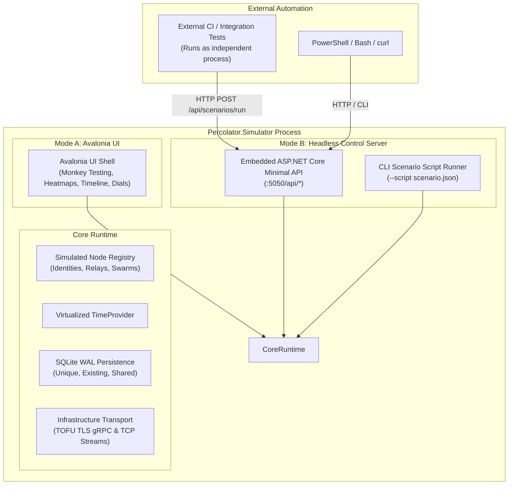

# Percolator.Simulator Implementation Plan

> [!NOTE] Non-Regulatory Tooling Disclaimer
> `Percolator.Simulator` is an engineering developer tool, interactive "monkey testing" environment, and headless integration test harness. It is **NOT** part of the formal medical device QMS (FDA 21 CFR 820.30 / IEC 62304) software item deliverables and does not contain `SYS-*` or `DEP-*` regulatory tags. Its requirements and design specifications serve internal engineering quality, protocol validation, and verification rigor.

---

## 1. Executive Summary & Core Mission

`Percolator.Simulator` is a standalone developer environment and integration test runtime built with **Avalonia UI**, **FluentAvalonia**, and **CommunityToolkit.Mvvm**. Its primary mission is to **prove, stress-test, and harden the real Application and Domain layers**—Direct Chat, Group Chat, Peer Discovery, Swarm File Transfer, and Relay Synchronization—*before* building the consumer desktop app (`Percolator.Desktop`).

We intentionally do not assume that all underlying layers work out of the box. Building the simulator provides the exact testbed needed to uncover, isolate, and fix bugs in `Percolator.Application`, `Percolator.Domain`, `Percolator.Infrastructure`, and `Percolator.Apps.*`.

### Core Architectural Principles:

1. **Real Classes Under Test (Zero Mock Engine Bloat)**:
   - Directly executes real domain aggregate roots, application command handlers, Signal/ZK cryptographic engines (`SignalCryptoEngine`, `ZkgroupCryptographyService`), Protobuf wire serializers, gRPC transport channels, and TCP swarm stream pools from `Percolator.Infrastructure`, `Percolator.Domain`, and `Percolator.Application`.
   - The only deviations from production:
     - Uses unencrypted SQLite files (to allow direct SQL inspection without requiring password unlock ceremonies).
     - Network runs on configurable localhost loopback ports or LAN interfaces.
2. **Protocol Logic Belongs in Application Layers (Zero Simulator Protocol Hacks)**:
   - Protocol mechanics such as **disjoint chunk scheduling**, **rarest-first piece picking**, **prekey pool watermarking**, and **prekey auto-replenishment** belong strictly in `Percolator.Apps.FileTransfer` and `Percolator.Application`.
   - The simulator does **not** reimplement or fake these algorithms. It orchestrates real scenarios (e.g. introducing late joiners, executing repeated handshakes to deplete prekeys) and observes real behavior. If a feature fails or deadlocks, the fix is made directly in the Application layer.
3. **Idiomatic Standalone Process Architecture (Embedded HTTP Control API & CLI Engine)**:
   - The simulator is a single, self-contained executable (`Percolator.Simulator`).
   - Rather than coupling internal simulator classes into unit test assemblies (`Percolator.ApplicationIntegrationTests`), the simulator supports idiomatic external automation:
     - **Interactive GUI Mode**: Avalonia UI desktop for interactive monkey-testing, real-time inspection, and visual heatmaps.
     - **Headless HTTP Control API (`--headless --port 5050`)**: Hosts an embedded ASP.NET Core Minimal API (`/api/personas`, `/api/relays`, `/api/scenarios/run`, `/api/state`, `/api/chaos`). External CI runners, automated integration test suites, or curl scripts control the simulator as a black-box process via standard HTTP/JSON calls.
     - **Headless CLI Script Engine (`--headless --script <path.json>`)**: Reads a declarative scenario script, executes the orchestrations, asserts expected outcomes, and exits with code `0` on success or non-zero on failure.
4. **Reusing Infrastructure SQLite Architecture for Shared DB Mode**:
   - Reuses existing SQLite connection pooling and PRAGMA configurations from `Percolator.Infrastructure` (`SqlCipherPragmaInterceptor`):
     - `PRAGMA journal_mode = WAL;`, `PRAGMA synchronous = NORMAL;`, `PRAGMA temp_store = MEMORY;`, and `PRAGMA busy_timeout = 5000;`.
     - Shared DB mode connects via `Data Source=personas/shared.db;Cache=Shared;Busy Timeout=5000`.
     - In-memory concurrency is protected by `KeyedSemaphoreLockService` from `Percolator.Application`.
     - No custom simulator-level file locking is invented.
5. **Real TOFU TLS via Infrastructure Layer**:
   - Reuses the native TOFU TLS transport implemented in `Percolator.Infrastructure` (`IPeerGrpcChannelFactory`, `PeerGrpcChannelFactory`, and `IPeerGrpcServerManager`).
   - Configures `SocketsHttpHandler` with TLS 1.3 and `RemoteCertificateValidationCallback = (_, _, _, _) => true`, backed by real ephemeral self-signed ECDSA certificates. No artificial TLS bypasses or fake mock certs are needed.
6. **Utilitarian Simulator vs. Sleek Desktop**:
   - Dense developer-facing tooling (BitTorrent-style piece heatmaps, packet sniffers, hex decoders, chaos dials) lives strictly in `Percolator.Simulator`.
   - This keeps `Percolator.Desktop` sleek, aesthetic, and completely unpolluted by diagnostic bloat or non-regulatory test code.

---

## 2. Core Functional Simulation Capabilities

### 2.1 Identity Management & Persistence Modes
When creating simulated identities, developers can choose between three persistence modes:
1. **New Unique DB (Default)**: Creates an isolated, dedicated database file (e.g. `personas/alice_<id>.db`). Provides a clean slate for deterministic tests.
2. **Existing DB (Resume Persona)**: Attaches to a previously saved `.db` file. Enables testing cold reboots, ratchet session rehydration across restarts, and offline message queue synchronization.
3. **Shared DB (Batch Mode)**: Hosts multiple simulated identities inside a single SQLite file configured with WAL mode and `busy_timeout=5000`, facilitating high-density cluster testing without lock contention.

**Identity Controls**:
- Generate Ed25519 identity keypairs, Signed PreKeys, and One-Time PreKey batches via real `SignalCryptoEngine`.
- Export connection tokens and QR codes for pairing with `Percolator.Desktop`.
- Persona state toggles: Online, Offline, Cold Reboot, Suspend Processing, Key Rotation.

### 2.2 Relay Node Hosting & Mailbox Monitoring
- Spin up standalone relay nodes on dedicated ports (`127.0.0.1:5201`, etc.).
- Real `ConnectMailboxStream`, `RegisterMailbox`, and `DrainMailbox` operations.
- **Mailbox Stash Inspector**: Inspect opaque envelopes buffered for offline peers and observe real-time draining when peers reconnect.
- **PreKey Depletion & Auto-Replenishment Verification**:
  - The simulator monitors the relay's hosted prekey pool count.
  - Developers can trigger repeated handshakes to deplete one-time prekeys down to the replenishment watermark.
  - Verifies that the client application's background sync worker automatically generates and publishes a new bundle of one-time prekeys. If not, the defect is resolved in `Percolator.Application`.
- **Rendezvous Directory**: Hosts blinded discovery directory entries with sliding TTL (24h/48h) eviction.

### 2.3 Group Chat & Shared Relay Orchestration
- Multi-peer group creation with a shared home relay.
- Real ZK presentation proof generation and verification against `IRelayLedgerRepository`.
- Real SenderKey ratchet derivation and distribution across members.
- Roster and epoch mutations: Add/evict members, force epoch conflicts, test key rotation.
- "Flood Group" monkey test button to dispatch concurrent messages across members and verify outbox ordering and deduplication.

### 2.4 File Transfer & Swarm Protocol with Late-Joining Peers
- Real `TransferManifest` trees (Merkle root, chunk hashes, piece lengths) for arbitrary payloads (1 MB – 500 MB).
- Swarm tracker coordination registering seeds and downloaders.
- Multi-stream parallel downloads over direct TCP and relay pipe connections (`TcpMultiStreamPool`).
- **Late-Joining Peer Scenario & Protocol Proving**:
  1. Peer Alice begins seeding a file; Peer Bob starts downloading.
  2. At 50% transfer progress, Peer Charlie joins as a late downloader.
  3. Charlie announces to the swarm tracker, receives the peer list, and requests chunk availability bitmasks.
  4. The underlying transfer coordinator in `Percolator.Apps.FileTransfer` performs disjoint chunk scheduling: Charlie requests rarest-first blocks from both Alice and Bob simultaneously.
  5. Bob seeds already-verified chunks to Charlie while continuing to download remaining pieces from Alice.
  6. All nodes verify 100% bit-for-bit Merkle convergence upon completion.
  7. *If chunk starvation or deadlocks occur during this scenario, the issue is logged and resolved in `Percolator.Apps.FileTransfer`.*
- **BitTorrent-Style Swarm Piece Heatmap**: Dense visual block grid rendering verified (🟩 green), in-flight (🟦 blue), missing (⬜ grey), and Merkle-corrupted (🟥 red) pieces across all swarm participants in real time. Hovering over any cell reveals chunk index, Merkle proof state, transfer rate, and source stream.

### 2.5 Peer Discovery Simulation
- Blinded rendezvous locator exchange and verification.
- Simulated local LAN / Wi-Fi broadcast discovery.
- PreKey availability polling (`IPreKeyAvailabilityPort`) vs. bundle retrieval (`IPreKeyBundleProvider`).

---

## 3. Advanced Simulator & Chaos Features

### 3.1 "Time Machine" Dials (Virtualized Time Fast-Forwarding)
- Hooked into `TimeProvider` to accelerate long-duration protocol events:
  - `+1 Minute`: Trigger outbox retry backoffs and token bucket refilling.
  - `+1 Hour`: Trigger disappearing message evictions.
  - `+24 Hours`: Trigger discovery rendezvous lease expirations and OPK replenishment thresholds.

### 3.2 Topology Presets & Scenario Blueprints
One-click scenario buttons (and importable/exportable JSON blueprints):
- **Preset 1 (Direct 1-on-1)**: Alice $\leftrightarrow$ Bob via localhost loopback.
- **Preset 2 (Sovereign Relay Triangle)**: Alice $\rightarrow$ Relay 1 $\rightarrow$ Bob.
- **Preset 3 (Group Mesh)**: 4 identities sharing a common home relay.
- **Preset 4 (Swarm Late Joiner)**: 1 Seeder, 2 Initial Downloaders, 1 Late Joiner.
- **Preset 5 (Partitioned Network)**: Two clusters severed by a simulated relay network outage.

### 3.3 Automated Chaos Injection
- Inject configurable network faults:
  - Latency jitter (0ms – 1000ms).
  - Packet loss rates (0% – 50%).
  - Random socket drops and simulated process crashes.
- "Verify Convergence" button: Stops chaos, lets outbox queues drain, and asserts zero message loss and complete data consistency across all nodes.

### 3.4 Interactive Timeline & Mermaid Sequence Diagram Export
- Real-time unified protocol timeline across all nodes.
- **One-Click Export to Mermaid Sequence Diagram**: Generates clean sequence diagrams showing exact handshake, message, and swarm piece flows for documentation and bug reports.

### 3.5 Asymmetric NAT / Firewall Simulator
- Toggle "Behind Symmetric NAT" on any simulated node (inbound TCP connections rejected).
- Proves automatic fallback to relay pipes and hole-punching mechanisms without user intervention.

---

## 4. Headless Automation & Control Architecture

The simulator is a unified standalone application (`Percolator.Simulator`) with two primary operating modes:



### 4.1 Embedded HTTP Control API (`--headless --port <PORT>`)
When started in headless server mode, the simulator hosts lightweight endpoints:
- `POST /api/personas`: Spawns a new persona with name, persistence mode, and port.
- `POST /api/relays`: Spawns a relay node on a designated port.
- `POST /api/handshakes`: Initiates a direct or relayed handshake between two personas.
- `POST /api/transfers`: Initiates a swarm file transfer session.
- `POST /api/transfers/{id}/peers`: Dynamically injects a late-joining peer into an active transfer.
- `POST /api/chaos`: Sets latency, jitter, or network drop percentages.
- `POST /api/time/advance`: Advances virtualized `TimeProvider` by a given duration.
- `GET /api/state`: Returns the consolidated state (identities, mailboxes, swarm completion percentages, errors).

### 4.2 CLI Scenario Script Runner (`--headless --script <file.json>`)
Executes declarative scenario files headlessly:
```json
{
  "scenario": "SwarmWithLateJoiner",
  "nodes": [
    { "name": "Alice", "mode": "NewUniqueFile", "role": "Seeder" },
    { "name": "Bob", "mode": "NewUniqueFile", "role": "Downloader" },
    { "name": "Charlie", "mode": "NewUniqueFile", "role": "LateJoiner" }
  ],
  "steps": [
    { "action": "StartTransfer", "payloadMb": 20, "from": "Alice", "to": ["Bob"] },
    { "action": "WaitForProgress", "node": "Bob", "progressPercent": 50 },
    { "action": "JoinSwarm", "node": "Charlie" },
    { "action": "WaitForAllComplete", "timeoutSeconds": 30 },
    { "action": "AssertChecksumMatch" }
  ]
}
```
Exits with exit code `0` on success and non-zero on assertion failure.

---

## 5. Implementation Milestones

### Milestone 1: Standalone Host Foundation, Port Allocator & WAL SQLite
- [ ] Implement `SimulatorStorageManager`: manages unencrypted SQLite persistence modes (**New Unique File**, **Existing File**, **Shared File**) in `personas/` reusing `SqlCipherPragmaInterceptor` settings (`journal_mode=WAL`, `synchronous=NORMAL`, `busy_timeout=5000`).
- [ ] Implement `SimulatedNodeHost`: wraps real Application `IHost` and `IStage2Host` with real infrastructure adapters and dynamic port allocation.
- [ ] Integrate TOFU TLS transport: bind dynamic Kestrel instances using `IPeerGrpcServerManager` and connect outbound channels via `PeerGrpcChannelFactory` from `Percolator.Infrastructure`.
- [ ] Implement `VirtualizedTimeProvider`: controllable `TimeProvider` supporting manual fast-forwarding (`FastForwardTime(TimeSpan)`).

### Milestone 2: Multi-Peer Manager & Persistent Identity Spawner
- [ ] Implement `SimulatedPeerRegistry`: state management and lifecycle tracking for active/offline personas.
- [ ] UI: "Peers" tab with:
  - "Create Identity" dialog offering persistence mode selection (New File, Select Existing File, Shared File).
  - Persona list with live status indicators, cold reboot buttons, and identity token / QR code exports.
- [ ] Headless API: `POST /api/personas`.

### Milestone 3: Relay Node Hosting & Discovery Simulation
- [ ] Implement `SimulatedRelayNode`: hosts real `UnauthenticatedDeliveryEndpoint`, `AuthenticatedRelayEndpoint`, and `AnonymousGroupRelayEndpoint`.
- [ ] UI: "Relays" tab displaying active relay instances and mailbox envelope queue inspector.
- [ ] PreKey Depletion & Auto-Replenishment Test Scenario:
  - Live inspector for relay one-time prekey ledger.
  - Scenario to deplete prekeys and assert that Application layer replenishes them.
- [ ] Peer discovery simulation: register blinded rendezvous locators, test query filtering, and verify sliding TTL eviction via fast-forwarded time.

### Milestone 4: Group Chat & Shared Relay Orchestration
- [ ] Implement group creation orchestrator: binds multiple simulated identities around a shared home relay.
- [ ] Wire real ZK presentation proof generation and verification against the relay ledger.
- [ ] Implement group message broadcast: dispatches real SenderKey encrypted messages across group members.
- [ ] UI: "Groups" tab showing member roster, current epoch, member keys, and "Flood Group" monkey button.
- [ ] Interactive roster mutation controls: "Add Member", "Evict Member", "Advance Epoch".

### Milestone 5: File Transfer Swarm & Late-Joining Peer Engine with Heatmap
- [ ] Implement file transfer orchestrator using real `TcpMultiStreamPool` and `PortableDesktopFileStore`.
- [ ] Implement **Late-Joining Peer Scenario**:
  - Alice seeds, Bob begins downloading.
  - Introduce Charlie at 50% transfer progress.
  - Exercise disjoint chunk scheduling and bidirectional piece seeding in `Percolator.Apps.FileTransfer`.
  - Assert 100% bit-for-bit Merkle root verification across all peers.
  - Log and remediate any application-level chunk picking bugs discovered.
- [ ] UI: "Swarm Transfer" tab with **BitTorrent-Style Swarm Piece Heatmap** showing verified (green), in-flight (blue), missing (grey), and corrupted (red) blocks with per-cell metadata tooltips.

### Milestone 6: Headless HTTP Control Server & CLI Script Runner
- [ ] Embed ASP.NET Core Minimal API in `Percolator.Simulator` enabled via `--headless --port <PORT>`.
- [ ] Implement CLI script engine (`--headless --script <path.json>`) with exit codes and structured JSON logging.
- [ ] Provide sample scenario scripts:
  - `direct-message-roundtrip.json`
  - `group-concurrent-broadcast.json`
  - `swarm-late-joiner.json`
  - `cold-restart-session-recovery.json`

### Milestone 7: Chaos Controls, Topology Presets & Mermaid Exporter
- [ ] Implement network fault interceptor:
  - Latency jitter slider (0ms – 1000ms).
  - Packet drop simulator (0% – 50%).
  - Asymmetric NAT toggle ("Behind Firewall").
- [ ] Topology Presets: One-click setup for Direct 1-on-1, Relay Triangle, Group Mesh, Swarm Late Joiner, and Partition.
- [ ] UI: "Timeline & Traffic" tab with live packet sniffer and **One-Click Export to Mermaid Sequence Diagram**.
