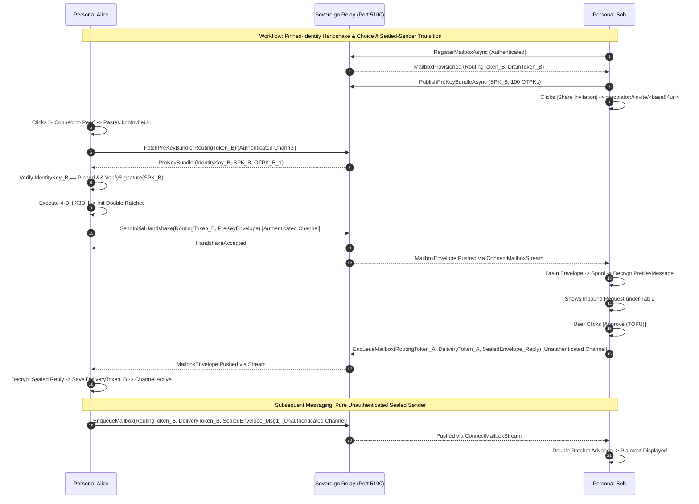
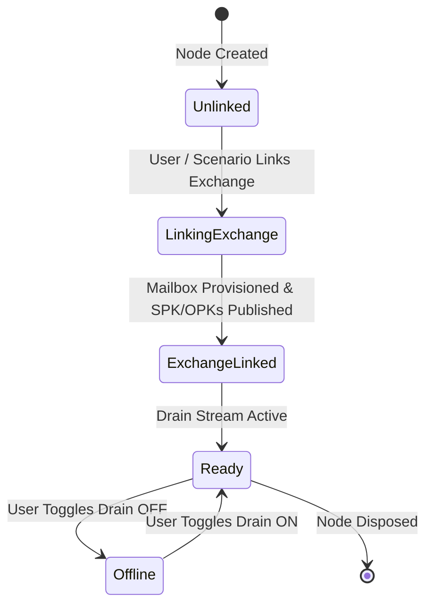

# Percolator.Simulator — UI/UX Specification & Technical Design

> **Document Version**: 2.1 (Relay-Mediated Hybrid Protocol Standard — Refined Architecture)  
> **Status**: Approved Specification  
> **Target Deployable**: `Percolator.Simulator` (Avalonia 11.2, Desktop .NET 10)  
> **Scope**: Developer interactive multi-node workbench, protocol wire telemetry inspector, and automated simulation harness.  
> **Precondition**: Zero direct P2P socket communication; all inter-persona traffic traverses real localhost TLS/gRPC relays via `TransportDispatcher` and `RelayMailboxDrainHost`. Zero cross-node RAM peeking (`_worldState` access prohibited outside top-level topology listing).

---

## 1. Executive Summary & Workbench Architecture

`Percolator.Simulator` is an engineering developer tool and multi-node test workbench. It hosts multiple isolated, real Percolator node instances (both sovereign Relays/Exchanges and client Personas) within a single process.

Each Persona executes the complete production client pipeline:
- In-memory SQLite persistence (`cache=shared`) using EF Core schemas.
- Full cryptographic engine (`SignalCryptoEngine` with Curve25519, Ed25519, AES-256-GCM, HMAC-SHA256).
- Real network traversal over localhost TLS 1.3 / gRPC via `TransportDispatcher`.
- Autonomous background workers: `RelayMailboxDrainHost` (continuous gRPC streaming drain) and `OutboxDispatchHost` (outbox retry with exponential backoff).
- **Pure Client Invariant**: Personas never bind listening ports and never run Kestrel servers.

Each Relay (Exchange) executes the complete production relay pipeline:
- **Canonical Port Allocation**: Allocates and leases listening ports using `IPortReservationService` in the canonical Percolator range (`5100–5199` per `DEC-CANONICAL-PORT-RANGE`, e.g. 5100, 5101, 5102, or a user-specified custom port), exactly as any Percolator client / Self-Hosted Exchange does.
- Kestrel gRPC transport server bound to `127.0.0.1:<allocated_port>`.
- `AuthenticatedRelayEndpoint` (authenticated registration, rate-limited PreKey bundle fetching, and initial 4-DH PreKeyMessage delivery).
- `UnauthenticatedDeliveryEndpoint` (unauthenticated Sealed Sender mailbox queuing with constant-time delivery token validation and cumulative storage quotas).
- `AnonymousGroupRelayEndpoint` (zero-knowledge group membership and ledger mutation verification).

The UI is built as a dense, high-information-density developer workbench designed for deep protocol observation, live policy tampering, network fault injection, and manual chaos testing without shortcuts.

---

## 2. Layout Architecture & Workspace Grid

The workbench layout employs a four-pane responsive docking architecture optimized for widescreen displays ($\ge 1400 \times 900$).

```
+----------------------------------------------------------------------------------------------------+
| TOP GLOBAL ACTION BAR (Height: 44px, Dense, Global Controls & Chaos)                               |
| [Status: Idle / Running] | [Pause Network Traffic] | [Chaos: 0ms, 0% v] | [Presets v] | [Wire Dock v] |
+--------------------------+-------------------------------------------------------------------------+
| LEFT RAIL: TOPOLOGY      | CENTER WORKSPACE: CONTEXTUAL INSPECTOR & LIVE OPERATIONS                |
| (Width: 300px, Splitter) | (Flex / Tabbed Splitter)                                                |
|                          |                                                                         |
| [ EXCHANGES (2)    [+] ] | When Persona Selected:                                                  |
| > Relay-1 (Open)   [ON]  | - Header: Avatar, Name, PublicIdentityId (hex/copy), Linked Exchanges    |
|   - Port: 5100, Q: 3     |   Actions: [+ Connect to Peer]  [Share Invitation]  [+ New Group]       |
| > Relay-2 (Appr.)  [ON]  | - Tab 1: Conversations & Live Chat (Roster + Timeline + Badges + Input) |
|   - Port: 5101, Q: 0     | - Tab 2: Inbound Requests (Pending TOFU Handshakes, Approve / Reject)   |
|                          | - Tab 3: Cryptographic & Ratchet State (Keys, SPK, OPKs, Sessions)     |
| [ PERSONAS (3)     [+] ] | - Tab 4: Linked Exchanges (Endpoints, Mailbox Tokens, Stream Status)    |
| > Alice (2 relays) [ON]  |                                                                         |
|   - 1 pending, 0 unread  | When Exchange (Relay) Selected:                                         |
| > Bob   (1 relay)  [ON]  | - Header: Name, Port 5100, Listener [ON/OFF], Held Envelopes Counter    |
| > Carol (1 relay)  [OFF] | - Tab 1: Live Policy Editor (Strategy, Flags, Quotas, Hot-Reload)       |
|                          | - Tab 2: Moderation Queue (Pending Registrations, Approve/Reject/Block) |
|                          | - Tab 3: Mailbox Queues (Opaque Ciphertext Metadata, Queue Depth, Purge)|
|                          | - Tab 4: Hosted PreKeys & Group Ledgers (OPK Gauges, SPKs, ZK Epochs)  |
+--------------------------+-------------------------------------------------------------------------+
| BOTTOM DOCK: PROTOCOL TELEMETRY & WIRE INSPECTOR (Collapsible, Height: 220px, Splitter)            |
| Filter: [Search...] [All Personas v] [All Relays v] [Event Toggles] [Clear Log] [Auto-Scroll [x]]   |
| Columns: [Timestamp] [Source] [Dest / Relay] [RPC / Method] [Payload / Key ID] [Status]            |
| Details Drawer: Serialized Protobuf Dump, Hex Envelope, Ratchet Step & Cryptographic Derivations   |
+----------------------------------------------------------------------------------------------------+
```

### Grid Dimensions & Splitter Constraints
- **Window Minimum**: $1400 \times 900$ pixels; resizable up to multi-monitor $4\text{K}$.
- **Top Global Action Bar**: Fixed height `44px`, zero margin, 8px horizontal padding. Dedicated to global workbench state, network chaos, scenario automation, and telemetry toggling.
- **Left Rail (Topology Tree)**: Default width `300px`; minimum width `220px`; maximum width `480px`; resizable via horizontal `GridSplitter`. Hosts the authoritative `[+]` creation buttons in section headers.
- **Center Workspace**: Flexible star-sizing (`1*`); dynamic content template swapped immediately upon Left Rail node selection.
- **Bottom Dock (Telemetry)**: Default height `220px`; minimum height `120px`; maximum height `600px`; resizable via vertical `GridSplitter`; collapsible to `0px` via 1-click toggle button.

---

## 3. Visual Styling & Color Tokens

The workbench implements a custom High-Contrast Dark Theme adhering to developer IDE ergonomics:

| Token Name | Hex Code | Visual Application |
| :--- | :--- | :--- |
| `BgCanvas` | `#121418` | Root application background. |
| `BgSurface` | `#1A1D24` | Card panels, top toolbar, dock headers. |
| `BgSubtle` | `#222630` | Selected list items, table headers, composer input. |
| `BorderSubtle` | `#2D323E` | Pane splitters, card borders, tab separators. |
| `TextPrimary` | `#E6EDF3` | Primary labels, persona names, decrypted plaintext. |
| `TextSecondary`| `#8B949E` | Timestamps, status subtitles, helper descriptions. |
| `TextMonospace`| `#7EE787` | Cryptographic hex fingerprints, tokens, port numbers. |
| `AccentPrimary`| `#2F81F7` | Primary buttons, active tabs, selected radio buttons. |
| `StatusActive` | `#2EA043` | Listening relays, draining personas, delivery `OK`. |
| `StatusPending`| `#D29922` | Inbound handshakes, outbox in-flight, `PendingApproval`. |
| `StatusDanger` | `#F85149` | Stopped relays, offline drain, policy reject, MitM abort. |
| `BadgeRelay`   | `#A371F7` | Relay endpoints, Exchange-scoped badges. |

### Typography Rules
- **Prose & Control Labels**: System sans-serif (`Segoe UI`, `Inter`, `SF Pro`, `Ubuntu`), sizes: `11px` (dense captions), `12px` (standard body), `13px` (headers).
- **Monospace Telemetry & Cryptography**: Monospace font (`Cascadia Code`, `Consolas`, `JetBrains Mono`), sizes: `11px` (data grid cells, protobuf payloads, hex keys).

---

## 4. Action Hierarchy & Contextual Decomposition

To eliminate redundancy and prevent synthetic shortcuts, actions are organized strictly by scope:

### Global Workbench Actions (Top Action Bar Only)
These actions operate on the **entire simulation environment**:
1. **`Pause / Resume Network Traffic`** (Toggle Button): Halts all outbound gRPC delivery across all nodes (red indicator). Allows developers to inspect queued outbox jobs before dispatching.
2. **`Network Chaos`** (Dropdown Popover):
   - Artificial Latency slider: `0 ms` to `2000 ms` injected into gRPC client handlers.
   - Packet Drop Rate slider: `0%` to `25%` to test outbox exponential backoff.
   - Network Jitter slider: `0 ms` to `500 ms`.
3. **`Automated Scenarios / Presets`** (Dropdown Menu):
   - `1:1 Double Ratchet Symmetric Exchange`: Boots 1 relay, 2 personas, pairs them, sends 4 alternating messages.
   - `Multi-Exchange Shared Mailboxes`: Boots 2 relays (`Friends:5100` and `Work:5101`), links Alice and Bob to both, verifies Option 3A independent channels and ratchets.
   - `Offline Mailbox Buffering & Recovery`: Pairs nodes, turns Bob offline, Alice sends 3 messages, turns Bob online, verifies drain order.
   - `Group V2 Epoch Rotation & Member Eviction`: 3 personas, creates group, sends messages, evicts 1 member, verifies ratchet key isolation.
4. **`Wire Telemetry Dock`** (Toggle Button): Collapses or expands the bottom telemetry inspector pane.
5. **`Reset Environment`** (Button): Cleans up all node processes, releases port leases, and resets databases.

---

### Entity Creation (Left Rail Header Buttons Only)
Entity creation belongs in the Left Rail headers where the entity collections reside:
1. **`[+ Add Exchange]`** (in `EXCHANGES (RELAYS)` header):
   - Opens modal to create a Self-Hosted Exchange.
   - Name input (defaults to `Relay-<N+1>`).
   - Port allocation: queries `IPortReservationService` and preselects the next available port in canonical range `5100–5199` (e.g., `5100`). Developer can optionally enter a custom port.
   - Initial Registration Strategy: `Open`, `ApprovalRequired`, or `Closed`.
   - Clicks `Create`: leases port via `IPortReservationService`, boots Kestrel, and adds to topology tree.
2. **`[+ Add Persona]`** (in `PERSONAS` header):
   - Opens modal to create an isolated client persona.
   - Name input (auto-generates word-pair, e.g. `Emerald-Otter`).
   - Optional initial Exchange selector: dropdown of active running Exchanges to link on boot (or leaves unlinked to test zero-exchange state).
   - Clicks `Create`: initializes master key, SQLite database, Ed25519 identity key, registers with selected Exchange if requested, and adds to topology tree.

---

### Persona-Centric Operations (Persona Context Header & Tabs)
All communication, pairing, and group workflows are initiated by a **specific Persona**:
1. **`[Share Invitation]`** (Header Action Button):
   - Selects which linked Exchange to route through.
   - Generates compact `percolator://invite/<base64url>` (4 fields: pinned `IdentityKey` + Exchange endpoint + inviter routing token; zero `DeliveryToken`).
   - 1-click `[Copy Invitation Link]` action with transient confirmation toast.
2. **`[+ Connect to Peer]`** (Header Action Button):
   - Opens dialog with monospace input for pasting `percolator://invite/<base64url>`.
   - Reactive preview card: Identicon, remote peer truncated identity fingerprint (`#a8f1...`), Exchange endpoint (`127.0.0.1:5100`), format validity badge.
   - If not yet linked to that Exchange, displays inline call-to-action: `[Link to this Exchange first]`.
   - Clicks `[Connect]`: executes real `IOutboundConnectionWorkflow.ConnectAsync` (fetches `PreKeyBundle` from Exchange, verifies pinned identity key and SPK signature, executes 4-DH X3DH, enqueues authenticated initial PreKeyMessage via `SendInitialHandshake`).
3. **`[+ New Group]`** (Header Action Button):
   - Opens group creation wizard for the active persona.
   - Group title input.
   - Selects which linked Exchange hosts the group.
   - Checklist of approved contacts to invite.
   - Clicks `[Create Group]`: initializes genesis credentials, creates group on relay, and distributes SenderKey over pairwise direct channels to each selected contact.

---

## 5. Detailed Component Specifications

### 5.1 Left Rail — Topology & Entities Tree

#### A. Section: `EXCHANGES (RELAYS)`
- Header: Text `EXCHANGES (RELAYS) (N)` with right-aligned button `[+ Add Exchange]`.
- **Exchange Card Item**:
  - Row 1: Status dot (`Green` listening, `Red` stopped), Relay Name (`Relay-1`), listener toggle switch `[ON / OFF]`.
  - Row 2: Host & Port (`127.0.0.1:5100` — leased via `IPortReservationService`), Strategy badge (`Open` [green], `Approval` [amber], `Closed` [red]).
  - Row 3: Metrics summary: `Q: 3 envelopes`, `MBX: 2 mailboxes`.

#### B. Section: `PERSONAS`
- Header: Text `PERSONAS (M)` with right-aligned button `[+ Add Persona]`.
- **Persona Card Item**:
  - Row 1: Identicon avatar ($24 \times 24\text{px}$), Persona Name (`Alice`), Drain toggle switch `[ON / OFF]`.
  - Row 2: Truncated Identity Key (`#a8f1...3b2c`), unread badge if $> 0$.
  - Row 3: Connectivity summary: `Linked: 2 Exchanges`, `Pending: 1 request`.

---

### 5.2 Center Workspace — Contextual Inspector

#### A. When Persona Selected

##### Header Panel
- Large Identicon ($48 \times 48\text{px}$).
- Persona Name in bold (`16px`).
- Monospace Public Identity Key hex with 1-click `[Copy Hex]` button.
- Badges for linked Exchanges (e.g. `Relay-1 [5100]`, `Relay-2 [5101]`).
- **Action Buttons Bar**:
  - `[+ Connect to Peer]`: Opens connection dialog to paste `percolator://invite/...`.
  - `[Share Invitation]`: Selects linked Exchange and outputs `percolator://invite/...` link.
  - `[+ New Group]`: Opens group creation wizard with contact checklist.

##### Tab 1: Conversations & Live Chat
- **Roster Pane (Width 220px)**:
  - List of active Direct and Group channels.
  - Each item displays: Remote peer / group name, Exchange endpoint badge, unread counter badge.
  - Empty state: *"No conversations yet. Connect to a peer or create a group to start messaging."*
- **Timeline Pane**:
  - Chat bubbles grouped by sender with timestamp (`HH:mm:ss.fff`).
  - **Cryptographic Badges on Every Bubble**:
    - For 1:1 Messages: `[Double Ratchet: Step N, DH #M, Route: Relayed]` (clicking opens flyout showing ratchet chain keys and counter progression).
    - For Group Messages: `[SenderKey: Epoch E, Iteration I, Route: GroupRelay]`.
  - Message actions (hover toolbar): `Reply`, `Edit`, `React` (emoji picker), `Delete` (tombstone).
- **Composer Dock**:
  - Monospace text area with rich input affordances (Enter to send, Shift+Enter for newline).
  - Paperclip attachment button: opens file picker, encrypts attachment with AES-256-GCM, uploads chunked blob to relay, sends message pointing to blob locator.

##### Tab 2: Inbound Requests (Handshake Moderation)
- Displays pending incoming contact requests received via `AuthenticatedRelayEndpoint.SendInitialHandshake`:
  - Applicant Identicon and Public Identity Key hex.
  - Target Exchange where request was delivered.
  - PreKey bundle details used in handshake (SPK ID, OTPK ID).
  - Actions:
    - **`[Approve (TOFU)]`**: Stages contact as active, computes 4-DH shared secret, sends initial reply carrying recipient `DeliveryToken` inside `ProfileCapabilityDto`.
    - **`[Reject]`**: Deletes pending handshake without replying.
    - **`[Block]`**: Records applicant in block list; drops any further envelopes silently.

##### Tab 3: Cryptographic & Ratchet State Inspector
- **Identity & Keys Panel**:
  - Ed25519 Identity Public Key: full hex representation.
  - Signed Pre-Key (SPK): Key ID, Public Key hex, Ed25519 signature hex, expiration date. Button: `[Rotate SPK Now]`.
  - One-Time Pre-Key (OPK) Pool: Visual gauge bar (`98 / 100 available`), low pool warning badge if $< 35$. Button: `[Replenish Pool]`.
- **Active Channel Sessions Grid**:
  - Table columns: `Peer Identity`, `Exchange Endpoint`, `Channel ID`, `Send Chain Step`, `Recv Chain Step`, `DH Ratchet Steps`, `Root Key (Truncated)`.
  - Double-clicking opens raw session inspection drawer.

##### Tab 4: Linked Exchanges
- Table of connected Exchanges:
  - `Exchange Endpoint`: URI string (`percolator://127.0.0.1:5100`).
  - `Blinded Routing Token`: 16-byte hex.
  - `Drain Token`: 32-byte hex.
  - `Delivery Token`: 32-byte hex (or `Not Assigned / Pending`).
  - `Drain Stream Status`: `Streaming Active` (green), `Reconnecting` (amber), `Stopped` (red).
  - Row Actions: `[Unlink]`, `[Force Re-Drain]`.
- Action Bar: `[+ Link to Another Exchange]` button.

---

#### B. When Exchange (Relay) Selected

##### Header Panel
- Relay Icon & Display Name (`Relay-1`).
- Leased Port Badge: `Port 5100 (IPortReservationService)`.
- Listener toggle switch: `[ON / OFF]` (starts or stops Kestrel).
- Held Envelopes Counter: `Total Queued: 3 envelopes`.
- Mailbox Count: `Total Mailboxes: 2`.

##### Tab 1: Live Policy Editor
- **Registration Strategy** (Radio Buttons):
  - `Approval Required`: Staged into pending moderation queue.
  - `Open`: Automatically approved up to quota.
  - `Closed`: Rejects new registrations with silent `HttpContext.Abort()`.
- **Localhost Fast-Path**:
  - Checkbox: `AutoApproveLocalhost` (default `Checked`). Allows loopback nodes with valid `LocalRelayAssociations` to auto-register over real localhost TLS/gRPC.
- **Relay Feature Flags** (Checkboxes):
  - `[x] PreKeys` (Enables hosted PreKey bundle publication and authenticated fetching).
  - `[x] Profiles` (Enables blind profile storage).
  - `[x] Blobs` (Enables chunked blind blob storage).
  - `[x] Groups` (Enables anonymous group ledger service).
  - `[x] Discovery` (Enables blind proximity rendezvous discovery).
- **Quotas & Retention**:
  - `Max Mailbox Bytes`: Numeric input (default `10,485,760` bytes / 10 MB).
  - `Max Mailboxes`: Numeric input (default `1024`).
  - `Envelope TTL`: Numeric input in seconds (default `604,800` / 7 days).
- **Action**: `[Apply Policy Changes]` button — hot-reloads `RelayHostingPolicyHolder` immediately in memory without restarting Kestrel.

##### Tab 2: Moderation Queue (Pending Registrations)
- Table of applicants waiting under `ApprovalRequired` strategy:
  - Columns: `Applicant Routing Token (Hex)`, `Requested At (UTC)`, `Status`.
  - Row Actions:
    - **`[Approve]`**: Calls `IExchangeRegistrationModerationService.ApproveAsync`, provisions mailbox, assigns tokens.
    - **`[Reject]`**: Marks rejected; future connection attempts are silently dropped via `HttpContext.Abort()`.
    - **`[Block]`**: Marks permanently blocked.

##### Tab 3: Mailbox Queues Inspector
- Real-time table of hosted mailboxes:
  - Columns: `Blinded Routing Token (Hex)`, `Envelopes Count`, `Total Queue Bytes`, `Oldest Envelope Age`.
  - **Ciphertext Opacity Invariant**: The inspector displays strictly opaque metadata:
    ```
    [RoutingToken: 7b2f...8a] | Envelopes: 3 | Size: 1.2 KB | Data: [EncryptedPackage: 248 bytes]
    ```
    *Plaintext is never decoded or peeked on the relay.*
  - Action: `[Purge Expired Envelopes]` button.

##### Tab 4: Hosted PreKeys & Group Ledgers
- **Hosted PreKey Bundles**:
  - Table: `Owner Routing Token`, `Device ID`, `Identity Key Hex`, `SPK ID`, `Available OTPKs Count` (warning badge if $< 35$).
- **Group Ledgers**:
  - Table: `Conversation ID (Hex)`, `Current Epoch`, `Roster Size`, `Commit Count`.

---

### 5.3 Bottom Dock — Protocol Telemetry & Wire Inspector

The Bottom Dock provides an exhaustive, live trace of every gRPC call and domain outbox event across all running nodes:

```
+----------------------------------------------------------------------------------------------------+
| TELEMETRY: [Search:            ] Node: [All v] Relay: [All v] [x] gRPC [x] Outbox [x] Net  [Clear] |
+----------------------------------------------------------------------------------------------------+
| Time         | Source | Dest / Relay   | RPC / Event            | Target / Payload ID | Status     |
+--------------+--------+----------------+------------------------+---------------------+------------+
| 21:14:02.104 | Alice  | 127.0.0.1:5100 | FetchPreKeyBundle      | Bob (7b2f...8a)     | OK (200)   |
| 21:14:02.128 | Alice  | 127.0.0.1:5100 | SendInitialHandshake   | Bob (7b2f...8a)     | OK (200)   |
| 21:14:02.180 | Bob    | 127.0.0.1:5100 | ConnectMailboxStream   | Bob (7b2f...8a)     | STREAMING  |
| 21:14:02.215 | Bob    | 127.0.0.1:5100 | InboundContactRequest  | Alice (3c11...4e)   | PENDING    |
| 21:14:05.402 | Bob    | 127.0.0.1:5100 | EnqueueMailbox (Sealed)| Alice (3c11...4e)   | OK (200)   |
+----------------------------------------------------------------------------------------------------+
| DETAILS DRAWER (Splitter):                                                                         |
| RPC: /percolator.infrastructure.AuthenticatedRelayService/SendInitialHandshake                     |
| Channel Pool: Authenticated | Method: POST | Content-Type: application/grpc                        |
| Request: RecipientRoutingToken: 7b2f...8a, EncryptedPackage: 617 bytes (Signal 4-DH PreKeyMessage) |
+----------------------------------------------------------------------------------------------------+
```

#### Telemetry Controls
- **Filter Search**: Text search across method names, tokens, and error strings.
- **Node Filter**: Dropdown filtering events by specific Persona or Relay.
- **Event Type Toggles**:
  - `[x] gRPC Calls`: Inbound and outbound network RPCs.
  - `[x] Outbox Jobs`: Enqueue, claim, deliver, retry, and backoff events.
  - `[x] Security Events`: TOFU approvals, key rotations, ratchet advancements.
  - `[x] Errors & Chaos`: Network timeouts, aborts, quota drops.
- **Selection Drawer**: Clicking any row renders the decoded Protobuf structure, headers, and cryptographic derivation metadata.

---

## 6. Multi-Node Simulation Workflows



### Complete Percolator Feature Test Matrix
1. **Single-Relay 1:1 Pinned-Identity Handshake & Choice A Transition**:
   - Tests authenticated `FetchPreKeyBundle` + `SendInitialHandshake` on authenticated channel pool, followed by post-approval `EnqueueMailbox` on unauthenticated channel pool.
2. **Multi-Exchange Shared Mailboxes & Option 3A Isolation**:
   - Tests Alice and Bob linked to two separate Exchanges (`Friends:5100` and `Work:5101`).
   - Verifies distinct `ChannelId` per Exchange, independent Double Ratchet instances, and same-Exchange reply routing.
3. **Multi-Peer Shared Invitation & Distinct OTPK Consumption**:
   - Tests Alice and Carol concurrently connecting via Bob's single invitation link.
   - Verifies Relay dispenses 2 strictly distinct OTPKs atomically with zero collisions.
4. **Relay Outage, Offline Buffering & Outbox Exponential Backoff**:
   - Tests clicking `[OFF]` on Relay. Alice sends messages. Outbox marks jobs as in-flight failure, records backoff intervals. Relay toggled `[ON]`; Outbox automatically flushes and delivers.
5. **Group V2 Epoch Rotation & Member Eviction**:
   - Tests 3-member group. Evicts Carol. Relay ledger epoch increments via ZK presentation. Alice rotates SenderKey and redistributes only to Bob. Carol receives post-eviction ciphertext but fails decryption.
6. **Relay Policy Moderation Queue & Closed Rejection**:
   - Tests setting `RegistrationStrategy` to `ApprovalRequired` and verifying applicants stage in Tab 2; tests setting to `Closed` and verifying connection aborts.
7. **Rich Chat Actions**:
   - Tests message replies, message edits, emoji reactions, message deletion (tombstones), and encrypted file attachment staging/download.

---

## 7. Zero-Shortcut Rules & UX Guardrails

1. **Canonical Port Reservation**:
   - Relays allocate ports via `IPortReservationService` in the `5100–5199` range. Personas are pure clients with zero listening ports.
2. **Zero Cross-Node RAM Peeking**:
   - `Connect to Peer` and all multi-node actions MUST invoke public driving ports (`IPeerInvitationService`, `IOutboundConnectionWorkflow`, `IChatService`).
   - Any coordinator accessing `_worldState.GetPersonaHost(...)` to peek at private keys, prekeys, or repositories is prohibited.
3. **Relay Prerequisite Gating**:
   - A Persona with 0 linked relays cannot send chat messages or export invitations. The UI disables these controls and displays an amber guidance banner:
     > *"No Exchange linked. Link an Exchange to export invitations and start messaging."*
4. **Zero Direct P2P Remnants**:
   - Zero direct IP/port input fields, zero port-range privacy presets, zero direct socket status indicators. All transport is relay-mediated.
5. **Relay Ciphertext Opacity**:
   - When inspecting Relay mailbox queues or wire telemetry, payload data is displayed strictly as `[EncryptedPackage: N bytes]`. Plaintext is only visible within recipient Persona timelines after Double Ratchet decryption.

---

## 8. State Machines & Keyboard Shortcuts

### Persona Lifecycle State Machine


### Global Keyboard Shortcuts
| Shortcut | Action | Description |
| :--- | :--- | :--- |
| `Ctrl+Shift+E` | New Exchange | Opens the Exchange creation modal. |
| `Ctrl+Shift+P` | New Persona | Opens the Persona creation modal. |
| `Ctrl+Shift+T` | Toggle Telemetry | Expands or collapses the bottom telemetry dock. |
| `Ctrl+Space`   | Pause/Resume Traffic | Pauses or resumes outbound gRPC delivery globally. |
| `Escape`       | Close Modal / Drawer | Dismisses active popovers or detail drawers. |
