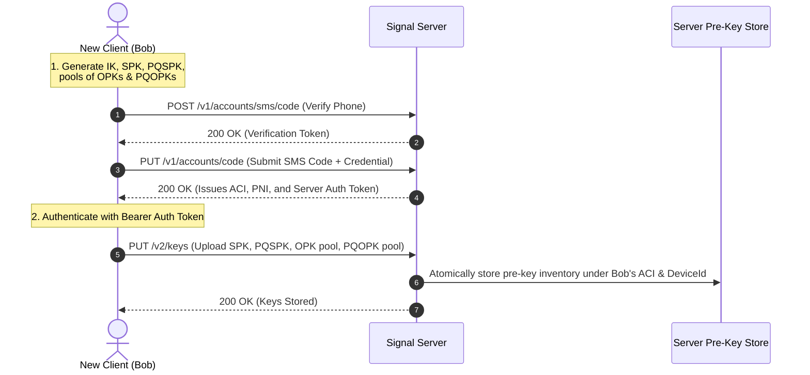
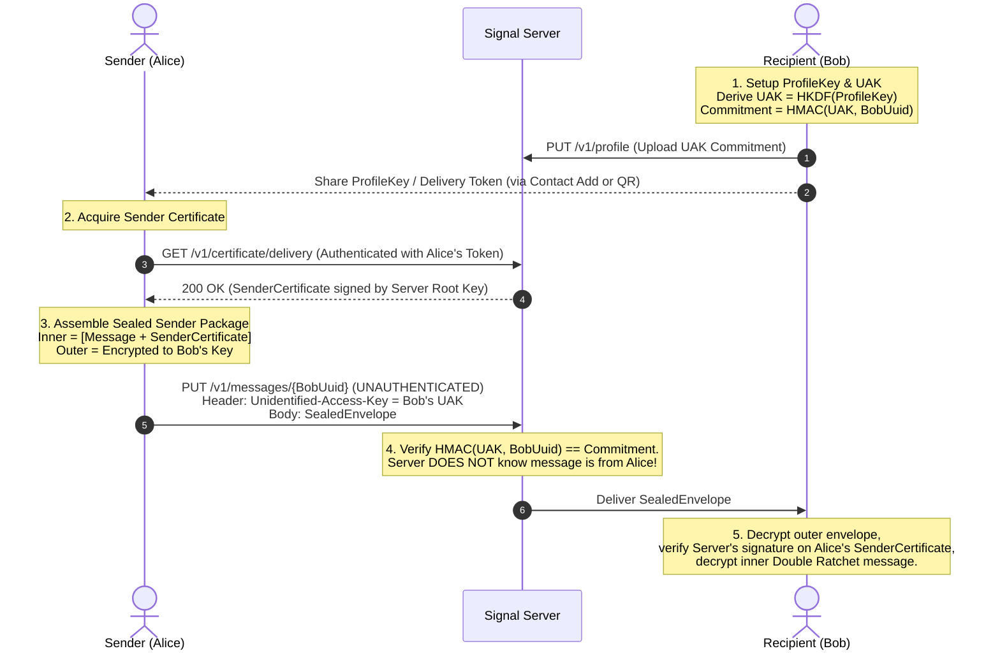

# Signal Protocol & Session Flows: Architecture, Cryptography, and Persistence

This document specifies the end-to-end cryptographic and wire protocols of the **Signal Protocol**, aligned with the latest official Signal specifications (including **PQXDH**, **Double Ratchet**, **Sealed Sender / Unidentified Delivery**, and **Server-Side Group V2**), as well as client-side persistence and integration with local application architectures.

---

## Table of Contents

1. [Terminology: Cryptographic Keys & Identifiers](#1-terminology-cryptographic-keys--identifiers)
2. [Section 1: Initial Client Registration & Pre-Key Hosting (Signal Server)](#2-section-1-initial-client-registration--pre-key-hosting-signal-server)
   - 1.1 Account Identifiers (ACI & PNI) and Authentication
   - 1.2 Cryptographic Key Pair Generation
   - 1.3 Publishing the Pre-Key Bundle (`PUT /v2/keys`)
   - 1.4 Pre-Key Depletion, Rotation, and Replenishment
3. [Section 2: Sealed Sender & Unidentified Delivery (Delivery Tokens & Certificates)](#3-section-2-sealed-sender--unidentified-delivery-delivery-tokens--certificates)
   - 2.1 The Metadata Privacy Challenge
   - 2.2 Requesting a Sender / Delivery Certificate (`GET /v1/certificate/delivery`)
   - 2.3 Delivery Tokens: The Unidentified Access Key (UAK) & Profile Keys
   - 2.4 Constructing the Sealed Sender Envelope (`UnidentifiedSenderMessage`)
   - 2.5 Unauthenticated Message Transmission (`PUT /v1/messages/{recipient_uuid}`)
   - 2.6 Recipient Ingress, Certificate Verification & Anti-Spoofing
4. [Section 3: The PQXDH Post-Quantum Key Agreement Protocol](#4-section-3-the-pqxdh-post-quantum-key-agreement-protocol)
   - 3.1 Motivation: Post-Quantum Forward Secrecy & Defense Against HNDL
   - 3.2 Pre-Key Bundle Retrieval (`GET /v2/keys/{recipient_uuid}/{device_id}`)
   - 3.3 Initiator (Alice) Logic: Diffie-Hellman + ML-KEM Encapsulation
   - 3.4 Wire Model: `PreKeySignalMessage` (with PQXDH Extensions)
   - 3.5 Responder (Bob) Logic: Decapsulation & Mirrored Derivation
   - 3.6 Associated Data ($AD$) & KEM Re-Encapsulation Defenses
5. [Section 4: Ongoing Messaging (The Double Ratchet Algorithm)](#5-section-4-ongoing-messaging-the-double-ratchet-algorithm)
   - 4.1 The Symmetric KDF Chain Ratchet
   - 4.2 The Asymmetric Diffie-Hellman Ratchet
   - 4.3 Wire Model: `SignalMessage` Structure
   - 4.4 Out-of-Order Message Handling & Skipped Keys
6. [Section 5: Client-Side Session & Key Persistence (SQLite Models)](#6-section-5-client-side-session--key-persistence-sqlite-models)
   - 5.1 Local Identity & Pre-Key Keyring Store
   - 5.2 Pairwise Sessions & Ratchet Index Tables
   - 5.3 Cryptographic Memory Zeroization & TTL Purges
7. [Section 6: Reverse-Signal / Direct Invitation Flows (Ad-Hoc P2P Variant)](#7-section-6-reverse-signal--direct-invitation-flows-ad-hoc-p2p-variant)
   - 6.1 Inviter Pre-Key Advertisement
   - 6.2 Acceptor Staging & Handshake Completion
8. [Section 7: Group V2 Relay Ledger & Epochs](#8-section-7-group-v2-relay-ledger--epochs)
9. [Section 8: Group V2 Mutations and State Choreography](#9-section-8-group-v2-mutations-and-state-choreography)
10. [Section 9: End-to-End Group Messaging Flow (Server-Side Fan-out)](#10-section-9-end-to-end-group-messaging-flow-server-side-fan-out)
11. [Section 10: Zero-Knowledge Mechanics](#11-section-10-zero-knowledge-mechanics)

---

## 1. Terminology: Cryptographic Keys & Identifiers

The Signal Protocol strictly isolates transmission identifiers, cryptographic keys, and local persistence rows:

### 1.1 Account & Identity Identifiers
* **ACI (Account Service Identifier)**: A cryptographically random UUID assigned to a user upon registration. The ACI is the primary identifier for all 1:1 chats, group memberships, and profile keys. It never leaks the user's phone number.
* **PNI (Phone Number Identity)**: A secondary UUID linked to a user's phone number ($E.164$). Used exclusively for phone-number-based contact discovery so that users who know a phone number can initiate contact without exposing the recipient's long-term ACI prematurely.
* **DeviceId**: A 32-bit unsigned integer identifying a specific registered device for an account (`1` is always the primary device; linked companion devices have IDs $\ge 2$).
* **RegistrationId**: A random 14-bit (or 32-bit) integer generated on device install. Used to detect when a remote peer has re-installed the app, triggering local session resets.
* **`PublicIdentityId` / `RoutingToken` (Percolator Layer)**: In Percolator's architecture, `PublicIdentityId` maps to Signal's Account UUID (ACI). `RoutingToken` is an opaque 16-byte token presented to a relay's blinded routing table to isolate user identity from network mailboxes.

### 1.2 Cryptographic Key Types
* **Identity Key ($IK$)**: Long-term Curve25519 key pair. In modern Signal, this key is also used as an Ed25519 signing key via XEdDSA / XEd25519.
* **Signed Pre-Key ($SPK$)**: Medium-term Curve25519 public/private key pair, rotated periodically (e.g. weekly or monthly) and signed by $IK$.
* **One-Time Pre-Key ($OPK$)**: Pool of ephemeral Curve25519 key pairs consumed once per handshake to provide immediate forward secrecy.
* **Post-Quantum Signed Pre-Key ($PQSPK$)**: Medium-term post-quantum KEM key pair (**ML-KEM-1024** / CRYSTALS-Kyber-1024), signed by $IK$. Acts as a "last-resort" PQ key when one-time PQ keys are exhausted.
* **Post-Quantum One-Time Pre-Key ($PQOPK$)**: Pool of ephemeral ML-KEM-1024 public/private key pairs consumed once per PQXDH handshake.
* **Ephemeral Key ($EK$)**: A freshly generated, single-use Curve25519 key pair created by an initiator for a specific handshake.

---

## 2. Section 1: Initial Client Registration & Pre-Key Hosting (Signal Server)

Before a client can send or receive end-to-end encrypted messages, it must register its identity and host an inventory of cryptographic pre-keys on the Signal Server.



### 1.1 Account Identifiers & Authentication
1. **Verification**: The client verifies phone number ownership via SMS or voice code.
2. **Account Provisioning**: The server allocates an **ACI (Account UUID)** and **PNI (Phone Number UUID)** and issues a high-entropy bearer authentication token.
3. **Transport Security**: All subsequent authenticated REST/WebSocket requests authenticate using HTTP Basic Auth or Bearer tokens (`username = ACI, password = auth_token`) over TLS 1.3 with certificate pinning.

### 1.2 Cryptographic Key Pair Generation
The client generates its initial cryptographic keyring:
1. **Long-Term Identity Key ($IK$)**: Curve25519 keypair $(ik, IK)$.
2. **Signed Pre-Key ($SPK$)**: Curve25519 keypair $(spk, SPK)$ with an integer `signedPreKeyId`.
   $$\text{sig}_{SPK} = \text{XEdDSA-Sign}(ik, SPK)$$
3. **One-Time Pre-Keys ($OPK$)**: Generates a batch of 100 classical Curve25519 keypairs:
   $$\{(opk_1, OPK_1), (opk_2, OPK_2), \dots, (opk_{100}, OPK_{100})\}$$
4. **Post-Quantum Last-Resort Pre-Key ($PQSPK$)**: ML-KEM-1024 keypair $(pqspk, PQSPK)$ with an integer `pqSignedPreKeyId`:
   $$\text{sig}_{PQSPK} = \text{XEdDSA-Sign}(ik, \text{EncodeKEM}(PQSPK))$$
5. **Post-Quantum One-Time Pre-Keys ($PQOPK$)**: Generates a batch of 100 ML-KEM-1024 keypairs:
   $$\{(pqopk_i, PQOPK_i, \text{sig}_{PQOPK_i}) \mid i = 1 \dots 100\}$$
   where each $\text{sig}_{PQOPK_i} = \text{XEdDSA-Sign}(ik, \text{EncodeKEM}(PQOPK_i))$.

### 1.3 Publishing the Pre-Key Bundle (`PUT /v2/keys`)
The client publishes its pre-key inventory to the server via an authenticated `PUT /v2/keys` request:

```protobuf
syntax = "proto3";
package signal.service;

message PreKeyUpload {
  uint32 key_id = 1;
  bytes public_key = 2; // 32-byte Curve25519 public key
}

message PqPreKeyUpload {
  uint32 key_id = 1;
  bytes public_key = 2; // 1568-byte ML-KEM-1024 public key
  bytes signature = 3;  // 64-byte Ed25519 signature by IK
}

message PublishKeysRequest {
  bytes identity_key = 1;                  // 32-byte Curve25519 Identity Key
  uint32 signed_pre_key_id = 2;
  bytes signed_pre_key = 3;               // 32-byte Curve25519 public key
  bytes signed_pre_key_signature = 4;     // 64-byte Ed25519 signature

  uint32 pq_last_resort_pre_key_id = 5;
  bytes pq_last_resort_pre_key = 6;       // ML-KEM-1024 public key
  bytes pq_last_resort_signature = 7;     // 64-byte Ed25519 signature

  repeated PreKeyUpload one_time_pre_keys = 8;
  repeated PqPreKeyUpload pq_one_time_pre_keys = 9;
}
```

### 1.4 Pre-Key Depletion, Rotation, and Replenishment
* **Atomic Consumption**: When peers fetch Bob's pre-key bundle, the server dispenses one $OPK$ and one $PQOPK$ and **immediately deletes them** from server storage.
* **Fallback to Last-Resort**: If Bob's pool of $PQOPK$s is exhausted, the server dispenses Bob's $PQSPK$ (last-resort pre-key) without deleting it, ensuring handshakes can still complete with post-quantum defense.
* **Replenishment Threshold**: When the server detects that Bob's pool of remaining one-time prekeys drops below a low-water mark (e.g. $< 10$ keys remaining), the server sends a push notification or WebSocket flag instructing the client to upload a fresh batch of 100 $OPK$ and $PQOPK$ keys.
* **Periodic Rotation**: Clients rotate $SPK$ and $PQSPK$ at regular intervals (typically every 7 to 14 days), deleting the retired private keys after a grace period to provide forward secrecy.

---

## 3. Section 2: Sealed Sender & Unidentified Delivery (Delivery Tokens & Certificates)

### 2.1 The Metadata Privacy Challenge
In standard client-server messaging, even if the payload is end-to-end encrypted, the server requires transport authentication (e.g. HTTP Bearer tokens or TLS client certificates) to prevent spam and rate-limit senders. This means the server learns:
$$\text{Metadata} = (\text{Sender ACI}, \text{Recipient ACI}, \text{Timestamp}, \text{Sender IP Address})$$

**Sealed Sender** (Unidentified Delivery) eliminates the sender's identity from the server's knowledge:
* Senders transmit messages over **unauthenticated connections** (no user credentials).
* The server only sees: *an anonymous client is delivering an encrypted blob to Recipient Bob*.
* To prevent abuse, the sender must present a **Delivery Token** proving the recipient consented to receive messages from them, and an inner **Sender Certificate** proving to the recipient that the sender is a legitimate registered user.



### 2.2 Requesting a Sender / Delivery Certificate (`GET /v1/certificate/delivery`)
When Alice connects to the Signal Server using her authenticated session, she requests a short-lived **Sender Certificate**:

```http
GET /v1/certificate/delivery HTTP/2
Host: chat.signal.org
Authorization: Basic <Alice_ACI:Alice_AuthToken>
```

The server responds with a signed certificate:
```protobuf
message SenderCertificate {
  bytes certificate = 1; // Serialized Certificate message
  bytes signature = 2;   // 64-byte Ed25519 signature from Server Certificate Root Key
}

message Certificate {
  string sender_uuid = 1;        // Alice's ACI (UUID)
  string sender_e164 = 2;        // Alice's Phone Number (optional/redacted)
  uint32 sender_device_id = 3;   // Alice's Device ID
  bytes identity_key = 4;        // Alice's Curve25519 Identity Key (IK_A)
  uint64 expires_at_ms = 5;      // Expiration timestamp (valid for 48 hours)
}
```
* **Validity Period**: Certificates typically expire after 24–48 hours to prevent long-term tracking. The client refreshes the certificate automatically in the background.

### 2.3 Delivery Tokens: The Unidentified Access Key (UAK) & Profile Keys
To prevent malicious actors from spamming unauthenticated endpoints, the server requires a **Delivery Token** called the **Unidentified Access Key (UAK)**:

1. **Profile Key Generation**: Bob generates a high-entropy 32-byte symmetric key, the `ProfileKey`:
   $$\text{ProfileKey} \leftarrow \text{RandomBytes}(32)$$
2. **UAK Derivation**: Bob (and any contact possessing Bob's `ProfileKey`) derives the 32-byte `UnidentifiedAccessKey`:
   $$\text{UAK} = \text{HKDF-SHA256}(\text{salt}=\emptyset, \text{IKM}=\text{ProfileKey}, \text{info}=\text{"UnidentifiedAccessKey"}, \text{len}=32)$$
3. **UAK Commitment**: Bob computes a commitment to the UAK tied to his ACI:
   $$\text{UAKCommitment} = \text{HMAC-SHA256}(\text{key}=\text{UAK}, \text{data}=\text{Bob's ACI})$$
4. **Registration**: Bob uploads `UAKCommitment` to his account settings on the server (`PUT /v1/profile` or `PUT /v1/accounts/configuration`).
5. **Token Exchange**: Alice receives Bob's `ProfileKey` (or pre-derived `UAK`) when:
   - Bob and Alice exchange contact cards or scan a QR code.
   - Bob sends Alice a message (which shares his `ProfileKey`).
   - Bob and Alice share a common group.
   - Alternatively, Bob enables the *"Allow from anyone"* setting, causing the server to accept messages without verifying a UAK commitment.

### 2.4 Constructing the Sealed Sender Envelope
When Alice sends a message to Bob, she packages it into two layers:

1. **Inner Plaintext Package**:
   ```protobuf
   message UnidentifiedSenderMessageContent {
     SenderCertificate sender_certificate = 1;
     bytes content = 2; // Serialized SignalMessage or PreKeySignalMessage
   }
   ```
2. **Outer Envelope Encryption**:
   Alice encrypts `UnidentifiedSenderMessageContent` using an ephemeral symmetric key or an ephemeral ECDH key agreement with Bob's Identity Key / Profile Key:
   ```protobuf
   message SealedSenderEnvelope {
     bytes ephemeral_public_key = 1; // 32-byte Curve25519 key for envelope decryption
     bytes encrypted_package = 2;    // AES-256-GCM ciphertext + 16-byte auth tag
   }
   ```

### 2.5 Unauthenticated Message Transmission (`PUT /v1/messages/{recipient_uuid}`)
Alice connects to the server endpoint **without sending any user authentication credentials**:

```http
PUT /v1/messages/6a2b3c4d-5e6f-7a8b-9c0d-1e2f3a4b5c6d HTTP/2
Host: chat.signal.org
Unidentified-Access-Key: <32-byte Base64-encoded UAK>
Content-Type: application/x-protobuf

<Binary serialized SealedSenderEnvelope>
```

* **Server Action**:
  1. The server extracts the recipient UUID from the URL path and the `Unidentified-Access-Key` from the HTTP header.
  2. The server verifies:
     $$\text{HMAC-SHA256}(\text{presented\_UAK}, \text{recipient\_uuid}) \stackrel{?}{=} \text{stored\_UAKCommitment}$$
  3. If valid (or if the recipient has enabled "Allow from anyone"), the server writes the `SealedSenderEnvelope` into the recipient's mailbox.
  4. The server's operational logs record **zero sender metadata**: only that an anonymous IP placed a payload into the recipient's queue.

### 2.6 Recipient Ingress, Certificate Verification & Anti-Spoofing
When Bob connects and drains his mailbox:
1. **Outer Decryption**: Bob uses his private key corresponding to `ephemeral_public_key` (or his `ProfileKey`) to decrypt `encrypted_package`.
2. **Certificate Validation**:
   - Bob parses `UnidentifiedSenderMessageContent`.
   - Bob verifies `sender_certificate.signature` against the **hardcoded Signal Server Root Certificate Authority public key**.
   - Bob checks that `sender_certificate.certificate.expires_at_ms > CurrentTimeUtc`.
3. **Identity Binding**:
   - Bob confirms that the `identity_key` inside the verified certificate matches the author of the inner Double Ratchet `SignalMessage`.
   - This prevents **sender spoofing**: an attacker cannot send an unauthorized message because the server's signature binds the ACI to the sender's public identity key.
4. **Ratchet Processing**: Bob passes the decrypted `content` to his standard Double Ratchet engine.

---

## 4. Section 3: The PQXDH Post-Quantum Key Agreement Protocol

The **Post-Quantum Extended Diffie-Hellman (PQXDH)** protocol is Signal's official key agreement protocol, superseding classical X3DH. It establishes a shared secret between Alice and Bob while protecting against **"Harvest Now, Decrypt Later" (HNDL)** quantum adversaries.

```
       Alice (Initiator)                                            Bob (Responder)
==============================                               ==============================
1. Fetch Bob's Pre-Key Bundle:
   {IK_B, SPK_B, sig_SPK,
    PQPK_B, sig_PQPK, [OPK_B]}
   Verify signatures using IK_B.

2. Generate ephemeral EK_A.
3. KEM Encapsulation:
   (CT, SS) = PQKEM-ENC(PQPK_B)

4. Compute ECDH:
   DH1 = X25519(ik_A,  SPK_B)
   DH2 = X25519(ek_A,  IK_B)
   DH3 = X25519(ek_A,  SPK_B)
   DH4 = X25519(ek_A,  OPK_B)  (optional)

5. Derive Shared Master Secret:
   SK = HKDF(F || DH1 || DH2 || DH3 || [DH4] || SS)
   AD = IK_A || IK_B || EncodeKEM(PQPK_B)

6. Send PreKeySignalMessage:
   {IK_A, EK_A, CT, KeyIDs, Ciphertext(SK, AD)}
   -------------------------------------------------------->
                                                              1. Lookup private keys:
                                                                 ik_B, spk_B, pqpk_B, [opk_B].
                                                              2. KEM Decapsulation:
                                                                 SS = PQKEM-DEC(pqpk_B, CT)
                                                              3. Compute matching ECDH:
                                                                 DH1 = X25519(spk_B, IK_A)
                                                                 DH2 = X25519(ik_B,  EK_A)
                                                                 DH3 = X25519(spk_B, EK_A)
                                                                 DH4 = X25519(opk_B, EK_A)
                                                              4. Derive matching SK:
                                                                 SK = HKDF(F || DH1 || DH2 || DH3 || [DH4] || SS)
                                                              5. Decrypt and initialize Double Ratchet.
```

### 3.1 Pre-Key Bundle Retrieval
Alice requests Bob’s published pre-key bundle from the server:
`GET /v2/keys/{bob_uuid}/{device_id}`

The server returns:
* **$IK_B$**: Bob's Curve25519 Identity Key.
* **$SPK_B$**: Bob's Curve25519 Signed Pre-Key + signature $\text{sig}_{SPK}$.
* **$OPK_B$** *(Optional)*: A single-use Curve25519 One-Time Pre-Key (deleted from server).
* **$PQPK_B$**: Bob's ML-KEM-1024 public key (either a single-use $PQOPK_B$, or the last-resort $PQSPK_B$) + signature $\text{sig}_{PQPK}$.
* **Key IDs**: Unique identifiers `signedPreKeyId`, `oneTimePreKeyId`, and `pqPreKeyId`.

### 3.2 Initiator (Alice) Computation
1. **Signature Verification**:
   Alice verifies both signatures against $IK_B$ using XEdDSA:
   $$\text{Verify}(IK_B, SPK_B, \text{sig}_{SPK}) == \text{True}$$
   $$\text{Verify}(IK_B, \text{EncodeKEM}(PQPK_B), \text{sig}_{PQPK}) == \text{True}$$
   If either fails, the handshake aborts immediately.

2. **KEM Encapsulation**:
   Alice generates a shared secret $SS$ (32 bytes) and a KEM ciphertext $CT$ (1,568 bytes) using ML-KEM-1024 encapsulation:
   $$(CT, SS) = \text{PQKEM-ENC}(PQPK_B)$$

3. **Ephemeral Key Generation**:
   Alice generates an ephemeral Curve25519 key pair $(ek_A, EK_A)$.

4. **Diffie-Hellman Calculations**:
   * $\text{DH}_1 = \text{X25519}(ik_A, SPK_B)$ — Mutual identity authentication.
   * $\text{DH}_2 = \text{X25519}(ek_A, IK_B)$ — Ephemeral authorization against Bob's identity.
   * $\text{DH}_3 = \text{X25519}(ek_A, SPK_B)$ — Ephemeral-to-prekey binding.
   * $\text{DH}_4 = \text{X25519}(ek_A, OPK_B)$ — Forward secrecy component (if $OPK_B$ present).

5. **Master Shared Secret Derivation**:
   Let $F = 0xFF \times 32$ (a 32-byte prefix ensuring the HKDF input cannot be confused with valid curve scalar points):
   $$\text{InputKeyMaterial (IKM)} = F \parallel \text{DH}_1 \parallel \text{DH}_2 \parallel \text{DH}_3 \parallel [\text{DH}_4] \parallel SS$$
   $$SK = \text{HKDF-SHA512}\left(\text{salt}=0^{64}, \text{IKM}=\text{IKM}, \text{info}=\text{"PQXDH_CURVE25519_SHA-512_CRYSTALS-KYBER-1024"}, \text{len}=32\right)$$

6. **Associated Data ($AD$) Construction**:
   To prevent KEM re-encapsulation attacks (where an active attacker swaps $CT$ without knowing $SS$), identity information and the KEM public key are bound into Associated Data:
   $$AD = IK_A \parallel IK_B \parallel \text{EncodeKEM}(PQPK_B)$$

7. **Immediate Zeroization**:
   Alice deletes $ek_A$, $\text{DH}_1 \dots \text{DH}_4$, and $SS$ from volatile memory.

### 3.3 Wire Model: `PreKeySignalMessage` (with PQXDH Extensions)
Alice sends her initial message wrapped in a `PreKeySignalMessage`:

```protobuf
message PreKeySignalMessage {
  uint32 registration_id = 1;
  uint32 pre_key_id = 2;              // Bob's OPK ID (optional)
  uint32 signed_pre_key_id = 3;       // Bob's SPK ID
  bytes base_key = 4;                 // Alice's ephemeral key EK_A (32 bytes)
  bytes identity_key = 5;             // Alice's identity key IK_A (32 bytes)
  bytes message = 6;                  // Inner SignalMessage (Double Ratchet ciphertext)

  // --- PQXDH Extensions ---
  uint32 pq_pre_key_id = 7;           // Bob's ML-KEM pre-key ID
  bytes pq_kem_ciphertext = 8;        // 1568-byte Kyber-1024 CT
}
```

### 3.4 Responder (Bob) Computation
Upon receiving `PreKeySignalMessage`:
1. Bob extracts `signed_pre_key_id`, `pre_key_id`, and `pq_pre_key_id` to load private keys $spk_B$, $opk_B$, and $pqpk_B$ from his local SQLite store.
2. Bob executes ML-KEM-1024 decapsulation:
   $$SS = \text{PQKEM-DEC}(pqpk_B, CT)$$
3. Bob calculates matching Diffie-Hellman operations:
   * $\text{DH}_1 = \text{X25519}(spk_B, IK_A)$
   * $\text{DH}_2 = \text{X25519}(ik_B, EK_A)$
   * $\text{DH}_3 = \text{X25519}(spk_B, EK_A)$
   * $\text{DH}_4 = \text{X25519}(opk_B, EK_A)$
4. Bob derives $SK$ using the identical HKDF formula.
5. Bob reconstructs $AD = IK_A \parallel IK_B \parallel \text{EncodeKEM}(PQPK_B)$.
6. Bob decrypts the inner message. If decryption succeeds, $SK$ is promoted to the **Root Key ($RK$)** of the new Double Ratchet session, and Bob immediately destroys $opk_B$.

---

## 5. Section 4: Ongoing Messaging (The Double Ratchet Algorithm)

Once the initial root key $RK$ is derived via PQXDH, ongoing message exchanges ratchet keys forward on every transmission and turn.

```
       Root KDF Chain                    Sending / Receiving KDF Chains
       ==============                    ==============================

          [ Root Key ]
               |
         +-----+-----+
         |           |
         v           v
    [ Next RK ]  [ Chain Key ] --------> [ Message Key 0 ] -> Encrypt/Decrypt
                     |
                     v
                 [ Chain Key 1 ] ------> [ Message Key 1 ] -> Encrypt/Decrypt
                     |
                     v
                 [ Chain Key 2 ] ------> [ Message Key 2 ] -> Encrypt/Decrypt
```

### 4.1 The Symmetric KDF Chain Ratchet
Each participant maintains a **Sending Chain** and a **Receiving Chain**. For every message sent or received:
$$\text{Input: Current Chain Key } CK_i$$
$$(CK_{i+1}, MK_i) = \text{HKDF-SHA256}\left(\text{salt}=0^{32}, \text{IKM}=CK_i, \text{info}=\text{"WhisperRatchet"}, \text{len}=64\right)$$
* **Bytes 0–31**: Next Chain Key $CK_{i+1}$ (persisted).
* **Bytes 32–63**: Message Key $MK_i$ (used once to encrypt/decrypt the payload via AES-256-CBC/GCM + HMAC-SHA256, then zeroized).

### 4.2 The Asymmetric Diffie-Hellman Ratchet
When a participant receives a message containing a *new* ratchet public key $DH_{remote}$, a DH Ratchet step executes **before** the symmetric step:

1. **Receiving Step**:
   $$DH_{in} = \text{X25519}(dh_{local\_priv}, DH_{remote\_pub})$$
   $$(RK_{new}, CK_{recv}) = \text{HKDF-SHA256}(RK_{current}, DH_{in}, \text{"WhisperRatchetRoot"}, 64)$$
2. **Sending Step**:
   Generate fresh local ratchet key pair $(dh_{new\_priv}, DH_{new\_pub})$.
   $$DH_{out} = \text{X25519}(dh_{new\_priv}, DH_{remote\_pub})$$
   $$(RK_{final}, CK_{send}) = \text{HKDF-SHA256}(RK_{new}, DH_{out}, \text{"WhisperRatchetRoot"}, 64)$$

### 4.3 Wire Model: `SignalMessage` Structure
All regular conversational messages use the `SignalMessage` protobuf:

```protobuf
message SignalMessage {
  bytes dh_ratchet_key = 1;      // Sender's current Curve25519 ratchet public key
  uint32 message_counter = 2;    // N: index in current sending chain
  uint32 previous_counter = 3;   // PN: total messages in previous sending chain
  bytes ciphertext = 4;          // Payload encrypted with MessageKey
  bytes mac = 5;                 // Truncated HMAC-SHA256 authenticating header + ciphertext
}
```

### 4.4 Out-of-Order Message Handling & Skipped Keys
When messages arrive out of order (e.g. counter $N=4$ received when expecting $N=1$):
1. The client ratchets the receiving chain forward, computing message keys for $N=1, 2, 3$.
2. These intermediate keys are saved into a dedicated `SkippedMessageKeys` table with a short expiration TTL (typically 7–30 days).
3. The client decrypts message $N=4$ with $MK_4$ and updates the receiving chain counter to 5.
4. If a delayed message arrives later, the client looks up its key in `SkippedMessageKeys`, decrypts the payload, and immediately deletes the key.

---

## 6. Section 5: Client-Side Session & Key Persistence (SQLite Models)

Clients persist cryptographic state using local encrypted SQLite databases (e.g. SQLCipher).

### 5.1 Local Identity & Pre-Key Keyring Store
```sql
-- Local long-term identity keys
CREATE TABLE IdentityKeyStore (
    id INTEGER PRIMARY KEY CHECK (id = 1),
    identity_public_key BLOB NOT NULL,
    identity_private_key BLOB NOT NULL, -- Encrypted at rest
    registration_id INTEGER NOT NULL
);

-- Signed pre-keys (rotated periodically)
CREATE TABLE SignedPreKeys (
    signed_pre_key_id INTEGER PRIMARY KEY,
    public_key BLOB NOT NULL,
    private_key BLOB NOT NULL, -- Encrypted at rest
    signature BLOB NOT NULL,
    created_at_utc DATETIME NOT NULL
);

-- Post-quantum signed pre-keys (ML-KEM-1024)
CREATE TABLE PqSignedPreKeys (
    pq_pre_key_id INTEGER PRIMARY KEY,
    public_key BLOB NOT NULL,   -- 1568 bytes
    private_key BLOB NOT NULL,  -- Encrypted at rest
    signature BLOB NOT NULL,
    is_last_resort BOOLEAN NOT NULL DEFAULT 0,
    created_at_utc DATETIME NOT NULL
);

-- One-time pre-keys (deleted immediately upon consumption)
CREATE TABLE OneTimePreKeys (
    pre_key_id INTEGER PRIMARY KEY,
    public_key BLOB NOT NULL,
    private_key BLOB NOT NULL   -- Encrypted at rest
);
```

### 5.2 Pairwise Sessions & Ratchet Index Tables
```sql
-- Established Double Ratchet sessions
CREATE TABLE Sessions (
    recipient_address TEXT NOT NULL, -- ACI (UUID string)
    device_id INTEGER NOT NULL,      -- 1 = primary, 2+ = linked
    session_version INTEGER NOT NULL DEFAULT 3,
    local_identity_key BLOB NOT NULL,
    remote_identity_key BLOB NOT NULL,
    root_key BLOB NOT NULL,          -- Encrypted at rest
    sending_chain_key BLOB,          -- Encrypted at rest
    sending_counter INTEGER NOT NULL DEFAULT 0,
    receiving_chain_key BLOB,        -- Encrypted at rest
    receiving_counter INTEGER NOT NULL DEFAULT 0,
    previous_chain_length INTEGER NOT NULL DEFAULT 0,
    local_ratchet_private_key BLOB NOT NULL,
    remote_ratchet_public_key BLOB NOT NULL,
    last_updated_at_utc DATETIME NOT NULL,
    PRIMARY KEY (recipient_address, device_id)
);

-- Skipped message keys for out-of-order decryption
CREATE TABLE SkippedMessageKeys (
    recipient_address TEXT NOT NULL,
    device_id INTEGER NOT NULL,
    ratchet_public_key BLOB NOT NULL,
    message_counter INTEGER NOT NULL,
    message_key BLOB NOT NULL,       -- Encrypted at rest
    created_at_utc DATETIME NOT NULL,
    PRIMARY KEY (recipient_address, device_id, ratchet_public_key, message_counter)
);
```

### 5.3 Cryptographic Memory Zeroization & TTL Purges
* **Sensitive Secret Zeroization**: All instances of private keys, initial root keys ($IRK$), derived message keys ($MK$), and chain keys ($CK$) implement zero-memory pinning (`CryptographicOperations.ZeroMemory`) upon object disposal.
* **Aggressive Purging**: Pending session initiation records and skipped message keys older than their expiration threshold (default: 14 days) are swept by background SQLite maintenance jobs.

---

## 7. Section 6: Reverse-Signal / Direct Invitation Flows (Ad-Hoc P2P Variant)

In ad-hoc peer-to-peer or local-network environments (such as Percolator's Direct P2P transport) where an intermediary pre-key directory server is unavailable, the protocol supports a **Reverse-Signal Flow**:

1. **Inviter Pre-Key Advertisement**:
   The Inviter (Alice) generates an invitation token containing her current $SPK$, $PQSPK$, and an optional one-time pre-key, signed with her $IK$.
2. **Acceptor Handshake Execution**:
   The Acceptor (Bob) receives the invitation out-of-band (e.g. via QR code, link, or local broadcast). Bob acts as the **PQXDH Initiator**, computes $SK$ using Alice's advertised bundle, and transmits an initial `PreKeySignalMessage` directly to Alice's listening endpoint.
3. **Session Promotion**:
   Alice receives Bob's message, acts as the PQXDH Responder, completes decapsulation and derivation, and promotes the channel to an active Double Ratchet session.

---

## 8. Section 7: Group V2 Relay Ledger & Epochs

To resolve the split-brain problem in peer-to-peer group messaging, Percolator utilizes a "Relay Ledger" inspired by Signal's Server-Side Group V2 (SVR2). The Relay acts as an authoritative persistence layer that enforces a strictly increasing `Epoch` (revision number) for all structural group changes.

### 8.1 The Fan-Out Post Office & ZK Sender Anonymity
The Relay coordinates group state and delivers messages. To perform fan-out delivery, the Relay **must** know exactly which `PeerId`s belong to the group.

However, it enforces authorization using Zero-Knowledge (ZK) Proofs (`VerifyAuthCredentialWithPniPresentation`). When a client submits a message, it mathematically proves it is an authorized member of the group roster *without revealing which specific `PeerId` it is*. The Relay knows the group's exact membership, but is completely blind to *who* actually sent the message.

### 8.2 Optimistic Concurrency (Epochs)
Every structural mutation to a group (e.g., adding or removing a member) increments the `Epoch`.
1. The client fetches the current `Epoch`.
2. The client submits a mutation requesting `Epoch + 1`.
3. If multiple clients attempt to mutate simultaneously, the Relay accepts the first one and rejects the others with an `EPOCH_CONFLICT`.

### 8.3 Conflict Resolution & State Catch-Up
If a client receives an `EPOCH_CONFLICT` (or reconnects after being offline), it does not download a history of mutations. The Relay does not store history. Instead, the client fetches the *latest* state.

1. The client calls the `GetGroupState` endpoint on the Relay.
2. The Relay returns the Current `Epoch`, `GroupPublicParams`, and `EncryptedProfile` blob.
3. The client decrypts the `EncryptedProfile` locally, compares it against its own local database, and updates its local SQLite DB to the new baseline.
4. If the client was attempting a mutation, it rebases its mutation against this new baseline and retries targeting `Epoch + 1`.

### 8.4 Ledger Persistence Schemas

The state is split between the Client (which can decrypt the payload) and the Relay Server (which handles routing).

#### Client (Peer) SQLite Database
Maintains the decrypted semantic state of the group, cryptographic ratchet states, and Zero-Knowledge credentials.

| Table | Column | Type | Description |
| :--- | :--- | :--- | :--- |
| **`GroupConversations`** | `Id` | BLOB | Primary Key (GUID). The Conversation ID. |
| | `Epoch` | INTEGER | The current strictly increasing ledger version. |
| | `Name` | TEXT | The decrypted local group name. |
| **`GroupCredentials`** | `ConversationId` | BLOB | Primary Key (Compound). Foreign Key to GroupConversations. |
| | `GroupMasterKey` | BLOB | The 32-byte secret required to derive Sender Keys. |
| | `AuthCredentialMac`| BLOB | The secret Algebraic MAC issued upon joining. REQUIRED to generate ZK proofs for sending messages. |
| **`GroupMembers`** | `ConversationId` | BLOB | Foreign Key to GroupConversations. |
| | `PublicIdentityId` | BLOB | The exact user identity (Network UUID) of the group member. |
| | `Role` | INTEGER | Enum: 0 = Standard, 1 = Admin. |
| | `ProfileKey` | BLOB | Decryption key for the user's avatar and profile data. |
| **`SenderKeyRatchets`** | `SenderKeyId` | INTEGER | Primary Key (Compound). The O(1) lookup tag chosen by the sender. |
| | `ConversationId` | BLOB | Primary Key (Compound). Foreign Key to GroupConversations. |
| | `AuthorPublicIdentityId`| BLOB | The exact user identity (UUID) of the sender. |
| | `ChainKey` | BLOB | The symmetric secret bytes for the current message iteration. |
| | `SignatureKey` | BLOB | The sender's public Ed25519 signature key for authorship verification. |
| **`UnknownMessageCache`**| `Id` | INTEGER | Primary Key (Auto-Increment). For missing Sender Keys (FIFO Ring Buffer). |
| | `ConversationId` | BLOB | Foreign Key. |
| | `SenderKeyId` | INTEGER | The unknown sender key ID. |
| | `Ciphertext` | BLOB | The encrypted payload. |
| | `ReceivedAtUtc` | DATETIME | For TTL-based eviction. If evicted, writes a "Tombstone" to the chat timeline. |
| **`SkippedMessageKeys`** | `ConversationId` | BLOB | Primary Key (Compound). |
| | `SenderKeyId` | INTEGER | Primary Key (Compound). |
| | `MessageIndex` | INTEGER | Primary Key (Compound). |
| | `MessageKey` | BLOB | The intermediate symmetric key saved for out-of-order delivery. |

#### Relay Server SQLite Database
Maintains the cryptographic consensus anchor. The Relay does NOT persist routing tables or identity mappings.

| Table | Column | Type | Description |
| :--- | :--- | :--- | :--- |
| **`RelayGroupLedger`** | `ConversationId` | BLOB | Primary Key (GUID). |
| | `Epoch` | INTEGER | The authoritative consensus version. |
| | `EncryptedEntriesBlob`| BLOB | The $N$-length list of opaque ZK ciphertexts. |

### 8.5 Privacy Invariants
* **Sender-Provided Routing (Transient Fanout):** The Relay is a blind mail-chute. The sender explicitly tells the Relay which mailboxes to hit, and the Relay immediately discards this list from RAM after dropping the messages. It does not persist group topologies.
* **Sender Anonymity (High Privacy):** ZK Proofs guarantee that while the Relay verifies authorized access, it cannot cryptographically prove *which* specific mailbox authored an incoming message or initiated a mutation.
* **Metadata Privacy (High Privacy):** The group's title, roster roles, and avatars are stored in the client. The Relay only stores opaque ZK ciphertexts.
* **Content Privacy (Absolute):** Payloads are encrypted using Sender Keys derived from the `GroupMasterKey`, which the Relay never possesses. Furthermore, authorship is proven via Ed25519 signatures inside the ciphertext.

---

## 9. Section 8: Group V2 Mutations and State Choreography

In the Group V2 architecture, the Relay acts purely as a Zero-Knowledge anchor. All operations (messaging, adding/kicking members, rotating keys) flow through a **single, unauthenticated endpoint** to prevent metadata leakage.

### 9.1 Flow: State Mutations (Add/Kick/Rename)
When Alice (Admin) adds Charlie to an existing group, she completely computes the new state locally.

1. **Client Computation:** Alice updates her local roster, generates the new $N$-length list of opaque ZK ciphertexts (the `new_encrypted_entries_blob`), and increments the Epoch.
2. **Relay Ledger Mutation:** Alice sends an `AnonymousGroupRequest` to the server with `new_encrypted_entries_blob` and `new_epoch`, attaching her ZK proof.
3. **Relay Verification:** The Relay blindly verifies the ZK proof against the current ledger state. If valid, the Relay *overwrites* its `RelayGroupLedger` with the new blob and epoch.
4. **Bootstrapping Charlie:** Alice sends a `GroupInitializationMessage` (Peer-to-Peer 1:1) to Charlie containing the `GroupMasterKey`, his `AuthCredentialMac`, and the Epoch.
5. **Group Announcement:** Alice fans out a standard group message with the `new_encrypted_entries_blob` to existing members via the Relay's transient routing, telling them to sync the new epoch.

### 9.2 Flow: Forward Secrecy & Member Removal
When Charlie leaves or is removed, the `GroupMasterKey` is **NEVER** rotated (which would destroy all remaining ZK credentials).

1. **Relay Ledger Mutation:** Alice (Admin) generates a new `encrypted_entries_blob` (with Charlie's ZK entry removed). She submits it to the Relay via `AnonymousGroupRequest` with a ZK proof. The Relay overwrites the ledger. Charlie's future ZK proofs will now fail.
2. **Sender Key Rotation:** Alice announces the removal to the remaining group. Every remaining member immediately destroys their current Group Sender Key. They generate new Sender Keys and distribute them exclusively to the *remaining* members via 1:1 sessions.

### 9.3 Protobuf Contracts & Payloads

#### 1. Relay API Contracts (Client -> Server)
These messages are read and processed by the Relay. Note the absence of mutation-specific endpoints.

```protobuf
// Target: AnonymousGroupService (Unauthenticated Unary gRPC)
message AnonymousGroupRequest {
    bytes conversation_id = 1;

    // The KVAC presentation proof. Must incorporate a hash of the payload 
    // and current epoch to act as a Signature of Knowledge.
    bytes presentation_proof = 2;

    // Transient Fanout: Explicit list of mailboxes to hit. Discarded immediately.
    repeated bytes target_public_identity_ids = 3;

    // The inner encrypted group message payload
    optional bytes ciphertext = 4;

    // Used ONLY for state mutations (Add/Kick/Rename)
    optional bytes new_encrypted_entries_blob = 5;
    optional uint32 new_epoch = 6;
}

message GetGroupStateRequest {
    bytes conversation_id = 1;
}

message GetGroupStateResponse {
    uint32 current_epoch = 1;
    bytes encrypted_entries_blob = 2;
}
```

#### 2. Peer-to-Peer Payloads (Client -> Client)
These protobuf messages are encrypted by the sender and only decrypted by the receiving peers. The Relay only ever sees them as opaque `ciphertext` bytes.

```protobuf
// Target: Peer (Via 1:1 Double Ratchet Session)
// Usage: Bootstrapping a new member into the group fabric. (Defined in internal_messaging.proto)
// ============================================================================
// 1. INITIAL GROUP CREATION / MEMBERSHIP INVITATION MESSAGE
// ============================================================================
// Sent by the group creator or admin to an invited peer via an encrypted 1:1 session.
// It hands over the foundational keys needed to compute group membership and auth tokens.
message GroupInitializationMessage {
    // The routing/conversation identifier for the group (UUID bytes)
    bytes conversation_id = 1;
    uint32 epoch = 2;

    // The root symmetric key for the group state (used to derive Sender Keys and state keys)
    bytes group_master_key = 3;

    // Public parameters required for Zero-Knowledge (KVAC) credential verification
    bytes group_public_params = 4;

    // The encrypted profile / initial encrypted roster blob 
    bytes encrypted_profile = 5;

    // The peer's assigned cryptographic credential proving they are an active member
    bytes member_credential = 6;

    // --- Percolator-specific Relay Topology ---
    // The relay's PublicIdentityId (UUID bytes) for establishing transport
    bytes relay_public_identity_id = 7;
    // The relay's hostname for network routing
    string relay_host = 8;
    // The relay's port for network routing
    int32 relay_port = 9;
}

// ============================================================================
// 2. GROUP MEMBERSHIP ACKNOWLEDGEMENT (Response-like)
// ============================================================================
// Sent back by the invited/added peer to the admin via an encrypted 1:1 session 
// to acknowledge receipt, sync state, and confirm successful initialization.
message GroupInitializationAckMessage {
    bytes conversation_id = 1;
    uint32 acknowledged_epoch = 2;

    // Confirmation status (e.g., success code or error details)
    bool success = 3;

    // Optional diagnostic or handshake correlation token
    bytes correlation_token = 4;
}

// ============================================================================
// 3. 1:1 SENDER KEY DISTRIBUTION MESSAGE (Creation / Rotation)
// ============================================================================
// Sent by any member (including the creator) to all other group peers via 1:1 sessions.
// This allows recipients to map the sender's ephemeral sender_key_id to their ratchet.
// The relay server never sees the contents of this payload (it only sees opaque 1:1 transport ciphertext).
message SenderKeyDistributionMessage {
    // The routing/conversation identifier for the group (UUID bytes)
    bytes conversation_id = 1;

    // The random, ephemeral ID chosen by the sender to tag their group broadcasts for O(1) lookups
    uint32 sender_key_id = 2;

    // The initial symmetric Chain Key for the Sender Key Ratchet
    bytes chain_key = 3;

    // The Ed25519 signature public key used by the sender to sign their group payloads
    bytes signature_public_key = 4;
}

// Target: Peer (Via Group V2 Sender Key Fan-out)
// Usage: Informing existing peers of semantic changes so they can update their local DBs.
message GroupUpdatePayload {
  // Only populated fields indicate a change
  optional string new_group_name = 1;
  optional bytes new_avatar_id = 2;
  repeated PeerRoleUpdate role_updates = 3; // e.g., Promoting a user to Admin
  repeated bytes added_public_identity_ids = 4;
  repeated bytes removed_public_identity_ids = 5;
}

message PeerRoleUpdate {
  bytes public_identity_id = 1;
  uint32 role_enum = 2; // 0 = Standard, 1 = Admin
}
```
---
## 10. Section 9: End-to-End Group Messaging Flow (Server-Side Fan-out)

### 10.1 Pre-Requisite: Group Formation State
* **What Group Members Know:** The `GroupMasterKey`, the local `AuthCredentialMac`, the plaintext `GroupMembers` roster, and the `ConversationId`.
* **What the Relay Knows:** The `ConversationId`, the current `Epoch`, and the opaque `encrypted_entries_blob`. It does *not* know who is in the group.

### 10.2 Bootstrapping the Sender Token
When Alice intends to send a message, she must bootstrap her Sender Key Ratchet.
1. Generate new Chain Key and Ed25519 Signature Key Pair.
2. Distribute the `sender_key_id`, Chain Key, and Signature Key to active members via 1:1 Double Ratchet messages.

### 10.3 The Transmission (Client to Relay)
Alice transmits the message to the Relay using the unauthenticated `AnonymousGroupRequest`.

1. Alice specifies the exact list of recipient mailboxes in `target_public_identity_ids`.
2. Alice encrypts her payload and explicitly includes her `PublicIdentityId` and Ed25519 signature *inside* the ciphertext.
3. Alice generates a ZK presentation proof demonstrating she holds a valid `AuthCredentialMac` for the current ledger state.

### 10.4 Relay Routing and Fan-Out
The Relay acts as a blind router:
1. **Authorization via ZK Proof ($O(N)$):** The Relay queries `RelayGroupLedger` for the `encrypted_entries_blob`. It feeds the ZK proof, payload hash, and the $N$ entries into an Elliptic Curve verification equation. If True, the Relay knows the anonymous sender mathematically owns exactly one of the entries.
2. **Execution:** The Relay iterates over `target_public_identity_ids` and inserts a copy of the `GroupMessageEnvelope` into a unified `RelayMessageOutbox` (a general outbox queue per peer) for each connected client.
3. **Cleanup:** The Relay immediately purges the `target_public_identity_ids` from RAM.

### 10.5 The Delivery (Relay to Peer)
When Bob connects, the Relay flushes the pending outbox records from his generalized message outbox down the stream. The outbox wraps all outbound messages in a `ServerRelayStream` envelope.

```protobuf
message ServerRelayStream {
    oneof payload {
        OpaqueMessageDelivery opaque_delivery = 1; // For 1:1 queued messages
        GroupMessageEnvelope group_message = 2; // For transient fan-out
    }
}

message GroupMessageEnvelope {
    bytes conversation_id = 1;
    uint32 sender_key_id = 2; 
    
    // Contains the inner payload, author PublicIdentityId, and Ed25519 signature
    bytes ciphertext = 3;
}
```

### 10.6 Receiver Processing and Tamper Verification
1. **Semantic Routing & Ratchet Resolution:** Bob looks up the `conversation_id` and `sender_key_id` in his SQLite.
2. **Missing Key Handling:** If missing, Bob places the message in the `UnknownMessageCache` (FIFO ring buffer) and requests the key via 1:1. If evicted before decryption, a Tombstone is written.
3. **Out-of-Order Handling:** If message indexes are skipped, Bob derives and stores intermediate keys in `SkippedMessageKeys`.
4. **Decryption & Extraction:** Bob decrypts the `ciphertext` and extracts the true author's `PublicIdentityId`.
5. **Authorship Verification:** Bob verifies the Ed25519 signature against the stored `signature_key`.
6. **Semantic Authorization:** Bob checks his local `GroupMembers` table to ensure the `PublicIdentityId` actually holds an active role. If not, the message is dropped.

---

## 11. Section 10: Zero-Knowledge Mechanics

This section demystifies the cryptographic "magic" enabling the Relay to authenticate senders without knowing their identities.

### 11.1 Client Computation
To send a message or mutate state, the client must prove membership without revealing which member it is.
1. The client downloads the full `encrypted_entries_blob` from the Relay.
2. Using its local `auth_credential_mac` (stored securely in the SQLite `GroupCredentials` table), the client runs a Keyed-Verification Anonymous Credential (KVAC) algorithm. This blends its secret into the entire public array of $N$ entries.
3. **Anti-Replay (Fiat-Shamir):** The client hashes the payload ciphertext and the current `epoch`. This hash is incorporated into the ZK proof's generation challenge. This creates a "Signature of Knowledge"—ensuring that the proof cannot be detached and reused for a different message or in a future epoch.

### 11.2 Relay Verification ($O(N)$ Complexity)
When the Relay receives the `AnonymousGroupRequest`, it performs the verification:
1. It fetches the current $N$-length `encrypted_entries_blob` from the `RelayGroupLedger`.
2. It hashes the incoming payload and epoch exactly as the client did.
3. It feeds the client's ZK proof, the payload hash, and the entire list of $N$ entries into a single Elliptic Curve verification equation.
4. **Result:** If the equation evaluates to True, the mathematics guarantee that the anonymous sender holds the secret MAC for *exactly one* of the $N$ entries in the ledger. The Relay learns absolutely nothing about *which* entry it is, but can confidently authorize the operation.
