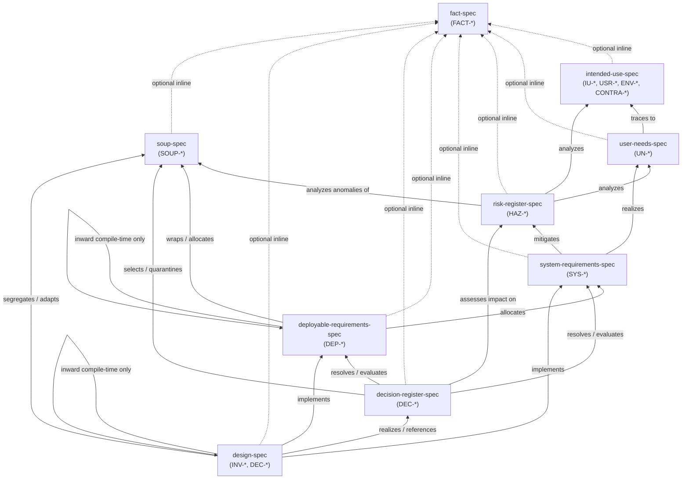

# Quality Management System (QMS) Specification Hierarchy

This directory contains the meta-specifications governing architectural documentation, requirements traceability, risk management, and design controls across the Percolator repository.

The framework is modeled on strict Medical Device Software Life Cycle standards (**IEC 62304:2006+AMD1:2015**, **ISO 13485:2016 Clause 7.3**, **ISO 14971:2019**, and **FDA 21 CFR 820.30**), adapted for modern Git-native engineering to eliminate documentation drift, avoid repetition, and maintain verifiable bidirectional traceability.

---

## 1. Regulatory Lifecycle Hierarchy & Code Symbol Permissions

To prevent architectural blurring between black-box requirements, software item allocations, and detailed code design, every document in the repository adheres to a strict three-tier regulatory mapping:

| QMS Document Tier | Identifier Prefix | IEC 62304 Lifecycle Role | FDA 21 CFR 820.30 Level | Permitted Code Symbols in Requirement Text |
| :--- | :--- | :--- | :--- | :--- |
| **System Requirements** ([`SystemRequirements.md`](../SystemRequirements.md)) | `SYS-*` | **Clause 5.2** (Software System Requirements Analysis) | **Design Input** (820.30(c)) | **Zero** code symbols. Strictly black-box system behavior (no C# interfaces, classes, or database schemas). |
| **Deployable Requirements** (`<Project>/Requirements.md`) | `DEP-*` | **Clause 5.3** (Software Architecture: 5.3.1 Allocation & 5.3.2 Item Interfaces) | **Software Item Architecture** / Design Output (820.30(d)) | Public port interfaces (`IPortName`) and domain value objects from **inward compile-time dependencies only**; **zero concrete implementing classes**. |
| **Technical Design** (`<Project>/Design.md`) | `INV-*`, `DEC-*` | **Clause 5.4** (Software Detailed Design) | **Detailed Design Output** (820.30(d)) | Concrete realizing classes, internal algorithms, database table schemas, and unmanaged FFI bindings. |

---

## 2. Master Traceability Directed Acyclic Graph (DAG)

Authoritative normative links are organized as a strict **Directed Acyclic Graph (DAG)**. Links point **inward/upward** along the dependency arrows (from downstream design/code toward upstream charter and risk baselines):

---

## 3. Specification Catalog (Meta-Specifications)

The meta-specifications define the required schema, rules, validation tags, and constraints for each document type in the repository:

| Meta-Specification | Scope & Role | Governed Identifiers |
| :--- | :--- | :--- |
| [`qms-spec.md`](qms-spec.md) | **Root Governance**: Master traceability DAG, semantic ID rules, human-approval change controls, and tagging taxonomy. | Global meta-rules |
| [`fact-spec.md`](fact-spec.md) | **External Axioms**: Immutable external facts, cryptographic RFCs, platform limits, and OS hardware baselines. | `FACT-*` |
| [`intended-use-spec.md`](intended-use-spec.md) | **System Charter**: Device scope, target user personas, operating environments, and contraindications. | `IU-*`, `USR-*`, `ENV-*`, `CONTRA-*` |
| [`user-needs-spec.md`](user-needs-spec.md) | **Design Validation**: Essential functional and trust capabilities required by stakeholders. | `UN-*` |
| [`risk-register-spec.md`](risk-register-spec.md) | **Hazard Analysis**: ISO 14971 hazards, severity/likelihood scoring, control priority hierarchy, and residual risk. | `HAZ-*` |
| [`system-requirements-spec.md`](system-requirements-spec.md) | **System Design Inputs**: Black-box verifiable functional, performance, and risk-mitigating requirements. | `SYS-*` |
| [`deployable-requirements-spec.md`](deployable-requirements-spec.md) | **Software Item Architecture**: Subsystem requirements allocation, port definitions, and cross-item interface boundaries. | `DEP-*` |
| [`design-spec.md`](design-spec.md) | **Software Detailed Design**: Architectural invariants, internal layers, realizing classes, and local design choices. | `INV-*`, `DEC-*` |
| [`decision-register-spec.md`](decision-register-spec.md) | **System Architecture Decisions**: Architectural Decision Records (ADRs) evaluating tradeoffs, SOUP selections, and mitigations. | `DEC-*` |
| [`soup-spec.md`](soup-spec.md) | **Third-Party Software (SOUP)**: Provenance, license, known anomalies, isolation wrappers, and risk management. | `SOUP-*` |

---

## 4. Repository Implementing Documents

The meta-specifications above are concretely realized by the following documents in the repository:

### 4.1 System-Wide Baselines (Repository Root)

*   [`IntendedUse.md`](../IntendedUse.md) — System boundaries, user roles, environments, and contraindications (implements [`intended-use-spec.md`](intended-use-spec.md)).
*   [`UserNeeds.md`](../UserNeeds.md) — Stakeholder capabilities and validation baseline (implements [`user-needs-spec.md`](user-needs-spec.md)).
*   [`RiskRegister.md`](../RiskRegister.md) — Hazard and threat analysis with ISO 14971 controls (implements [`risk-register-spec.md`](risk-register-spec.md)).
*   [`SystemRequirements.md`](../SystemRequirements.md) — Black-box verifiable system requirements and risk controls (implements [`system-requirements-spec.md`](system-requirements-spec.md)).
*   [`DecisionRegister.md`](../DecisionRegister.md) — System-wide architecture decision records (ADRs) (implements [`decision-register-spec.md`](decision-register-spec.md)).

### 4.2 Deployable Project Documents

Every project in the solution maintains its own localized requirements and detailed design:

*   **`<Project>/Requirements.md`**: Software Item requirements allocated to that deployable (`DEP-*`), port interfaces, and verification tags (`[Verify: Unit]`, `[Verify: Integration]`, `[Verify: StaticAnalysis]`) implementing [`deployable-requirements-spec.md`](deployable-requirements-spec.md).
*   **`<Project>/Design.md`**: Software detailed design, architectural invariants (`INV-*`), concrete realizing classes, internal layer boundaries, and local decisions (`DEC-*`) implementing [`design-spec.md`](design-spec.md).

---

## 5. Architectural Principles & Enforcement

1.  **Code-as-Truth & Anti-Duplication**: Method names, parameters, class hierarchies, and call graphs are verified directly in source code. Specifications document *obligations, invariants, boundaries, and rationale*, never verbatim method bodies or duplicating code structures.
2.  **Strict Item Boundaries (IEC 62304 Clause 5.3.2)**: Requirements in `<Project>/Requirements.md` may only reference public interfaces declared within the project or imported from inward compile-time dependencies. Sibling or outward project types and concrete implementing class names are strictly forbidden.
3.  **Human Change Control**: Semantic item definitions (`<PREFIX>-<SLUG>`), risk scores, and harm calculations require explicit human approval to modify or delete. AI assistants never move the goalposts.
