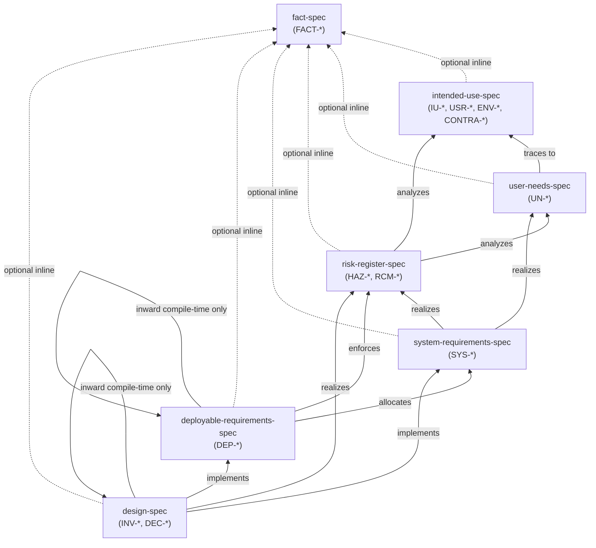

# Quality Management System Meta-Specification (`qms-spec`)

## 1. Purpose and Regulatory Basis

This document is the root meta-specification governing all specification, requirements, risk, and design documents in the repository. It establishes a lightweight, Git-native architecture and traceability framework inspired by Medical Device Quality Management Systems (QMS) so humans and AI assistants can acquire accurate architectural context rapidly without maintaining brittle, repetitive documentation.

- **IEC 62304:2006+AMD1:2015** (*Medical device software — Software life cycle processes*): Software item decomposition, architectural segregation, requirements allocation, and bidirectional traceability (Clauses 5.1–5.4, 7.1–7.3, 8).
- **ISO 13485:2016 Clause 7.3** & **FDA 21 CFR 820.30** (*Design Controls*): Design inputs, design outputs, design verification, design validation, and formal design change control.
- **ISO 14971:2019** (*Application of risk management to medical devices*): Hazard identification, risk control priority order (*Inherent* $\rightarrow$ *Protective* $\rightarrow$ *Information*), and residual risk evaluation.

---

## 2. Master Traceability Directed Acyclic Graph (DAG)

To prevent circular dependencies and spaghetti cross-linking, documents are organized into a strict **Directed Acyclic Graph (DAG)**. Normative markdown links may only point **upward/inward** along the arrows below:

---

## 3. Universal Identification & Change Control Policy

### 3.1 Globally Unique Semantic Slug Identifiers (`<PREFIX>-<SLUG>`)
Every normative item in an implementing QMS document **MUST** begin with a self-documenting semantic identifier rather than relying on fragile list numbers (`1.`, `2.`). Every `<PREFIX>-<SLUG>` identifier **MUST be globally unique across the entire repository** (a `grep` for its definition must match at most one document):

| Document Type | Allowed Prefixes | Example |
| :--- | :--- | :--- |
| [`fact-spec`](fact-spec.md) | `FACT-<SLUG>` | `FACT-SCHANNEL-CNG-ISOLATION` |
| [`intended-use-spec`](intended-use-spec.md) | `IU-<SLUG>`, `USR-<SLUG>`, `ENV-<SLUG>`, `CONTRA-<SLUG>` | `IU-SOVEREIGN-ID`, `USR-END-USER`, `ENV-NETWORK`, `CONTRA-POST-DELIVERY-DRM` |
| [`user-needs-spec`](user-needs-spec.md) | `UN-<SLUG>` | `UN-MULTI-DEVICE`, `UN-PEER-BLOCKING` |
| [`risk-register-spec`](risk-register-spec.md) | `HAZ-<SLUG>`, `RCM-<SLUG>` | `HAZ-PREKEY-EXHAUSTION`, `RCM-STEALTH-STARTUP` |
| [`system-requirements-spec`](system-requirements-spec.md) | `SYS-<SLUG>` | `SYS-FORWARD-SECRECY`, `SYS-OFFLINE-BUFFER` |
| [`deployable-requirements-spec`](deployable-requirements-spec.md) | `DEP-<SLUG>` | `DEP-DOMAIN-PURITY`, `DEP-VAULT-ZEROIZATION` |
| [`design-spec`](design-spec.md) | `INV-<SLUG>` (Invariants), `DEC-<SLUG>` (Choices) | `INV-ZERO-PRIMITIVES`, `DEC-DEBOUNCED-RELOAD` |

### 3.2 Design Change Control ("Never Move the Goalposts")
In accordance with **ISO 13485 Clause 7.3.9** and **FDA 21 CFR 820.30(i)**:
1. **No Deletion, Renaming, or Weakening Without Explicit Human Approval:** Once an ID-tagged item is committed, **no AI agent or automated process may delete, retire, rename, or semantically weaken it without explicit human instruction**. (Non-semantic editorial fixes such as repairing broken markdown links or typos are permitted).
2. **Escalation Over Silent Spec Editing:** If an AI agent discovers that code, tests, or a new feature conflicts with an existing ID-tagged item, the agent **MUST** halt and ask the human user whether to change the implementation or approve a spec modification—never silently altering the spec to make a task easier.
3. **Identifier Non-Reuse:** When a human approves retiring an item, its `<PREFIX>-<SLUG>` identifier must never be reassigned to a different concept.

### 3.3 Lightweight Verification Method Tags (`[Verify: ...]`)
In accordance with **IEC 62304 Clause 5.2.2(k) & 5.3.6**, requirements in `system-requirements` (`SYS-*`) and `deployable-requirements` (`DEP-*`) **MUST** include a verification method tag indicating how the obligation is verified without hardcoding brittle test method names:
- **Allowed on `SYS-*` (Black-Box System Boundary):**
  - `[Verify: Integration]` — End-to-end multi-component, database, or loopback transport verification.
  - `[Verify: Simulation]` — Multi-peer adversarial or network-fault verification in `Percolator.Simulator`.
- **Allowed on `DEP-*` (Software Item / Assembly Boundary):**
  - `[Verify: Unit]` — Deterministic in-memory assembly unit test.
  - `[Verify: Integration]` — Adapter/boundary integration test (e.g., SQLite, OS kernel/CNG).
  - `[Verify: StaticAnalysis]` — Enforced at compile time by Roslyn analyzers, source generators, or C# visibility/type constraints.

---

## 4. Non-Authoritative Cross-Cutting Tags (`#tag-name`)

While `<PREFIX>-<SLUG>` links enforce authoritative DAG traceability, related concepts sometimes span across non-adjacent QMS layers (e.g., `IntendedUse` $\leftrightarrow$ `Design`) or across sibling plugins that are forbidden from linking to one another. **Tags** provide a flexible, **non-authoritative**, grep-friendly discovery aid without a central registry.

### 4.1 Rules to Prevent AI Tag Sprawl and Over-Tagging
1. **Mandatory `grep` Before Tagging:** Before adding any tag, an author or AI agent **MUST** search (`grep` / `search_regex`) existing QMS documents for `#<tag>` usage (`#[a-z0-9-]+`) and reuse an existing tag if one already covers the concept, preventing synonym drift (e.g., do not invent `#vault-lock` if `#session-lock` already exists).
2. **Never Tag What Is Already Directly Linked (`<PREFIX>-<SLUG>` Preemption):** If two items are already connected by a direct 1-hop `<PREFIX>-<SLUG>` reference (e.g., an infrastructure invariant linking directly to `INV-INTERNAL-REHYDRATION` in `Percolator.Domain`), **DO NOT** add a `#tag` to them—searching for `INV-INTERNAL-REHYDRATION` already links them. Reserve tags strictly for:
   - **Multi-hop vertical slices** across layers that cannot link directly in the DAG (e.g., connecting a `UserNeed` to a `Design` choice), or
   - **Lateral sibling concerns** across peer deployables that do not depend on one another at compile time.
3. **Default is Zero Tags (Sparse Budget):** Tags are the exception, not the default. **At least half of the items in any document should have zero tags**, and no item may carry more than **1 or 2 tags**. Never add an orphan tag that appears in only one document.
4. **Problem-Domain Naming for Cross-Layer Tags:** When a tag bridges upstream documents (`IntendedUse`, `UserNeeds`) and downstream `Design` documents, name the tag after the **capability or trust boundary** (e.g., `` `#session-lock` ``, `` `#group-membership` ``, `` `#offline-delivery` ``, `` `#relay-privacy` ``) so implementation jargon (like `#outbox` or `#rehydration`) never leaks into `UserNeeds`.
5. **Forbidden Umbrella & Structural Tags:** Never use broad domain nouns (`#security`, `#crypto`, `#privacy`, `#messaging`, `#p2p`, `#network`, `#database`, `#ui`) or project/layer names (`#domain`, `#infrastructure`, `#desktop`, `#chat`).
6. **Non-Authoritative End-of-Item Formatting:** Tags carry zero compliance weight and never replace required `<PREFIX>-<SLUG>` links. Format tags as plain inline backtick tokens at the **very end** of an item (e.g., `` `#session-lock` ``)—**never** as markdown hyperlinks (`[#session-lock](...)`) and never in the middle of a sentence.

---

## 5. Universal Anti-Duplication & Stability Rules

All specifications and implementing documents **MUST** obey these five baseline rules:

1. **Single Header Spec Link:** Every implementing document must link to its governing `*-spec.md` once immediately below the H1 title (`Spec: [<name>-spec](<relative-path>/spec/<name>-spec.md)`) and **MUST NOT** repeat the section definitions from the spec.
2. **Code-as-Truth (Never Duplicate the Compiler or Filesystem):** Never list `.csproj` `<ProjectReference>` or `<PackageReference>` inventories, directory trees, class/file inventories, or copy-pasted C# interface signatures in markdown documents.
3. **Zero Feature-Churn (Mechanisms Over Magic Numbers):** Never hardcode tunable implementation constants (buffer sizes, timeout seconds, Argon2 parameters, bucket byte tiers, or repository counts) that belong in code or `README.md`.
4. **Inline Contextual Reference Rule (No Link-Dump Tables):** Never create standalone "Upstream References" or "Permitted Inward References" link-dump sections. Link inline to an allowed upstream `<PREFIX>-<SLUG>` only where a specific rule is inherited or realized.
5. **Git-Authoritative History Policy:** In-file revision history tables are prohibited across all documents (`git log` is authoritative). Only three specific QMS metadata records are permitted in-file:
   - Pinned external standard revisions/years in [`fact-spec`](fact-spec.md).
   - Hazard control state and residual risk justification in [`risk-register-spec`](risk-register-spec.md).
   - Brief *Rejected Alternatives* under technical design choices in [`design-spec`](design-spec.md).
