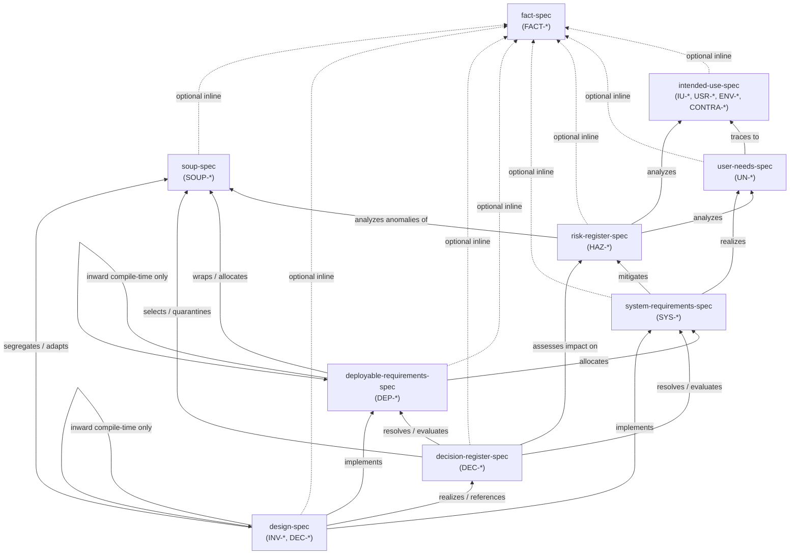

# Quality Management System Meta-Specification (`qms-spec`)

## 1. Purpose and Regulatory Basis

This document is the root meta-specification governing all specification, requirements, risk, and design documents in a repository. It establishes a lightweight, Git-native architecture and traceability framework inspired by Medical Device Quality Management Systems (QMS) so humans and AI assistants can acquire accurate architectural context rapidly without maintaining brittle, repetitive documentation.

- **IEC 62304:2006+AMD1:2015** (*Medical device software — Software life cycle processes*): Software item decomposition, architectural segregation, SOUP management (Clauses 3.24, 5.3.3, 5.3.4, 7.1.3, 8.1.2), requirements allocation, and bidirectional traceability (Clauses 5.1–5.4, 7.1–7.3, 8).
- **ISO 13485:2016 Clause 7.3** & **FDA 21 CFR 820.30** (*Design Controls*): Design inputs, design outputs, design review, design verification, design validation, control of design changes, and Design History File / Design and Development Files.
- **FDA Guidance: *Off-The-Shelf Software Use in Medical Devices* (August 2023)** & ***Content of Premarket Submissions for Device Software Functions* (June 2023)**: Specification, risk assessment, verification, and software architecture interfaces for medical device software items and third-party software.
- **ISO 14971:2019** (*Application of risk management to medical devices*): Hazard identification, risk control priority order (*Inherent* $\rightarrow$ *Protective* $\rightarrow$ *Information*), and residual risk evaluation.
- **AAMI TIR45:2023** (*Guidance on the use of AGILE practices in the development of medical device software*): Evolutionary architecture, continuous design review records, and Architecture Decision Records (ADRs) as living design artifacts.

### 1.1 Regulatory Lifecycle Hierarchy & Code Symbol Permissions

To prevent abstraction breakdown between system requirements, software item architecture, and detailed design, all documents adhere to this strict three-tier regulatory mapping:

| QMS Document Tier | Identifier Prefix | IEC 62304 Lifecycle Role | FDA 21 CFR 820.30 Level | Permitted Code Symbols in Requirement Text |
| :--- | :--- | :--- | :--- | :--- |
| **System Requirements** (`SystemRequirements.md`) | `SYS-*` | **Clause 5.2** (Software System Requirements Analysis) | **Design Input** (820.30(c)) | **Zero** code symbols. Strictly black-box system behavior (no C# interfaces, classes, or database schemas). |
| **Deployable Requirements** (`<Project>/Requirements.md`) | `DEP-*` | **Clause 5.3** (Software Architecture: 5.3.1 Allocation & 5.3.2 Item Interfaces) | **Software Item Architecture** / Design Output (820.30(d)) | Public port interfaces (`IPortName`) and domain value objects from **inward compile-time dependencies only**; **zero concrete implementing classes**. |
| **Technical Design** (`<Project>/Design.md`) | `INV-*`, `DEC-*` | **Clause 5.4** (Software Detailed Design) | **Detailed Design Output** (820.30(d)) | Concrete realizing classes, internal algorithms, database table schemas, and unmanaged FFI bindings. |

---

## 2. Master Traceability Directed Acyclic Graph (DAG)

To prevent circular dependencies and spaghetti cross-linking, documents are organized into a strict **Directed Acyclic Graph (DAG)**. Normative markdown links may only point **upward/inward** along the arrows below:

---

## 3. Universal Identification & Change Control Policy

### 3.1 Globally Unique Semantic Slug Identifiers (`<PREFIX>-<SLUG>`)
Every normative item in an implementing QMS document **MUST** begin with a self-documenting semantic identifier rather than relying on fragile list numbers (`1.`, `2.`). Every `<PREFIX>-<SLUG>` identifier **MUST be globally unique across the entire repository** (a `grep` for its definition must match at most one document):

| Document Type | Allowed Prefixes |
| :--- | :--- |
| [`fact-spec`](fact-spec.md) | `FACT-<SLUG>` |
| [`intended-use-spec`](intended-use-spec.md) | `IU-<SLUG>`, `USR-<SLUG>`, `ENV-<SLUG>`, `CONTRA-<SLUG>` |
| [`user-needs-spec`](user-needs-spec.md) | `UN-<SLUG>` |
| [`risk-register-spec`](risk-register-spec.md) | `HAZ-<SLUG>` |
| [`system-requirements-spec`](system-requirements-spec.md) | `SYS-<SLUG>` |
| [`deployable-requirements-spec`](deployable-requirements-spec.md) | `DEP-<SLUG>` |
| [`decision-register-spec`](decision-register-spec.md) | `DEC-<SLUG>` (System & Architectural Decisions) |
| [`design-spec`](design-spec.md) | `INV-<SLUG>` (Invariants), `DEC-<SLUG>` (Local Deployable Choices) |
| [`soup-spec`](soup-spec.md) | `SOUP-<SLUG>` |

### 3.2 Design Change Control ("Never Move the Goalposts")
In accordance with **ISO 13485 Clause 7.3.9**, **FDA 21 CFR 820.30(i)**, and **ISO 14971 Clauses 4.4, 7.3, & 8**:
1. **No Deletion, Renaming, or Weakening Without Explicit Human Approval:** Once an ID-tagged item is committed, **no AI agent or automated process may delete, retire, rename, or semantically weaken it without explicit human instruction**. (Non-semantic editorial fixes such as repairing broken markdown links or typos are permitted).
2. **Mandatory Human Approval for Risk & Harm Calculations:** No AI agent or automated process may modify any **Harm definition**, **Severity (`S`)**, **Probability/Likelihood (`L`)**, **initial or residual risk calculation**, **control status**, or **risk scoring rubric** without explicit human approval.
3. **Escalation Over Silent Spec Editing:** If an AI agent discovers that code, tests, or a new feature conflicts with an existing ID-tagged item or risk evaluation, the agent **MUST** halt and ask the human user whether to change the implementation or approve a spec modification—never silently altering the spec to make a task easier.
4. **Identifier Non-Reuse:** When a human approves retiring an item, its `<PREFIX>-<SLUG>` identifier must never be reassigned to a different concept.

### 3.3 Lightweight Verification & Risk Control Tags (`[Verify: ...]`, `[Control: ...]`)
In accordance with **IEC 62304 Clause 5.2.2(k) & 5.3.6** and **ISO 14971 Clause 7.1**, requirements in `system-requirements` (`SYS-*`), `deployable-requirements` (`DEP-*`), and `soup` (`SOUP-*`) **MUST** include a verification method tag indicating how the obligation is verified without hardcoding brittle test method names:
- **Allowed on `SYS-*` (Black-Box System Boundary):**
  - `[Verify: Integration]` — End-to-end system boundary, persistence, or transport verification.
  - `[Verify: Simulation]` — Multi-node, environmental, or fault-injection harness verification.
  - `[Verify: Unit]` — Permitted on pure-software algorithmic, path sanitization, or memory barrier zeroization constraints where verification is established deterministically via automated test harness.
  - When a `SYS-*` requirement mitigates a hazard (`HAZ-*`), it **MUST** also declare its ISO 14971 control priority tag: `[Control: Inherent | Protective | Information]`.
- **Allowed on `DEP-*` (Software Item / Deployable Boundary):**
  - `[Verify: Unit]` — Deterministic in-memory unit test.
  - `[Verify: Integration]` — Component boundary or adapter integration test.
  - `[Verify: StaticAnalysis]` — Enforced at compile time by compiler diagnostics, code generators, or type/visibility constraints.
- **Allowed on `SOUP-*` (Third-Party Boundary & Capabilities):**
  - `[Verify: Integration]` — Component boundary adapter or runtime linkage verification.
  - `[Verify: Simulation]` — Fault injection or adverse environmental condition verification.
  - `[Verify: StaticAnalysis]` — Compile-time check, dependency vulnerability scanner, or ABI signature check.

---

## 4. Non-Authoritative Cross-Cutting Tags (`#tag-name`)

While `<PREFIX>-<SLUG>` links enforce authoritative DAG traceability, related concepts sometimes span across non-adjacent QMS layers (e.g., `IntendedUse` $\rightarrow$ `Design`) or across sibling deployables that are forbidden from linking to one another. **Tags** provide a flexible, **non-authoritative**, grep-friendly discovery aid without a central registry.

### 4.1 Rules to Prevent AI Tag Sprawl and Over-Tagging
1. **Mandatory `grep` Before Tagging:** Before adding any tag, an author or AI agent **MUST** search (`grep` / `search_regex`) existing QMS documents for `#<tag>` usage (`#[a-z0-9-]+`) and reuse an existing tag if one already covers the concept, preventing synonym drift.
2. **Never Tag What Is Already Directly Linked (`<PREFIX>-<SLUG>` Preemption):** If two items are already connected by a direct 1-hop `<PREFIX>-<SLUG>` reference, **DO NOT** add a `#tag` to them—searching for the `<PREFIX>-<SLUG>` ID already links them. Reserve tags strictly for:
   - **Multi-hop vertical slices** across layers that cannot link directly in the DAG (e.g., connecting a `UserNeed` to a `Design` choice), or
   - **Lateral sibling concerns** across peer deployables that do not depend on one another at compile time.
3. **Default is Zero Tags (Sparse Budget):** Tags are the exception, not the default. **At least half of the items in any document should have zero tags**, and no item may carry more than **1 or 2 tags**. Never add an orphan tag that appears in only one document.
4. **Problem-Domain Naming for Cross-Layer Tags:** When a tag bridges upstream documents (`IntendedUse`, `UserNeeds`) and downstream `Design` documents, name the tag after the **capability or boundary** rather than internal code mechanics so implementation jargon never leaks into `UserNeeds` achievements.
5. **Forbidden Umbrella & Structural Tags:** Never use broad domain nouns (`#security`, `#crypto`, `#privacy`, `#network`, `#database`, `#ui`) or layer/deployable names (`#domain`, `#infrastructure`, `#application`, `#user-need`).
6. **Non-Authoritative End-of-Item Formatting:** Tags carry zero compliance weight and never replace required `<PREFIX>-<SLUG>` links. Format tags as plain inline backtick tokens at the **very end** of an item—**never** as markdown hyperlinks (`[#tag](...)`) and never in the middle of a sentence.

---

## 5. Universal Anti-Duplication & Stability Rules

All specifications and implementing documents **MUST** obey these five baseline rules:

1. **Single Header Spec Link:** Every implementing document must link to its governing `*-spec.md` once immediately below the H1 title (`Spec: [<name>-spec](<relative-path>/spec/<name>-spec.md)`) and **MUST NOT** repeat the section definitions from the spec.
2. **Code-as-Truth (Never Duplicate the Compiler or Filesystem):** Never list build-file dependency manifests, package versions, directory trees, class/file inventories, or copy-pasted code interface signatures in markdown documents. In specifications and requirements documents (`SYS-*`, `DEP-*`), **never cite concrete implementing classes, records, structs, or database table names**; specify obligations strictly against public boundaries and contracts (`IPortName`, domain value objects). Concrete realizing types belong exclusively in `design` documents (`INV-*`, `DEC-*`) and the code itself (IEC 62304 Clause 5.4).
3. **Zero Feature-Churn (Mechanisms Over Magic Numbers):** Never hardcode tunable implementation constants (buffer sizes, timeout durations, cryptographic parameters, or component counts) that belong in code or `README.md`.
4. **Inline Contextual Reference Rule (No Link-Dump Tables):** Never create standalone "Upstream References" or "Permitted Inward References" link-dump sections. Link inline to an allowed upstream `<PREFIX>-<SLUG>` only where a specific rule is inherited or realized.
5. **Git-Authoritative History Policy:** In-file revision history tables are prohibited across all documents (`git log` is authoritative). Only three specific QMS metadata records are permitted in-file:
   - Pinned external standard revisions/years in [`fact-spec`](fact-spec.md).
   - Hazard control state and residual risk evaluation in [`risk-register-spec`](risk-register-spec.md).
   - Brief *Rejected Alternatives* and lifecycle status under architectural decisions in [`decision-register-spec`](decision-register-spec.md) and technical design choices in [`design-spec`](design-spec.md).
